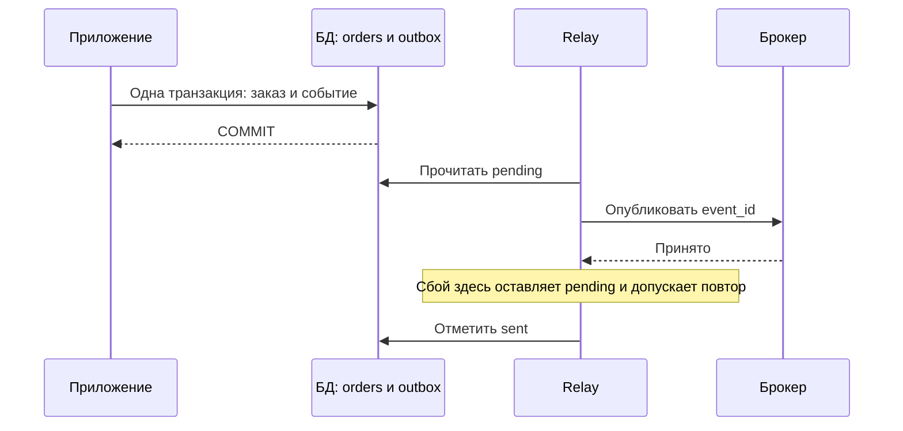

# Организация приложения и распределённые сценарии

[К паттернам](README.md) · [Принципы](../principles.md)

| Параметр | Значение |
| --- | --- |
| Уровни | Базовый — разные оси решения; средний — код/развёртывание; продвинутый — отказы и согласованность |
| Предпосылки | Модульные контракты, транзакции, различие локального и сетевого вызова |
| Концепции сверены | 2026-11-06, Cockburn, Bogard, Fowler и Microsoft Azure Architecture Center |
| Выполнено | 2026-11-06, Python 3.14.7 / SQLite 3.53.4: полный пример; rollback обеих записей при отказе UNIQUE и повтор публикации после смоделированного сбоя |
| Границы | Демонстрация Outbox моделирует один worker и публикацию в памяти; это не готовый брокер/production relay |

## Навигация

- [Базовый уровень: разные оси решения](#базовый-уровень-разные-оси-решения)
- [Организация кода](#организация-кода)
- [Границы развёртывания](#границы-развёртывания)
- [Распределённые сценарии](#распределённые-сценарии)
- [Полный пример: Outbox и дубликат публикации](#полный-пример-outbox-и-дубликат-публикации)
- [Источники](#источники)

## Базовый уровень: разные оси решения

| Ось | Примеры | Проверяемый вопрос |
| --- | --- | --- |
| Модули и зависимости кода | Layered, Vertical Slice, Ports & Adapters | Какое изменение пересекает границу и какое знание скрыто? |
| Выпуск и процессы | Modular Monolith, Microservices | Что можно независимо выпустить, остановить и наблюдать? |
| Данные и отказ | Cache-Aside, Outbox, Saga, CQRS, retry | Что происходит при задержке, повторе или частичном выполнении? |

Ports & Adapters можно применить внутри модульного монолита или отдельного сервиса.
Вертикальные сценарии могут находиться внутри модулей с портами.
Названия описывают разные свойства, поэтому их нельзя сравнивать как взаимоисключающие варианты одного списка.

## Организация кода

**Средний уровень.** Выбирайте границы по реальному сценарию изменения, а не по обязательному дереву папок.

| Подход | Когда рассматривать | Что проверить | Цена |
| --- | --- | --- | --- |
| Layered | Есть понятное разделение представления, прикладных правил и доступа к данным | Разрешённые зависимости явны; слой содержит решение, а не только пересылку | Изменение одной функции может пройти через несколько слоёв |
| Vertical Slice | Функциональные сценарии меняются в основном независимо | Один use case понятен целиком, общее правило не разошлось по копиям | Нужны дисциплина границ и пересмотр общего кода; единообразие слоёв меньше |
| Ports & Adapters | Правило нужно проверять без UI/БД или подключать разными адаптерами | Приложение задаёт порт; детали преобразуют внешний протокол в его контракт | Появляются контракты и адаптеры, которые нужно сопровождать |

Логический layer не равен физическому tier: несколько слоёв могут работать в одном процессе.
В Ports & Adapters входной адаптер вызывает приложение, выходной реализует нужный приложению порт.
Runtime-вызов через порт к БД не требует зависимости бизнес-кода от конкретного SQL-клиента;
[диаграмма DIP](../solid.md#продвинутый-уровень) показывает именно зависимости кода.

Пример проверки границы: замените адаптер чтения локальным тестовым источником.
Если для расчёта всё ещё приходится создавать HTTP request или импортировать ORM-модель,
выбранный контракт может пропускать лишнюю техническую деталь. Но для простого CRUD прямой
запрос в обработчике может быть обоснованнее, чем сеть пустых абстракций.

## Границы развёртывания

**Средний / продвинутый уровень.** Ни размер команды, ни количество таблиц не задают автоматический выбор.

| Форма | Возможная польза | Цена и проверка |
| --- | --- | --- |
| Modular Monolith | Явные модули при одном выпуске; локальные вызовы и доступные локальные транзакции | Общий процесс/выпуск; проверяйте запрет обхода API модулей и владение данными |
| Microservices | Независимый выпуск/масштабирование частей с отдельной ответственностью | Сеть, наблюдение, совместимость протоколов и распределённая согласованность; независимость должна подтверждаться практикой |

Начало с монолита часто снижает эксплуатационную цену, пока границы предметной области уточняются.
Это эвристика, не универсальная последовательность миграции.
Обоснование выделения сервиса может быть конкретным: часть требует другого профиля масштабирования
или независимого выпуска, и команда способна поддерживать её данные и отказы.
Общая изменяемая БД и синхронные цепочки вызовов могут сохранить сильную связанность при множестве процессов.

## Распределённые сценарии

**Продвинутый уровень.** Начните с отказа и нужной гарантии. В таблице — границы паттернов, не готовые реализации.

| Паттерн | Проблема / механизм | Обязательная оговорка |
| --- | --- | --- |
| Cache-Aside | На промахе читать основную БД и заполнять кеш; после записи инвалидировать/обновлять | Гонка заполнения и инвалидирования может оставить старое значение; TTL/версионирование задают допустимую устарелость |
| Transactional Outbox | Сохранить состояние и событие в одной локальной транзакции; relay публикует позже | Между публикацией и отметкой возможен сбой: будут дубликаты; нужны наблюдение, retention и идемпотентный consumer |
| Saga | Последовательность локальных транзакций с координацией и компенсациями | Компенсация — новое бизнес-действие, не физический rollback; возможны промежуточные состояния и сбой самой компенсации |
| CQRS | Отдельные модели команд и чтения под разные потребности | Не требует разных БД, брокера или Event Sourcing; при асинхронной проекции нужно учитывать отставание |
| Retry | Повторить распознанный временный отказ с ограничением попыток/общего времени | Неизвестный исход записи может означать уже выполненный эффект; нужны идемпотентность/operation id, backoff/jitter и учёт вложенных повторов |

Event Sourcing хранит события как источник восстановления состояния; это отдельное решение
с версиями событий, replay и эволюцией схемы. CQRS можно использовать без него.
«Доставили сообщение» не равно «ровно один раз выполнили внешний эффект».
Для эффекта и записи dedup в одной БД нужна совместная транзакция; для внешнего провайдера — его
поддержка идемпотентного запроса или другой явно ограниченный протокол.

Для Saga выберите choreography или orchestration по наблюдаемости и управлению процессом;
для обоих нужны сохранённое состояние шага, корреляция, таймауты и повторяемые действия.
Необратимые шаги требуют отдельного решения о порядке и обработке отказа.
Для retry не повторяйте ошибки валидации/доступа как временные и не умножайте попытки независимо на каждом слое.

## Полный пример: Outbox и дубликат публикации

**Продвинутый уровень.** Сохраните как `outbox.py`, выполните `python3.14 outbox.py`.
Используется sqlite3 из стандартной библиотеки, только БД в памяти и список вместо брокера.
Проверяются две разные границы: атомарность локальной записи и возможный повтор внешней публикации.

<!-- example: architecture/outbox.py -->
```python
import json
import sqlite3
from collections.abc import Callable
from contextlib import closing

Publisher = Callable[[str, str], None]


class SimulatedCrash(Exception):
    pass


with closing(sqlite3.connect(":memory:", autocommit=True)) as db:
    db.execute("PRAGMA foreign_keys = ON")
    db.executescript("""
        CREATE TABLE orders (id TEXT PRIMARY KEY NOT NULL);
        CREATE TABLE outbox (
            event_id TEXT PRIMARY KEY NOT NULL,
            order_id TEXT NOT NULL REFERENCES orders(id),
            payload TEXT NOT NULL,
            sent INTEGER NOT NULL DEFAULT 0 CHECK (sent IN (0, 1))
        );
    """)

    def create_order(order_id: str, event_id: str) -> None:
        db.execute("BEGIN")
        try:
            db.execute("INSERT INTO orders VALUES (?)", (order_id,))
            db.execute("INSERT INTO outbox (event_id, order_id, payload) VALUES (?, ?, ?)",
                       (event_id, order_id, json.dumps({"type": "OrderCreated", "order_id": order_id})))
            db.execute("COMMIT")
        except BaseException:
            db.execute("ROLLBACK")
            raise

    create_order("42", "event-42")
    try:
        create_order("43", "event-42")  # Ошибка второй записи: event_id уже занят.
    except sqlite3.IntegrityError:
        pass
    else:
        raise AssertionError("Ожидался отказ UNIQUE")
    assert db.execute("SELECT id FROM orders").fetchall() == [("42",)]
    assert db.execute("SELECT COUNT(*) FROM outbox").fetchone() == (1,)

    published: list[str] = []

    def publish(event_id: str, payload: str) -> None:
        assert json.loads(payload)["order_id"] == "42"
        published.append(event_id)

    def publish_then_crash(event_id: str, payload: str) -> None:
        publish(event_id, payload)
        raise SimulatedCrash("Брокер принял, отметка sent ещё не записана")

    def relay_once(publisher: Publisher) -> bool:
        row = db.execute("SELECT event_id, payload FROM outbox WHERE sent = 0 ORDER BY event_id LIMIT 1").fetchone()
        if row is None:
            return False
        event_id, payload = row
        publisher(event_id, payload)
        db.execute("UPDATE outbox SET sent = 1 WHERE event_id = ?", (event_id,))
        return True

    try:
        relay_once(publish_then_crash)
    except SimulatedCrash:
        pass
    else:
        raise AssertionError("Ожидался сбой между публикацией и отметкой")
    assert db.execute("SELECT sent FROM outbox").fetchone() == (0,)
    assert relay_once(publish)
    assert not relay_once(publish)
    assert published == ["event-42", "event-42"]
    print("OK: atomic order/outbox, rollback on refusal and duplicate after relay failure")
```

**Результат:** OK. Заказ 43 не сохранился после ошибки записи события; событие заказа 42
опубликовано дважды при смоделированном сбое. Это ожидаемая граница Outbox, а не exactly-once гарантия.

Диаграмма показывает **runtime-поток**, а не зависимости модулей:



Production relay требует блокировки/lease для workers, подтверждения брокера, обработки «исход неизвестен»,
управления порядком, повторов, мёртвых сообщений и уборки outbox. Исключение в этом примере моделирует
точку отказа, а не проверяет настоящий процессный сбой/диск. Consumer здесь не реализован.

## Источники

- [Cockburn: Ports & Adapters](https://alistair.cockburn.us/hexagonal-architecture/), [Bogard: Vertical Slice Architecture](https://www.jimmybogard.com/vertical-slice-architecture/), [Microsoft: logical layers / physical tiers](https://learn.microsoft.com/en-us/azure/architecture/guide/architecture-styles/n-tier).
- [Fowler: Monolith First](https://martinfowler.com/bliki/MonolithFirst.html), [CQRS](https://martinfowler.com/bliki/CQRS.html).
- [Microsoft: Transactional Outbox](https://learn.microsoft.com/en-us/azure/architecture/databases/guide/transactional-out-box-cosmos), [Saga](https://learn.microsoft.com/en-us/azure/architecture/patterns/saga), [CQRS](https://learn.microsoft.com/en-us/azure/architecture/patterns/cqrs), [Retry](https://learn.microsoft.com/en-us/azure/architecture/patterns/retry), [Cache-Aside](https://learn.microsoft.com/en-us/azure/architecture/patterns/cache-aside).
- [Python sqlite3](https://docs.python.org/3.14/library/sqlite3.html) — выполнение локальной учебной транзакции, не реализация Azure SDK.
