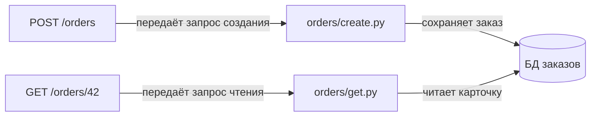
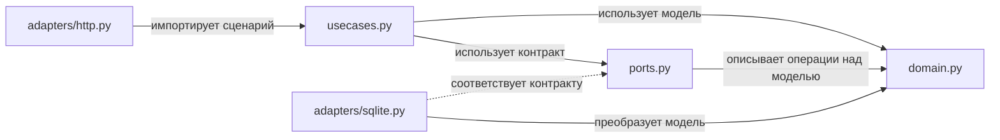
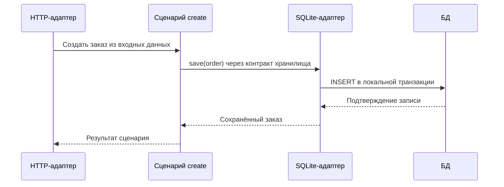
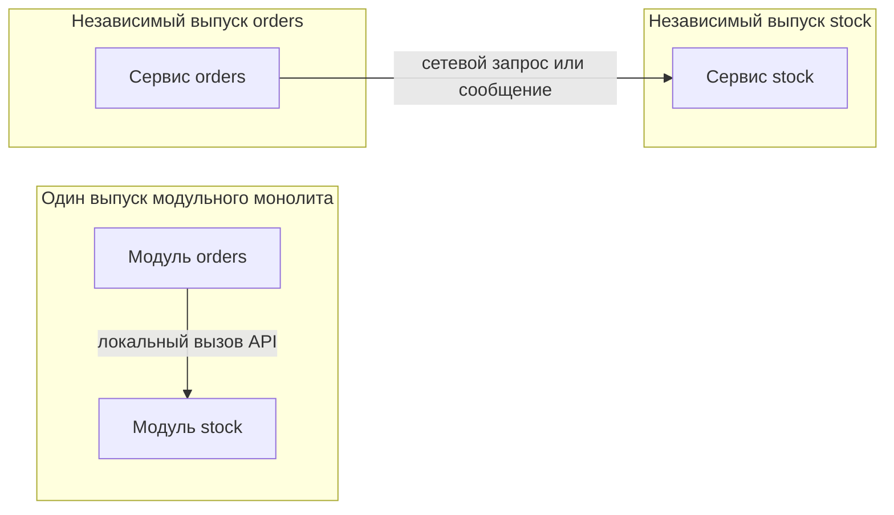

# Организация приложения и распределённые сценарии

Шпаргалка о границах приложения: где держать код, от чего ему зависеть и что выпускать отдельно.
Сквозной пример — создание и чтение заказа; сетевые отказы разобраны на отдельной странице.

[К паттернам](README.md) · [Принципы](../principles.md) · [Распределённые сценарии](distributed-systems.md)

| Что выбрать | Какую проблему решает | Когда рассматривать | Где вспомнить |
| --- | --- | --- | --- |
| Layered | Разделить технические роли | Представление, правила и хранение меняются по разным причинам | [Слои](#layered-разделить-по-роли) |
| Feature-oriented / Vertical Slice | Держать изменение сценария рядом | Создание и чтение заказа развиваются независимо | [Сценарии](#feature-oriented-и-vertical-slice-собрать-сценарий) |
| Ports & Adapters | Изолировать правило от UI/БД | Проверять без внешних служб, подменять интеграции | [Порты](#ports--adapters-отделить-приложение-от-деталей) |
| Modular Monolith / Microservices | Задать границу выпуска и владения | Нужны явные модули либо обоснованно независимые сервисы | [Развёртывание](#границы-развёртывания) |
| Cache-Aside / Outbox / Saga / CQRS / Retry | Управлять данными и частичным отказом | Есть конкретное требование к свежести, доставке или восстановлению | [Выбор по отказу](#распределённые-сценарии) |

| Проверка | Состояние |
| --- | --- |
| Предпосылки | Модульные контракты, транзакции, различие локального и сетевого вызова |
| Сверено с источниками | 2026-11-06, Cockburn, Bogard, Fowler / Lewis и Microsoft Azure Architecture Center; ссылки рядом с темами |
| Выполнено | [Полный Outbox](distributed-systems.md#полный-пример-outbox-и-дубликат-публикации): дата, версии и проверенные отказы указаны на подробной странице |
| Границы | Деревья и схемы — возможные решения, не запущенные приложения и не измерения |

## Навигация

- [Базовый уровень: разные оси решения](#базовый-уровень-разные-оси-решения)
- [Организация кода](#организация-кода) — средний уровень: слои, сценарии, порты
- [Границы развёртывания](#границы-развёртывания) — средний / продвинутый уровень
- [Распределённые сценарии](#распределённые-сценарии) — продвинутый уровень
- [Полный пример: Outbox и дубликат публикации](#полный-пример-outbox-и-дубликат-публикации)
- [Источники](#источники)

## Базовый уровень: разные оси решения

| Вид представления | Отвечает на вопрос | Чего из него не узнать |
| --- | --- | --- |
| Дерево исходников | В каком файле искать создание заказа? | Кто кого импортирует или вызывает |
| Зависимости кода | Какое знание нужно модулю для работы? | Порядок вызовов и число процессов |
| Runtime-поток | Кто кому передаёт управление/сообщение? | Направление импортов |
| Развёртывание | Что выпускается и работает отдельно? | Как код организован внутри сервиса |

Например, правило вызывает переданный SQL-адаптер во время выполнения, но не импортирует его класс.
А три каталога в одном проекте могут работать в одном процессе. Подпись каждой схемы ниже задаёт её смысл.

**Совместимость решений:** Ports & Adapters применимы внутри монолита или сервиса;
сценарии Vertical Slice могут находиться внутри предметного модуля с портами.
Название папки не доказывает ни изоляцию, ни независимость выпуска.

## Организация кода

**Средний уровень.** Выберите способ находить и менять сценарий заказа.
Деревья ниже — условные планы исходников с Python-подобными именами, не готовые пакеты для запуска.
Имена и число файлов не предписаны паттернами; создавайте файл/каталог только для существующей обязанности.

| Подход | Главная граница | Проверка полезности | Цена / когда упростить |
| --- | --- | --- | --- |
| Layered | Представление / правила / хранение | HTTP-формат не попал в правило; SQL остаётся в хранении | Одно изменение проходит через несколько слоёв; пустой пересылающий слой можно убрать |
| Feature-oriented / Vertical Slice | Предметная возможность / отдельный сценарий | Создание заказа читается и меняется целиком; общее правило не разошлось по копиям | Нужно сознательно выделять общее знание, а не копировать всё между сценариями |
| Ports & Adapters | Приложение / внешняя технология | Тест правила не требует HTTP request, ORM и живой БД | Контракты и сборку нужно сопровождать; простому CRUD иногда достаточно прямого запроса |

### Layered: разделить по роли

**Задача:** отдельно менять HTTP-представление, правило создания заказа и способ хранения.
Один возможный вариант для небольшого приложения:

```text
src/orderapp/
├── http.py       # HTTP-вход и представление ответа
├── service.py    # create/get: прикладные правила заказа
└── storage.py    # чтение/запись заказов через SQL
```

**Зависимости кода** выбранного закрытого варианта: стрелка означает импорт нижнего слоя.
Обратные импорты запрещены соглашением проекта; дерево само их не запрещает.


**Результат:** SQL находится в `storage.py`, проверка заказа — в `service.py`, HTTP-коды — в `http.py`.
Runtime-вызовы в этом простом варианте тоже идут сверху вниз, но импорт и вызов остаются разными отношениями.
Закрытые слои допускают обращения только к следующему слою; в открытом варианте проект явно разрешает пропуски.
Сложным правилам может понадобиться отдельная доменная модель; она не обязательна ради симметрии дерева.

**Ограничение:** логический *layer* не равен физическому *tier*: три слоя могут жить в одном процессе.
Новая операция часто затронет все три файла. См. [различие layers / tiers у Microsoft](https://learn.microsoft.com/en-us/azure/architecture/guide/architecture-styles/n-tier).

### Feature-oriented и Vertical Slice: собрать сценарий

**Задача:** изменение создания заказа не должно заставлять искать его части во всех технических каталогах.
Feature-oriented группирует по возможности (`orders`); Vertical Slice делает акцент на самостоятельном use case
(`create`, `get`). Просто перенести прежние слои в папку `orders` ещё не значит выделить вертикальный сценарий.

```text
src/orderapp/
├── orders/
│   ├── create.py   # вход, проверка и запись сценария создания
│   ├── get.py      # вход и чтение карточки заказа
│   └── rules.py    # общее правило заказа, если оно реально нужно обоим
└── bootstrap.py    # связывает обработчики с точками входа
```

**Runtime-поток** возможной реализации. Обработчики обслуживают разные запросы;
ни один не обязан вызывать другой. Доступ к БД может быть прямым или через порт по потребностям сценария.



**Результат:** основная работа по изменению создания находится в `create.py`.
При росте сценарий можно сделать пакетом с собственными деталями, не заводя одинаковую пустую структуру заранее.
Общее бизнес-правило остаётся авторитетным в одном месте; случайно похожий код не требует общей абстракции.
CQRS/брокер/разные БД из такого дерева не следуют.
Источник: [Bogard: Vertical Slice Architecture](https://www.jimmybogard.com/vertical-slice-architecture/).

### Ports & Adapters: отделить приложение от деталей

**Задача:** запускать одно правило создания заказа из HTTP, теста или batch и менять хранилище отдельно.
Порт — осмысленный контракт приложения; адаптер переводит внешний протокол в этот контракт или обратно.

```text
src/orderapp/
├── domain.py       # данные и инварианты заказа
├── usecases.py     # сценарии create/get
├── ports.py        # нужный сценариям контракт хранилища
├── adapters/
│   ├── http.py     # входной адаптер: HTTP → вызов сценария
│   └── sqlite.py   # выходной адаптер: контракт → SQL
└── bootstrap.py    # создаёт адаптеры и передаёт их сценариям
```

**Ключевые зависимости кода:** правило знает собственный контракт, а не конкретную БД.
Пунктир показывает структурное соответствие контракту: Python-адаптеру не обязательно импортировать Protocol.
`bootstrap.py` знает конкретные детали и собирает их; он не показан ради читаемости.



**Runtime-поток** тех же ролей: выходной адаптер уже передан в сценарий при сборке.
Порт — контракт этого вызова, а не обязательный промежуточный объект/процесс.



**Результат:** в тесте сценария вместо SQLite можно передать память; HTTP/ORM не нужны самому правилу.
Контракт должен сохранять ошибки, транзакционные границы и семантику чтения; одна форма метода недостаточна.
Это схема вызовов, а не готовый безопасный протокол повторной записи.
Источник: [Cockburn: Ports & Adapters](https://alistair.cockburn.us/hexagonal-architecture/);
связь с [DIP и DI](../solid.md#продвинутый-уровень).

## Границы развёртывания

**Средний / продвинутый уровень.** Это выбор единиц выпуска и владения данными, а не дерево папок.
Ни размер команды, ни количество таблиц не задают автоматический выбор.

| Форма | Когда полезна | Что проверить | Цена |
| --- | --- | --- | --- |
| Modular Monolith | Нужны предметные границы при одном выпуске | `orders` и `stock` общаются через API модулей; чужие данные не меняются в обход владельца | Общий выпуск и обычно общий процесс; границы нужно защищать |
| Microservices | Подтверждена нужда в независимом выпуске/масштабировании частей | Сервис можно выпустить без одновременного релиза соседей; он владеет данными и отказами | Сеть, совместимость протоколов, наблюдение и распределённая согласованность |

**Развёртывание с обозначенными runtime-связями:** слева единый артефакт приложения,
справа два независимых. Группы — границы выпуска, стрелки — подписанные взаимодействия.
Число реплик и отдельные инфраструктурные БД на схеме не заданы.



**Результат:** в монолите допустимы локальные вызовы и согласованные локальные транзакции;
между сервисами нужен явный протокол частичного отказа. Отдельные физические серверы БД не обязательны:
существенно владение данными и отсутствие обхода API через чужие изменяемые таблицы.
Общая изменяемая БД и обязательные синхронные цепочки могут сохранить сильную связанность при множестве процессов.

Начать с монолита бывает дешевле, пока предметные границы уточняются; это эвристика с условиями,
а не обязательная миграция. Выделение сервиса обосновывают конкретной независимостью и способностью её сопровождать.
Источники: [Fowler / Lewis: Microservices](https://martinfowler.com/articles/microservices.html),
[Fowler: Monolith First](https://martinfowler.com/bliki/MonolithFirst.html).

## Распределённые сценарии

**Продвинутый уровень.** Сначала назовите отказ и требуемую гарантию; затем выбирайте механизм.
Это отдельная ось: Outbox бывает нужен и монолиту, публикующему сообщения.

| Наблюдаемая проблема | Кандидат | Проверить до выбора |
| --- | --- | --- |
| Повторные чтения дороги; допустима ограниченная устарелость | [Cache-Aside](distributed-systems.md#cache-aside-читать-через-кеш) | Гонку заполнения/инвалидации, TTL и поведение при недоступном кеше |
| Заказ записан, событие потеряно между БД и брокером | [Transactional Outbox](distributed-systems.md#transactional-outbox-сохранить-заказ-и-намерение-публикации) | Общую транзакцию заказа/события, повтор публикации и dedup эффекта |
| Несколько владельцев данных выполняют шаги общего процесса | [Saga](distributed-systems.md#saga-согласовать-локальные-шаги) | Компенсации, промежуточные состояния, таймаут и необратимый шаг |
| Одна модель неудобна и для записи, и для чтения | [CQRS](distributed-systems.md#cqrs-разделить-модели-записи-и-чтения) | Различие моделей, цену проекции и допустимое отставание |
| Временный отказ может исчезнуть при повторе | [Retry](distributed-systems.md#retry-повторить-временный-отказ) | Классификацию, общий бюджет времени, идемпотентность и неизвестный исход |

Ни один из этих паттернов сам по себе не обещает exactly-once для произвольного внешнего эффекта.
[Карточки со схемами и ограничениями](distributed-systems.md) показывают, что именно проверять.

## Полный пример: Outbox и дубликат публикации

[Полный исполняемый пример перенесён на подробную страницу](distributed-systems.md#полный-пример-outbox-и-дубликат-публикации).
Он сохраняет заказ/событие атомарно, проверяет rollback при отказе UNIQUE и повтор публикации
после смоделированного сбоя relay. Старый якорь оставлен для входящих ссылок.

## Источники

- Организация кода: [Cockburn](https://alistair.cockburn.us/hexagonal-architecture/), [Bogard](https://www.jimmybogard.com/vertical-slice-architecture/), [Microsoft: layers / tiers](https://learn.microsoft.com/en-us/azure/architecture/guide/architecture-styles/n-tier).
- Выпуск и границы: [Fowler / Lewis: Microservices](https://martinfowler.com/articles/microservices.html), [Fowler: Monolith First](https://martinfowler.com/bliki/MonolithFirst.html).
- Источники по данным и отказам собраны [на подробной странице](distributed-systems.md#источники).
