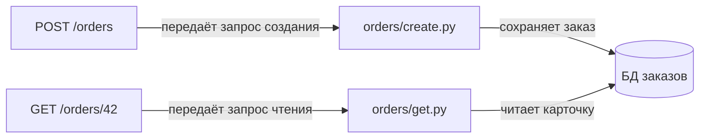
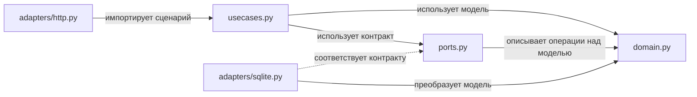
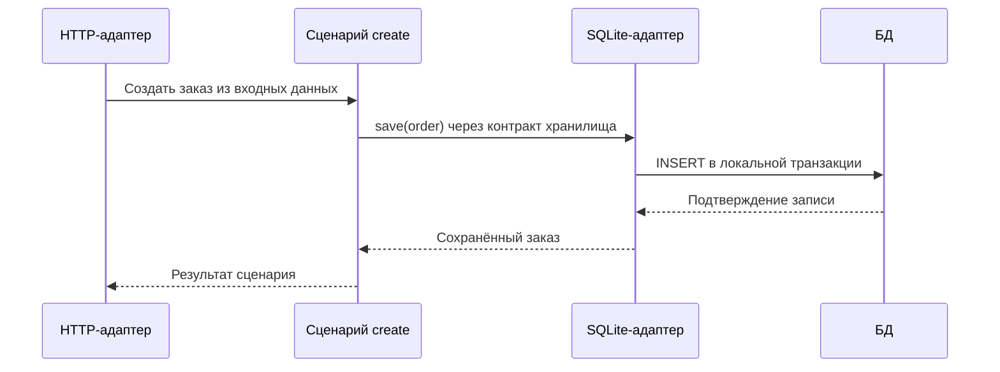
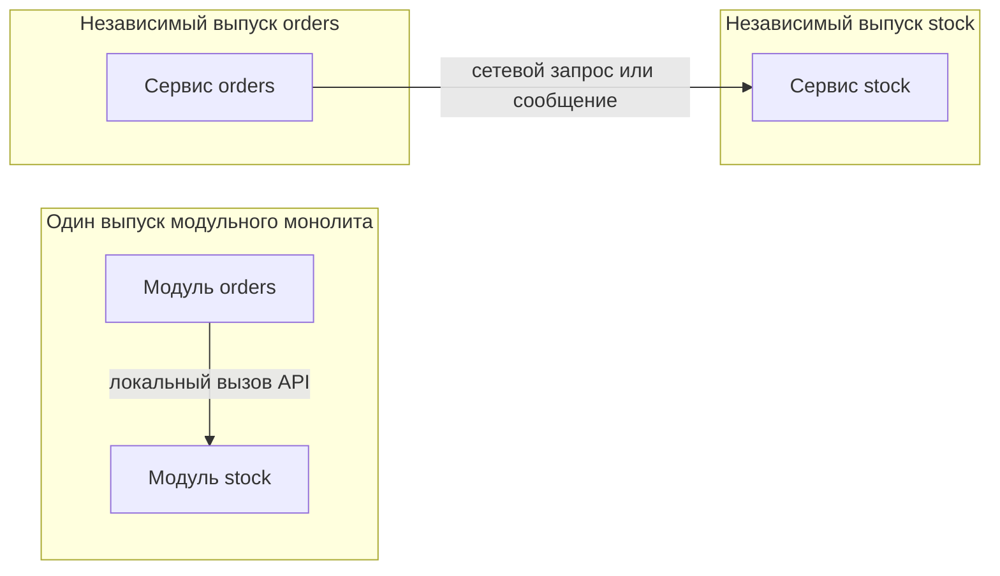

# Выбрать организацию кода и границы выпуска

<a id="организация-приложения-и-распределённые-сценарии"></a>

Шпаргалка объясняет границы приложения.
Выберите размещение кода.
Определите зависимости кода.
Определите единицы отдельного выпуска.
Сквозной пример создаёт и читает заказ.
Сетевые отказы разобраны на отдельной странице.

[К паттернам](README.md) · [Принципы](../principles.md) · [Распределённые сценарии](distributed-systems.md)

| Ситуация | Приём | Где вспомнить |
| --- | --- | --- |
| Представление, правила и хранение меняются независимо | Layered: разделите технические роли | [Слои](#layered-разделить-по-роли) |
| Создание и чтение заказа развиваются независимо | Vertical Slice: держите сценарий рядом | [Сценарии](#feature-oriented-и-vertical-slice-собрать-сценарий) |
| Тест правила требует внешнюю БД или UI | Ports & Adapters: отделите правило от интеграций | [Порты](#ports--adapters-отделить-приложение-от-деталей) |
| Частям нужны общий или независимые релизы | Сравните Modular Monolith и Microservices | [Развёртывание](#границы-развёртывания) |
| Запись, публикация или повтор могут завершиться частично | Выберите протокол по требуемой гарантии | [Данные и отказы](#распределённые-сценарии) |

| Параметр | Значение |
| --- | --- |
| Предпосылки | Модульные контракты, транзакции, различие локального и сетевого вызова |
| Границы | Деревья и схемы показывают возможные решения; реализация приложения и измерения требуют отдельной работы |

## Навигация

- [Базовый уровень: разные оси решения](#базовый-уровень-разные-оси-решения)
- [Организация кода](#организация-кода) — средний уровень: слои, сценарии, порты
- [Границы развёртывания](#границы-развёртывания) — средний / продвинутый уровень
- [Распределённые сценарии](#распределённые-сценарии) — продвинутый уровень
- [Полный пример: Outbox и дубликат публикации](#полный-пример-outbox-и-дубликат-публикации)
- [Источники](#источники)

## Базовый уровень: разные оси решения

| Вид представления | Отвечает на вопрос | Чего из него не узнать |
| --- | --- | --- |
| Дерево исходников | В каком файле искать создание заказа? | Кто кого импортирует или вызывает |
| Зависимости кода | Какое знание нужно модулю для работы? | Порядок вызовов и число процессов |
| Runtime-поток | Кто кому передаёт управление/сообщение? | Направление импортов |
| Развёртывание | Что выпускается и работает отдельно? | Как код организован внутри сервиса |

Правило может вызвать переданный SQL-адаптер без импорта его класса.
Три каталога одного проекта могут работать в одном процессе.
Подпись каждой схемы задаёт смысл представления.

**Совместимость решений:** Ports & Adapters применимы внутри монолита или сервиса.
Сценарии Vertical Slice могут находиться внутри предметного модуля с портами.
Название папки не доказывает изоляцию.
Название папки не доказывает независимость выпуска.

## Организация кода

**Средний уровень.** Выберите способ находить и менять сценарий заказа.
Деревья ниже показывают условные планы исходников с Python-подобными именами.
Эти планы не являются готовыми пакетами для запуска.
Паттерны не предписывают имена и число файлов.
Создавайте файл или каталог только для существующей обязанности.

| Подход | Главная граница | Проверка полезности | Цена / когда упростить |
| --- | --- | --- | --- |
| Layered | Представление / правила / хранение | HTTP-формат не попал в правило; SQL остаётся в хранении | Одно изменение проходит через несколько слоёв; пустой пересылающий слой можно убрать |
| Feature-oriented / Vertical Slice | Предметная возможность / отдельный сценарий | Создание заказа читается и меняется целиком; общее правило не разошлось по копиям | Нужно сознательно выделять общее знание, а не копировать всё между сценариями |
| Ports & Adapters | Приложение / внешняя технология | Тест правила не требует HTTP request, ORM и живой БД | Контракты и сборку нужно сопровождать; простому CRUD иногда достаточно прямого запроса |

### Layered: разделить по роли

**Задача:** отдельно менять HTTP-представление, правило создания заказа и способ хранения.
Дерево показывает один возможный вариант небольшого приложения:

```text
src/orderapp/
├── http.py       # HTTP-вход и представление ответа
├── service.py    # create/get: прикладные правила заказа
└── storage.py    # чтение/запись заказов через SQL
```

**Зависимости кода** относятся к выбранному закрытому варианту.
Стрелка означает импорт нижнего слоя.
Соглашение проекта запрещает обратные импорты.
Дерево само по себе не запрещает обратные импорты.


**Результат:** SQL находится в `storage.py`.
Проверка заказа находится в `service.py`.
HTTP-коды находятся в `http.py`.
В этом простом варианте runtime-вызовы тоже идут сверху вниз.
При этом импорт и вызов остаются разными отношениями.
Закрытые слои допускают обращения только к следующему слою.
В открытом варианте проект явно разрешает пропуски.
Для сложных правил может потребоваться отдельная доменная модель.
Необходимость доменной модели не следует из симметрии дерева.

**Ограничение:** логический *layer* не равен физическому *tier*.
Три слоя могут находиться в одном процессе.
Новая операция часто затронет все три файла.
См. [различие layers / tiers у Microsoft](https://learn.microsoft.com/en-us/azure/architecture/guide/architecture-styles/n-tier).

### Feature-oriented и Vertical Slice: собрать сценарий

**Задача:** держать части сценария создания заказа рядом.
При изменении сценария не должно требоваться искать его части во всех технических каталогах.
Feature-oriented группирует код по возможности (`orders`).
Vertical Slice выделяет самостоятельный use case (`create`, `get`).
Перенос прежних слоёв в папку `orders` сам по себе не выделяет вертикальный сценарий.

```text
src/orderapp/
├── orders/
│   ├── create.py   # вход, проверка и запись сценария создания
│   ├── get.py      # вход и чтение карточки заказа
│   └── rules.py    # общее правило заказа, если оно реально нужно обоим
└── bootstrap.py    # связывает обработчики с точками входа
```

**Runtime-поток** показывает возможную реализацию.
Обработчики обслуживают разные запросы.
Один обработчик не обязан вызывать другой.
Сценарий может обращаться к БД напрямую или через порт.
Выбирайте способ по потребностям сценария.



**Результат:** основная работа по изменению создания находится в `create.py`.
При росте сценарий можно сделать пакетом с собственными деталями.
Создавайте структуру по текущим обязанностям, а не заранее ради одинаковых папок.
Общее бизнес-правило остаётся авторитетным в одном месте.
Случайно похожий код не требует общей абстракции.
CQRS, брокер и разные БД не следуют из этого дерева.
Источник: [Bogard: Vertical Slice Architecture](https://www.jimmybogard.com/vertical-slice-architecture/).

### Ports & Adapters: отделить приложение от деталей

**Задача:** запускать одно правило создания заказа из HTTP, теста или batch.
Способ хранения должен меняться отдельно.
Порт задаёт осмысленный контракт приложения.
Адаптер переводит внешний протокол в контракт приложения или обратно.

```text
src/orderapp/
├── domain.py       # данные и инварианты заказа
├── usecases.py     # сценарии create/get
├── ports.py        # нужный сценариям контракт хранилища
├── adapters/
│   ├── http.py     # входной адаптер: HTTP → вызов сценария
│   └── sqlite.py   # выходной адаптер: контракт → SQL
└── bootstrap.py    # создаёт адаптеры и передаёт их сценариям
```

**Ключевые зависимости кода:** правило знает собственный контракт.
Правило не знает конкретную БД.
Пунктир показывает структурное соответствие контракту.
Python-адаптеру не обязательно импортировать Protocol.
`bootstrap.py` знает конкретные детали.
`bootstrap.py` собирает детали.
Ради читаемости схема не показывает `bootstrap.py`.



**Runtime-поток** показывает те же роли.
Выходной адаптер передан в сценарий при сборке.
Порт задаёт контракт этого вызова.
Порт не требует отдельного промежуточного объекта или процесса.



**Результат:** в тесте сценария вместо SQLite можно передать память.
Самому правилу не нужны HTTP или ORM.
Контракт должен сохранять ошибки.
Контракт должен сохранять транзакционные границы и семантику чтения.
Одна форма метода недостаточна.
Схема показывает вызовы, а не готовый безопасный протокол повторной записи.
Источник: [Cockburn: Ports & Adapters](https://alistair.cockburn.us/hexagonal-architecture/).
Связь с [DIP и DI](../solid.md#продвинутый-уровень).

## Границы развёртывания

**Средний / продвинутый уровень.** Выберите единицы выпуска и владения данными.
Этот выбор отличается от дерева папок.
Размер команды сам по себе не определяет выбор.
Количество таблиц само по себе не определяет выбор.

| Форма | Когда полезна | Что проверить | Цена |
| --- | --- | --- | --- |
| Modular Monolith | Нужны предметные границы при одном выпуске | `orders` и `stock` общаются через API модулей; чужие данные не меняются в обход владельца | Общий выпуск и обычно общий процесс; границы нужно защищать |
| Microservices | Подтверждена нужда в независимом выпуске/масштабировании частей | Сервис можно выпустить без одновременного релиза соседей; он владеет данными и отказами | Сеть, совместимость протоколов, наблюдение и распределённая согласованность |

**Развёртывание с обозначенными runtime-связями:** слева показан единый артефакт приложения.
Справа показаны два независимых артефакта.
Группы обозначают границы выпуска.
Стрелки обозначают подписанные взаимодействия.
Схема не задаёт число реплик и отдельные инфраструктурные БД.



**Результат:** в монолите допустимы локальные вызовы и согласованные локальные транзакции.
Между сервисами нужен явный протокол частичного отказа.
Отдельные физические серверы БД не обязательны.
Существенно владение данными.
Существенно отсутствие обхода API через чужие изменяемые таблицы.
Общая изменяемая БД может сохранить сильную связанность при множестве процессов.
Обязательные синхронные цепочки тоже могут сохранить сильную связанность.

Пока предметные границы уточняются, начало с монолита бывает дешевле.
Это эвристика с условиями, а не обязательная миграция.
Обоснуйте выделение сервиса конкретной независимостью.
Оцените способность сопровождать эту независимость.
Источники: [Fowler / Lewis: Microservices](https://martinfowler.com/articles/microservices.html),
[Fowler: Monolith First](https://martinfowler.com/bliki/MonolithFirst.html).

## Распределённые сценарии

**Продвинутый уровень.** Сначала назовите отказ.
Укажите требуемую гарантию.
Затем выберите механизм.
Это отдельная ось решения.
Outbox бывает нужен и монолиту, который публикует сообщения.

| Наблюдаемая проблема | Кандидат | Проверить до выбора |
| --- | --- | --- |
| Повторные чтения дороги; допустима ограниченная устарелость | [Cache-Aside](distributed-systems.md#cache-aside-читать-через-кеш) | Гонку заполнения/инвалидации, TTL и поведение при недоступном кеше |
| Заказ записан, событие потеряно между БД и брокером | [Transactional Outbox](distributed-systems.md#transactional-outbox-сохранить-заказ-и-намерение-публикации) | Общую транзакцию заказа/события, повтор публикации и dedup эффекта |
| Несколько владельцев данных выполняют шаги общего процесса | [Saga](distributed-systems.md#saga-согласовать-локальные-шаги) | Компенсации, промежуточные состояния, таймаут и необратимый шаг |
| Одна модель неудобна и для записи, и для чтения | [CQRS](distributed-systems.md#cqrs-разделить-модели-записи-и-чтения) | Различие моделей, цену проекции и допустимое отставание |
| Временный отказ может исчезнуть при повторе | [Retry](distributed-systems.md#retry-повторить-временный-отказ) | Классификацию, общий бюджет времени, идемпотентность и неизвестный исход |

Ни один из этих паттернов сам по себе не обещает exactly-once для произвольного внешнего эффекта.
[Карточки со схемами и ограничениями](distributed-systems.md) показывают, что именно проверять.

## Полный пример: Outbox и дубликат публикации

[Выполните полный пример Outbox](outbox-example.md#полный-пример-outbox-и-дубликат-публикации).
Пример атомарно сохраняет заказ и событие.
Пример проверяет rollback при отказе UNIQUE.
Пример проверяет повтор публикации после смоделированного сбоя relay.

## Источники

- Организация кода: [Cockburn](https://alistair.cockburn.us/hexagonal-architecture/), [Bogard](https://www.jimmybogard.com/vertical-slice-architecture/), [Microsoft: layers / tiers](https://learn.microsoft.com/en-us/azure/architecture/guide/architecture-styles/n-tier).
- Выпуск и границы: [Fowler / Lewis: Microservices](https://martinfowler.com/articles/microservices.html), [Fowler: Monolith First](https://martinfowler.com/bliki/MonolithFirst.html).
- Источники по данным и отказам собраны [на подробной странице](distributed-systems.md#источники).
