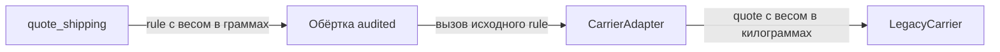
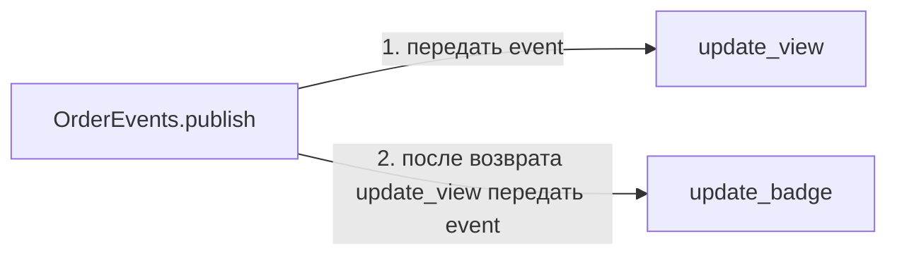
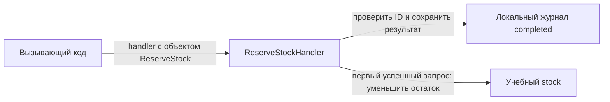

# Выполнить примеры паттернов кода

Три локальных примера: тариф доставки соединяет Strategy, Adapter, Decorator и Factory;
Observer показывает подписки и ошибки, Command — запрос с отдельным обработчиком и повтором.

[Краткий выбор и роли](design-patterns.md) · [К паттернам](README.md)

**Уровень:** средний; разбор ошибок и повтора — продвинутый.
**Предпосылки:** Python 3.14, функции/callable, классы, исключения; только стандартная библиотека.

## Навигация

- [Полный пример: Strategy, Adapter и декоратор](#полный-пример-strategy-adapter-и-декоратор)
- [Observer: подписка, отписка и ошибка слушателя](#observer-подписка-отписка-и-ошибка-слушателя)
- [Command: запрос, обработчик и локальный повтор](#command-запрос-обработчик-и-локальный-повтор)
- [Проверка и границы](#проверка-и-границы)

## Полный пример: Strategy, Adapter и декоратор


**Полный пример.** Только стандартная библиотека, внешние зависимости не нужны.
Сохраните весь блок как `shipping-patterns.py`, выполните `python3.14 shipping-patterns.py`.
Контракт: положительный целый вес в граммах → неотрицательная целая стоимость в условных центах.
LegacyCarrier — локальный заменитель внешнего SDK с килограммами и условными денежными единицами;
его сетевой протокол здесь не моделируется.

<!-- example: architecture/shipping-patterns.py -->
```python
from collections.abc import Callable
from decimal import Decimal, ROUND_CEILING

ShippingRule = Callable[[int], int]


def flat_rate(grams: int) -> int:
    return 500


class LegacyCarrier:
    def quote(self, kilograms: Decimal) -> Decimal:
        return Decimal("3.00") + Decimal("2.00") * kilograms


class CarrierAdapter:
    def __init__(self, carrier: LegacyCarrier):
        self._carrier = carrier

    def __call__(self, grams: int) -> int:
        units = self._carrier.quote(Decimal(grams) / Decimal(1000))
        return int((units * 100).quantize(Decimal("1"), rounding=ROUND_CEILING))


def audited(rule: ShippingRule, events: list[tuple[int, int]]) -> ShippingRule:
    def wrapped(grams: int) -> int:
        result = rule(grams)
        events.append((grams, result))
        return result
    return wrapped


def make_rule(name: str) -> ShippingRule:
    rules = {"flat": flat_rate, "legacy": CarrierAdapter(LegacyCarrier())}
    try:
        return rules[name]
    except KeyError:
        raise ValueError("Неизвестный тариф") from None


def quote_shipping(grams: int, rule: ShippingRule) -> int:
    if type(grams) is not int or grams <= 0:
        raise ValueError("Нужен целый положительный вес")
    result = rule(grams)
    if type(result) is not int or result < 0:
        raise ValueError("Тариф нарушил контракт результата")
    return result


assert quote_shipping(500, make_rule("flat")) == 500
assert quote_shipping(500, make_rule("legacy")) == 400
assert quote_shipping(501, make_rule("legacy")) == 401
events: list[tuple[int, int]] = []
assert quote_shipping(500, audited(make_rule("legacy"), events)) == 400
assert events == [(500, 400)]
for operation in [
    lambda: quote_shipping(0, flat_rate),
    lambda: quote_shipping(1, lambda _: -1),
    lambda: make_rule("unknown"),
]:
    try:
        operation()
    except ValueError:
        pass
    else:
        raise AssertionError("Ожидался отказ входа/контракта/выбора")
print("OK: strategies, unit adapter, rounding, wrapper and factory refusal")
```

**Результат:** OK. Проверены два тарифа, перевод граммов в килограммы, явное округление вверх
до цента, сохранение результата обёрткой, запись аудита и три сценария отказа.
Внешний SDK может возвращать недопустимые значения/ошибки: политика их преобразования должна быть отдельным контрактом адаптера.

Ниже все стрелки показывают **вызовы во время выполнения**, а не imports:



Результат возвращается обратно по стеку вызовов; адаптер переводит денежные единицы в целые центы.
Обёртка здесь пишет в список. Сбой удалённого аудита потребовал бы решения: провалить операцию,
сохранить событие отдельно или допустить потерю наблюдения.


## Observer: подписка, отписка и ошибка слушателя

**Задача:** уведомлять локальных слушателей по порядку подписки. Публикация синхронная;
первая ошибка прерывает рассылку и передаётся вызывающему коду. Уже выполненные callbacks не откатываются.

**Полный пример.** Только стандартная библиотека. Сохраните как `observer-pattern.py`,
выполните `python3.14 observer-pattern.py`. События и результаты — учебные строки/списки.

<!-- example: architecture/observer-pattern.py -->
```python
from collections.abc import Callable

Listener = Callable[[str], None]


class OrderEvents:
    def __init__(self) -> None:
        self._listeners: list[Listener] = []

    def subscribe(self, listener: Listener) -> None:
        if listener not in self._listeners:
            self._listeners.append(listener)

    def unsubscribe(self, listener: Listener) -> None:
        self._listeners.remove(listener)

    def publish(self, event: str) -> None:
        for listener in tuple(self._listeners):
            listener(event)


events = OrderEvents()
calls: list[tuple[str, str]] = []


def update_view(event: str) -> None:
    calls.append(("view", event))


def update_badge(event: str) -> None:
    calls.append(("badge", event))


def broken_listener(event: str) -> None:
    raise RuntimeError("Слушатель недоступен")


events.subscribe(update_view)
events.subscribe(update_badge)
events.publish("order-paid")
assert calls == [("view", "order-paid"), ("badge", "order-paid")]

events.unsubscribe(update_badge)
calls.clear()
events.publish("order-shipped")
assert calls == [("view", "order-shipped")]

# Ошибка второго слушателя не даёт вызвать третьего.
events.subscribe(broken_listener)
events.subscribe(update_badge)
calls.clear()
try:
    events.publish("order-cancelled")
except RuntimeError as error:
    assert str(error) == "Слушатель недоступен"
else:
    raise AssertionError("Ошибка слушателя должна выйти из publish")
assert calls == [("view", "order-cancelled")]
print("OK: observer order, unsubscribe and fail-fast delivery")
```

**Ожидаемый результат:** `OK: observer order, unsubscribe and fail-fast delivery`.
Проверены два слушателя, порядок, отписка и прерывание рассылки при исключении.

**Схема вызовов при выполнении:** подписи задают порядок синхронных вызовов;
вторая стрелка достигается, только если первый слушатель завершился успешно.



**Ограничения:** `publish` использует снимок списка: изменение подписок во время рассылки
повлияет на следующую публикацию. Повторная подписка того же callback не добавляет дубликат;
отписка отсутствующего callback вызывает `ValueError`. Издатель держит сильные ссылки на слушателей:
время отписки задаёт владелец подписки. Нет потокобезопасности, хранения событий и повторной доставки.

## Command: запрос, обработчик и локальный повтор

**Задача:** отделить запрос на резервирование от исполнения и явно определить повтор:
тот же ID и те же параметры возвращают сохранённый результат, тот же ID с другими параметрами отвергается.
Команда здесь — данные плюс отдельный handler; отдельный метод `execute` в самой команде не обязателен.

**Полный пример.** Только стандартная библиотека. Сохраните как `command-pattern.py`,
выполните `python3.14 command-pattern.py`. Остатки и журнал результатов хранятся в памяти одного handler.

<!-- example: architecture/command-pattern.py -->
```python
from dataclasses import dataclass


@dataclass(frozen=True)
class ReserveStock:
    sku: str
    quantity: int
    request_id: str


class ReserveStockHandler:
    def __init__(self, stock: dict[str, int]) -> None:
        self.stock = dict(stock)
        self._completed: dict[str, tuple[ReserveStock, int]] = {}

    def __call__(self, command: ReserveStock) -> int:
        if not isinstance(command.sku, str) or not command.sku:
            raise ValueError("Нужен SKU")
        if type(command.quantity) is not int or command.quantity <= 0:
            raise ValueError("Нужно целое положительное количество")
        if not isinstance(command.request_id, str) or not command.request_id:
            raise ValueError("Нужен request_id")
        if command.request_id in self._completed:
            previous, result = self._completed[command.request_id]
            if previous != command:
                raise ValueError("request_id уже использован с другими параметрами")
            return result
        available = self.stock.get(command.sku, 0)
        if available < command.quantity:
            raise ValueError("Недостаточно товара")
        remaining = available - command.quantity
        self.stock[command.sku] = remaining
        self._completed[command.request_id] = (command, remaining)
        return remaining


handler = ReserveStockHandler({"book": 3})
command = ReserveStock("book", 1, "request-1")
assert handler(command) == 2
assert handler(command) == 2  # Успешный повтор не резервирует ещё раз.
assert handler.stock == {"book": 2}

for invalid in [
    ReserveStock("book", 0, "request-2"),
    ReserveStock("book", 4, "request-3"),
    ReserveStock("book", 2, "request-1"),
]:
    try:
        handler(invalid)
    except ValueError:
        pass
    else:
        raise AssertionError("Ожидался отказ валидации/остатка/конфликта ID")
    assert handler.stock == {"book": 2}
print("OK: command validation, reserve, replay and ID conflict")
```

**Ожидаемый результат:** `OK: command validation, reserve, replay and ID conflict`.
Проверены резервирование, успешный повтор, невалидное количество, недостаточный остаток и конфликт ID;
при этих отказах остаток не меняется. Возвращаемое при повторе число — результат первого исполнения,
а не обещание показать текущий остаток после других команд.

**Схема вызовов при выполнении:** команда передаётся обработчику как аргумент;
изменение остатка происходит только при первом успешном исполнении ID.



**Ограничения:** `dataclass` создаёт методы для данных, но не валидирует типы аннотаций;
валидация здесь явная. `frozen=True` ограничивает присваивание полей, а не обеспечивает бизнес-гарантии.
Локальный журнал даёт повтор только в течение жизни этого handler; нет транзакции с БД,
защиты конкурентных вызовов, восстановления после рестарта и политики очистки журнала.
Для внешнего действия сохранение результата и самого эффекта нужно согласовывать отдельно;
undo может быть [бизнес-компенсацией](architecture-patterns.md#распределённые-сценарии).

## Проверка и границы

| Проверка | Основание / границы |
| --- | --- |
| Сверено с документацией | 2026-11-06: Python 3.14, [Callable](https://docs.python.org/3.14/library/collections.abc.html#collections.abc.Callable), [Decimal](https://docs.python.org/3.14/library/decimal.html), [dataclasses](https://docs.python.org/3.14/library/dataclasses.html) |
| Выполнено | 2026-11-06, Python 3.14.7: доставка, Observer и Command; успешные сценарии и перечисленные отказы, а также короткие продолжения из шпаргалки |
| Не проверяется этими примерами | Сеть/реальный SDK, потоки, падение процесса, надёжный аудит, доставка и хранение команд |
