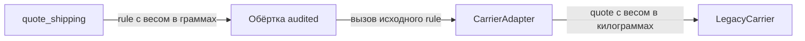

# Выбирать паттерн кода

[К паттернам](README.md) · [SOLID](../solid.md)

| Параметр | Значение |
| --- | --- |
| Уровни | Базовый — намерения паттернов; средний — композиция; продвинутый — контракты и ошибки |
| Предпосылки | Python 3.14, функции/callable и композиция объектов |
| Концепции сверены | 2026-11-06, GoF; примеры оригинальные, с синтетическими данными |
| Выполнено | 2026-11-06, Python 3.14.7: полный пример; два тарифа, перевод единиц/округление, результат и эффект обёртки, три ожидаемых отказа |
| Границы | Нет сетевого SDK, потоков или надёжного аудита; тестируется локальное поведение |

## Навигация

- [Базовый уровень](#базовый-уровень)
- [Выбор паттерна](#выбор-паттерна)
- [Полный пример: Strategy, Adapter и декоратор](#полный-пример-strategy-adapter-и-декоратор)
- [Продвинутый уровень](#продвинутый-уровень)
- [Источники](#источники)

## Базовый уровень

Начните с вопроса, что меняется: алгоритм, внешний интерфейс, дополнительное поведение,
создание объектов, набор слушателей или представление действия. Если достаточно прямого вызова функции,
оставьте его. Паттерн полезен, когда делает существующий вариант изменения понятнее.

Композиция передаёт работу другому объекту/функции. Наследование не требуется для каждого паттерна;
в Python часто достаточно callable или небольшого [Protocol](../solid.md).

## Выбор паттерна

**Средний уровень.** Строки таблицы — критерии выбора, не правила генерации классов.

| Паттерн | Конкретная задача | Как проверить | Цена / альтернатива |
| --- | --- | --- | --- |
| Strategy | Подменить алгоритм тарифа, сохранив потребителя | Один клиент работает с двумя правилами по общему контракту | Появляется выбор стратегии; для единственного простого варианта хватит функции |
| Adapter | Перевести единицы, формат или ошибки внешнего API | Один набор контрактных тестов для внешнего и локального источника | Адаптер нужно сопровождать при смене SDK; он не должен скрывать важные ошибки |
| Decorator | Добавить аудит/метрики вокруг того же интерфейса | Результат/ошибки сохраняются, дополнительный эффект проверен | Порядок обёрток и сбой дополнительного эффекта могут менять поведение |
| Factory | Собрать объект с зависимостями в одном месте | Конфигурация выбирает нужный вариант, неизвестный вариант отвергается | Иногда достаточно конструктора; простая factory-функция не равна Abstract Factory или Factory Method |
| Observer | Одно событие в процессе уведомляет нескольких слушателей | Проверены подписка/отписка, порядок и политика ошибки слушателя | Связи и время жизни менее явны; это не надёжный брокер сообщений |
| Command | Представить запрос действием с данными, например ReserveStock | Handler проверяет вход и результат, повтор имеет заданную семантику | Команда сама не обеспечивает хранение, undo, retry или идемпотентность |

Пример для Observer: изменение состояния заказа уведомляет несколько локальных представлений.
Сначала решите, останавливает ли ошибка одного слушателя остальных и кто отписывает уничтоженный объект.
Если уведомление должно пережить падение процесса, локальные callbacks недостаточны.

Пример для Command: запись `ReserveStock(sku, quantity, request_id)` позволяет отделить входные данные
от обработчика. Undo для выполненного внешнего действия может быть бизнес-компенсацией,
а не автоматическим вызовом обратного метода. См. [Saga и Outbox](architecture-patterns.md#распределённые-сценарии).

## Полный пример: Strategy, Adapter и декоратор

Сохраните как `shipping-patterns.py`, выполните `python3.14 shipping-patterns.py`.
Контракт: положительный целый вес в граммах → неотрицательная целая стоимость в условных центах.
LegacyCarrier — локальный заменитель внешнего SDK с килограммами и условными денежными единицами;
его сетевой протокол здесь не моделируется.

<!-- example: architecture/shipping-patterns.py -->
```python
from collections.abc import Callable
from decimal import Decimal, ROUND_CEILING

ShippingRule = Callable[[int], int]


def flat_rate(grams: int) -> int:
    return 500


class LegacyCarrier:
    def quote(self, kilograms: Decimal) -> Decimal:
        return Decimal("3.00") + Decimal("2.00") * kilograms


class CarrierAdapter:
    def __init__(self, carrier: LegacyCarrier):
        self._carrier = carrier

    def __call__(self, grams: int) -> int:
        units = self._carrier.quote(Decimal(grams) / Decimal(1000))
        return int((units * 100).quantize(Decimal("1"), rounding=ROUND_CEILING))


def audited(rule: ShippingRule, events: list[tuple[int, int]]) -> ShippingRule:
    def wrapped(grams: int) -> int:
        result = rule(grams)
        events.append((grams, result))
        return result
    return wrapped


def make_rule(name: str) -> ShippingRule:
    rules = {"flat": flat_rate, "legacy": CarrierAdapter(LegacyCarrier())}
    try:
        return rules[name]
    except KeyError:
        raise ValueError("Неизвестный тариф") from None


def quote_shipping(grams: int, rule: ShippingRule) -> int:
    if type(grams) is not int or grams <= 0:
        raise ValueError("Нужен целый положительный вес")
    result = rule(grams)
    if type(result) is not int or result < 0:
        raise ValueError("Тариф нарушил контракт результата")
    return result


assert quote_shipping(500, make_rule("flat")) == 500
assert quote_shipping(500, make_rule("legacy")) == 400
assert quote_shipping(501, make_rule("legacy")) == 401
events: list[tuple[int, int]] = []
assert quote_shipping(500, audited(make_rule("legacy"), events)) == 400
assert events == [(500, 400)]
for operation in [
    lambda: quote_shipping(0, flat_rate),
    lambda: quote_shipping(1, lambda _: -1),
    lambda: make_rule("unknown"),
]:
    try:
        operation()
    except ValueError:
        pass
    else:
        raise AssertionError("Ожидался отказ входа/контракта/выбора")
print("OK: strategies, unit adapter, rounding, wrapper and factory refusal")
```

**Результат:** OK. Проверены два тарифа, перевод граммов в килограммы, явное округление вверх
до цента, сохранение результата обёрткой, запись аудита и три сценария отказа.
Внешний SDK может возвращать недопустимые значения/ошибки: политика их преобразования должна быть отдельным контрактом адаптера.

Ниже все стрелки показывают **вызовы во время выполнения**, а не imports:



Результат возвращается обратно по стеку вызовов; адаптер переводит денежные единицы в целые центы.
Обёртка здесь пишет в список. Сбой удалённого аудита потребовал бы решения: провалить операцию,
сохранить событие отдельно или допустить потерю наблюдения.

## Продвинутый уровень

### Проверить, сохраняется ли контракт

Для Adapter перечислите единицы, NULL, таймауты и ошибки, которые видит потребитель.
Для Decorator проверьте порядок, повтор и исключения: retry вокруг списания/отправки может повторить эффект.
Для Observer задайте синхронность и время жизни подписчиков; асинхронная очередь меняет гарантии доставки.
Для Command разделите само представление запроса, его хранение и исполнение: это независимые обязанности.

Factory — место сборки, не способ спрятать случайные условия. В примере выбор по имени находится
в одном месте; добавление нового правила может изменить factory, не требуя менять quote_shipping.
Это ограниченная точка расширения, а не обещание никогда не редактировать код.

Паттерн можно убрать, когда исчезла вариативность и обёртка/интерфейс только пересылает вызовы
без полезной границы. Не переносите классический классовый шаблон буквально, если функция проще сохраняет тот же контракт.

## Источники

- [GoF: каталог и официальные материалы издателя](https://www.informit.com/store/design-patterns-elements-of-reusable-object-oriented-9780201633610).
- [PEP 544: структурные контракты](https://peps.python.org/pep-0544/).
- [Python Decimal и округление](https://docs.python.org/3.14/library/decimal.html), [Callable](https://docs.python.org/3.14/library/collections.abc.html#collections.abc.Callable).
