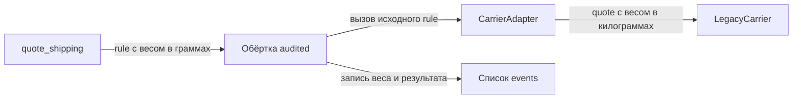
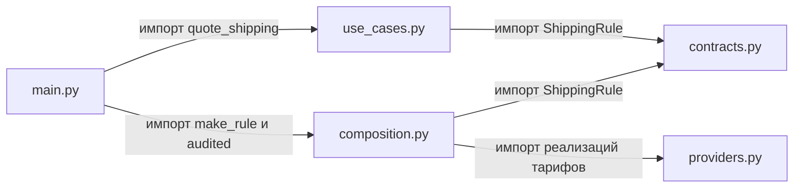

# Выбирать паттерн кода

Выберите приём по тому, что меняется.
Варианты изменения: алгоритм, внешний API, обёртка, сборка, подписка или действие.
Карточки показывают роли и короткий вызов.
Полные реализации доступны по ссылкам.

## Выбор паттерна

| Что меняется | Паттерн | Что получает потребитель | Когда хватит более простого решения |
| --- | --- | --- | --- |
| Алгоритм расчёта | [Strategy](#strategy-подменить-алгоритм) | Один контракт, несколько правил | Один короткий алгоритм без подмены — обычная функция |
| Формат, единицы или интерфейс внешнего API | [Adapter](#adapter-перевести-внешний-контракт) | Данные в понятном ему контракте | Одно локальное преобразование — функция без класса |
| Поведение вокруг операции | [Decorator](#decorator-добавить-поведение-вокруг-вызова) | Прежний способ вызова плюс аудит/метрики | Один явный вызов до/после операции без повторного использования |
| Создание и выбор реализации | [Factory](#factory-собрать-нужную-реализацию) | Готовый объект с зависимостями | Конструктор, если выбор и сборка тривиальны |
| Набор получателей события | [Observer](#observer-уведомить-локальных-подписчиков) | Подписка на событие | Прямые вызовы, если получатели фиксированы |
| Представление запроса | [Command](#command-передать-действие-как-данные) | Отдельное действие с параметрами | Прямой вызов функции, если не нужно передавать/сохранять запрос |


[К паттернам](README.md) · [SOLID](../solid.md) · [Полные примеры](code-examples.md)

**Предпосылки:** функции, callable и композиция объектов.
Примеры ориентированы на Python 3.14.
[Совместимость и результаты проверки](#проверка-и-совместимость).

## Базовый уровень

Если отдельная граница пока не нужна, начните с обычной функции.
Таблица помогает выбрать решение под существующее изменение.
Таблица не требует создавать набор классов.

Композиция передаёт работу другому объекту или функции.
Общий контракт в Python может выражаться через `Callable` или небольшой [Protocol](../solid.md).
Эти примеры не требуют наследования от общего базового класса.

## Навигация

- [Базовый уровень: выбор паттерна](#выбор-паттерна)
- [Средний уровень: роли и короткие вызовы](#средний-уровень)
- [Композиция Strategy, Adapter и декоратора](#полный-пример-strategy-adapter-и-декоратор)
- [Возможное размещение в модулях](#возможное-размещение-в-модулях)
- [Продвинутый уровень: контракты и отказы](#продвинутый-уровень)
- [Частые ошибки](#частые-ошибки)
- [Проверка и совместимость](#проверка-и-совместимость)
- [Источники](#источники)

## Средний уровень

Короткие блоки ниже показывают вызов.
Это **продолжения указанных полных примеров**.
Определения функций и классов находятся по ссылке.
Сначала выполните соответствующий полный блок.
Затем добавьте короткий блок в тот же файл.

### Strategy: подменить алгоритм

**Когда:** один потребитель должен работать с разными тарифами по общему контракту.
Контракт принимает положительный целый вес в граммах.
Контракт возвращает неотрицательную целую стоимость в центах.

| Роль | Имя в примере | Обязанность |
| --- | --- | --- |
| Потребитель / context | `quote_shipping` | Проверяет вход/выход и вызывает переданное правило |
| Контракт стратегии | `ShippingRule` | Описывает вызываемый объект `Callable[[int], int]` |
| Реализации | `flat_rate`, `CarrierAdapter` | Считают стоимость по разным правилам |

**Продолжение [примера доставки](code-examples.md#полный-пример-strategy-adapter-и-декоратор):**

```python
assert quote_shipping(500, flat_rate) == 500
assert quote_shipping(500, CarrierAdapter(LegacyCarrier())) == 400
```

**Результат:** один потребитель даёт 500 или 400 центов в зависимости от переданного правила.
Вызывающий код выбирает правило.
Сама аннотация типа не проверяет контракт.

### Adapter: перевести внешний контракт

**Когда:** потребитель работает с граммами и целыми центами.
Внешний API работает с килограммами и `Decimal` в денежных единицах.

| Роль | Имя в примере | Обязанность |
| --- | --- | --- |
| Внешний интерфейс / adaptee | `LegacyCarrier.quote` | Принимает килограммы, возвращает денежные единицы |
| Адаптер | `CarrierAdapter.__call__` | Переводит единицы и округляет вверх до целого цента |
| Потребитель | `quote_shipping` | Видит только контракт `ShippingRule` |

**Продолжение [примера доставки](code-examples.md#полный-пример-strategy-adapter-и-декоратор):**

```python
rule = CarrierAdapter(LegacyCarrier())
assert quote_shipping(501, rule) == 401
```

**Результат:** 501 г → 0,501 кг → 4,002 денежной единицы → 401 цент.
Округление является частью контракта адаптера.
Отдельно согласуйте ошибки SDK.
Отдельно согласуйте обработку недопустимых значений.

### Decorator: добавить поведение вокруг вызова

**Когда:** нужно записать результат операции с сохранением способа её вызова.
Пример использует функциональную обёртку с идеей Decorator.
Синтаксис `@` не обязателен.

| Роль | Имя в примере | Обязанность |
| --- | --- | --- |
| Исходная операция | `rule` | Рассчитывает стоимость |
| Создатель обёртки | `audited` | Возвращает функцию того же контракта |
| Обёртка | `wrapped` | Вызывает правило, записывает событие, возвращает результат |

**Продолжение [примера доставки](code-examples.md#полный-пример-strategy-adapter-и-декоратор):**

```python
events = []
rule = audited(make_rule("legacy"), events)
assert quote_shipping(500, rule) == 400
assert events == [(500, 400)]
```

**Результат:** стоимость не изменилась.
В список добавилась пара «вес, стоимость».
Ошибка исходного правила передаётся наружу.
При этой ошибке событие не записывается.
Отдельно задайте политику сбоя записи аудита.
Отдельно задайте порядок нескольких обёрток.

### Factory: собрать нужную реализацию

**Когда:** выбор по имени и создание зависимостей повторяются или мешают потребителю.
Пример использует простую factory-функцию.
Пример не реализует все варианты GoF Factory Method / Abstract Factory.

| Роль | Имя в примере | Обязанность |
| --- | --- | --- |
| Фабрика | `make_rule` | Выбирает тариф и собирает адаптер с `LegacyCarrier` |
| Результат сборки | `ShippingRule` | Позволяет клиенту не разбирать имя тарифа |

**Продолжение [примера доставки](code-examples.md#полный-пример-strategy-adapter-и-декоратор):**

```python
rule = make_rule("legacy")
assert quote_shipping(500, rule) == 400
```

**Результат:** собран подходящий вызываемый объект.
Неизвестное имя даёт `ValueError`.
[Полный пример](code-examples.md#полный-пример-strategy-adapter-и-декоратор) проверяет этот отказ.
Добавление тарифа может менять фабрику без изменения потребителя.

### Observer: уведомить локальных подписчиков

**Когда:** одно событие в процессе должно обновить несколько представлений/наблюдателей.

| Роль | Имя в примере | Обязанность |
| --- | --- | --- |
| Издатель / subject | `OrderEvents` | Хранит подписчиков и публикует событие |
| Подписчик / observer | `Listener`, например `calls.append` | Принимает событие |
| Управление подпиской | `subscribe`, `unsubscribe` | Определяет, кто получит следующее событие |

**Продолжение [примера Observer](code-examples.md#observer-подписка-отписка-и-ошибка-слушателя):**

```python
events = OrderEvents()
calls = []
events.subscribe(calls.append)
events.publish("order-paid")
assert calls == ["order-paid"]
```

**Результат:** слушатель вызван синхронно.
В примере слушатели идут по порядку подписки.
Первая ошибка останавливает рассылку.
Отписывайте подписчиков в нужный момент их времени жизни.
Доставка после падения процесса требует другого механизма.
Пример такого механизма — [Outbox](architecture-patterns.md#распределённые-сценарии).

### Command: передать действие как данные

**Когда:** запрос с параметрами нужно отделить от момента и места исполнения.
В примере команда представлена данными.
Отдельный handler исполняет команду.

| Роль | Имя в примере | Обязанность |
| --- | --- | --- |
| Команда | `ReserveStock` | Несёт SKU, количество и идентификатор запроса |
| Обработчик | `ReserveStockHandler` | Проверяет запрос, применяет его и задаёт политику повтора |
| Получатель действия / receiver | `stock` | Хранит учебные остатки, которые меняет обработчик |

**Продолжение [примера Command](code-examples.md#command-запрос-обработчик-и-локальный-повтор):**

```python
handler = ReserveStockHandler({"book": 3})
command = ReserveStock("book", 1, "request-1")
assert handler(command) == 2
```

**Результат:** зарезервирована одна книга.
Осталось две книги.
Сама команда не обеспечивает хранение, undo, retry или идемпотентность.
В полном примере локальная таблица handler обрабатывает повтор с тем же ID.
Для внешнего действия undo может быть [бизнес-компенсацией](architecture-patterns.md#распределённые-сценарии).

## Полный пример: Strategy, Adapter и декоратор

[Полный исходный пример доставки](code-examples.md#полный-пример-strategy-adapter-и-декоратор) находится на отдельной странице.
Он содержит импорты, запуск и проверки.
Пример также использует Factory.

**Схема вызовов при выполнении:** стрелка означает вызов следующего участника.
Стрелка не обозначает `import`, наследование или расположение файлов.



Результат возвращается обратно по стеку вызовов.
Адаптер переводит денежные единицы в центы.
Фабрика собирает правило до расчёта.
Фабрика не участвует в каждом вызове `rule`.

### Возможное размещение в модулях

**Псевдоструктура файлов:** дерево показывает возможное разделение растущего примера доставки.
Дерево иллюстрирует ответственность.
Дерево не задаёт обязательный каркас.
Полный пример остаётся одним файлом.

```text
shipping/
├── contracts.py       # ShippingRule: общий контракт
├── use_cases.py       # quote_shipping: потребитель правила
├── providers.py       # flat_rate, LegacyCarrier, CarrierAdapter
└── composition.py     # make_rule, audited: выбор и сборка
main.py                # входная точка: собрать правило и вызвать сценарий
```

Для двух других примеров возможны такие же небольшие модули.
Отдельные каталоги по имени паттерна не нужны:

| Пример | Где могут лежать роли | Где соединить участников |
| --- | --- | --- |
| Observer | `events.py`: `Listener`, `OrderEvents`; `views.py`: callbacks представлений | `main.py`: подписка и завершение её времени жизни |
| Command | `reserve.py`: `ReserveStock`, `ReserveStockHandler` рядом с правилом резерва | `main.py`: создать handler с остатками и передать команду |

**Схема зависимостей исходного кода для этой иллюстрации:** стрелка показывает импорт.
Модуль слева импортирует указанное имя из модуля справа.



Дерево показывает размещение кода.
Схема зависимостей показывает, от каких модулей зависит код.
Схема вызовов выше показывает, кто кого вызывает.
Различайте эти три представления.

## Продвинутый уровень

### Проверить, сохраняется ли контракт

**Предпосылки:** понятны короткие вызовы и исходные реализации на [странице примеров](code-examples.md).

| Паттерн | Что проверить помимо успешного результата |
| --- | --- |
| Strategy | Разные правила принимают одинаковые единицы и возвращают допустимый результат; в этом примере неверный вес отвергает общий вход `quote_shipping`, а сами правила вызываются с уже проверенным весом |
| Adapter | Единицы, `None`/NULL, округление, таймауты и ошибки, которые увидит потребитель |
| Decorator | Порядок обёрток, исключения и повтор: retry вокруг списания/отправки может повторить эффект |
| Factory | Отказ на неизвестную конфигурацию, корректную сборку и стоимость создания зависимостей |
| Observer | Подписку/отписку, порядок, политику ошибок, время жизни слушателей; очередь меняет гарантии доставки |
| Command | Валидацию, повтор и конфликт параметров для одного ID; хранение запроса и исполнение — разные обязанности |

При каждом вызове `make_rule` создаёт оба варианта.
Для локальных объектов это удобно.
Для дорогих клиентов или соединений определите время жизни.
Добавление правила меняет фабрику.
При этом `quote_shipping` менять не требуется.
Это ограниченная точка расширения.

Если вариативность исчезла, паттерн можно убрать.
Это уместно, если обёртка или интерфейс только пересылает вызовы без полезной границы.
Если функция проще сохраняет тот же контракт, используйте функцию вместо буквального классового шаблона.

## Частые ошибки

| Симптом | Причина | Исправление |
| --- | --- | --- |
| Для каждого тарифа создана иерархия классов | Паттерн принят за форму кода | Начать с `Callable` и проверить общий контракт |
| Adapter скрывает все ошибки SDK | Совместимость принята за отсутствие ошибок | Явно определить преобразуемые и передаваемые ошибки |
| Обёртка повторно списывает деньги | Retry обернул внешний эффект | Задать идемпотентность и классификацию отказов до повтора |
| Локальный Observer потерял событие после рестарта | Callback принят за надёжную доставку | Выбрать механизм сохранения и повторной доставки |
| `request_id` появился, а действие всё равно повторяется | ID не связан с учётом исполненных команд | Определить хранение результата и конфликт повторных параметров |

## Проверка и совместимость

| Проверка | Основание / границы |
| --- | --- |
| Сверено с документацией | 2026-11-06: Python 3.14 (`Callable`, `Decimal`, `dataclass`); намерения паттернов — GoF |
| Выполнено | 2026-11-06, Python 3.14.7: доставка, Observer и Command; успешные сценарии и перечисленные отказы, а также короткие продолжения из шпаргалки |
| Границы | Синтетические данные и стандартная библиотека; без сетевого SDK, потоков и надёжного аудита/доставки |

## Источники

[GoF: каталог и официальные материалы издателя](https://www.informit.com/store/design-patterns-elements-of-reusable-object-oriented-9780201633610) описывает намерения, условия применения и цену паттернов.
Показанные Python-реализации являются учебными.
- [PEP 544: структурные контракты](https://peps.python.org/pep-0544/).
- [Python 3.14: Callable](https://docs.python.org/3.14/library/collections.abc.html#collections.abc.Callable), [Decimal и округление](https://docs.python.org/3.14/library/decimal.html), [dataclasses](https://docs.python.org/3.14/library/dataclasses.html).
