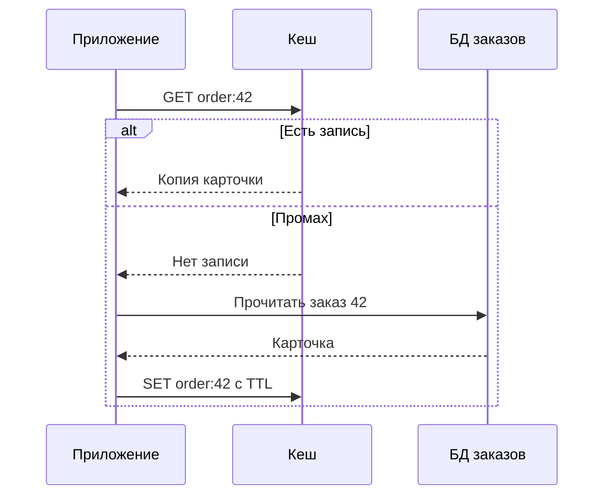
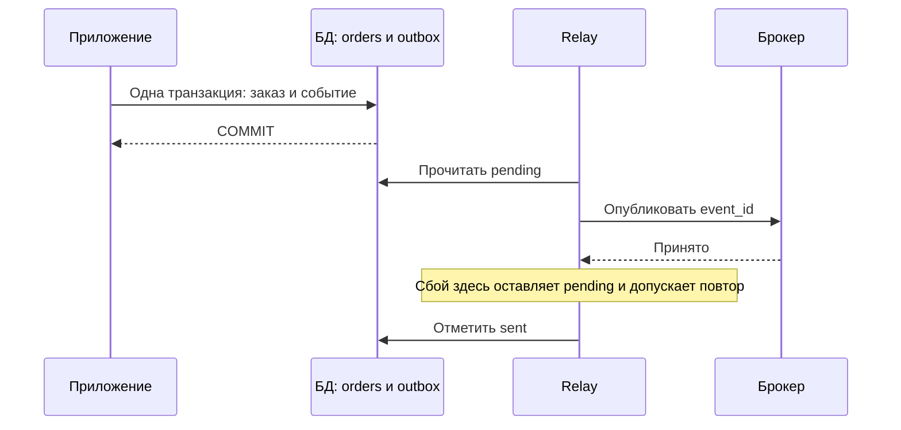
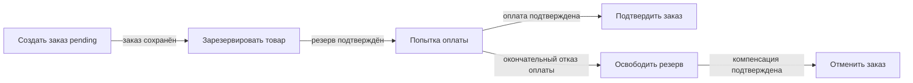
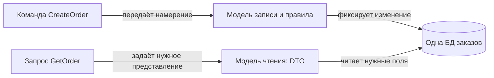
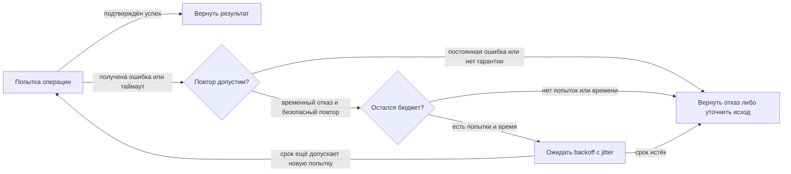

# Данные, повторы и частичный отказ

Карточки Cache-Aside, Outbox, Saga, CQRS и Retry: какой отказ покрывает механизм и где заканчивается гарантия.
Сквозной контекст — создание и чтение заказа. Схемы показывают возможные runtime-потоки, а не imports или готовую конфигурацию.

[К паттернам](README.md) · [Организация приложения](architecture-patterns.md) · [Принципы](../principles.md)

## Быстрый выбор

| Что требуется | Механизм | Где применяется | Чего не обещает |
| --- | --- | --- | --- |
| Сократить повторные дорогие чтения | [Cache-Aside](#cache-aside-читать-через-кеш) | Чтение карточки заказа с допустимой устарелостью | Сильную согласованность кеша и БД |
| Не потерять намерение отправки после записи | [Outbox](#transactional-outbox-сохранить-заказ-и-намерение-публикации) | Одна локальная транзакция заказа и события | Единственную доставку или единственный внешний эффект |
| Завершить или компенсировать общий процесс | [Saga](#saga-согласовать-локальные-шаги) | Заказ, резерв и оплата у разных владельцев данных | Общий ACID rollback и изоляцию всех шагов |
| Развести разные потребности записи и чтения | [CQRS](#cqrs-разделить-модели-записи-и-чтения) | Проверка правил записи и удобная карточка чтения | Необходимость брокера, разных БД или Event Sourcing |
| Пережить распознанный временный отказ | [Retry](#retry-повторить-временный-отказ) | Вызов с безопасной семантикой повтора | Отсутствие двойного эффекта при неизвестном исходе |

[Полный пример Outbox с проверками](#полный-пример-outbox-и-дубликат-публикации) · [Источники](#источники)

| Параметр | Значение |
| --- | --- |
| Уровень | Продвинутый; краткий выбор — в таблице выше, затем карточки и полный пример |
| Предпосылки | Транзакции, таймауты, различие записи и публикации, локальный и сетевой вызов |
| Сверено с документацией | 2026-11-06, Microsoft Azure Architecture Center и Python sqlite3 3.14; источники рядом с карточками |
| Выполнено | 2026-11-06, Python 3.14.7 / SQLite 3.53.4: полный пример Outbox; rollback обеих записей при отказе UNIQUE и повтор публикации после смоделированного сбоя |
| Границы | Один worker, БД в памяти, список вместо брокера; сеть, процессный сбой, диск и конкуренция не проверены |

## Cache-Aside: читать через кеш

**Что / когда:** приложение само проверяет кеш; при промахе читает основное хранилище и заполняет кеш.
Рассматривайте для повторных дорогих чтений, если согласована допустимая устарелость.
**Где:** путь чтения карточки заказа; кеш хранит копию, БД остаётся источником истины.

**Схема runtime-чтения:**



**Результат:** попадание обслуживается без чтения БД. В распространённом варианте записи сначала
подтвердите изменение БД, затем инвалидируйте кеш; обновление кеша — отдельная согласованная политика.
Гонка старого чтения с заполнением/инвалидированием всё равно может вернуть старое значение.
TTL ограничивает жизнь конкретной копии, но сам по себе не доказывает требуемую свежесть всех чтений.

**Проверить:** конкурентную запись во время промаха, отказ кеша и одновременные промахи множества запросов.
Для разных локальных кешей учитывайте независимые копии.
Источник: [Microsoft: Cache-Aside](https://learn.microsoft.com/en-us/azure/architecture/patterns/cache-aside).

## Transactional Outbox: сохранить заказ и намерение публикации

**Что / когда:** изменение заказа и событие фиксируются в одной локальной транзакции;
отдельный relay читает ожидающие события и публикует их. Нужен при риске «БД записана, брокер не получил».
**Где:** транзакционная граница записи заказа; relay находится за ней.

**Схема runtime-потока:**



**Результат:** локальный commit сохраняет и заказ, и намерение отправки; relay можно повторить.
Для eventual delivery нужны доступность relay/брокера, повторы и достаточное хранение pending.
Сбой после принятия брокером, но до отметки `sent` допускает дубликат.

**Проверить:** возраст pending, подтверждения брокера, порядок, workers/lease, retention и повторные сообщения.
Для локального эффекта consumer запись dedup и изменение данных должны входить в одну транзакцию.
Для внешнего эффекта нужна поддержка идемпотентности провайдером или другой явно ограниченный протокол:
«доставили сообщение» не равно «ровно один раз выполнили эффект».
[Полный пример ниже](#полный-пример-outbox-и-дубликат-публикации) демонстрирует атомарность и окно дубликата.
Источник: [Microsoft: Transactional Outbox](https://learn.microsoft.com/en-us/azure/architecture/databases/guide/transactional-out-box-cosmos)
(источник использует Cosmos DB / Service Bus, учебный пример ниже — SQLite).

## Saga: согласовать локальные шаги

**Что / когда:** общий процесс разбивается на локальные транзакции участников, а отказ обрабатывается
компенсирующими бизнес-действиями. Рассматривайте, когда данные принадлежат разным сервисам и общей транзакции нет.
**Где:** процесс заказа, резерва и оплаты; состояние процесса сохраняется отдельно от текущего вызова.

**Условная схема шагов и результатов** — успешный резерв уже зафиксирован до оплаты;
отказ оплаты здесь окончательный и известный, а не таймаут с неизвестным результатом:



**Результат:** процесс имеет явные промежуточные состояния и пути восстановления.
Компенсация — новое действие, не физический rollback уже зафиксированных транзакций;
она сама может отказать. Нет общей изоляции от параллельных процессов.

| Координация | Когда рассматривать | Цена |
| --- | --- | --- |
| Choreography | Небольшое число шагов реагируют на события друг друга | Труднее проследить весь процесс и избежать циклических связей |
| Orchestration | Нужны явное состояние и управление сложным процессом | Нужно сопровождать устойчивого координатора |

**Проверить:** корреляцию, сохранённое состояние шага, таймауты, идемпотентность и повтор компенсации.
Неизвестный исход оплаты сначала разрешают по контракту провайдера; его нельзя считать отказом автоматически.
Для необратимого шага заранее выберите порядок и ручное/автоматическое разрешение отказа.
Источник: [Microsoft: Saga](https://learn.microsoft.com/en-us/azure/architecture/patterns/saga).

## CQRS: разделить модели записи и чтения

**Что / когда:** команды используют модель правил изменения, запросы — модель удобного чтения.
Рассматривайте, когда эти потребности существенно различаются; простому CRUD часто достаточно общей модели.
**Где:** создание заказа и представление карточки/отчёта. Разделение возможно внутри одного процесса и одной БД.

**Схема runtime-потоков базового варианта с общей БД:**



**Результат:** проверка изменения и представление результата развиваются отдельно.
При отдельных асинхронных проекциях добавляются доставка, дубликаты, перестроение и отставание чтения;
после успешной команды карточка может ещё показывать прежнюю версию.

**Проверить:** нужен ли клиенту read-your-writes и как обнаружить отставание, если проекция асинхронна.
CQRS не требует Event Sourcing. Event Sourcing хранит события как источник восстановления состояния:
это отдельное решение с версиями событий, replay и эволюцией схемы.
Источник: [Microsoft: CQRS](https://learn.microsoft.com/en-us/azure/architecture/patterns/cqrs).

## Retry: повторить временный отказ

**Что / когда:** ограниченно повторить операцию, если распознанная временная ошибка может исчезнуть.
**Где:** один слой, который понимает весь контекст операции, её общий срок и семантику повторного эффекта.

**Схема решения после попытки** — политика, не исполняемый алгоритм:



**Результат:** краткий сбой может быть скрыт от потребителя без бесконечного ожидания.
Таймаут записи не доказывает отсутствие эффекта: сервис мог выполнить запрос и потерять ответ.
Для повтора нужны идемпотентная операция либо поддерживаемый получателем `operation_id`/ключ;
само добавление поля в запрос не обеспечивает dedup.

**Проверить:** классификацию ошибок, timeout каждой попытки, общий deadline и лимит попыток,
backoff/jitter и встроенные повторы SDK. Не повторяйте валидацию/отказ доступа как временный сбой;
не умножайте независимые повторы на каждом слое. Длительная недоступность требует отдельного решения,
например прекращения запросов через circuit breaker, а не увеличения числа попыток.
Источник: [Microsoft: Retry](https://learn.microsoft.com/en-us/azure/architecture/patterns/retry).

## Полный пример: Outbox и дубликат публикации

**Продвинутый уровень.** Сохраните как `outbox.py`, выполните `python3.14 outbox.py`.
Используется sqlite3 из стандартной библиотеки, только БД в памяти и список вместо брокера.
Проверяются две разные границы: атомарность локальной записи и возможный повтор внешней публикации.

<!-- example: architecture/outbox.py -->
```python
import json
import sqlite3
from collections.abc import Callable
from contextlib import closing

Publisher = Callable[[str, str], None]


class SimulatedCrash(Exception):
    pass


with closing(sqlite3.connect(":memory:", autocommit=True)) as db:
    db.execute("PRAGMA foreign_keys = ON")
    db.executescript("""
        CREATE TABLE orders (id TEXT PRIMARY KEY NOT NULL);
        CREATE TABLE outbox (
            event_id TEXT PRIMARY KEY NOT NULL,
            order_id TEXT NOT NULL REFERENCES orders(id),
            payload TEXT NOT NULL,
            sent INTEGER NOT NULL DEFAULT 0 CHECK (sent IN (0, 1))
        );
    """)

    def create_order(order_id: str, event_id: str) -> None:
        db.execute("BEGIN")
        try:
            db.execute("INSERT INTO orders VALUES (?)", (order_id,))
            db.execute("INSERT INTO outbox (event_id, order_id, payload) VALUES (?, ?, ?)",
                       (event_id, order_id, json.dumps({"type": "OrderCreated", "order_id": order_id})))
            db.execute("COMMIT")
        except BaseException:
            db.execute("ROLLBACK")
            raise

    create_order("42", "event-42")
    try:
        create_order("43", "event-42")  # Ошибка второй записи: event_id уже занят.
    except sqlite3.IntegrityError:
        pass
    else:
        raise AssertionError("Ожидался отказ UNIQUE")
    assert db.execute("SELECT id FROM orders").fetchall() == [("42",)]
    assert db.execute("SELECT COUNT(*) FROM outbox").fetchone() == (1,)

    published: list[str] = []

    def publish(event_id: str, payload: str) -> None:
        assert json.loads(payload)["order_id"] == "42"
        published.append(event_id)

    def publish_then_crash(event_id: str, payload: str) -> None:
        publish(event_id, payload)
        raise SimulatedCrash("Брокер принял, отметка sent ещё не записана")

    def relay_once(publisher: Publisher) -> bool:
        row = db.execute("SELECT event_id, payload FROM outbox WHERE sent = 0 ORDER BY event_id LIMIT 1").fetchone()
        if row is None:
            return False
        event_id, payload = row
        publisher(event_id, payload)
        db.execute("UPDATE outbox SET sent = 1 WHERE event_id = ?", (event_id,))
        return True

    try:
        relay_once(publish_then_crash)
    except SimulatedCrash:
        pass
    else:
        raise AssertionError("Ожидался сбой между публикацией и отметкой")
    assert db.execute("SELECT sent FROM outbox").fetchone() == (0,)
    assert relay_once(publish)
    assert not relay_once(publish)
    assert published == ["event-42", "event-42"]
    print("OK: atomic order/outbox, rollback on refusal and duplicate after relay failure")
```

**Результат:** OK. Заказ 43 не сохранился после ошибки записи события; событие заказа 42
опубликовано дважды при смоделированном сбое. Это ожидаемая граница Outbox, а не exactly-once гарантия.

См. [runtime-схему Outbox выше](#transactional-outbox-сохранить-заказ-и-намерение-публикации).

Production relay требует блокировки/lease для workers, подтверждения брокера, обработки «исход неизвестен»,
управления порядком, повторов, мёртвых сообщений и уборки outbox. Исключение в этом примере моделирует
точку отказа, а не проверяет настоящий процессный сбой/диск. Consumer здесь не реализован.

## Источники

- [Microsoft: Cache-Aside](https://learn.microsoft.com/en-us/azure/architecture/patterns/cache-aside).
- [Microsoft: Transactional Outbox](https://learn.microsoft.com/en-us/azure/architecture/databases/guide/transactional-out-box-cosmos).
- [Microsoft: Saga](https://learn.microsoft.com/en-us/azure/architecture/patterns/saga).
- [Microsoft: CQRS](https://learn.microsoft.com/en-us/azure/architecture/patterns/cqrs).
- [Microsoft: Retry](https://learn.microsoft.com/en-us/azure/architecture/patterns/retry).
- [Python sqlite3 3.14](https://docs.python.org/3.14/library/sqlite3.html) — локальная учебная транзакция, не реализация Azure SDK.
