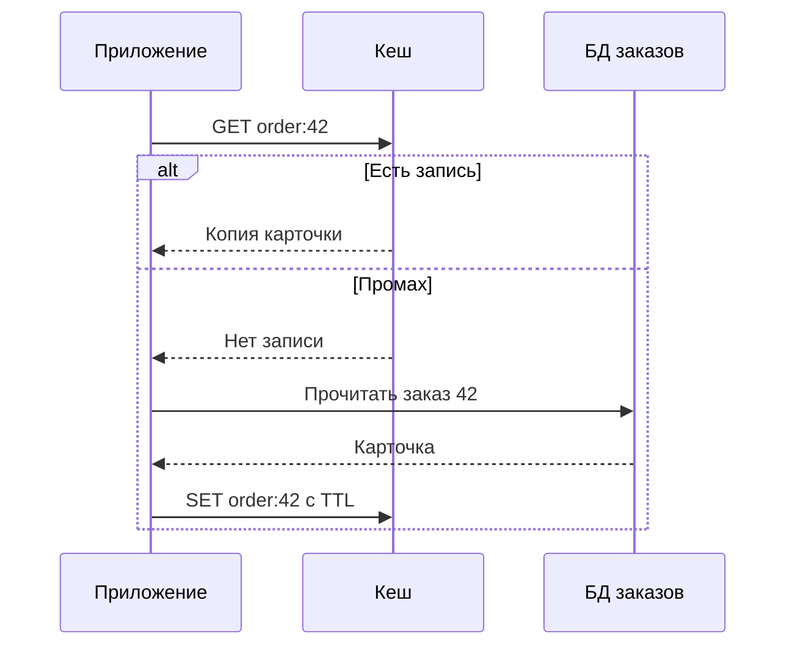
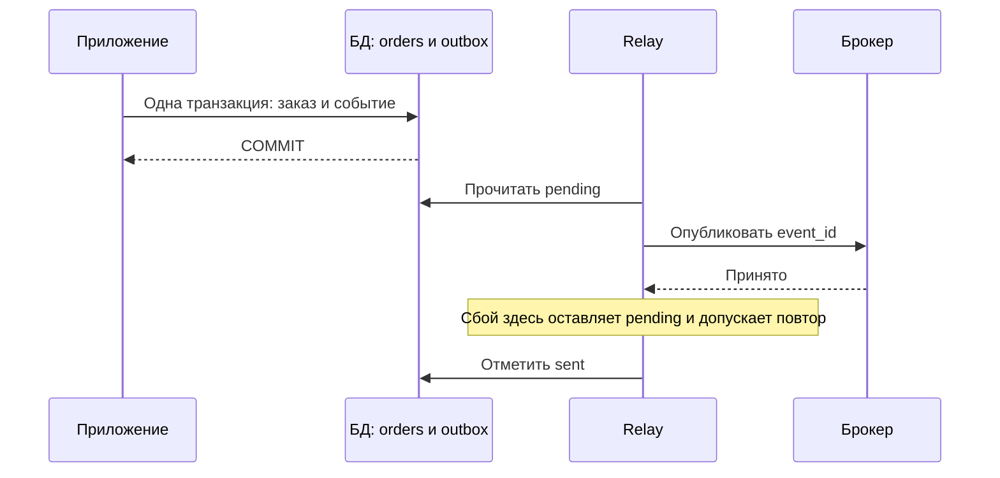
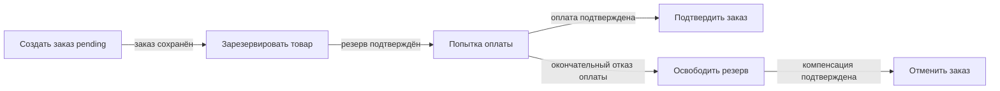
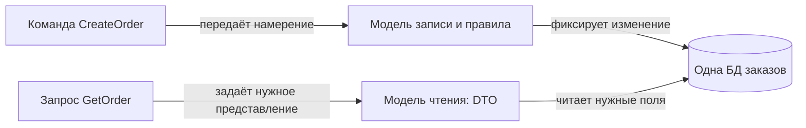
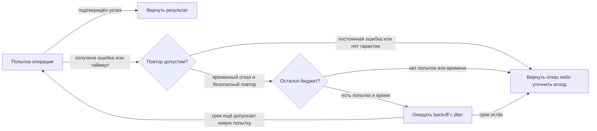

# Данные, повторы и частичный отказ

Карточки разбирают Cache-Aside, Outbox, Saga, CQRS и Retry.
Выберите механизм по отказу.
Проверьте границу гарантии.
Сквозной пример показывает создание и чтение заказа.
Схемы показывают возможные runtime-потоки.
Схемы не показывают imports или готовую конфигурацию.

[К паттернам](README.md) · [Организация приложения](architecture-patterns.md) · [Принципы](../principles.md)

## Быстрый выбор

| Что требуется | Механизм | Где применяется | Чего не обещает |
| --- | --- | --- | --- |
| Сократить повторные дорогие чтения | [Cache-Aside](#cache-aside-читать-через-кеш) | Чтение карточки заказа с допустимой устарелостью | Сильную согласованность кеша и БД |
| Не потерять намерение отправки после записи | [Outbox](#transactional-outbox-сохранить-заказ-и-намерение-публикации) | Одна локальная транзакция заказа и события | Единственную доставку или единственный внешний эффект |
| Завершить или компенсировать общий процесс | [Saga](#saga-согласовать-локальные-шаги) | Заказ, резерв и оплата у разных владельцев данных | Общий ACID rollback и изоляцию всех шагов |
| Развести разные потребности записи и чтения | [CQRS](#cqrs-разделить-модели-записи-и-чтения) | Проверка правил записи и удобная карточка чтения | Необходимость брокера, разных БД или Event Sourcing |
| Пережить распознанный временный отказ | [Retry](#retry-повторить-временный-отказ) | Вызов с безопасной семантикой повтора | Отсутствие двойного эффекта при неизвестном исходе |

[Полный пример Outbox с проверками](#полный-пример-outbox-и-дубликат-публикации) · [Источники](#источники)

| Параметр | Значение |
| --- | --- |
| Уровень | Продвинутый; краткий выбор — в таблице выше, затем карточки и полный пример |
| Предпосылки | Транзакции, таймауты, различие записи и публикации, локальный и сетевой вызов |
| Среда примера | Python 3.14, `sqlite3`; один worker, БД в памяти, список вместо брокера |

## Cache-Aside: читать через кеш

**Что / когда:** приложение само проверяет кеш.
При промахе приложение читает основное хранилище.
Затем приложение заполняет кеш.
Если допустимая устарелость согласована, рассмотрите механизм для повторных дорогих чтений.
**Где:** путь чтения карточки заказа.
Кеш хранит копию.
БД остаётся источником истины.

**Схема runtime-чтения:**

**Результат:** попадание в кеш обслуживается без чтения БД.
В распространённом варианте записи сначала подтвердите изменение БД.
Затем инвалидируйте кеш.
Обновление кеша требует отдельной согласованной политики.
Гонка старого чтения с заполнением или инвалидированием может вернуть старое значение.
TTL ограничивает жизнь конкретной копии.
Сам по себе TTL не доказывает требуемую свежесть всех чтений.

**Проверить:**

- [ ] Проверьте конкурентную запись во время промаха.
- [ ] Проверьте отказ кеша.
- [ ] Проверьте одновременные промахи множества запросов.

Для разных локальных кешей учитывайте независимые копии.
Источник: [Microsoft: Cache-Aside](https://learn.microsoft.com/en-us/azure/architecture/patterns/cache-aside).

## Transactional Outbox: сохранить заказ и намерение публикации

**Что / когда:** одна локальная транзакция фиксирует изменение заказа и событие.
Отдельный relay читает ожидающие события.
Relay публикует эти события.
Рассмотрите механизм при риске «БД записана, брокер не получил».
**Где:** транзакционная граница записи заказа.
Relay находится за этой границей.

**Схема runtime-потока:**

**Результат:** локальный commit сохраняет заказ и намерение отправки.
Relay можно повторить.
Для eventual delivery нужны доступность relay и брокера.
Нужны повторы и достаточное хранение pending.
Сбой после принятия брокером, но до отметки `sent` допускает дубликат.

**Проверить:**

- [ ] Проверьте возраст pending.
- [ ] Проверьте подтверждения брокера.
- [ ] Проверьте порядок.
- [ ] Проверьте workers/lease.
- [ ] Проверьте retention.
- [ ] Проверьте повторные сообщения.

Для локального эффекта consumer включите запись dedup и изменение данных в одну транзакцию.
Для внешнего эффекта нужна поддержка идемпотентности провайдером или другой явно ограниченный протокол.
«Доставили сообщение» не означает «ровно один раз выполнили эффект».
[Самостоятельный пример](outbox-example.md#полный-пример-outbox-и-дубликат-публикации) демонстрирует атомарность и окно дубликата.
Источник: [Microsoft: Transactional Outbox](https://learn.microsoft.com/en-us/azure/architecture/databases/guide/transactional-out-box-cosmos).
Источник использует Cosmos DB / Service Bus.
Учебный пример использует SQLite.

## Saga: согласовать локальные шаги

**Что / когда:** общий процесс разделяется на локальные транзакции участников.
Компенсирующие бизнес-действия обрабатывают отказ.
Если данные принадлежат разным сервисам и общей транзакции нет, рассмотрите Saga.
**Где:** процесс заказа, резерва и оплаты.
Состояние процесса сохраняется отдельно от текущего вызова.

**Условная схема шагов и результатов:** успешный резерв зафиксирован до оплаты.
Отказ оплаты здесь окончательный и известный.
Схема не рассматривает таймаут с неизвестным результатом:

**Результат:** процесс имеет явные промежуточные состояния и пути восстановления.
Компенсация выполняет новое действие.
Компенсация не делает физический rollback уже зафиксированных транзакций.
Сама компенсация может отказать.
Общей изоляции от параллельных процессов нет.

| Координация | Когда рассматривать | Цена |
| --- | --- | --- |
| Choreography | Небольшое число шагов реагируют на события друг друга | Труднее проследить весь процесс и избежать циклических связей |
| Orchestration | Нужны явное состояние и управление сложным процессом | Нужно сопровождать устойчивого координатора |

**Проверить:**

- [ ] Проверьте корреляцию.
- [ ] Проверьте сохранённое состояние шага.
- [ ] Проверьте таймауты.
- [ ] Проверьте идемпотентность.
- [ ] Проверьте повтор компенсации.

Сначала разрешите неизвестный исход оплаты по контракту провайдера.
Не считайте неизвестный исход отказом автоматически.
Для необратимого шага заранее выберите порядок.
Определите ручной или автоматический способ разрешения отказа.
Источник: [Microsoft: Saga](https://learn.microsoft.com/en-us/azure/architecture/patterns/saga).

## CQRS: разделить модели записи и чтения

**Что / когда:** команды используют модель правил изменения.
Запросы используют модель удобного чтения.
Если потребности существенно различаются, рассмотрите CQRS.
Для простого CRUD часто достаточно общей модели.
**Где:** создание заказа и представление карточки или отчёта.
Разделение возможно внутри одного процесса и одной БД.

**Схема runtime-потоков базового варианта с общей БД:**

**Результат:** проверка изменения и представление результата развиваются отдельно.
При отдельных асинхронных проекциях добавляются доставка и дубликаты.
Добавляются перестроение проекции и отставание чтения.
После успешной команды карточка может показывать прежнюю версию.

**Проверить:** определите, нужен ли клиенту read-your-writes.
Если проекция асинхронна, определите способ обнаружения отставания.
CQRS не требует Event Sourcing.
Event Sourcing хранит события как источник восстановления состояния.
Это отдельное решение.
Оно требует учитывать версии событий, replay и эволюцию схемы.
Источник: [Microsoft: CQRS](https://learn.microsoft.com/en-us/azure/architecture/patterns/cqrs).

## Retry: повторить временный отказ

**Что / когда:** ограниченно повторите операцию, если распознанная временная ошибка может исчезнуть.
**Где:** один слой, который понимает весь контекст операции.
Этот слой учитывает общий срок операции.
Этот слой учитывает семантику повторного эффекта.

**Схема решения после попытки** показывает политику.
Она не является исполняемым алгоритмом:

**Результат:** краткий сбой может быть скрыт от потребителя без бесконечного ожидания.
Таймаут записи не доказывает отсутствие эффекта.
Сервис мог выполнить запрос и потерять ответ.
Для повтора нужна идемпотентная операция либо поддерживаемый получателем `operation_id`/ключ.
Само добавление поля в запрос не обеспечивает dedup.

**Проверить:**

- [ ] Проверьте классификацию ошибок.
- [ ] Проверьте timeout каждой попытки.
- [ ] Проверьте общий deadline.
- [ ] Проверьте лимит попыток.
- [ ] Проверьте backoff/jitter.
- [ ] Проверьте встроенные повторы SDK.

Не повторяйте ошибки валидации и отказа доступа как временный сбой.
Не умножайте независимые повторы на каждом слое.
Длительная недоступность требует отдельного решения.
Пример такого решения — прекращение запросов через circuit breaker вместо увеличения числа попыток.
Источник: [Microsoft: Retry](https://learn.microsoft.com/en-us/azure/architecture/patterns/retry).

## Полный пример: Outbox и дубликат публикации

[Запустите самостоятельный пример](outbox-example.md#полный-пример-outbox-и-дубликат-публикации).
Пример проверяет rollback заказа при ошибке записи события.
Пример также показывает повтор публикации после сбоя отправителя.
Пример использует Python 3.14 и SQLite в памяти без внешних служб.

## Источники

- [Microsoft: Cache-Aside](https://learn.microsoft.com/en-us/azure/architecture/patterns/cache-aside).
- [Microsoft: Transactional Outbox](https://learn.microsoft.com/en-us/azure/architecture/databases/guide/transactional-out-box-cosmos).
- [Microsoft: Saga](https://learn.microsoft.com/en-us/azure/architecture/patterns/saga).
- [Microsoft: CQRS](https://learn.microsoft.com/en-us/azure/architecture/patterns/cqrs).
- [Microsoft: Retry](https://learn.microsoft.com/en-us/azure/architecture/patterns/retry).
- [Python sqlite3 3.14](https://docs.python.org/3.14/library/sqlite3.html) — локальная учебная транзакция, не реализация Azure SDK.
