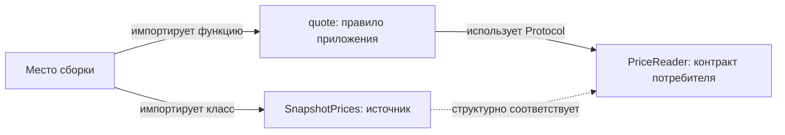

# SOLID

SOLID предлагает пять способов сделать изменение кода управляемым.
Разделите причины изменений.
Выделите нужную вариацию.
Сохраните контракт.
Направьте зависимости к потребителю.
Применяйте принципы к функциям и модулям так же, как к классам.

## Быстрый поиск

| Принцип | Проблема → изменение | Карточка |
| --- | --- | --- |
| **S — Single Responsibility** | Тариф и формат ответа меняют один модуль → разделить причины изменений | [S: расчёт и JSON](#s--причины-изменений) |
| **O — Open/Closed** | Каждый новый тариф меняет потребителя → передать правило расчёта | [O: точка расширения](#o--обоснованная-точка-расширения) |
| **L — Liskov Substitution** | Замена источника меняет ошибки → проверить обещанное поведение | [L: контракт цены](#l--поведенческая-подстановка) |
| **I — Interface Segregation** | Чтение зависит от большого API БД → дать нужную клиенту роль | [I: только price](#i--интерфейс-под-потребителя) |
| **D — Dependency Inversion** | Расчёт знает SDK/ORM → деталь подстроить под контракт приложения | [DIP и DI](#d--направление-зависимости-di--способ-передачи) |

[К архитектуре](README.md) · [Базовый](#базовый-уровень) · [Средний](#средний-уровень) · [Продвинутый](#продвинутый-уровень) · [Полные проверки](contracts.md) · [Ошибки](#частые-ошибки)

**Предпосылки:** функции, композиция, исключения и duck typing.
Примеры используют Python 3.14.
Конечный набор тестов не доказывает контракт для всех входов и реализаций.

## Базовый уровень

### S — причины изменений

**Проблема:** требования к цене и JSON-ответу приходят независимо.
При этом оба требования меняют одну функцию.
**Изменение:** отделите расчёт от представления.
Расчёт возвращает значение.
Представление оформляет значение.

| До | После | Что остаётся общим |
| --- | --- | --- |
| `invoice_before` знает цену и JSON | `total` знает расчёт, `invoice_json` — формат | Место вызова связывает обе операции |

Полный мини-пример использует положительное количество и фиксированную цену в центах.
Сохраните код как `solid-srp.py`.
Выполните `python3.14 solid-srp.py`.
Зависимости не нужны.
Валидация количества в этом мини-примере опущена.
Рабочая валидация есть в [полном контракте](contracts.md#подстановка-источника-цен).

<!-- example: architecture/solid-srp.py -->
```python
import json


# До: два независимых повода менять одну функцию.
def invoice_before(quantity: int) -> str:
    return json.dumps({"total": 1200 * quantity})


# После: правило расчёта и формат ответа можно менять отдельно.
def total(quantity: int) -> int:
    return 1200 * quantity


def invoice_json(amount: int) -> str:
    return json.dumps({"total": amount})


assert invoice_json(total(2)) == invoice_before(2) == '{"total": 2400}'
```

**Результат:** ответ сохранился.
SRP связывает ответственность с actor — источником требований.
SRP не задаёт правило «один метод на класс».
Если причины изменений связаны, дробление может не помочь.

### O — обоснованная точка расширения

**Проблема:** добавление тарифа требует править устойчивый расчёт.
**Изменение:** выберите ожидаемую вариацию — формулу тарифа.
Передавайте формулу как callable.

| До | После | Где меняется выбор |
| --- | --- | --- |
| Ветвления по имени тарифа внутри потребителя | Потребитель вызывает переданное правило | В месте сборки; [пример Factory](patterns/design-patterns.md#factory-собрать-нужную-реализацию) |

Полный мини-пример использует целое положительное количество.
Сохраните код как `solid-ocp.py`.
Выполните `python3.14 solid-ocp.py`.
Зависимости не нужны.

<!-- example: architecture/solid-ocp.py -->
```python
from collections.abc import Callable


# До: новый вид цены требует новой ветки здесь.
def quote_before(quantity: int, kind: str) -> int:
    if kind == "regular":
        return quantity * 1200
    raise ValueError("Неизвестный тариф")


# После: добавление функции тарифа не меняет этого потребителя.
def quote_with(quantity: int, rule: Callable[[int], int]) -> int:
    return rule(quantity)


assert quote_with(2, lambda q: q * 1200) == quote_before(2, "regular") == 2400
assert quote_with(2, lambda q: q * 1000) == 2000
```

**Результат:** один потребитель работает с двумя правилами.
Открытость относится к выбранной вариации.
Исправления требуют редактирования.
Изменение самого контракта тоже требует редактирования.
Защитить код от всех будущих изменений невозможно.

## Средний уровень

### L — поведенческая подстановка

**Проблема:** источник с тем же методом незаметно возвращает `0` для неизвестного товара.
**Изменение:** проверьте обещанное потребителю поведение.
Проверьте предусловия, результат, ошибки и эффекты.

| До: несовместимый снимок | После: совместимый снимок |
| --- | --- |
| `prices.get(sku, 0)` скрывает отсутствие товара | `prices[sku]` даёт обещанный `KeyError` |
| Сигнатура совпала, поведение отличается | Клиент сохраняет обработку отказа |

Конкретный контракт для обеих реализаций:

| Вход / операция | Обещание `PriceReader` |
| --- | --- |
| Известный `book` | Целая неотрицательная цена в центах |
| Неизвестный `sku` | `KeyError` |
| Повторное чтение снимка | Та же цена, без изменения снимка |

Фрагмент после определений из [полного `solid-contract.py`](contracts.md#подстановка-источника-цен):

```python
reader = SnapshotPrices({"book": 1200})
check_reader_contract(reader)
assert quote(reader, "book", 2) == 2400
```

**Результат:** совместимый источник проходит проверку.
Полный пример отвергает `SilentMissingPrices`.
Реализация не усиливает обещанные предусловия.
Реализация не ослабляет результат.
Наследование не обязательно.
Правило относится и к duck typing / `Protocol`.

### I — интерфейс под потребителя

**Проблема:** для расчёта цены передают объект с `price`, `delete`, `commit`, `export`.
**Изменение:** опишите роль чтения, которая нужна этому клиенту.

| До | После |
| --- | --- |
| Потребитель аннотирован большим API хранилища | Потребитель знает только `PriceReader` |
| Изменения ненужных операций затрагивают его зависимость | Запись и экспорт имеют других потребителей |

Фрагмент интерфейса взят из [полного примера](contracts.md#подстановка-источника-цен).
Многоточие объявляет метод `Protocol`.
Реализация находится в `SnapshotPrices`:

```python
from typing import Protocol


class PriceReader(Protocol):
    def price(self, sku: str) -> int: ...
```

**Применение:** вызовите `quote(reader, "book", 2)` из карточки L.
Объект может иметь другие методы.
Контракт клиента не требует этих методов.
ISP не обязывает создавать интерфейс на каждый метод.
`Protocol` предназначен для статической проверки.
Аннотации не проверяют поведение при запуске.

### Полный пример: контракт вместо формы метода

[Исходник, запуск и проверки успеха/отказов](contracts.md#подстановка-источника-цен) вынесены отдельно.
Сохранена проверка количества `0`.
Сохранено обнаружение реализации с неправильным поведением ошибки.

## Продвинутый уровень

### D — направление зависимости; DI — способ передачи

**Проблема:** функция расчёта создаёт конкретный SDK-клиент.
Функция зависит от формата SDK.
**Изменение:** задайте контракт цены на стороне приложения.
Техническая деталь предоставляет реализацию контракта.

| До | После |
| --- | --- |
| Расчёт знает класс SDK и его ответ | Расчёт использует `PriceReader.price` |
| Для теста нужно создать SDK-клиент | В сборке передаётся `SnapshotPrices` или другой совместимый источник |

**Зависимости кода:** сплошная стрелка обозначает знание API.
Пунктир обозначает структурное соответствие.
Python-адаптеру не обязательно импортировать `Protocol`.



Фрагмент сборки после определений [полного примера](contracts.md#подстановка-источника-цен):

```python
reader = SnapshotPrices({"book": 1200})
amount = quote(reader, "book", 2)
assert amount == 2400
```

**Во время выполнения** `quote` вызывает `price` у переданного объекта.
**DI** — передача `reader` аргументом.
**DIP** — зависимость правила от своего контракта.
Техническая деталь подстраивается под этот контракт.
Внедрение конкретного SQL-клиента само по себе не обеспечивает DIP.
Возможные [модули примера](contracts.md#возможное-размещение-по-модулям) показаны отдельно.
DI-контейнер не нужен.

### Проверять цену абстракции

Используйте общие проверки для реализаций.

- [ ] Укажите потребителя.
- [ ] Укажите конкретное изменение, которое упрощает граница.
- [ ] Проверьте результат новой реализации.
- [ ] Проверьте ошибки новой реализации.
- [ ] Проверьте эффекты новой реализации.
- [ ] Проверьте, оправдана ли цена контракта текущей задачей.
- [ ] Проверьте, оправдана ли цена места сборки текущей задачей.

Если единственная реализация проста и не мешает изменению или тесту, дополнительный `Protocol` может быть лишним.
При замене памяти БД согласуйте транзакции.
Согласуйте `NULL`, ошибки и свежесть данных.
Статический анализ не проверяет сетевые отказы.
Локальные тесты тоже не проверяют сетевые отказы.

## Частые ошибки

| Ошибка | Уточнение |
| --- | --- |
| SRP = одна функция | Причина изменения связана с требованиями actor |
| OCP запрещает редактировать код | Защищена определённая вариация, а не все будущие изменения |
| LSP = метод существует / isinstance прошёл | Нужен поведенческий контракт |
| ISP требует раздробить любой интерфейс | Граница следует из потребностей клиента |
| DIP = библиотека DI | Направление зависимости и способ передачи — разные решения |
| SOLID требует наследования | Композиция, функции и структурные контракты часто достаточны |

## Источники

- [Robert C. Martin: Solid Relevance](https://blog.cleancoder.com/uncle-bob/2020/10/18/Solid-Relevance.html), [SRP](https://blog.cleancoder.com/uncle-bob/2014/05/08/SingleReponsibilityPrinciple.html).
- [Liskov / Wing: A Behavioral Notion of Subtyping](https://www.cs.cmu.edu/~wing/publications/LiskovWing94.pdf).
- [PEP 544](https://peps.python.org/pep-0544/), [Python 3.14: Protocol](https://docs.python.org/3.14/library/typing.html#typing.Protocol).
