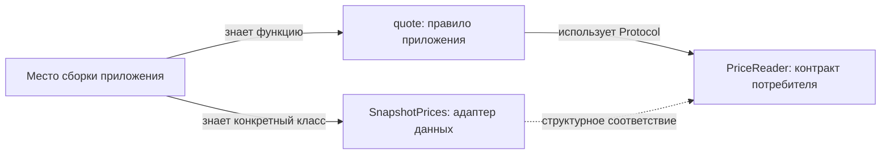

# SOLID

Пять принципов помогают обсуждать причины изменений, контракты и направление зависимостей.
Они применимы к модулям и функциям, а не только к иерархиям классов.

[К архитектуре](README.md) · [Общие принципы](principles.md) · [Паттерны кода](patterns/design-patterns.md)

| Параметр | Значение |
| --- | --- |
| Предпосылки | Интерфейсы/duck typing, зависимости и тесты; Python 3.14 Protocol |
| Концепции сверены | 2026-11-06, Martin, Liskov/Wing и PEP 544; это обзор принципов |
| Выполнено | 2026-11-06, Python 3.14.7: полный пример; корректный расчёт, отказ количества 0 и обнаружение реализации, нарушающей контракт ошибки |
| Границы | Конечный набор контрактных тестов не доказывает подстановочность для всех реализаций/входов |

## Навигация

- [Быстрый поиск](#быстрый-поиск)
- [Базовый уровень](#базовый-уровень)
- [Средний уровень](#средний-уровень)
- [Продвинутый уровень](#продвинутый-уровень)
- [Частые ошибки](#частые-ошибки)
- [Источники](#источники)

## Быстрый поиск

| Принцип | Вопрос при изменении |
| --- | --- |
| S — Single Responsibility | Чьи разные требования заставляют менять этот модуль? |
| O — Open/Closed | Можно ли добавить ожидаемый вариант через понятную точку расширения? |
| L — Liskov Substitution | Сохраняет ли реализация обещанное поведение для потребителя? |
| I — Interface Segregation | Не зависит ли потребитель от операций, которые ему не нужны? |
| D — Dependency Inversion | Кто определяет контракт: правило приложения или внешний технический инструмент? |

## Базовый уровень

### S — причины изменений

SRP — про согласованную ответственность перед actor, то есть источником связанных требований,
а не «один метод на класс». Например, изменение правил расчёта доставки и смена JSON-формата SDK
могут иметь разные причины. Разделение имеет смысл, если эти изменения действительно независимы;
общую мелкую функцию не нужно дробить только ради количества обязанностей в описании.

### O — обоснованная точка расширения

OCP предлагает защищать устойчивую часть от определённого вида изменений.
Например, расчёт принимает стратегию тарифа вместо знания о каждом перевозчике.
Открытость выбирается относительно ожидаемой вариации: нельзя закрыть код от всех будущих изменений.
Исправления ошибок и изменение самого контракта всё равно требуют редактирования.

## Средний уровень

### L — поведенческая подстановка

Совпадение методов недостаточно: реализация сохраняет предусловия, постусловия, инварианты
и значимые для клиента правила ошибок/побочных эффектов.
Она не должна требовать более сильного входа, чем обещает интерфейс, или давать более слабый результат.
Наследование не обязательно: правило относится также к duck typing и Protocol.

### I — интерфейс под потребителя

Читателю цены нужен `price(sku)`, а не также delete/commit/export всей базы.
Небольшие интерфейсы выводят из потребностей клиента; это не требование сделать отдельный интерфейс
для каждого метода. Один объект может реализовывать несколько ролей.

### Полный пример: контракт вместо формы метода

Сохраните как `solid-contract.py`, выполните `python3.14 solid-contract.py`; pip не нужен.
Контракт снимка цен: известный book имеет неотрицательную целую цену в условных центах,
неизвестный sku вызывает KeyError, чтение снимка не изменяет значение.

<!-- example: architecture/solid-contract.py -->
```python
from typing import Protocol


class PriceReader(Protocol):
    def price(self, sku: str) -> int: ...


class SnapshotPrices:
    def __init__(self, prices: dict[str, int]):
        if any(type(value) is not int or value < 0 for value in prices.values()):
            raise ValueError("Цена должна быть целой и неотрицательной")
        self._prices = dict(prices)

    def price(self, sku: str) -> int:
        return self._prices[sku]


class SilentMissingPrices:
    # Форма метода совпала, но неизвестный sku скрывается вместо KeyError.
    def price(self, sku: str) -> int:
        return {"book": 1200}.get(sku, 0)


def quote(reader: PriceReader, sku: str, quantity: int) -> int:
    if type(quantity) is not int or quantity <= 0:
        raise ValueError("Количество должно быть целым положительным")
    return reader.price(sku) * quantity


def check_reader_contract(reader: PriceReader) -> None:
    value = reader.price("book")
    assert type(value) is int and value >= 0
    assert reader.price("book") == value
    try:
        reader.price("missing")
    except KeyError:
        pass
    else:
        raise AssertionError("Реализация скрыла неизвестный sku")


reader = SnapshotPrices({"book": 1200})
check_reader_contract(reader)
assert quote(reader, "book", 2) == 2400
try:
    quote(reader, "book", 0)
except ValueError:
    pass
else:
    raise AssertionError("Ожидался отказ для количества 0")
try:
    check_reader_contract(SilentMissingPrices())
except AssertionError as error:
    assert "sku" in str(error)
else:
    raise AssertionError("Контракт должен обнаружить несовместимую реализацию")
print("OK: consumer contract, valid substitution and incompatible implementation detected")
```

**Результат:** OK. Обе реализации имеют одинаковую сигнатуру, но одна нарушает договорённость об ошибке.
Protocol описывает структурную типизацию для статической проверки; аннотации не проверяют этот контракт
автоматически при запуске. Даже runtime_checkable не заменяет проверку семантики и всех типов методов.
Статический анализатор здесь не запускался; выполнены именно поведенческие проверки.

## Продвинутый уровень

### D — направление зависимости; DI — способ передачи

DIP: политика высокого уровня зависит от подходящей абстракции; техническая деталь подстраивается под неё.
В примере потребитель quote знает PriceReader, но не способ получения цен.
Передача reader аргументом — dependency injection, механика сборки объектов.
Можно внедрить конкретный SQL-клиент и всё равно связать правило с его API: наличие DI ещё не означает DIP.

Сплошные стрелки ниже обозначают **зависимости кода**, а не порядок вызовов.
Пунктир — структурное соответствие: в Python адаптеру не обязательно импортировать Protocol.



Во время выполнения quote вызывает метод конкретного объекта; это не требует импорта его класса внутрь quote.
В одном файле примера логические роли показаны рядом; реальные модульные границы выбираются по проекту.
Framework/container для DI не обязателен.

### Проверять цену абстракции

Сначала определите клиента и конкретное изменение. Затем сравните варианты по числу необходимых
знаний, обработке ошибок и понятности тестов. Если единственная реализация проста и деталь не мешает
ни изменению, ни проверке правила, дополнительный Protocol может оказаться лишним.
LSP-тесты особенно важны при замене памяти реальной БД: согласуйте ошибки, транзакции, NULL и свежесть данных.

## Частые ошибки

| Ошибка | Уточнение |
| --- | --- |
| SRP = одна функция | Причина изменения связана с требованиями actor, не счётчиком методов |
| OCP запрещает менять существующий код | Выделяется определённая точка расширения; контракт тоже может измениться |
| LSP = метод существует / isinstance прошёл | Нужен поведенческий контракт |
| ISP требует раздробить любой интерфейс | Граница следует из потребностей потребителей |
| DIP = библиотека DI | Направление зависимости и способ передачи объекта — разные решения |
| SOLID требует наследования | Композиция, функции и структурные контракты часто достаточны |

## Источники

- [Robert C. Martin: Solid Relevance](https://blog.cleancoder.com/uncle-bob/2020/10/18/Solid-Relevance.html), [SRP и причины изменений](https://blog.cleancoder.com/uncle-bob/2014/05/08/SingleReponsibilityPrinciple.html).
- [Liskov / Wing: A Behavioral Notion of Subtyping](https://www.cs.cmu.edu/~wing/publications/LiskovWing94.pdf).
- [PEP 544: Protocols](https://peps.python.org/pep-0544/), [typing.Protocol Python 3.14](https://docs.python.org/3.14/library/typing.html#typing.Protocol).
