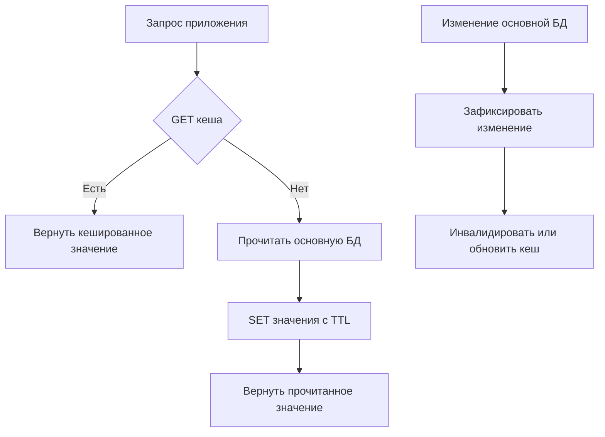

# Структуры, TTL и кеширование

[К Redis](README.md)

| Параметр | Значение |
| --- | --- |
| Уровни | Базовый — структуры/TTL; средний — кеширование |
| Предпосылки | Выделенный Redis 8.2, Python 3.14 и redis-py 8.1.0 |
| Сверено с документацией | 2026-11-06 |
| Выполнено | 2026-11-06: полный пример на Redis 8.2.11 / redis-py 8.1.0 / Python 3.14.7, выделенный Unix socket; проверены структуры, INCR, KEEPTTL и истечение; ключи очищены |
| Не проверено | Прикладная cache-aside интеграция, нагрузка, eviction и отказы сервера |

## Подготовка

Установите клиент в отдельное временное/учебное окружение: `python -m pip install 'redis==8.1.0'`.
Сначала подготовьте [изолированный Redis](operations.md#учебный-экземпляр), проверьте его адрес
и задайте REDIS_URL. Пример для собственного Unix socket: `export REDIS_URL='unix:///путь/redis.sock?db=0'`.
Для выделенного TCP-экземпляра используется `redis://127.0.0.1:порт/0`.
Это формы адресов; не направляйте примеры в рабочую БД.

## Полный пример: структуры и TTL

Сохраните как `data.py`, выполните `python data.py`. Все ключи получают уникальный namespace;
finally удаляет только явно созданные ключи. Временная память этого примера очищается также при успешном запуске.

<!-- example: redis/data.py -->
```python
import os
import time
import uuid
from redis import Redis

client = Redis.from_url(os.environ["REDIS_URL"], decode_responses=True, socket_timeout=3)
prefix = f"cheatsheet:{{{uuid.uuid4().hex}}}:"
cache, counter, profile, tags, queue, ranking = [
    prefix + name for name in ("cache", "counter", "profile", "tags", "queue", "ranking")
]
keys = [cache, counter, profile, tags, queue, ranking]
try:
    assert client.ping()
    assert client.set(cache, '{"name":"Ada"}', ex=60, nx=True)
    assert 0 < client.ttl(cache) <= 60
    client.set(cache, '{"name":"Ada Lovelace"}', keepttl=True)
    assert 0 < client.ttl(cache) <= 60
    assert client.pexpire(cache, 0)
    assert client.ttl(cache) == -2
    client.set(cache, "temporary", px=40)
    time.sleep(0.08)
    assert client.get(cache) is None

    assert client.incrby(counter, 2) == 2
    client.hset(profile, mapping={"name": "Ada", "language": "Python"})
    assert client.hgetall(profile) == {"name": "Ada", "language": "Python"}
    client.sadd(tags, "sql", "python", "sql")
    assert client.smembers(tags) == {"sql", "python"}
    client.rpush(queue, "first", "second")
    assert client.lpop(queue) == "first"
    assert client.lrange(queue, 0, -1) == ["second"]
    client.zadd(ranking, {"Ada": 10, "Bob": 20})
    assert client.zrevrange(ranking, 0, 0, withscores=True) == [("Bob", 20.0)]
    print("OK: structures, atomic counter, TTL preservation and expiry")
finally:
    client.unlink(*keys)
    client.close()
```

**Результат:** строка OK, исключений нет; только собственные ключи удалены.
Это проверки корректности, не замер скорости или точности таймера.
List с LPOP выше показывает порядок, но не надёжную очередь задач: после извлечения нет ACK/повторной доставки.
Для такого протокола нужен другой дизайн, например [stream](transactions-and-messaging.md#полный-пример-stream-и-pubsub).

| Данные | Команды | Ограничение |
| --- | --- | --- |
| String / двоичное значение | SET/GET/MGET, INCR | INCR требует строковое целое; сериализацию объекта выбирает приложение |
| Hash | HSET/HGET/HGETALL | Отдельные поля; тип/валидацию полей определяет приложение |
| List | LPUSH/RPUSH/LPOP/LRANGE | Порядок элементов; большие диапазоны дорого передавать |
| Set | SADD/SISMEMBER/SINTER | Уникальность, порядок не гарантирован |
| Sorted set | ZADD/ZRANGE/ZREVRANGE | Сортировка по score, при равенстве — правила структуры |
| Bitmap / HyperLogLog / geo | SETBIT / PFADD / GEOADD | Специализированные задачи; HyperLogLog даёт оценку количества, не точное множество |
| Stream | XADD/XREADGROUP/XACK | Журнал сообщений и учёт доставки; сохраняемость зависит от конфигурации |

Проверить тип помогает TYPE; переиспользование имени для другой структуры даёт WRONGTYPE.
TTL/PTTL возвращают секунды/миллисекунды; EXPIRE/PEXPIRE меняют срок, PERSIST снимает его.
Замена значения SET обычно удаляет TTL, а INCR/HSET не заменяют весь ключ этим способом.
Для обхода большого namespace используйте SCAN с MATCH/COUNT и учитывайте возможные повторы/изменения во время обхода;
COUNT — подсказка, а не жёсткий размер порции.

## Кеширование cache-aside

**Средний уровень.** Источник истины находится в основной БД; Redis хранит копию с ограниченным сроком.



Это схема протокола, а не обещание строгой согласованности: конкурентное чтение может заполнить кеш
старым значением после инвалидирования. Выберите допустимую устарелость, версионирование или другой протокол.
Добавляйте небольшой разброс TTL против массового одновременного истечения; ограничивайте параллельное
заполнение горячего ключа. Для отсутствующих объектов можно кешировать специальный отрицательный ответ на короткий срок.

Ошибка кеша не должна молча перегрузить основную БД: нужны лимиты, наблюдение и определённый fallback.
Отдельно задают maxmemory и eviction policy. Кешируемые и незаменимые данные часто стоит разделить
по экземплярам, чтобы вытеснение кеша не стало потерей прикладного состояния.
SET NX PX может быть частью блокировки, но безопасное освобождение требует проверки токена;
это не готовая распределённая блокировка без анализа отказов.

## Источники

- [Структуры](https://redis.io/docs/latest/develop/data-types/), [SET](https://redis.io/docs/latest/commands/set/), [EXPIRE](https://redis.io/docs/latest/commands/expire/), [TTL](https://redis.io/docs/latest/commands/ttl/).
- [SCAN](https://redis.io/docs/latest/commands/scan/), [eviction](https://redis.io/docs/latest/develop/reference/eviction/), [cache-aside](https://redis.io/tutorials/howtos/solutions/microservices/caching/).
