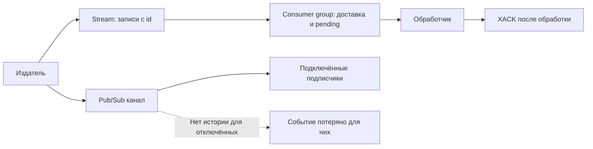

# Атомарные изменения и доставка сообщений

[К Redis](README.md)

| Параметр | Значение |
| --- | --- |
| Уровни | Средний — pipeline/MULTI/WATCH; продвинутый — stream/доставка |
| Предпосылки | Подготовка и REDIS_URL из [первого примера](data-and-caching.md#подготовка); standalone Redis 8.2 |
| Сверено с документацией | 2026-11-06 |
| Выполнено | 2026-11-06: оба полных сценария на Redis 8.2.11 / redis-py 8.1.0 / Python 3.14.7; проверены WATCH-отказ, runtime error без rollback, pending/ACK и Pub/Sub; свой Unix socket и ключи |
| Не проверено | Cluster, failover, падение consumer с внешним побочным эффектом и повторная доставка при авариях |

## Атомарность, транзакция и pipeline

| Механизм | Для чего | Чего не гарантирует |
| --- | --- | --- |
| Одна команда, например INCR | Атомарное изменение одного значения | Сохранность на диске при любой конфигурации |
| Pipeline | Отправка нескольких команд без отдельного ожидания каждого ответа | Отсутствие вмешательства других клиентов, если нет MULTI/EXEC |
| MULTI → команды → EXEC | Выполнение группы без команд другого клиента внутри группы | Откат успешных команд после runtime error одной команды |
| WATCH → чтение → MULTI/EXEC | Оптимистическая проверка отсутствия изменения наблюдаемого ключа | Успех без повторов; данные могут измениться и EXEC отменится |
| Lua / Redis Functions | Чтение, проверка и изменение на сервере в одной атомарной операции | Автоматический rollback уже сделанных записей при любой ошибке; бесконечный ресурс времени |

redis-py `pipeline()` по умолчанию использует транзакцию.
Для чистого pipeline явно задайте transaction=False.
WATCH привязывает соединение до завершения или reset.
Используйте контекстный менеджер.
DISCARD отменяет очередь до EXEC.
Ошибки постановки команд отличаются от ошибок исполнения.
При ошибке исполнения проверьте каждый результат.
Не предполагайте полный откат.

## Полный пример: конфликт и ошибка команды

Сохраните пример как `transactions.py`.
Выполните `python transactions.py` в подготовленном окружении.
Скрипт намеренно вызывает конфликт WATCH и ошибку INCR.
Скрипт проверяет оба результата и удаляет только свои ключи.

<!-- example: redis/transactions.py -->
```python
import os
import uuid
from redis import Redis
from redis.exceptions import ResponseError, WatchError

client = Redis.from_url(os.environ["REDIS_URL"], decode_responses=True, socket_timeout=3)
prefix = f"cheatsheet:{{{uuid.uuid4().hex}}}:"
counter, bad, after = [prefix + name for name in ("counter", "bad", "after")]
try:
    with client.pipeline(transaction=False) as pipe:
        pipe.incr(counter)
        pipe.incr(counter)
        pipe.get(counter)
        assert pipe.execute() == [1, 2, "2"]

    client.set(counter, 0)
    with client.pipeline() as pipe:
        pipe.watch(counter)
        observed = int(pipe.get(counter))
        client.incr(counter)  # Другой запрос через другое соединение пула.
        pipe.multi()
        pipe.set(counter, observed + 10)
        try:
            pipe.execute()
        except WatchError:
            pass
        else:
            raise AssertionError("WATCH должен отклонить изменение")
    assert client.get(counter) == "1"

    with client.pipeline(transaction=True) as pipe:
        pipe.incr(counter)
        pipe.expire(counter, 60)
        assert pipe.execute() == [2, True]

    client.set(bad, "not-an-integer")
    with client.pipeline(transaction=True) as pipe:
        pipe.incr(bad)
        pipe.set(after, "applied")
        results = pipe.execute(raise_on_error=False)
    assert isinstance(results[0], ResponseError)
    assert results[1] is True
    assert client.get(after) == "applied"
    print("OK: pipeline, WATCH conflict, MULTI/EXEC and no runtime rollback")
finally:
    client.unlink(counter, bad, after)
    client.close()
```

Результат — OK.
После WatchError приложение обычно читает данные заново и ограниченно повторяет операцию.
Пример намеренно не повторяет операцию, чтобы явно проверить отказ.
Для нескольких ключей в Redis Cluster нужна совместимость hash slots.
Операции одной транзакции не образуют распределённую транзакцию по произвольным шардам.

## Полный пример: stream и Pub/Sub

**Продвинутый уровень.** Сохраните пример как `messaging.py`.
Выполните `python messaging.py`.
Пример создаёт stream с собственной группой.
Pub/Sub-подписка ограничена одной доставкой без бесконечного цикла.

<!-- example: redis/messaging.py -->
```python
import os
import uuid
from redis import Redis

client = Redis.from_url(os.environ["REDIS_URL"], decode_responses=True, socket_timeout=3)
prefix = f"cheatsheet:{{{uuid.uuid4().hex}}}:"
stream, channel = prefix + "stream", prefix + "channel"
try:
    client.xgroup_create(stream, "workers", id="0", mkstream=True)
    message_id = client.xadd(stream, {"order_id": "42"})
    deliveries = client.xreadgroup("workers", "worker-1", {stream: ">"}, count=1, block=500)
    assert deliveries == [[stream, [(message_id, {"order_id": "42"})]]]
    assert client.xpending(stream, "workers")["pending"] == 1
    # Здесь должна завершиться прикладная обработка; только затем ACK.
    assert client.xack(stream, "workers", message_id) == 1
    assert client.xpending(stream, "workers")["pending"] == 0

    with client.pubsub() as subscriber:
        subscriber.subscribe(channel)
        confirmation = subscriber.get_message(timeout=1)
        assert confirmation is not None and confirmation["type"] == "subscribe"
        assert client.publish(channel, "updated") == 1
        notification = subscriber.get_message(timeout=1)
        assert notification is not None
        assert notification["type"] == "message" and notification["data"] == "updated"
    print("OK: stream delivery/pending/ACK and bounded Pub/Sub notification")
finally:
    client.unlink(stream)
    client.close()
```

Результат — OK.
Пример проверяет доставку, pending до ACK и отсутствие pending после ACK.
В примере нет внешнего побочного эффекта.
В реальной обработке отправляйте ACK после надёжного завершения работы.
При повторной доставке обработчик должен быть идемпотентным.



Stream сохраняет записи до удаления или обрезки.
Сохранность при сбое зависит от persistence.
XACK снимает запись с pending без удаления записи из stream.
Наблюдайте зависшие pending.
Переназначайте зависшие pending через XAUTOCLAIM или другой протокол.
Обрабатывайте повторы.
Согласуйте retention/MAXLEN с задержкой consumers.
Один ACK не восстановит удалённое тело сообщения.
Pub/Sub имеет at-most-once доставку.
Отключение или ошибка подписчика не создаёт очередь повторов.

## Источники

- [Транзакции / WATCH / ошибки](https://redis.io/docs/latest/develop/using-commands/transactions/), [pipelining](https://redis.io/docs/latest/develop/using-commands/pipelining/).
- [Streams](https://redis.io/docs/latest/develop/data-types/streams/), [XACK](https://redis.io/docs/latest/commands/xack/), [XAUTOCLAIM](https://redis.io/docs/latest/commands/xautoclaim/).
- [Pub/Sub и гарантии](https://redis.io/docs/latest/develop/pubsub/), [redis-py pipeline](https://redis.readthedocs.io/en/stable/advanced_features.html).
