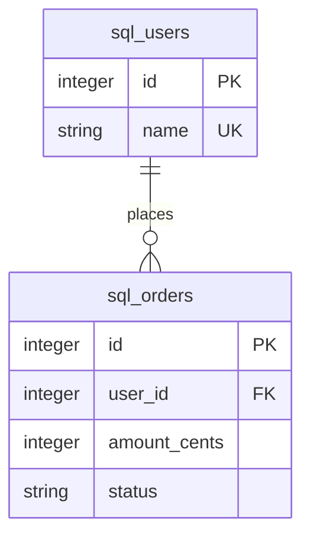

# Запросы на согласованном наборе данных

[К SQL](README.md)

| Параметр | Значение |
| --- | --- |
| Уровни | Базовый — CRUD/фильтры; средний — JOIN/группы; продвинутый — окна/рекурсия |
| Предпосылки | Новая учебная БД PostgreSQL 18 или SQLite 3.53; имена sql_users/sql_orders свободны |
| Сверено с документацией | 2026-11-06 |
| Выполнено | 2026-11-06: все 5 SQL-блоков страницы, точные результаты и сохранение данных после отката на SQLite 3.53.4 / Python 3.14.7 и PostgreSQL 18.6 / PGlite 0.5.15 (WebAssembly, в памяти) |
| Не проверено | Показанные команды CLI, MySQL/SQL Server и конкурентные сеансы |

## Полный пример

**Базовый уровень.** Сохраните SQL как `demo.sql`. В PostgreSQL запускайте в отдельной учебной БД
через `psql -X --set=ON_ERROR_STOP=1 --dbname=имя_учебной_бд --file=demo.sql`;
в SQLite — через `sqlite3 -bail -cmd 'PRAGMA foreign_keys=ON' sql-demo.db < demo.sql`,
выбрав новый файл sql-demo.db в отдельном учебном каталоге. Это команды оболочки, не SQL.
MySQL/SQL Server требуют адаптации управления транзакцией из [таблицы диалектов](dialects-and-transactions.md).

Полный SQL-пример PostgreSQL/SQLite; создаёт только учебные объекты, без DROP:

<!-- example: sql/demo.sql -->
```sql
BEGIN;
CREATE TABLE sql_users (
    id integer PRIMARY KEY,
    name varchar(80) NOT NULL UNIQUE
);
CREATE TABLE sql_orders (
    id integer PRIMARY KEY,
    user_id integer NOT NULL REFERENCES sql_users(id),
    amount_cents integer NOT NULL CHECK (amount_cents >= 0),
    status varchar(20) NOT NULL CHECK (status IN ('paid', 'pending'))
);
INSERT INTO sql_users (id, name) VALUES (1, 'alice'), (2, 'bob'), (3, 'carol');
INSERT INTO sql_orders (id, user_id, amount_cents, status) VALUES
    (1, 1, 10000, 'paid'), (2, 1, 4000, 'paid'), (3, 2, 30000, 'pending');

SELECT u.name, COALESCE(SUM(o.amount_cents), 0) AS paid_cents
FROM sql_users AS u
LEFT JOIN sql_orders AS o ON o.user_id = u.id AND o.status = 'paid'
GROUP BY u.id, u.name
ORDER BY u.name;

SAVEPOINT before_change;
UPDATE sql_orders SET amount_cents = 1 WHERE id = 1;
ROLLBACK TO SAVEPOINT before_change;
RELEASE SAVEPOINT before_change;
COMMIT;

SELECT amount_cents AS preserved_amount FROM sql_orders WHERE id = 1;
```

Ожидаемые суммы: `alice | 14000`, `bob | 0`, `carol | 0`; preserved_amount — `10000`.
Сумма хранится в целых условных центах, чтобы пример не зависел от округления REAL.
Идентификаторы задаются явно: генерация ключей различается между СУБД.
Все следующие SQL-фрагменты используют эти таблицы в том же соединении/БД.



Внешний ключ связывает каждый заказ с пользователем; у пользователя может не быть заказов.

## Фильтрация и соединения

**Базовый / средний уровень.** Независимые фрагменты без изменения данных:

```sql
SELECT id, amount_cents FROM sql_orders
WHERE status IN ('paid', 'pending')
  AND amount_cents BETWEEN 4000 AND 10000
ORDER BY amount_cents DESC, id;

SELECT u.name, o.amount_cents
FROM sql_users AS u JOIN sql_orders AS o ON o.user_id = u.id
WHERE NOT (o.status = 'pending') ORDER BY o.id;

SELECT u.name FROM sql_users AS u
WHERE NOT EXISTS (SELECT 1 FROM sql_orders AS o WHERE o.user_id = u.id);

SELECT id FROM sql_users
EXCEPT
SELECT user_id FROM sql_orders;
```

Результаты: заказы `1 | 10000`, `2 | 4000`; `alice | 10000`, `alice | 4000`;
пользователь без заказов `carol`; разность множеств — id `3`.
Скобки уточняют сочетания AND/OR/NOT. BETWEEN включает обе границы.
LIKE понимает `%` как любое число символов, `_` как один символ; NULL проверяют через IS NULL.

| Соединение / операция | Назначение / ограничение |
| --- | --- |
| INNER JOIN | Совпавшие строки; не обязательно «пересечение множеств» при дубликатах |
| LEFT / RIGHT / FULL JOIN | Сохранение несовпавших строк слева / справа / с обеих сторон; FULL JOIN отсутствует в MySQL 8.4 |
| CROSS JOIN | Все сочетания; размер результата может резко вырасти |
| SELF JOIN | Обычное соединение таблицы с собой через разные псевдонимы |
| USING (id) | Соединение по одноимённым столбцам; не поддерживается этим синтаксисом в SQL Server |
| NATURAL JOIN | Соединяет по всем общим именам; добавление столбца способно незаметно изменить смысл |
| UNION / UNION ALL | Объединение с удалением / сохранением дубликатов |
| INTERSECT / EXCEPT | Общие строки / строки слева без строк справа; проверьте поддержку ветки СУБД |

Подзапрос может стоять в WHERE (IN/EXISTS/сравнение), FROM (производная таблица с alias)
или SELECT (скалярное значение одного столбца). PostgreSQL отклоняет скалярный подзапрос,
вернувший несколько строк; SQLite берёт первую строку. Для переносимого результата обеспечьте
одну строку по смыслу запроса, например условием по UNIQUE-ключу. Пустой результат даёт NULL.
Не предполагайте, что любой коррелированный подзапрос медленный: проверяйте план.

## Изменение данных

**Базовый уровень.** Фрагмент PostgreSQL/SQLite: изменения откатываются целиком.
До запуска убедитесь, что это учебная БД. Без WHERE UPDATE/DELETE затронут все строки.

```sql
BEGIN;
INSERT INTO sql_users (id, name) VALUES (4, 'dave');
INSERT INTO sql_orders (id, user_id, amount_cents, status)
SELECT 4, id, 500, 'pending' FROM sql_users WHERE name = 'dave';
UPDATE sql_orders SET status = 'paid', amount_cents = 600 WHERE id = 4;
SELECT amount_cents, status FROM sql_orders WHERE id = 4;
DELETE FROM sql_orders WHERE id = 4;
DELETE FROM sql_users WHERE id = 4;
ROLLBACK;
```

Промежуточный SELECT — `600 | paid`; после отката исходные counts остаются 3/3.
Возврат изменённых строк (`RETURNING`/`OUTPUT`) и UPDATE с JOIN разбираются в [диалектах](dialects-and-transactions.md#различия-диалектов).
ON DELETE CASCADE действует только если объявлен внешний ключ с таким действием и проверки включены.

## Агрегация, CTE и окна

**Средний уровень.** Фрагменты PostgreSQL/SQLite на учебных данных:

```sql
WITH totals AS (
    SELECT user_id, COUNT(*) AS orders, SUM(amount_cents) AS total
    FROM sql_orders
    GROUP BY user_id HAVING COUNT(*) >= 2
)
SELECT u.name, t.orders, t.total
FROM totals AS t JOIN sql_users AS u ON u.id = t.user_id;

SELECT id, amount_cents,
       ROW_NUMBER() OVER (ORDER BY amount_cents DESC, id) AS position,
       SUM(amount_cents) OVER (
           ORDER BY id ROWS BETWEEN UNBOUNDED PRECEDING AND CURRENT ROW
       ) AS running_cents,
       LAG(amount_cents) OVER (ORDER BY id) AS previous_cents
FROM sql_orders ORDER BY id;
```

Первый результат — `alice | 2 | 14000`. Второй:

| id | amount_cents | position | running_cents | previous_cents |
| --- | --- | --- | --- | --- |
| 1 | 10000 | 2 | 10000 | NULL |
| 2 | 4000 | 3 | 14000 | 10000 |
| 3 | 30000 | 1 | 44000 | 4000 |

COUNT, SUM, AVG, MIN/MAX работают с группой; большинство агрегатов пропускают NULL.
CTE именует промежуточный запрос, но само по себе не обещает материализацию или ускорение.
Для подзапроса в FROM производную таблицу именуют явно, например `FROM (...) AS totals`.

**Продвинутый уровень.** PARTITION BY делит окно на группы; ORDER BY внутри OVER задаёт порядок расчёта,
но не порядок вывода всего SELECT. RANK оставляет пропуски после равенств, DENSE_RANK — нет;
LEAD смотрит вперёд, FIRST_VALUE/LAST_VALUE зависят от фрейма.
`ROWS 6 PRECEDING` считает строки, не дни. Для LAST_VALUE всей группы нужен фрейм до UNBOUNDED FOLLOWING.
Доля суммы требует защиты от деления на ноль и подходящего дробного типа: целочисленное деление различается.

Самостоятельный фрагмент PostgreSQL/SQLite, без зависимостей от таблиц:

```sql
WITH RECURSIVE numbers(n) AS (
    SELECT 1
    UNION ALL
    SELECT n + 1 FROM numbers WHERE n < 3
)
SELECT n FROM numbers ORDER BY n;
```

Результат — `1`, `2`, `3`. Для графов нужны обнаружение циклов и ограничение глубины.
В SQL Server рекурсивный CTE записывается без слова RECURSIVE и имеет собственные ограничения.

## Источники

- [PostgreSQL: JOIN/группы](https://www.postgresql.org/docs/18/queries-table-expressions.html), [CTE](https://www.postgresql.org/docs/18/queries-with.html), [окна](https://www.postgresql.org/docs/18/functions-window.html).
- [SQLite: SELECT](https://www.sqlite.org/lang_select.html), [WITH](https://www.sqlite.org/lang_with.html), [окна](https://www.sqlite.org/windowfunctions.html).
- [SQLite: scalar subquery](https://www.sqlite.org/lang_expr.html#subquery_expressions), [PostgreSQL: scalar subquery](https://www.postgresql.org/docs/18/sql-expressions.html#SQL-SYNTAX-SCALAR-SUBQUERIES).
- [MySQL 8.4: JOIN](https://dev.mysql.com/doc/refman/8.4/en/join.html), [SQL Server: CTE](https://learn.microsoft.com/en-us/sql/t-sql/queries/with-common-table-expression-transact-sql?view=sql-server-ver17).
