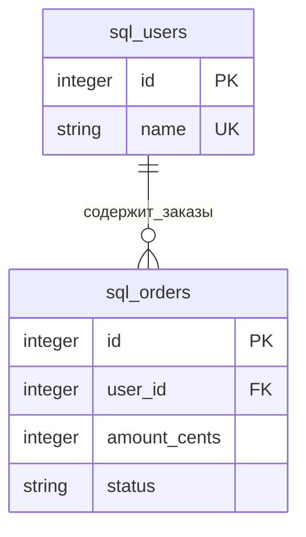

# Подготовить учебные таблицы SQL

Пример создаёт пользователей и заказы для карточек SQL.
Используйте новую учебную БД PostgreSQL 18 или SQLite 3.53.
[К карточкам запросов](queries.md) · [К SQL](README.md).

| Задача | Приём | Пример |
| --- | --- | --- |
| Создать исходные данные и проверить результат | Полный учебный сценарий | [Код и запуск](#полный-пример) |

| Параметр | Значение |
| --- | --- |
| Уровни | Базовый — схема и данные; средний — JOIN и savepoint |
| Предпосылки | Новая учебная БД PostgreSQL 18 или SQLite 3.53; имена sql_users/sql_orders свободны |

## Полный пример

**Базовый уровень.** Сохраните SQL как `demo.sql`.
В PostgreSQL выберите отдельную учебную БД.
Запустите `psql -X --set=ON_ERROR_STOP=1 --dbname=имя_учебной_бд --file=demo.sql`.
В SQLite выберите новый файл sql-demo.db в отдельном учебном каталоге.
Запустите `sqlite3 -bail -cmd 'PRAGMA foreign_keys=ON' sql-demo.db < demo.sql`.
Эти команды выполняются в оболочке, а не в SQL.
MySQL/SQL Server требуют адаптации управления транзакцией из [таблицы диалектов](dialects-and-transactions.md).

Полный SQL-пример предназначен для PostgreSQL/SQLite.
Пример создаёт только учебные объекты без DROP:

<!-- example: sql/demo.sql -->
```sql
BEGIN;
CREATE TABLE sql_users (
    id integer PRIMARY KEY,
    name varchar(80) NOT NULL UNIQUE
);
CREATE TABLE sql_orders (
    id integer PRIMARY KEY,
    user_id integer NOT NULL REFERENCES sql_users(id),
    amount_cents integer NOT NULL CHECK (amount_cents >= 0),
    status varchar(20) NOT NULL CHECK (status IN ('paid', 'pending'))
);
INSERT INTO sql_users (id, name) VALUES (1, 'alice'), (2, 'bob'), (3, 'carol');
INSERT INTO sql_orders (id, user_id, amount_cents, status) VALUES
    (1, 1, 10000, 'paid'), (2, 1, 4000, 'paid'), (3, 2, 30000, 'pending');

SELECT u.name, COALESCE(SUM(o.amount_cents), 0) AS paid_cents
FROM sql_users AS u
LEFT JOIN sql_orders AS o ON o.user_id = u.id AND o.status = 'paid'
GROUP BY u.id, u.name
ORDER BY u.name;

SAVEPOINT before_change;
UPDATE sql_orders SET amount_cents = 1 WHERE id = 1;
ROLLBACK TO SAVEPOINT before_change;
RELEASE SAVEPOINT before_change;
COMMIT;

SELECT amount_cents AS preserved_amount FROM sql_orders WHERE id = 1;
```

Ожидаемые суммы: `alice | 14000`, `bob | 0`, `carol | 0`.
Значение preserved_amount равно `10000`.
Сумма хранится в целых условных центах, чтобы пример не зависел от округления REAL.
Идентификаторы задаются явно: генерация ключей различается между СУБД.
[Следующие карточки](queries.md) используют эти таблицы в той же БД.

Схема показывает таблицы и внешний ключ учебных данных:



Внешний ключ связывает каждый заказ с пользователем.
У пользователя может не быть заказов.

## Источники

- [PostgreSQL: JOIN/группы](https://www.postgresql.org/docs/18/queries-table-expressions.html), [CTE](https://www.postgresql.org/docs/18/queries-with.html), [окна](https://www.postgresql.org/docs/18/functions-window.html).
- [SQLite: SELECT](https://www.sqlite.org/lang_select.html), [WITH](https://www.sqlite.org/lang_with.html), [окна](https://www.sqlite.org/windowfunctions.html).
- [SQLite: scalar subquery](https://www.sqlite.org/lang_expr.html#subquery_expressions), [PostgreSQL: scalar subquery](https://www.postgresql.org/docs/18/sql-expressions.html#SQL-SYNTAX-SCALAR-SUBQUERIES).
- [MySQL 8.4: JOIN](https://dev.mysql.com/doc/refman/8.4/en/join.html), [SQL Server: CTE](https://learn.microsoft.com/en-us/sql/t-sql/queries/with-common-table-expression-transact-sql?view=sql-server-ver17).
- [PostgreSQL 18.6: release notes](https://www.postgresql.org/docs/18/release-18-6.html), [SQLite 3.53.4: release notes](https://www.sqlite.org/releaselog/3_53_4.html).
