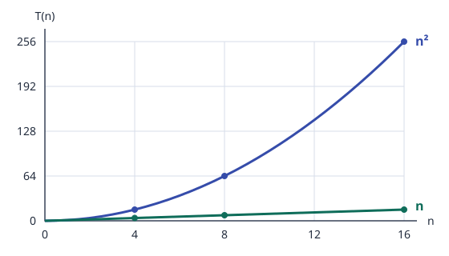

# Algorithms

[Русский](../../ru/algorithms/README.md) · [Catalog](../README.md)

Estimate how the number of operations grows as the input gets larger. This section introduces time complexity with Python loops.

## Big O

Big O gives an upper bound on the growth of the operation count. For a simple traversal, the input size `n` is the number of items in the sequence.

### Count iterations

Choose an operation to count. In this fragment, each increment represents one execution of a loop body. The variable `items` holds a sequence of `n` items, such as `range(n)`.

```python
linear = 0
for item in items:
    linear += 1

quadratic = 0
for first in items:
    for second in items:
        quadratic += 1
```

The first loop runs `n` times. In the second case, the inner loop visits all `n` items for each of the `n` items in the outer loop. The inner loop body runs `n × n = n²` times.

The nested loops visit ordered pairs of positions. For the list `['A', 'B']`, they count `(A, A)`, `(A, B)`, `(B, A)`, and `(B, B)`.

When loops run in sequence, add their iteration counts. For example, two full passes take `2n` iterations. For nested loops that traverse two full sequences of lengths `n` and `m`, multiply the lengths. The inner loop body runs `n × m` times.

### Run the example

Run the [complete example](../../../examples/algorithms/big-o/count_operations.py) from the repository root with Python 3.14. The program creates its input with the built-in `range()`.

```bash
python3.14 examples/algorithms/big-o/count_operations.py
```

```text
n linear quadratic
4 4 16
8 8 64
16 16 256
```

When `n` doubles from 4 to 8, the linear count doubles. The quadratic count quadruples because `(2n)² = 4n²`.

The horizontal axis `n` shows the number of input items. The vertical axis `T(n)` shows the number of increments. The dots mark the counts from the program output.



### Express the growth rate

For all sufficiently large `n`, `O(g(n))` bounds the operation count from above by `c × g(n)`. The factor `c` is a positive constant that stays the same for every `n`.

The linear count has an upper bound of `O(n)`. The bound `O(n²)` also holds because `n ≤ n²` for `n ≥ 1`. The notation `Θ(n)` gives a tight bound. Positive constant multiples of `n` bound the count from above and below. The quadratic count has a tight bound of `Θ(n²)`.

For a polynomial, the highest-degree term determines the growth rate. For example, `2n` is `Θ(n)`. The count `n² + n` is `Θ(n²)` because `n² ≤ n² + n ≤ 2n²` for `n ≥ 1`.

To estimate running time, count operations with constant cost in the chosen model. If inputs of the same size require different numbers of operations, specify the case. For example, linear search can find a value on the first check, and it checks all `n` items if the value is absent. Its worst-case time complexity is `O(n)`.

| Upper bound | Example operation or algorithm |
| --- | --- |
| `O(1)` | Access an array element by index |
| `O(log n)` | Search a sorted array with binary search |
| `O(n)` | Traverse `n` items with constant work per item |
| `O(n log n)` | Sort `n` items with merge sort and constant-time comparisons |
| `O(n²)` | Visit all ordered pairs of positions with constant work per pair |

## Sources

- [Big O in the NIST dictionary](https://www.nist.gov/dads/HTML/bigOnotation.html) · [Θ in the NIST dictionary](https://www.nist.gov/dads/HTML/theta.html)
- [Binary search in the NIST dictionary](https://www.nist.gov/dads/HTML/binarySearch.html) · [Merge sort in the NIST dictionary](https://www.nist.gov/dads/HTML/mergesort.html)
- [`range` in the Python 3.14 documentation](https://docs.python.org/3.14/library/stdtypes.html#ranges)
