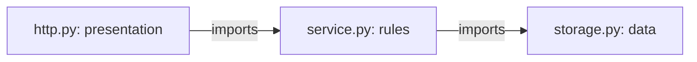
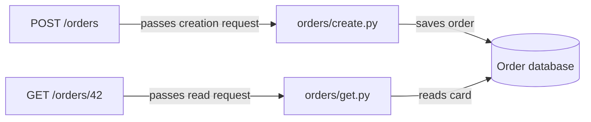
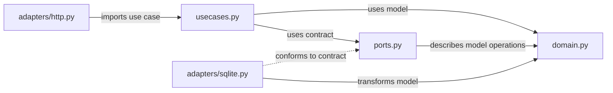
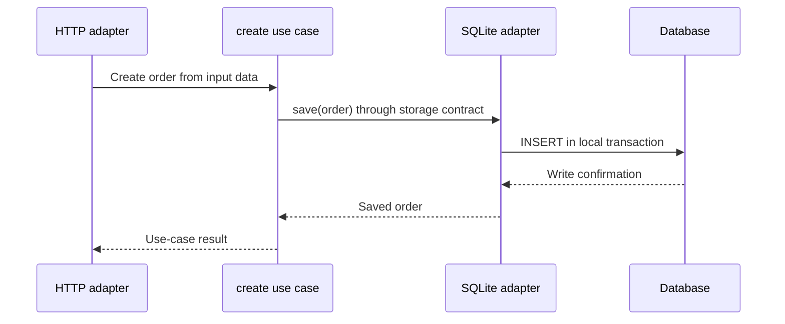
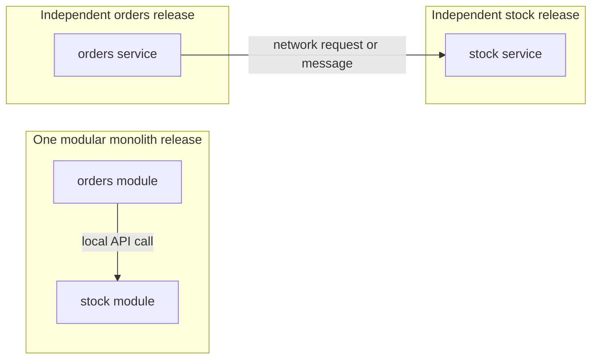

<a id="выбрать-организацию-кода-и-границы-выпуска"></a>
# Choose code organization and release boundaries

[Русский](../../../ru/architecture/patterns/architecture-patterns.md)

<a id="организация-приложения-и-распределённые-сценарии"></a>

This cheat sheet explains application boundaries.
Choose code placement.
Define code dependencies.
Define independently released units.
The running example creates and reads an order.
Network failures are covered on a separate page.

[Patterns](README.md) · [Principles](../principles.md) · [Distributed scenarios](distributed-systems.md)

| Situation | Technique | Reference |
| --- | --- | --- |
| Presentation, rules, and storage change independently | Layered separates technical roles | [Layers](#layered-for-separation-by-role) |
| Order creation and reading evolve independently | Vertical Slice keeps a use case together | [Use cases](#feature-oriented-and-vertical-slice-for-grouping-a-use-case) |
| A rule test requires an external database or UI | Ports & Adapters separates the rule from integrations | [Ports](#ports--adapters-for-separating-the-application-from-details) |
| Parts require shared or independent releases | Compare Modular Monolith and Microservices | [Deployment](#deployment-boundaries) |
| Writing, publication, or retry can finish partially | Choose a protocol by the required guarantee | [Data and failures](#distributed-scenarios) |

| Parameter | Value |
| --- | --- |
| Prerequisites | Module contracts, transactions, and the distinction between local and network calls |
| Boundaries | Trees and diagrams show possible solutions. Application implementation and measurement require separate work |

<a id="навигация"></a>
## Navigation

- [Distinguish representations](#distinguish-representations)
- [Code organization](#code-organization) with layers, use cases, and ports
- [Deployment boundaries](#deployment-boundaries)
- [Distributed scenarios](#distributed-scenarios)
- [Complete Outbox example and duplicate publication](#complete-outbox-example-and-duplicate-publication)
- [Sources](#sources)

<a id="базовый-уровень-разные-оси-решения"></a>

<a id="различать-представления"></a>
## Distinguish representations

| Representation | Question answered | Information it does not provide |
| --- | --- | --- |
| Source tree | Which file contains order creation? | Which part imports or calls another |
| Code dependencies | What knowledge does a module require? | Call order and process count |
| Runtime flow | Which part passes control/a message to another? | Import direction |
| Deployment | What releases and runs independently? | Internal service code organization |

A rule can call a supplied SQL adapter without importing its class.
Three directories in one project can run in one process.
Each diagram's description defines the representation's meaning.

Ports & Adapters can operate inside a monolith or service.
Vertical Slice use cases can live inside a domain module with ports.
A folder name does not prove isolation.
A folder name does not prove release independence.

<a id="организация-кода"></a>
## Code organization

Choose how to find and change the order use case.
The trees below show illustrative source layouts with Python-like names.
These layouts are not runnable packages.
Patterns do not prescribe filenames or file counts.
Create a file or directory only for an existing responsibility.

| Approach | Main boundary | Usefulness check | Cost / when to simplify |
| --- | --- | --- | --- |
| Layered | Presentation / rules / storage | HTTP format stays outside the rule. SQL stays in storage | One change crosses several layers. An empty forwarding layer can be removed |
| Feature-oriented / Vertical Slice | Domain capability / individual use case | Order creation can be read and changed as a whole. Shared rules do not diverge across copies | Shared knowledge must be extracted deliberately instead of copying everything between use cases |
| Ports & Adapters | Application / external technology | Rule tests require no HTTP request, ORM, or live database | Contracts and composition require maintenance. Simple CRUD can sometimes use a direct query |

<a id="layered-разделить-по-роли"></a>
### Layered for separation by role

The task is to change HTTP presentation, the order-creation rule, and storage independently.
The tree shows one possible small application layout.

```text
src/orderapp/
├── http.py       # HTTP entry and response presentation
├── service.py    # create/get: application order rules
└── storage.py    # reading/writing orders through SQL
```

The **code dependencies** describe the selected closed-layer variant.
An arrow means importing the lower layer.
The project convention prohibits reverse imports.
The tree alone does not prohibit reverse imports.



SQL lives in `storage.py`.
Order validation lives in `service.py`.
HTTP status codes live in `http.py`.
In this simple variant, runtime calls also flow downward.
Importing and calling remain distinct relationships.
Closed layers allow access only to the next layer.
An open-layer variant explicitly allows skipping layers.
Complex rules may require a separate domain model.
Tree symmetry does not imply a need for a domain model.

A logical *layer* differs from a physical *tier*.
Three layers can run in one process.
A new operation often touches all three files.
See [Microsoft's layer / tier distinction](https://learn.microsoft.com/en-us/azure/architecture/guide/architecture-styles/n-tier).

<a id="feature-oriented-и-vertical-slice-собрать-сценарий"></a>
### Feature-oriented and Vertical Slice for grouping a use case

The task is to keep order-creation parts together.
Changing the use case should not require finding its parts across all technical directories.
Feature-oriented organization groups code by capability (`orders`).
Vertical Slice isolates an individual use case (`create`, `get`).
Moving former layers into an `orders` folder alone does not isolate a vertical slice.

```text
src/orderapp/
├── orders/
│   ├── create.py   # input, validation, and write for order creation
│   ├── get.py      # input and order-card reading
│   └── rules.py    # shared order rule, if both genuinely need it
└── bootstrap.py    # connects handlers to entry points
```

The **runtime flow** shows a possible implementation.
The handlers serve different requests.
One handler need not call another.
A use case can access the database directly or through a port.
Choose according to use-case needs.



Most work on changing creation occurs in `create.py`.
As the use case grows, it can become a package with its own details.
Create structure for current responsibilities, without prebuilding matching folders.
A shared business rule remains authoritative in one place.
Coincidentally similar code does not require a shared abstraction.
CQRS, a broker, and separate databases do not follow from this tree.
Source — [Bogard, Vertical Slice Architecture](https://www.jimmybogard.com/vertical-slice-architecture/).

<a id="ports--adapters-отделить-приложение-от-деталей"></a>
### Ports & Adapters for separating the application from details

The task is to run one order-creation rule from HTTP, tests, or batch processing.
Storage must be independently replaceable.
A port defines a meaningful application contract.
An adapter translates an external protocol into the application contract or back.

```text
src/orderapp/
├── domain.py       # order data and invariants
├── usecases.py     # create/get use cases
├── ports.py        # storage contract required by use cases
├── adapters/
│   ├── http.py     # inbound adapter: HTTP → use-case call
│   └── sqlite.py   # outbound adapter: contract → SQL
└── bootstrap.py    # creates adapters and passes them to use cases
```

The **main code dependencies** show the rule knowing its own contract.
The rule does not know the concrete database.
The dotted line shows structural contract conformance.
A Python adapter need not import Protocol.
`bootstrap.py` knows the concrete details.
`bootstrap.py` assembles those details.
The diagram omits `bootstrap.py` for readability.



The **runtime flow** shows the same roles.
Composition passes the outbound adapter into the use case.
The port defines this call's contract.
The port does not require a separate intermediary object or process.



A use-case test can receive in-memory storage in place of SQLite.
The rule itself needs neither HTTP nor ORM.
The contract must preserve errors.
The contract must preserve transaction boundaries and read semantics.
A method signature alone is insufficient.
The diagram shows calls, without providing a ready safe-write retry protocol.
Source — [Cockburn, Ports & Adapters](https://alistair.cockburn.us/hexagonal-architecture/).
See the connection to [DIP and DI](../solid.md#продвинутый-уровень).

<a id="границы-развёртывания"></a>
## Deployment boundaries

Choose release units and data ownership.
This decision differs from a folder tree.
Team size alone does not determine the choice.
Table count alone does not determine the choice.

| Form | When useful | Checks | Cost |
| --- | --- | --- | --- |
| Modular Monolith | Domain boundaries are needed within one release | `orders` and `stock` communicate through module APIs. Other modules' data is not changed outside its owner | Shared release and usually shared process. Boundaries need protection |
| Microservices | Independent release/scaling needs are confirmed | A service can release without simultaneous neighboring releases. It owns its data and failures | Networking, protocol compatibility, observability, and distributed consistency |

The **deployment diagram with labeled runtime relationships** shows one application artifact on the left.
It shows two independent artifacts on the right.
Groups indicate release boundaries.
Arrows indicate labeled interactions.
The diagram does not prescribe replica counts or separate infrastructure databases.



A monolith permits local calls and coordinated local transactions.
Services require an explicit partial-failure protocol between them.
Separate physical database servers are optional.
Data ownership matters.
Preventing API bypass through other owners' mutable tables matters.
A shared mutable database can retain tight coupling across many processes.
Mandatory synchronous call chains can also retain tight coupling.

While domain boundaries are being clarified, starting with a monolith can cost less.
This is a conditional heuristic, without requiring a future migration.
Justify extracting a service through specific independence needs.
Evaluate the ability to maintain that independence.
Sources include [Fowler / Lewis, Microservices](https://martinfowler.com/articles/microservices.html) and
[Fowler, Monolith First](https://martinfowler.com/bliki/MonolithFirst.html).

<a id="распределённые-сценарии"></a>
## Distributed scenarios

Name the failure first.
State the required guarantee.
Then choose a mechanism.
This is a separate decision axis.
A monolith that publishes messages can also need Outbox.

| Observable problem | Candidate | Check before choosing |
| --- | --- | --- |
| Repeated reads are expensive. Limited staleness is acceptable | [Cache-Aside](distributed-systems.md#cache-aside-for-cached-reads) | Fill/invalidation races, TTL, and behavior when the cache is unavailable |
| An order is saved but an event is lost between database and broker | [Transactional Outbox](distributed-systems.md#transactional-outbox-for-saving-an-order-and-publication-intent) | Shared order/event transaction, repeated publication, and effect deduplication |
| Several data owners perform steps in a shared process | [Saga](distributed-systems.md#saga-for-coordinating-local-steps) | Compensations, intermediate states, timeout, and irreversible step |
| One model is awkward for both writes and reads | [CQRS](distributed-systems.md#cqrs-for-separate-write-and-read-models) | Model differences, projection cost, and acceptable lag |
| A transient failure may disappear on retry | [Retry](distributed-systems.md#retry-for-transient-failures) | Classification, total time budget, idempotency, and unknown outcome |

None of these patterns alone promises exactly-once execution for an arbitrary external effect.
The [cards with diagrams and limitations](distributed-systems.md) show specific checks.

<a id="полный-пример-outbox-и-дубликат-публикации"></a>
## Complete Outbox example and duplicate publication

[Run the complete Outbox example](outbox-example.md#complete-outbox-example-and-duplicate-publication).
The example saves an order and event atomically.
It checks rollback on a UNIQUE failure.
It checks repeated publication after a simulated relay failure.

<a id="источники"></a>
## Sources

- Code organization — [Cockburn](https://alistair.cockburn.us/hexagonal-architecture), [Bogard](https://www.jimmybogard.com/vertical-slice-architecture/), [Microsoft layers / tiers](https://learn.microsoft.com/en-us/azure/architecture/guide/architecture-styles/n-tier).
- Releases and boundaries — [Fowler / Lewis, Microservices](https://martinfowler.com/articles/microservices.html), [Fowler, Monolith First](https://martinfowler.com/bliki/MonolithFirst.html).
- Data and failure sources are collected on the [detailed page](distributed-systems.md#sources).
