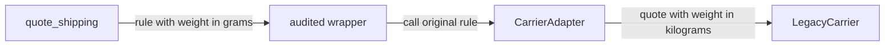
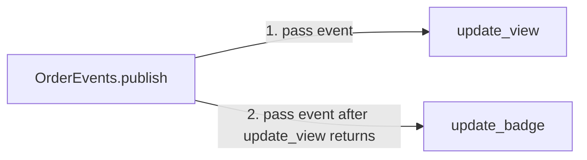
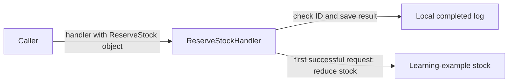

<a id="выполнить-примеры-паттернов-кода"></a>
# Run code pattern examples

[Русский](../../../ru/architecture/patterns/code-examples.md)

This page contains three local examples.
The shipping rate combines Strategy, Adapter, Decorator, and Factory.
Observer shows subscriptions and errors.
Command shows a request, a separate handler, and replay.
Open this page to run the selected pattern and test its important failure cases.

| Situation | Technique | Complete example |
| --- | --- | --- |
| Rates use different algorithms and units | Combine Strategy, Adapter, Decorator, and Factory | [Shipping](#complete-strategy-adapter-and-decorator-example) |
| An event updates several local recipients | Store subscriptions and define an error policy | [Observer](#observer-subscriptions-unsubscribe-and-listener-errors) |
| A request is passed separately from execution and may be repeated | Separate command data and handler | [Command](#command-request-handler-and-local-replay) |

[Quick choice and roles](design-patterns.md) · [Patterns](README.md)

**Level** — intermediate.
Error and retry handling belong to the advanced level.
**Prerequisites** include Python 3.14, functions/callables, classes, and exceptions.
The examples use only the standard library.

<a id="навигация"></a>
## Navigation

- [Complete Strategy, Adapter, and Decorator example](#complete-strategy-adapter-and-decorator-example)
- [Observer subscriptions, unsubscribe, and listener errors](#observer-subscriptions-unsubscribe-and-listener-errors)
- [Command request, handler, and local replay](#command-request-handler-and-local-replay)
- [Example boundaries](#example-boundaries)

<a id="полный-пример-strategy-adapter-и-декоратор"></a>
## Complete Strategy, Adapter, and Decorator example


**Complete example.** The example uses only the standard library.
No external dependencies are required.
Run this command from the repository root.

```bash
python3.14 examples/architecture/shipping-patterns.py
```

The contract accepts a positive integer weight in grams.
The contract returns a nonnegative integer cost in illustrative cents.
LegacyCarrier stands in for an external SDK with a local object.
The object accepts kilograms and returns illustrative currency units.
The network protocol is not modeled here.

[`architecture/shipping-patterns.py`](../../../../examples/architecture/shipping-patterns.py)

Expect `OK: strategies, unit adapter, rounding, wrapper and factory refusal`.
The example compares two rates and converts grams to kilograms.
The cost rounds up to a cent.
The wrapper preserves the result and records an audit entry.
Three invalid inputs cause rejection.
An external SDK can return invalid values or errors.
Define a separate translation contract for them in the adapter.

All arrows below show **runtime calls**.
The arrows do not represent imports.



The result returns up the call stack.
The adapter converts currency units into integer cents.
The wrapper writes to a list.
If remote auditing fails, a policy must be chosen.
Possible policies include failing the operation, saving the event separately, or accepting lost observation.


<a id="observer-подписка-отписка-и-ошибка-слушателя"></a>
## Observer subscriptions, unsubscribe, and listener errors

The task is to notify local listeners in subscription order.
Publication is synchronous.
The first error interrupts delivery.
The error propagates to the caller.
Callbacks already executed are not rolled back.

**Complete example.** The example uses only the standard library.
Run this command from the repository root.

```bash
python3.14 examples/architecture/observer-pattern.py
```

Illustrative strings and lists represent events and results.

[`architecture/observer-pattern.py`](../../../../examples/architecture/observer-pattern.py)

Expect `OK: observer order, unsubscribe and fail-fast delivery`.
The example shows the order of two listeners, unsubscribe, and delivery interrupted by an exception.

The **runtime call diagram** labels the synchronous call order.
The second arrow is reached only after the first listener succeeds.



`publish` uses a list snapshot.
Changing subscriptions during delivery affects the next publication.
Subscribing the same callback again does not add a duplicate.
Unsubscribing an absent callback raises `ValueError`.
The publisher holds strong references to listeners.
The subscription owner decides when to unsubscribe.
There is no thread safety.
There is no event storage or redelivery.

<a id="command-запрос-обработчик-и-локальный-повтор"></a>
## Command request, handler, and local replay

The task is to separate a reservation request from execution.
Define replay semantics explicitly.
The same ID with the same parameters returns the stored result.
The same ID with different parameters is rejected.
Data with a separate handler represents the command.
An `execute` method on the command itself is optional.

**Complete example.** The example uses only the standard library.
Run this command from the repository root.

```bash
python3.14 examples/architecture/command-pattern.py
```

One handler keeps stock and a result log in memory.

[`architecture/command-pattern.py`](../../../../examples/architecture/command-pattern.py)

Expect `OK: command validation, reserve, replay and ID conflict`.
The first request reserves stock.
Replay returns the stored result.
Invalid quantities, insufficient stock, and ID conflicts cause rejection.
Stock remains unchanged on these rejections.
Replay returns the result of the first execution.
That number does not promise current stock after other commands.

In the **runtime call diagram**, the caller passes the command to the handler as an argument.
Stock changes only on the first successful execution of an ID.



`dataclass` generates methods for data.
`dataclass` does not validate annotated types.
The example uses explicit validation.
`frozen=True` restricts field assignment.
This parameter does not provide business guarantees.
The local log supports replay only during this handler's lifetime.
There is no database transaction.
There is no protection against concurrent calls.
There is no restart recovery or log cleanup policy.
For an external action, coordinate persistence of its result and the effect itself separately.
Undo can be a [business compensation](architecture-patterns.md#distributed-scenarios).

<a id="границы-примеров"></a>
## Example boundaries

The examples run in one process without networking or an external SDK.
Threads, recovery after process termination, reliable auditing, delivery, and command storage require separate mechanisms.

<a id="источники"></a>
## Sources

- [Python 3.14 Callable](https://docs.python.org/3.14/library/collections.abc.html#collections.abc.Callable).
- [Python 3.14 Decimal](https://docs.python.org/3.14/library/decimal.html).
- [Python 3.14 dataclasses](https://docs.python.org/3.14/library/dataclasses.html).
