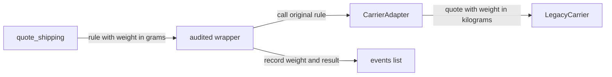
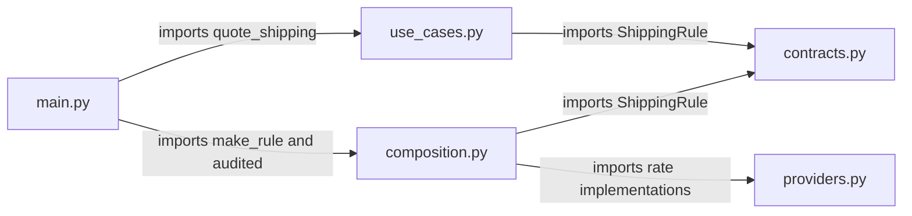

<a id="выбирать-паттерн-кода"></a>
# Choose a code pattern

[Русский](../../../ru/architecture/patterns/design-patterns.md)

Choose a technique according to what changes.
Possible changes include an algorithm, external API, wrapper, composition, subscription, or action.
The cards show roles and a short call.
Links lead to complete implementations.

<a id="выбор-паттерна"></a>
## Choose a pattern

| What changes | Pattern | Consumer benefit | When a simpler solution suffices |
| --- | --- | --- | --- |
| Calculation algorithm | [Strategy](#strategy-for-algorithm-substitution) | One contract, several rules | One short algorithm without substitution can be an ordinary function |
| External API format, units, or interface | [Adapter](#adapter-for-translating-an-external-contract) | Data under a familiar contract | One local conversion can be a function without a class |
| Behavior around an operation | [Decorator](#decorator-for-behavior-around-a-call) | Existing call interface plus auditing/metrics | One explicit call before/after the operation without reuse |
| Implementation creation and selection | [Factory](#factory-for-assembling-the-required-implementation) | Ready object with dependencies | A constructor when selection and composition are trivial |
| Set of event recipients | [Observer](#observer-for-notifying-local-subscribers) | Event subscription | Direct calls when recipients are fixed |
| Request representation | [Command](#command-for-passing-an-action-as-data) | Separate action with parameters | Direct function call when the request need not be passed/stored |


[Patterns](README.md) · [SOLID](../solid.md) · [Complete examples](code-examples.md)

**Prerequisites** include functions, callables, and object composition.
The examples target Python 3.14.

<a id="базовый-уровень"></a>

Composition delegates work to another object or function.
A shared Python contract can be expressed with `Callable` or a small [Protocol](../solid.md).
These examples require no inheritance from a common base class.

<a id="навигация"></a>
## Navigation

- [Choose a pattern](#choose-a-pattern)
- [Roles and short calls](#roles-and-short-calls)
- [Strategy, Adapter, and Decorator composition](#complete-strategy-adapter-and-decorator-example)
- [Possible module layout](#possible-module-layout)
- [Contracts and failures](#contracts-and-failures)
- [Common mistakes](#common-mistakes)
- [Example boundaries](#example-boundaries)
- [Sources](#sources)

<a id="средний-уровень"></a>

<a id="роли-и-короткие-вызовы"></a>
## Roles and short calls

Short blocks show the technique in place.
They are independent mini-examples using the Python 3.14 standard library.
Validation, additional implementations, and failure checks appear in the linked complete examples.
The role tables name participants in the complete examples.

<a id="strategy-подменить-алгоритм"></a>
### Strategy for algorithm substitution

Use this when one consumer must work with different rates under a common contract.
The contract accepts a positive integer weight in grams.
The contract returns a nonnegative integer cost in cents.

| Role | Example name | Responsibility |
| --- | --- | --- |
| Consumer / context | `quote_shipping` | Validates input/output and calls the supplied rule |
| Strategy contract | `ShippingRule` | Describes a `Callable[[int], int]` object |
| Implementations | `flat_rate`, `CarrierAdapter` | Calculate cost using different rules |

In this **mini-example**, pass the calculation function as an argument.

```python
def quote_shipping(grams, rule):
    return rule(grams)


def flat_rate(grams):
    return 500


assert quote_shipping(500, flat_rate) == 500
assert quote_shipping(500, lambda grams: 300 + grams // 5) == 400
```

One consumer produces 500 or 400 cents depending on the supplied rule.
The caller selects the rule.
The complete version's type annotation alone does not enforce the contract.
The mini-example accepts an already-validated weight.
The [complete version](code-examples.md#complete-strategy-adapter-and-decorator-example) validates input and result.

<a id="adapter-перевести-внешний-контракт"></a>
### Adapter for translating an external contract

Use this when the consumer works with grams and integer cents.
The external API works with kilograms and `Decimal` currency units.

| Role | Example name | Responsibility |
| --- | --- | --- |
| External interface / adaptee | `LegacyCarrier.quote` | Accepts kilograms and returns currency units |
| Adapter | `CarrierAdapter.__call__` | Converts units and rounds up to a whole cent |
| Consumer | `quote_shipping` | Sees only the `ShippingRule` contract |

In this **mini-example**, convert the external calculation's input and output.

```python
from decimal import Decimal, ROUND_CEILING


def legacy_quote(kilograms):
    return Decimal("3.00") + Decimal("2.00") * kilograms


def adapted_quote(grams):
    units = legacy_quote(Decimal(grams) / 1000)
    return int((units * 100).quantize(Decimal("1"), rounding=ROUND_CEILING))


assert adapted_quote(501) == 401
```

The result is 501 g → 0.501 kg → 4.002 currency units → 401 cents.
Rounding is part of the adapter contract.
Agree on SDK errors separately.
Agree on invalid-value handling separately.
The [complete `CarrierAdapter` version](code-examples.md#complete-strategy-adapter-and-decorator-example) combines the adapter with Strategy.

<a id="decorator-добавить-поведение-вокруг-вызова"></a>
### Decorator for behavior around a call

Use this to record an operation's result while preserving its call interface.
The example uses a functional wrapper based on the Decorator idea.
The `@` syntax is optional.

| Role | Example name | Responsibility |
| --- | --- | --- |
| Original operation | `rule` | Calculates cost |
| Wrapper creator | `audited` | Returns a function with the same contract |
| Wrapper | `wrapped` | Calls the rule, records an event, and returns the result |

In this **mini-example**, return a wrapper with the existing call interface.

```python
def audited(rule, events):
    def wrapped(grams):
        result = rule(grams)
        events.append((grams, result))
        return result
    return wrapped


events = []
rule = audited(lambda grams: 400, events)
assert rule(500) == 400
assert events == [(500, 400)]
```

The cost remains unchanged.
A weight/cost pair is added to the list.
An error from the original rule propagates outward.
No event is recorded on that error.
Define an audit-write failure policy separately.
Define the order of multiple wrappers separately.
The [complete composition](code-examples.md#complete-strategy-adapter-and-decorator-example) adds an adapter and factory.

<a id="factory-собрать-нужную-реализацию"></a>
### Factory for assembling the required implementation

Use this when name-based selection and dependency creation repeat or obstruct the consumer.
The example uses a simple factory function.
It does not implement every GoF Factory Method / Abstract Factory variant.

| Role | Example name | Responsibility |
| --- | --- | --- |
| Factory | `make_rule` | Selects the rate and assembles the adapter with `LegacyCarrier` |
| Composition result | `ShippingRule` | Lets the client avoid interpreting the rate name |

In this **mini-example**, hide implementation selection behind a function.

```python
def make_rule(name):
    rules = {"flat": lambda grams: 500, "weight": lambda grams: 300 + grams // 5}
    try:
        return rules[name]
    except KeyError:
        raise ValueError("Неизвестный тариф") from None


rule = make_rule("weight")
assert rule(500) == 400
```

The appropriate callable is assembled.
An unknown name raises `ValueError`.
The [complete example](code-examples.md#complete-strategy-adapter-and-decorator-example) tests this rejection.
Adding a rate can change the factory without changing the consumer.

<a id="observer-уведомить-локальных-подписчиков"></a>
### Observer for notifying local subscribers

Use this when one in-process event must update several views/observers.

| Role | Example name | Responsibility |
| --- | --- | --- |
| Publisher / subject | `OrderEvents` | Stores subscribers and publishes the event |
| Subscriber / observer | `Listener`, such as `calls.append` | Receives the event |
| Subscription management | `subscribe`, `unsubscribe` | Determines who receives the next event |

In this **mini-example**, pass the event to each subscribed handler.

```python
calls = []
listeners = [calls.append]
for listener in tuple(listeners):
    listener("order-paid")
assert calls == ["order-paid"]
```

The listener is called synchronously.
Listeners run in subscription order in this example.
The first error stops delivery.
The [complete `OrderEvents` version](code-examples.md#observer-subscriptions-unsubscribe-and-listener-errors) adds subscribe and unsubscribe.
Unsubscribe listeners at the appropriate point in their lifetime.
Delivery after a process crash requires another mechanism.
[Outbox](architecture-patterns.md#distributed-scenarios) is one example.

<a id="command-передать-действие-как-данные"></a>
### Command for passing an action as data

Use this when a parameterized request must be separated from when and where it executes.
Data represents the command in this example.
A separate handler executes the command.

| Role | Example name | Responsibility |
| --- | --- | --- |
| Command | `ReserveStock` | Carries the SKU, quantity, and request identifier |
| Handler | `ReserveStockHandler` | Validates and applies the request and defines replay policy |
| Action receiver | `stock` | Stores the illustrative stock changed by the handler |

In this **mini-example**, store parameters separately from the handler.

```python
from dataclasses import dataclass


@dataclass(frozen=True)
class ReserveStock:
    sku: str
    quantity: int
    request_id: str


def handle(command, stock):
    stock[command.sku] -= command.quantity
    return stock[command.sku]


stock = {"book": 3}
command = ReserveStock("book", 1, "request-1")
assert handle(command, stock) == 2
```

One book is reserved.
Two books remain.
A command alone does not provide storage, undo, retry, or idempotency.
The mini-example accepts a valid request and sufficient stock.
Repeating the mini-example reduces stock again.
In the complete example, the handler's local table handles replay with the same ID.
For an external action, undo can be a [business compensation](architecture-patterns.md#distributed-scenarios).

<a id="полный-пример-strategy-adapter-и-декоратор"></a>
## Complete Strategy, Adapter, and Decorator example

The [complete shipping source example](code-examples.md#complete-strategy-adapter-and-decorator-example) lives on a separate page.
It contains imports, execution instructions, and checks.
The example also uses Factory.

In the **runtime call diagram**, an arrow means a call to the next participant.
An arrow does not represent `import`, inheritance, or file layout.



The result returns up the call stack.
The adapter converts currency units to cents.
The factory assembles the rule before calculation.
The factory does not participate in every `rule` call.

<a id="возможное-размещение-в-модулях"></a>
### Possible module layout

The **illustrative file structure** shows a possible split of the growing shipping example.
The tree illustrates responsibility.
It does not prescribe a mandatory skeleton.
The complete example remains a single file.

```text
shipping/
├── contracts.py       # ShippingRule: shared contract
├── use_cases.py       # quote_shipping: rule consumer
├── providers.py       # flat_rate, LegacyCarrier, CarrierAdapter
└── composition.py     # make_rule, audited: selection and composition
main.py                # entry point: assemble a rule and call the use case
```

Similar small modules are possible for the other two examples.
Separate pattern-named directories are unnecessary.

| Example | Possible role locations | Where participants connect |
| --- | --- | --- |
| Observer | `events.py` with `Listener`, `OrderEvents`. `views.py` with view callbacks | `main.py` subscribes and ends the subscription lifetime |
| Command | `reserve.py` with `ReserveStock`, `ReserveStockHandler` beside the reservation rule | `main.py` creates the handler with stock and passes the command |

In this illustration's **source dependency diagram**, an arrow shows an import.
The module on the left imports the named item from the module on the right.



The tree shows code placement.
The dependency diagram shows which modules the code depends on.
The call diagram above shows which participant calls another.
Distinguish these three representations.

<a id="продвинутый-уровень"></a>

<a id="контракты-и-отказы"></a>
## Contracts and failures

<a id="проверить-сохраняется-ли-контракт"></a>
### Check whether the contract is preserved

First understand the short calls and original implementations on the [examples page](code-examples.md).

| Pattern | Checks beyond successful results |
| --- | --- |
| Strategy | Different rules accept the same units and return a valid result. In this example, the shared `quote_shipping` entry point rejects invalid weight, and rules receive an already-validated weight |
| Adapter | Units, `None`/NULL, rounding, timeouts, and errors visible to the consumer |
| Decorator | Wrapper order, exceptions, and retries. Retry around a debit/send can repeat the effect |
| Factory | Rejection of unknown configuration, correct composition, and dependency creation cost |
| Observer | Subscribe/unsubscribe, order, error policy, and listener lifetime. A queue changes delivery guarantees |
| Command | Validation, replay, and parameter conflict for one ID. Storing the request and executing it are separate responsibilities |

`make_rule` creates both variants on every call.
This is convenient for local objects.
For expensive clients or connections, define their lifetime.
Adding a rule changes the factory.
It does not require changing `quote_shipping`.
This is a bounded extension point.

If variability disappears, the pattern can be removed.
This is appropriate when a wrapper or interface merely forwards calls without a useful boundary.
If a function preserves the same contract more simply, use the function instead of a literal class-based template.

<a id="частые-ошибки"></a>
## Common mistakes

| Symptom | Cause | Correction |
| --- | --- | --- |
| A class hierarchy for every rate | Pattern mistaken for code shape | Start with `Callable` and check the shared contract |
| Adapter hides every SDK error | Compatibility mistaken for absence of errors | Explicitly define translated and propagated errors |
| A wrapper charges money twice | Retry wraps an external effect | Define idempotency and failure classification before retrying |
| Local Observer loses an event after restart | Callback mistaken for reliable delivery | Choose persistence and redelivery mechanisms |
| `request_id` exists but the action repeats | ID is not connected to execution tracking | Define result storage and conflicting replay parameters |

<a id="границы-примеров"></a>
## Example boundaries

The examples use synthetic data and the standard library.
A network SDK, threads, and reliable auditing or delivery require separate mechanisms.

<a id="источники"></a>
## Sources

The [GoF publisher catalog and official materials](https://www.informit.com/store/design-patterns-elements-of-reusable-object-oriented-9780201633610) describe pattern intent, applicability, and costs.
The Python implementations shown are learning examples.

- [PEP 544 structural contracts](https://peps.python.org/pep-0544/).
- [Python 3.14 Callable](https://docs.python.org/3.14/library/collections.abc.html#collections.abc.Callable), [Decimal and rounding](https://docs.python.org/3.14/library/decimal.html), [dataclasses](https://docs.python.org/3.14/library/dataclasses.html).
