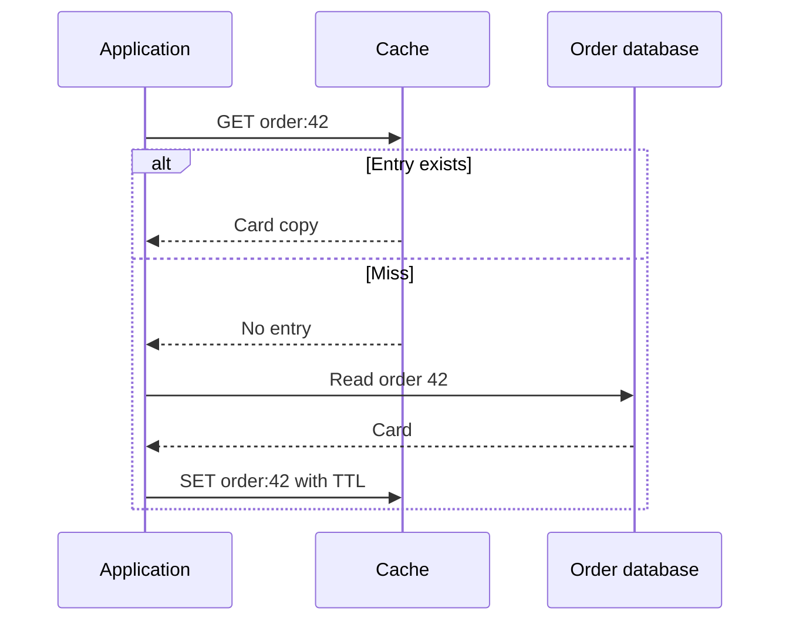
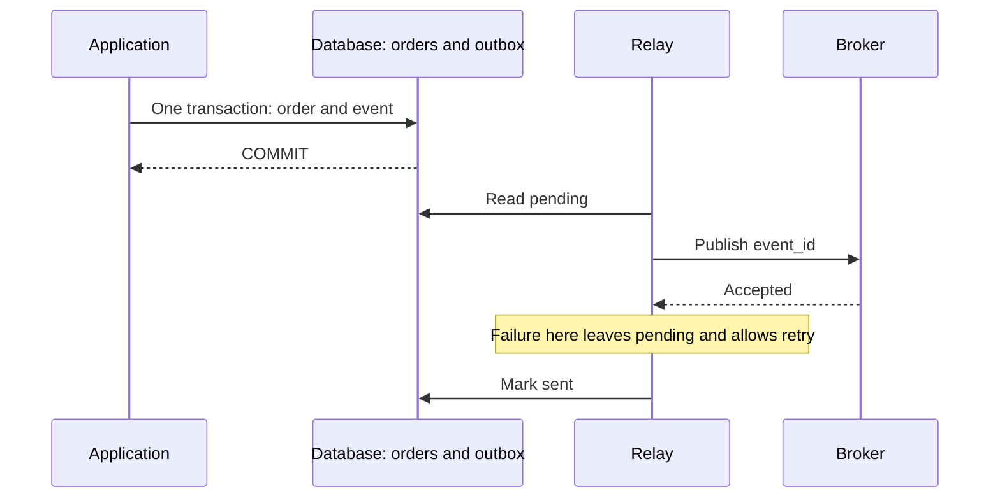
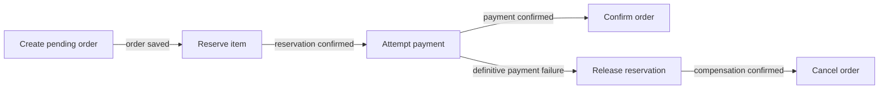
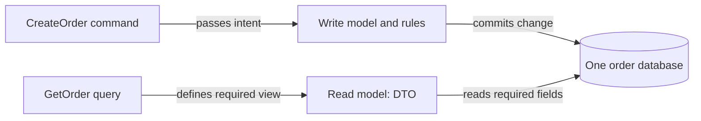
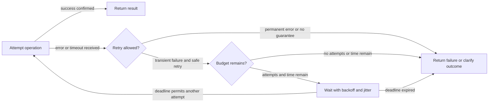

# Data, retries, and partial failure

[Русский](../../../ru/architecture/patterns/distributed-systems.md)

The cards cover Cache-Aside, Outbox, Saga, CQRS, and Retry.
Choose a mechanism according to the failure.
Check the guarantee's boundary.
The running example creates and reads an order.
The diagrams show possible runtime flows.
They do not show imports or ready configurations.

[Patterns](README.md) · [Application organization](architecture-patterns.md) · [Principles](../principles.md)

## Quick choice

| Requirement | Mechanism | Application | What it does not promise |
| --- | --- | --- | --- |
| Reduce repeated expensive reads | [Cache-Aside](#cache-aside-for-cached-reads) | Read an order card with acceptable staleness | Strong consistency between cache and database |
| Preserve send intent after a write | [Outbox](#transactional-outbox-for-saving-an-order-and-publication-intent) | One local order/event transaction | A single delivery or single external effect |
| Complete or compensate a shared process | [Saga](#saga-for-coordinating-local-steps) | Order, reservation, and payment under different data owners | Shared ACID rollback and isolation across all steps |
| Separate different write and read needs | [CQRS](#cqrs-for-separate-write-and-read-models) | Write-rule validation and a convenient read card | A requirement for a broker, separate databases, or Event Sourcing |
| Survive a recognized transient failure | [Retry](#retry-for-transient-failures) | A call with safe retry semantics | Absence of duplicate effects when the outcome is unknown |

[Complete Outbox example with checks](#complete-outbox-example-and-duplicate-publication) · [Sources](#sources)

| Parameter | Value |
| --- | --- |
| Level | Advanced. Start with the quick-choice table, then cards and the complete example |
| Prerequisites | Transactions, timeouts, writing versus publication, local and network calls |
| Example environment | Python 3.14, `sqlite3`, one worker, in-memory database, list standing in for a broker |

## Cache-Aside for cached reads

Use this when repeated reads are expensive and limited data staleness is acceptable.
The application checks the cache itself.
On a miss, the application reads the primary store.
Then the application fills the cache.
This applies to the order-card read path.
The cache holds a copy.
The database remains the source of truth.

The diagram shows **runtime reads**.

A cache hit is served without reading the database.
In a common write variant, confirm the database change first.
Then invalidate the cache.
Updating the cache requires a separate coordinated policy.
A race between an old read and cache filling or invalidation can return an old value.
TTL, the entry's time to live, bounds the life of one particular copy.
TTL alone does not prove the required freshness for every read.

- [ ] Test a concurrent write during a cache miss.
- [ ] Test cache failure.
- [ ] Test simultaneous misses from many requests.

Account for independent copies in separate local caches.
Source — [Microsoft Cache-Aside](https://learn.microsoft.com/en-us/azure/architecture/patterns/cache-aside).

## Transactional Outbox for saving an order and publication intent

Use this when an order can be saved while its event is lost during separate broker delivery.
One local transaction commits the order change and event.
A separate sender, or relay, reads pending events.
The relay publishes those events.
This applies to the order-write transaction boundary.
The relay operates outside that boundary.

The diagram shows the **runtime flow**.

The local commit preserves the order and send intent.
The relay can be retried.
Eventual delivery requires relay and broker availability.
It requires retries and sufficient pending retention.
A failure after broker acceptance but before marking `sent` permits a duplicate.

- [ ] Check pending age.
- [ ] Check broker acknowledgments.
- [ ] Check ordering.
- [ ] Check event allocation between concurrent senders.
- [ ] Check returning an event to processing after ownership expires.
- [ ] Check event retention.
- [ ] Check duplicate messages.

For a consumer's local effect, include the dedup record and data change in one transaction.
An external effect requires provider-supported idempotency or another explicitly bounded protocol.
Message delivery does not imply exactly-once effect execution.
The [standalone example](outbox-example.md#complete-outbox-example-and-duplicate-publication) demonstrates atomicity and the duplicate window.
Source — [Microsoft Transactional Outbox](https://learn.microsoft.com/en-us/azure/architecture/databases/guide/transactional-out-box-cosmos).
The source uses Cosmos DB / Service Bus.
The learning example uses SQLite.

## Saga for coordinating local steps

Use this when different services own the data and the process has no shared transaction.
The shared process is split into participants' local transactions.
Compensating business actions handle failure.
This applies to the order, reservation, and payment process.
Process state persists separately from the current call.

In this **illustrative step/outcome diagram**, a successful reservation commits before payment.
Payment failure here is definitive and known.
The diagram does not cover a timeout with an unknown outcome.

The process has explicit intermediate states and recovery paths.
Compensation performs a new action.
Compensation does not physically roll back committed transactions.
Compensation itself can fail.
There is no shared isolation from concurrent processes.

| Coordination | When to consider | Cost |
| --- | --- | --- |
| Events between participants, Choreography | A small number of steps react to one another's events | Harder to trace the entire process and avoid cyclic relationships |
| Explicit coordinator, Orchestration | Explicit state and control of a complex process are required | A durable coordinator needs maintenance |

- [ ] Check correlation.
- [ ] Check persisted step state.
- [ ] Check timeouts.
- [ ] Check idempotency.
- [ ] Check compensation retries.

Resolve an unknown payment outcome according to the provider contract first.
Avoid automatically treating an unknown outcome as failure.
Choose the order of irreversible steps in advance.
Define a manual or automatic failure-resolution method.
Source — [Microsoft Saga](https://learn.microsoft.com/en-us/azure/architecture/patterns/saga).

## CQRS for separate write and read models

Use this when one model is awkward for both write validation and report generation.
Commands use a model of mutation rules.
Queries use a convenient read model.
Simple CRUD often needs only a shared model.
This applies to order creation and card/report presentation.
Separation is possible within one process and database.

The diagram shows **runtime flows in a basic shared-database variant**.

Change validation and result presentation evolve separately.
Separate asynchronous projections add delivery and duplicates.
They add projection rebuilding and read lag.
After a successful command, the card may show the previous version.

Determine whether the client must immediately see its own write, known as read-your-writes.
For an asynchronous projection, define how to detect lag.
CQRS does not require Event Sourcing.
Event Sourcing stores events as the source for state reconstruction.
This is a separate decision.
It requires considering event versions, replay, and schema evolution.
Source — [Microsoft CQRS](https://learn.microsoft.com/en-us/azure/architecture/patterns/cqrs).

## Retry for transient failures

Use this when a recognized transient error may disappear and retrying the operation is safe.
Bound retries by attempt count and total duration.
Apply this in one layer that understands the operation's full context.
That layer accounts for the total operation deadline.
That layer accounts for repeated-effect semantics.

The **post-attempt decision diagram** shows a policy.
It is not an executable algorithm.

A brief failure can be hidden from the consumer without unlimited waiting.
A write timeout does not prove the absence of an effect.
The service may have executed the request and lost the response.
Retry requires an idempotent operation or a recipient-supported `operation_id`/key.
Adding a request field alone does not ensure deduplication.
Deduplication detects requests or messages already processed.
Backoff increases the delay between attempts.
Jitter adds random delay variation so clients do not retry simultaneously.

- [ ] Check error classification.
- [ ] Check each attempt's timeout.
- [ ] Check the overall deadline.
- [ ] Check the attempt limit.
- [ ] Check backoff/jitter.
- [ ] Check SDK built-in retries.

Avoid retrying validation and access-denied errors as transient failures.
Avoid multiplying independent retries at every layer.
Prolonged unavailability requires a separate decision.
A circuit breaker that stops requests is one possible response instead of increasing attempt counts.
Source — [Microsoft Retry](https://learn.microsoft.com/en-us/azure/architecture/patterns/retry).

## Complete Outbox example and duplicate publication

[Run the standalone example](outbox-example.md#complete-outbox-example-and-duplicate-publication).
The example checks order rollback on an event-write error.
It also shows repeated publication after sender failure.
The example uses Python 3.14 and in-memory SQLite without external services.

## Sources

- [Microsoft Cache-Aside](https://learn.microsoft.com/en-us/azure/architecture/patterns/cache-aside).
- [Microsoft Transactional Outbox](https://learn.microsoft.com/en-us/azure/architecture/databases/guide/transactional-out-box-cosmos).
- [Microsoft Saga](https://learn.microsoft.com/en-us/azure/architecture/patterns/saga).
- [Microsoft CQRS](https://learn.microsoft.com/en-us/azure/architecture/patterns/cqrs).
- [Microsoft Retry](https://learn.microsoft.com/en-us/azure/architecture/patterns/retry).
- [Python sqlite3 3.14](https://docs.python.org/3.14/library/sqlite3.html) supports the local learning transaction. This is not an Azure SDK implementation.
