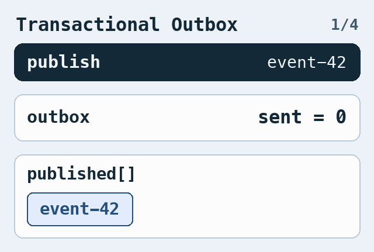

# Test Outbox atomicity and publication retries

[Русский](../../../ru/architecture/patterns/outbox-example.md)

Use this example when an order and the intent to send an event must be saved together.
A separate sender can terminate after publication and before marking the event sent.

| Check | Technique | Result |
| --- | --- | --- |
| A failed second write leaves no order | Write the order and event in one transaction | Order `43` is absent after a `UNIQUE` failure |
| Retrying the sender can duplicate delivery | Simulate failure before the `sent` marker | Event `event-42` is published twice |

[Outbox card and diagram](distributed-systems.md#transactional-outbox-for-saving-an-order-and-publication-intent) · [Patterns](README.md)

**Prerequisites** include Python 3.14, SQLite transactions, and exceptions.
No external dependencies or network services are required.

## Complete Outbox example and duplicate publication

**Advanced level.** Save the code as `outbox.py`.
Run `python3.14 outbox.py`.
The example uses sqlite3 from the standard library.
The example uses only an in-memory database.
A list stands in for a broker.
The checks cover local-write atomicity and possible repeated external publication.

[`architecture/outbox.py`](../../../../examples/architecture/outbox.py)

The result is OK.
After the event-write error, order 43 was not saved.
After the simulated failure, the event for order 42 was published twice.
This is an expected Outbox boundary.
The example provides no exactly-once guarantee.

Show the duplicate publication step by step

The first publication adds `event-42` to the list that stands in for the broker. The simulated crash leaves the outbox row at `sent = 0`. The next attempt publishes the same ID and then sets `sent = 1`.
To deduplicate a consumer's local effect, record the processed `event_id` and apply the effect in the same transaction.

[Replay the GIF](../../../assets/transactional-outbox-retry.gif?raw=true)

See the [Outbox call diagram](distributed-systems.md#transactional-outbox-for-saving-an-order-and-publication-intent).

A production relay needs worker locking or leases.
It needs broker acknowledgment.
It needs handling for unknown outcomes.
It needs management of ordering, retries, and dead messages.
It needs outbox cleanup.
The example's exception simulates a failure point.
The in-memory database does not model disk durability or recovery after process termination.
The consumer is not implemented here.

## Sources

- [Python 3.14 sqlite3](https://docs.python.org/3.14/library/sqlite3.html).
- [Microsoft Transactional Outbox](https://learn.microsoft.com/en-us/azure/architecture/databases/guide/transactional-out-box-cosmos).
