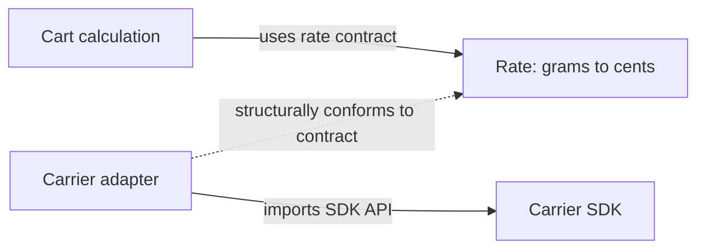
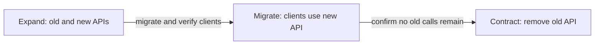

<a id="принципы-проектирования"></a>
# Design principles

[Русский](../../ru/architecture/principles.md)

Use principles to choose a module boundary and evaluate a change.
Identify which knowledge to group, what to hide, and which behavior to preserve.
Find an observable problem first. Then test the solution with an example.

<a id="быстрый-поиск"></a>
## Quick lookup

| Observation | Action | Card / example |
| --- | --- | --- |
| Unrelated tasks change in one module | Separate reasons for change | [Cohesion / coupling](#cohesion-and-coupling) |
| Invalid stock levels are possible | Protect operations with a contract | [Invariant](#contracts-and-invariants), [complete Stock](contracts.md#reserve-stock) |
| A calculation test requires HTTP / a database | Hide the external protocol behind the API required by the rule | [Dependency boundary](#encapsulation-and-dependencies), [DIP](solid.md#продвинутый-уровень) |
| A rule is copied / a framework grows without a consumer | Extract shared knowledge. Remove unnecessary variability | [DRY / KISS / YAGNI](#dry-kiss-and-yagni) |
| Debate over architecture names | Record the scenario, cost, and check | [Decision table](#make-a-trade-off-testable) |
| All clients cannot migrate at once | Add a compatible path. Then gradually remove the old path | [Parallel change](#change-a-contract-gradually) |

[Architecture](README.md) · [Boundaries](#cohesion-and-coupling) · [Invariants](#contracts-and-invariants) · [Trade-offs](#make-a-trade-off-testable) · [Mistakes](#common-mistakes) · [Sources](#sources)

**Prerequisites** include functions, modules, state, and tests.
The [complete Python examples](contracts.md) show success, rejection, and state after rejection.
Principles do not prescribe a number of classes, layers, or services.
Evaluate decisions against requirements and consequences.

<a id="базовый-уровень"></a>

<a id="связность-и-связанность"></a>
## Cohesion and coupling

| Concept | Quick reminder | Example decision |
| --- | --- | --- |
| **Cohesion** | A module solves one coherent task. Code changes for related reasons | Keep rate calculation together with its constraints |
| **Coupling** | One part knows another part's data, call order, errors, or response time | Hide SDK response translation inside an adapter |

A carrier's new JSON format forces a change to the rate-selection rule.
Separate external response translation from rate selection.

The diagram shows **code dependencies** after the separation.
Arrow labels identify the API used.



Change JSON/SDK details inside the adapter.
Check that calculation results are preserved.
Check that calculation dependencies are preserved.

In a small module, functions can stay together.
Increasing the file count alone does not reduce coupling.
A shared mutable structure can couple parts more tightly than an explicit call.

<a id="контракт-и-инвариант"></a>
## Contracts and invariants

| Aspect to define | `Stock.reserve(quantity)` contract |
| --- | --- |
| Input | Positive integer quantity. `bool` is disallowed |
| Success | The operation reduces stock by the specified quantity |
| Errors | `ValueError` for invalid input. `OutOfStock` for a shortage |
| Side effect on rejection | Stock remains unchanged |
| State invariant | Stock is always an integer and nonnegative |

This call snippet comes from the [complete `invariants.py`](contracts.md#reserve-stock).
Use the snippet after defining `Stock`.

```python
stock = Stock(3)
stock.reserve(2)
assert stock.available == 1
```

Stock equals `1`.
Reserving another `2` raises `OutOfStock`.
Stock remains `1`.

The example runs in one thread.
Concurrent database reservation requires separate transactional guarantees.

<a id="средний-уровень"></a>

<a id="инкапсуляция-и-зависимости"></a>
## Encapsulation and dependencies

| Hide | Expose to the consumer | Boundary check |
| --- | --- | --- |
| SDK / HTTP response format | A value in agreed units and understandable errors | Apply the same contract test to adapters |
| Mutable internal data | An operation, copy, or immutable view | Check that the public API preserves the invariant |
| Price storage mechanism | `price(sku)` with agreed freshness | Run the calculation with a local source without an ORM |

A function parameter, module, or small `Protocol` can provide a sufficient boundary.
[DIP and DI](solid.md#продвинутый-уровень) show dependency direction and the passing mechanism.
[Ports & Adapters](patterns/architecture-patterns.md#code-organization) shows a possible role layout.

<a id="dry-kiss-и-yagni"></a>
## DRY, KISS, and YAGNI

| Principle | Signal → action | Necessary qualification |
| --- | --- | --- |
| **DRY** | If one business rule is copied, keep one authoritative definition | Similar lines can express independent rules |
| **KISS** | If hidden modes obscure the result, choose an explicit, simple solution for the contract | Fewer lines do not always make code simpler |
| **YAGNI** | If current consumers do not need an option, defer it | Preserve tests and boundaries required for the current task |

Two reports happen to have identical columns.
A shared helper accumulates more flags.
Keep independent formats alongside their reports.
If the rule is genuinely shared, extract it.
Change one format.
Check that the second format is preserved.
If the rule is shared, check both consumers.

<a id="продвинутый-уровень"></a>

<a id="делать-компромисс-проверяемым"></a>
## Make a trade-off testable

The table contains a sample **decision record**.
It does not specify configuration or a ready implementation plan.

| Field | Example of a specific record |
| --- | --- |
| Problem | A new carrier requires cart calculation and HTTP errors to change in one module |
| Constraint | Price tests run without a network. Existing results are preserved |
| Trial change | Response translation lives in an adapter. Rate selection lives in a separate function |
| Verification | Contract tests pass for two adapters. Calculation does not import the HTTP module |
| Cost | Maintain the error contract and object composition point |
| Reconsider when | Adapters still require SDK details inside the rule |

Data isolation, availability, latency, and consistency can conflict.
The layer count alone does not prove a useful boundary.
The coverage percentage alone does not prove a useful boundary.

<a id="менять-контракт-постепенно"></a>
## Change a contract gradually

Consider a staged change for a published interface with independently updated clients.



The diagram shows the **sequence of change stages**.
It does not show calls or source dependencies.
The compatibility period has a cost.
Define how to track old calls in advance.
For an internal local function, changing all calls together can be simpler.
[Parallel change source and details](https://martinfowler.com/bliki/ParallelChange.html).

<a id="частые-ошибки"></a>
## Common mistakes

| Mistake | More useful check |
| --- | --- |
| “DRY requires removing every duplication” | Determine whether code expresses one piece of knowledge or merely similar text |
| “An abstraction is needed for the future” | Identify the current change and consumer |
| “Encapsulation means private fields” | Check whether public operations preserve invariants |
| “Microservices will fix coupling” | Check whether parts can change and release independently |
| “The example test proved the architecture” | Identify the inputs, states, and failures the test checked |

<a id="источники"></a>
## Sources

- [Robert C. Martin, SRP](https://blog.cleancoder.com/uncle-bob/2014/05/08/SingleReponsibilityPrinciple.html) covers reasons for change.
- [Alistair Cockburn, Ports & Adapters](https://alistair.cockburn.us/hexagonal-architecture) covers application isolation.
- [Martin Fowler, Yagni](https://martinfowler.com/bliki/Yagni.html), [Danilo Sato, Parallel Change](https://martinfowler.com/bliki/ParallelChange.html).
