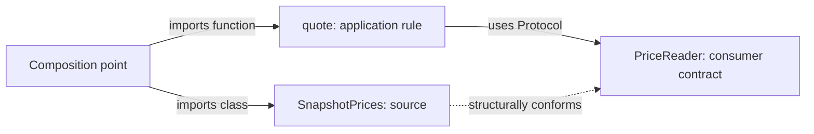

# SOLID

[Русский](../../ru/architecture/solid.md)

SOLID offers five ways to make code changes manageable.
Separate reasons for change.
Isolate the required variation.
Preserve the contract.
Direct dependencies toward the consumer.
Apply the principles to functions and modules as well as classes.

<a id="быстрый-поиск"></a>
## Quick lookup

| Principle | Problem → change | Card |
| --- | --- | --- |
| **S — Single Responsibility** | Rate and response format change one module → separate reasons for change | [S with calculation and JSON](#s--reasons-for-change) |
| **O — Open/Closed** | Each new rate changes the consumer → pass the calculation rule | [O extension point](#o--a-justified-extension-point) |
| **L — Liskov Substitution** | Replacing the source changes errors → test promised behavior | [L price contract](#l--behavioral-substitution) |
| **I — Interface Segregation** | Reading depends on a large database API → provide the role the client needs | [I with price only](#i--a-consumer-focused-interface) |
| **D — Dependency Inversion** | Calculation knows the SDK/ORM → adapt the detail to the application contract | [DIP and DI](#d--dependency-direction-and-di-as-a-passing-mechanism) |

[Architecture](README.md) · [Complete examples](contracts.md) · [Mistakes](#common-mistakes)

**Prerequisites** include functions, composition, exceptions, and duck typing.
The examples use Python 3.14.
A finite test set does not prove a contract for all inputs and implementations.

<a id="базовый-уровень"></a>

<a id="s--причины-изменений"></a>
## S — reasons for change

Price requirements and JSON response requirements arrive independently.
Both currently change one function.
Separate calculation from presentation.
Calculation returns a value.
Presentation formats the value.

| Before | After | Shared responsibility |
| --- | --- | --- |
| `invoice_before` knows the price and JSON | `total` knows the calculation. `invoice_json` knows the format | The call site connects both operations |

The complete mini-example uses a positive quantity and a fixed price in cents.
Save the code as `solid-srp.py`.
Run `python3.14 solid-srp.py`.
No dependencies are required.
Quantity validation is omitted from this mini-example.
Working validation appears in the [complete contract](contracts.md#substitute-a-price-source).

[`architecture/solid-srp.py`](../../../examples/architecture/solid-srp.py)

The response is preserved.
SRP ties responsibility to an actor, the source of requirements.
SRP does not prescribe one method per class.
If reasons for change are related, splitting code may not help.

<a id="o--обоснованная-точка-расширения"></a>
## O — a justified extension point

Adding a rate requires editing stable calculation code.
Choose the expected variation, the rate formula.
Pass the formula as a callable.

| Before | After | Where selection changes |
| --- | --- | --- |
| Branches on rate names inside the consumer | The consumer calls the supplied rule | At the composition point, as in the [Factory example](patterns/design-patterns.md#factory-for-assembling-the-required-implementation) |

The complete mini-example uses a positive integer quantity.
Save the code as `solid-ocp.py`.
Run `python3.14 solid-ocp.py`.
No dependencies are required.

[`architecture/solid-ocp.py`](../../../examples/architecture/solid-ocp.py)

One consumer works with two rules.
Openness applies to the chosen variation.
Bug fixes require editing.
Changes to the contract itself also require editing.
Code cannot be protected against every future change.

<a id="средний-уровень"></a>

<a id="l--поведенческая-подстановка"></a>
## L — behavioral substitution

A source with the same method silently returns `0` for an unknown product.
Test the behavior promised to the consumer.
Check preconditions, results, errors, and effects.

| Before, incompatible snapshot | After, compatible snapshot |
| --- | --- |
| `prices.get(sku, 0)` hides a missing product | `prices[sku]` raises the promised `KeyError` |
| The signature matches but behavior differs | The client preserves its failure handling |

The specific contract applies to both implementations.

| Input / operation | `PriceReader` promise |
| --- | --- |
| Known `book` | Nonnegative integer price in cents |
| Unknown `sku` | `KeyError` |
| Repeated snapshot reading | Same price, with no snapshot mutation |

Use this snippet after the definitions from the [complete `solid-contract.py`](contracts.md#substitute-a-price-source).

```python
reader = SnapshotPrices({"book": 1200})
check_reader_contract(reader)
assert quote(reader, "book", 2) == 2400
```

The compatible source passes the check.
The complete example rejects `SilentMissingPrices`.
The implementation does not strengthen the promised preconditions.
The implementation does not weaken the result.
Inheritance is optional.
The rule also applies to duck typing / `Protocol`.

<a id="i--интерфейс-под-потребителя"></a>
## I — a consumer-focused interface

Price calculation receives an object with `price`, `delete`, `commit`, and `export`.
Describe the reading role this client needs.

| Before | After |
| --- | --- |
| The consumer is annotated with a large storage API | The consumer knows only `PriceReader` |
| Changes to unnecessary operations affect its dependency | Writing and export have other consumers |

The interface snippet comes from the [complete example](contracts.md#substitute-a-price-source).
The ellipsis declares a `Protocol` method.
The implementation lives in `SnapshotPrices`.

```python
from typing import Protocol


class PriceReader(Protocol):
    def price(self, sku: str) -> int: ...
```

Call `quote(reader, "book", 2)` from the L card.
The object may have other methods.
The client contract does not require those methods.
ISP does not require an interface for every method.
`Protocol` is intended for static checking.
Annotations do not check behavior at runtime.

<a id="полный-пример-контракт-вместо-формы-метода"></a>
## Complete example of a behavioral contract

The [complete example](contracts.md#substitute-a-price-source) checks quantity `0` and detects an implementation with incorrect error behavior.

<a id="продвинутый-уровень"></a>

<a id="d--направление-зависимости-di--способ-передачи"></a>
## D — dependency direction and DI as a passing mechanism

The calculation function creates a concrete SDK client.
The function depends on the SDK's format.
Define the price contract on the application side.
The technical detail supplies an implementation of the contract.

| Before | After |
| --- | --- |
| Calculation knows the SDK class and its response | Calculation uses `PriceReader.price` |
| Testing requires creating an SDK client | Composition passes `SnapshotPrices` or another compatible source |

The diagram shows **code dependencies**. A solid arrow means knowledge of an API.
A dotted arrow means structural conformance.
A Python adapter does not have to import `Protocol`.



Use this composition snippet after the [complete example's](contracts.md#substitute-a-price-source) definitions.

```python
reader = SnapshotPrices({"book": 1200})
amount = quote(reader, "book", 2)
assert amount == 2400
```

**At runtime**, `quote` calls `price` on the supplied object.
**DI** means passing `reader` as an argument.
**DIP** means the rule depends on its own contract.
The technical detail adapts to that contract.
Injecting a concrete SQL client alone does not ensure DIP.
Possible [example modules](contracts.md#possible-module-layout) appear separately.
A DI container is unnecessary.

<a id="проверять-цену-абстракции"></a>
## Check the cost of an abstraction

Choose a boundary for the current consumer and a specific change.
The contract and composition point require maintenance.
If the only implementation is simple and does not obstruct changes or tests, an additional `Protocol` may be unnecessary.
When replacing in-memory storage with a database, align transactions.
Align `NULL`, errors, and data freshness.
Static analysis does not check network failures.
Local tests do not check network failures either.

<a id="частые-ошибки"></a>
## Common mistakes

| Mistake | Clarification |
| --- | --- |
| SRP = one function | A reason for change relates to an actor's requirements |
| OCP prohibits editing code | A specific variation is protected, without covering every future change |
| LSP = the method exists / isinstance passed | A behavioral contract is required |
| ISP requires splitting every interface | The boundary follows client needs |
| DIP = a DI library | Dependency direction and passing mechanism are separate decisions |
| SOLID requires inheritance | Composition, functions, and structural contracts are often sufficient |

<a id="источники"></a>
## Sources

- [Robert C. Martin, Solid Relevance](https://blog.cleancoder.com/uncle-bob/2020/10/18/Solid-Relevance.html), [SRP](https://blog.cleancoder.com/uncle-bob/2014/05/08/SingleReponsibilityPrinciple.html).
- [Liskov / Wing, A Behavioral Notion of Subtyping](https://www.cs.cmu.edu/~wing/publications/LiskovWing94.pdf).
- [PEP 544](https://peps.python.org/pep-0544/), [Python 3.14 Protocol](https://docs.python.org/3.14/library/typing.html#typing.Protocol).
