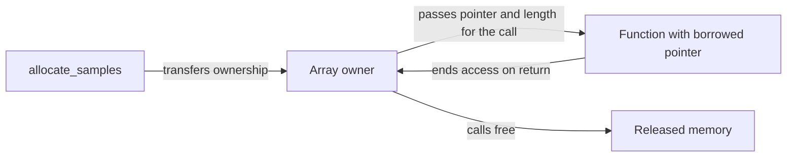

# C patterns and application areas

[C cheat sheet](README.md) · [Русский](../../ru/c/practice.md)

Choose an ownership contract for a C17 function or select tools for a project. The pattern excerpts use the standard library. Check the available libraries and build requirements for your target platform.

| Task | Technique | Card |
| --- | --- | --- |
| Pass memory or return a result | Ownership, borrowing, output parameter | [Ownership and errors](#patterns) |
| Release a resource after several operations | Shared cleanup block | [Cleanup on exit](#cleanup-on-exit) |
| Choose tools and a first task | Platform and library matrix | [Application areas](#application-areas) |

<a id="patterns"></a>

## Ownership and errors

Document the owner and lifetime of each object passed by pointer. State the unit of any length parameter. If a function accepts `NULL`, define its meaning in the function contract.

| Situation | Contract | Technique |
| --- | --- | --- |
| A function reads data owned by its caller | The object remains valid until the function returns. | Pass `const T *` and the element count. |
| A function creates an object for its caller | The caller receives ownership on success. | Expose a `create`/`destroy` pair. Use an incomplete type to hide fields if you need to enforce invariants. |
| A function writes its result to a caller-owned object | The output pointer is valid for writing. The function writes a value only on success. | Return a status code and pass an output parameter. |
| A library provides a resource | Release it with the function documented by the API. | Pair `fopen` with `fclose`. Pair `sqlite3_prepare_v2` with `sqlite3_finalize`. |

### Choose a design pattern

| Task | Pattern and example | Condition |
| --- | --- | --- |
| Hide object fields behind a stable interface | Opaque handle. [SQLite](https://www.sqlite.org/cintro.html) exposes `sqlite3 *` and functions that operate on the connection. | Document how to create, own, and close the handle. |
| Change an operation while keeping the traversal | Strategy. [`visit_readings`](syntax.md#functions-structs-and-callbacks) calls the supplied function for each reading. | Define the function signature and the context lifetime. |
| Connect a library to a command-line interface | Adapter. [`main.c`](../../../examples/c/port-parser/main.c) passes the argument to the parser and maps the status to a message and exit code. | Keep parsing in the library. Handle output and process status in the CLI. |

### Allocate an array

Excerpt for allocating space for `count` values of type `int`. Check the byte size before multiplying. On success, initialize the memory before reading from it.

```c
#include <stddef.h>
#include <stdint.h>
#include <stdlib.h>

static int *allocate_samples(size_t count)
{
    if (count == 0 || count > SIZE_MAX / sizeof(int)) {
        return NULL;
    }
    return malloc(count * sizeof(int));
}
```

If the function returns a pointer, the caller owns the memory and calls `free`. Borrowed pointers are valid only during the object's lifetime. The diagram shows the transitions after a successful allocation.



To resize a block, pass a checked nonzero size to `realloc`. Store the result in a temporary pointer. If `realloc` returns `NULL`, the owner keeps the old block. On success, update the owning pointer and stop using previous borrowed pointers.

### Return an error code

Use an output parameter when a function needs to report both a status and a value. In the [port parser](../../../examples/c/port-parser/port.c), `parse_port("8080", &port)` returns `PORT_OK` and writes `8080`. On every other status, `port` keeps its previous value. This contract lets callers check failures without unexpected writes to the output.

### Cleanup on exit

Excerpt for checking the first four bytes of a file. After a successful `fopen`, both validation branches reach the same call to `fclose`.

```c
#include <stdio.h>
#include <string.h>

static int check_header(const char *path)
{
    const unsigned char expected[] = {0x44, 0x41, 0x54, 0x41};
    unsigned char actual[sizeof expected];
    int status = -1;

    FILE *file = fopen(path, "rb");
    if (file == NULL) {
        return status;
    }

    if (fread(actual, 1, sizeof actual, file) != sizeof actual) {
        goto cleanup;
    }
    if (memcmp(actual, expected, sizeof actual) != 0) {
        goto cleanup;
    }
    status = 0;

cleanup:
    if (fclose(file) == EOF) {
        status = -1;
    }
    return status;
}
```

A result of `0` means the header matched and the file closed successfully. This excerpt reports every failure with status `-1`. Return named statuses if callers need the reason. With several resources, release only the resources you acquired, in reverse order.

<a id="application-areas"></a>

## Where to use C

Choose the compiler and libraries for the target platform. If the program calls OS or device APIs, verify its behavior in that environment.

| Area | Platform and build | Libraries and APIs | What to learn | First task | Important constraint |
| --- | --- | --- | --- | --- | --- |
| Command-line tools | Linux or macOS, GCC or Clang, Make or CMake | Standard library, POSIX as needed | Arguments, streams, and exit codes | Build the [port parser](tooling-and-testing.md#tests). | POSIX APIs require support on the target platform. |
| Firmware | STM32 board, ARM cross-compiler, debug probe | [STM32Cube HAL or LL](https://www.st.com/en/embedded-software/stm32cube-mcu-mpu-packages.html), Unity for host-side logic | Registers, timers, and interrupts | Toggle an LED on a development board using a timer. | Account for the board's memory and latency limits. |
| Linux kernel modules | Linux VM, kbuild, target kernel build files | [Kernel APIs](https://docs.kernel.org/kbuild/modules.html) | Call context and allocation rules | Build a minimal module in a learning VM. | Use the target kernel's configuration and headers. |
| Network clients | Linux, macOS, or Windows, compiler and TLS backend | [libcurl](https://curl.se/libcurl/c/libcurl.html) | HTTP, TLS, timeouts, and callbacks | Fetch a local test HTTP response. | Distinguish a transfer error from an HTTP status. |
| Local data | Application with file access or in-memory SQLite | [SQLite 3 C API](https://www.sqlite.org/cintro.html) | Prepared statements, binding, and transactions | Insert and read a row in a `:memory:` database. | Finalize statements before closing the connection. |
| Graphics and multimedia | Desktop OS, compiler, and graphical session | [SDL3](https://wiki.libsdl.org/SDL3/FrontPage) | Events, frames, and resource lifetimes | Open a window and handle its close event. | Follow SDL's per-function threading requirements. |

## Sources

- [ISO/IEC 9899:2018 (C17)](https://www.iso.org/standard/74528.html) and [public WG14 draft N1570](https://www.open-std.org/jtc1/sc22/wg14/www/docs/n1570.pdf), sections 6.2.4 and 7.22.3 for lifetime and basic allocation rules.
- [WG14 discussion of zero-size `realloc`](https://www.open-std.org/jtc1/sc22/wg14/www/docs/n2438.htm).
