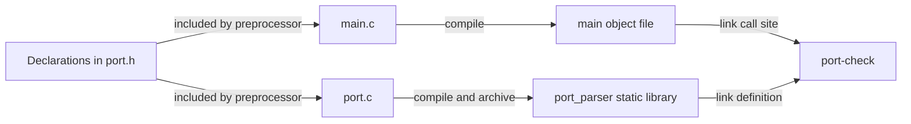

# C builds, dependencies, and tests

[C cheat sheet](README.md) · [Русский](../../ru/c/tooling-and-testing.md)

Build a program from multiple files and run its tests with CTest. The example validates a decimal port number from a command-line argument.

| Task | Technique | Card |
| --- | --- | --- |
| Diagnose a build failure | Translation unit, object file, linking | [Compile and link files](#compile-and-link-files) |
| Add an external library | `FetchContent`, `target_link_libraries` | [Add a dependency](#packages) |
| Verify library code | Unity and CTest | [Build and run tests](#tests) |
| Check memory accesses | ASan and UBSan in Clang | [Run sanitizers](#run-sanitizers) |

## Compile and link files

The `port.h` header declares the `parse_port` function and its return type. The `#ifndef` and `#define` include guard prevents repeated inclusion in a single translation unit. Include the header in `port.c` and `main.c` so the compiler can check the definition and call against the declaration.

The diagram shows the files involved in building `port-check`. Each translation unit is the result of preprocessing one source file.



| Symptom | What to check |
| --- | --- |
| The compiler cannot find `port.h` | Check the header path and the include search directory. In CMake, set the directory with `target_include_directories`. |
| The linker cannot find `parse_port` | Check that `port.c` belongs to the library. Link the executable target to the library with `target_link_libraries`. |
| The linker reports multiple definitions | Keep one definition of the exported function in a source file. Put the declaration in the header. |

For one source file, use the [first-run command](README.md#first-run). The Clang flag `-c` builds an object file separately. For a project with several targets, CMake generates rules for Make or Ninja. The `cmake --build` command runs the selected build tool.

<a id="packages"></a>

## Add a dependency

Choose the library source before configuring the project. C has several ways to acquire and connect dependencies.

| Condition | Tool | Action |
| --- | --- | --- |
| A small CMake project needs the source of a pinned release | [CMake FetchContent](https://cmake.org/cmake/help/v3.31/module/FetchContent.html) | Fetch the source at configure time. Link its library target to your own target. |
| The project declares dependencies in a manifest | [vcpkg manifest mode](https://learn.microsoft.com/vcpkg/users/buildsystems/cmake-integration) | Declare packages in `vcpkg.json`. Pass the toolchain file when configuring CMake. Use `find_package` according to the port documentation. |
| The library is already installed by a system package manager or SDK | [CMake `find_package`](https://cmake.org/cmake/help/v3.31/command/find_package.html) or [`pkg-config`](https://cmake.org/cmake/help/v3.31/module/FindPkgConfig.html) | Find its metadata, header paths, and link flags. |

In the [complete parser build configuration](../../../examples/c/port-parser/CMakeLists.txt), the `FetchContent` module downloads the Unity 2.7.0 archive. The `URL_HASH` option checks the archive's SHA-256. The `FetchContent_MakeAvailable(unity)` call adds the `unity::framework` target from source. The line `target_link_libraries(test_port PRIVATE port_parser unity::framework)` links the application library and Unity to the test executable target.

`FetchContent` gets source for the current build. A package manager such as vcpkg also manages package installation and package dependencies. Check the library's platform support, version, and license before adding it. For a CLI-only build, configure with `-DBUILD_TESTING=OFF`. In this mode, CMake skips the Unity download.

<a id="tests"></a>

## Build and run tests

Use Clang with C17 support, the C standard library, Make, and CMake with CTest 3.24 or later. The first configure with tests needs HTTPS access to GitHub codeload. The commands use Bash or Zsh.

The complete example includes the [interface](../../../examples/c/port-parser/port.h), [parser](../../../examples/c/port-parser/port.c), [CLI](../../../examples/c/port-parser/main.c), [tests](../../../examples/c/port-parser/test_port.c), and [build configuration](../../../examples/c/port-parser/CMakeLists.txt). The tests use strings from the source file.

From the repository root, create a temporary directory. Configure and build the project. Run the tests and pass `8080` to the program.

```bash
build_dir=$(mktemp -d) &&
  cmake -S examples/c/port-parser -B "$build_dir" -G "Unix Makefiles" \
    -DCMAKE_C_COMPILER=clang -DCMAKE_BUILD_TYPE=Debug &&
  cmake --build "$build_dir" &&
  ctest --test-dir "$build_dir" --output-on-failure --no-tests=error &&
  "$build_dir/port-check" 8080
```

CTest reports one passing test process. Inside the process, Unity runs six unit tests. Run `ctest --test-dir "$build_dir" -V` to see the result of each Unity test. The program prints `Port: 8080`.

Excerpt from `test_port.c`. The `TEST_ASSERT_EQUAL_INT` and `TEST_ASSERT_EQUAL_UINT` macros take the expected value as their first argument. The test checks the error status and confirms that `port` keeps its value when the input is outside the range.

```c
static void test_out_of_range(void)
{
    unsigned int port = 80;
    TEST_ASSERT_EQUAL_INT(PORT_OUT_OF_RANGE, parse_port("0", &port));
    TEST_ASSERT_EQUAL_UINT(80, port);
    TEST_ASSERT_EQUAL_INT(PORT_OUT_OF_RANGE, parse_port("65536", &port));
    TEST_ASSERT_EQUAL_UINT(80, port);
}
```

Include `<unity.h>` for the assertions. Add `RUN_TEST(test_out_of_range)` between `UNITY_BEGIN()` and `UNITY_END()` in the test process's `main`. CTest uses the process exit status to determine the outcome.

The tests cover decimal parsing with a leading zero, both range boundaries, and argument, syntax, and range errors. On error, the parser preserves the previous value of the output parameter. The parser validates a configuration value without opening a network connection.

Run `"$build_dir/port-check" 65536` to check CLI failure. The program writes `Expected a decimal port from 1 to 65535.` to standard error and returns a nonzero status.

## Run sanitizers

If Clang for your platform supports ASan and UBSan, rebuild the tests in a new directory. The `-fno-sanitize-recover=undefined` flag stops the process on detected undefined behavior so that CTest marks the run as failed.

```bash
sanitizer_dir=$(mktemp -d) &&
  cmake -S examples/c/port-parser -B "$sanitizer_dir" -G "Unix Makefiles" \
    -DCMAKE_C_COMPILER=clang -DCMAKE_BUILD_TYPE=Debug \
    "-DCMAKE_C_FLAGS=-fsanitize=address,undefined -fno-sanitize-recover=undefined -fno-omit-frame-pointer" &&
  cmake --build "$sanitizer_dir" &&
  ctest --test-dir "$sanitizer_dir" --output-on-failure --no-tests=error
```

ASan detects problems such as buffer overflows and accesses to freed memory. UBSan detects problems such as signed integer overflow. Sanitizers check executed code paths.

## Sources

- [Clang 21 command guide](https://releases.llvm.org/21.1.0/tools/clang/docs/CommandGuide/clang.html) and [release notes](https://releases.llvm.org/21.1.0/tools/clang/docs/ReleaseNotes.html).
- [CMake 3.31](https://cmake.org/cmake/help/v3.31/manual/cmake.1.html), [CTest](https://cmake.org/cmake/help/v3.31/manual/ctest.1.html), and [release notes](https://cmake.org/cmake/help/v3.31/release/3.31.html).
- [CMake 3.24 archive download options](https://cmake.org/cmake/help/v3.24/module/ExternalProject.html).
- [Unity 2.7.0 guide](https://github.com/ThrowTheSwitch/Unity/blob/v2.7.0/docs/UnityGettingStartedGuide.md) and [Unity 2.7.0 release](https://github.com/ThrowTheSwitch/Unity/releases/tag/v2.7.0).
- [AddressSanitizer](https://clang.llvm.org/docs/AddressSanitizer.html) and [UndefinedBehaviorSanitizer](https://clang.llvm.org/docs/UndefinedBehaviorSanitizer.html).
