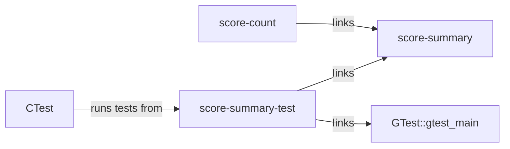

# C++20 builds, packages, and tests

[C++ reference](README.md) · [Русский](../../ru/cpp/tooling-and-testing.md)

Build a CLI that counts scores at or above a threshold. Use this lab to follow a dependency from its manifest through to a running test suite.

| Task | Tool | Example |
| --- | --- | --- |
| Build a program from two files | `clang++`, standard library | [Build without CMake](#build-the-cli-with-clang) |
| Build an application and a library | CMake targets and `target_link_libraries` | [Build targets](#cmake-targets) |
| Choose how to add a dependency | vcpkg, Conan 2, CMake `FetchContent` | [Packages](#packages) |
| Reproduce the build on Apple Silicon | CMake, vcpkg, GoogleTest | [Run the lab](#run-the-lab) |
| Check ordinary inputs and errors | GoogleTest, CTest | [Tests](#tests) |
| Check for memory errors and undefined behavior | AddressSanitizer, UndefinedBehaviorSanitizer | [Diagnostics](#diagnostics) |

## Build the CLI with Clang

From the repository root, build the [CLI](../../../examples/cpp/score-count.cpp) and its [scoring implementation](../../../examples/cpp/score-summary.cpp). Use a C++20 compiler and standard library with Bash or Zsh.

```bash
build_dir=$(mktemp -d) &&
  clang++ -std=c++20 -Wall -Wextra -pedantic examples/cpp/score-count.cpp examples/cpp/score-summary.cpp \
    -o "$build_dir/score-count" &&
  "$build_dir/score-count" 60 55 60 95
```

The result is `2 of 3`. Of the three scores, 60 and 95 reach the minimum of 60. To build with GoogleTest, follow the [test lab](#run-the-lab).

<a id="cmake-targets"></a>

## Build targets

The diagram shows the relationships between targets in the [complete `CMakeLists.txt`](../../../examples/cpp/CMakeLists.txt). The application and tests use the same scoring implementation.



Excerpt from `CMakeLists.txt`. These commands use the lab's adjacent source files and header.

```cmake
add_library(score-summary STATIC score-summary.cpp)
target_compile_features(score-summary PUBLIC cxx_std_20)
target_include_directories(score-summary PUBLIC "${CMAKE_CURRENT_SOURCE_DIR}")

add_executable(score-count score-count.cpp)
target_link_libraries(score-count PRIVATE score-summary)
```

The Unix Makefiles generator produces build rules for `make`. The `cmake --build` command invokes `make` with those rules. The `PUBLIC` scope passes the C++20 requirement and include path to targets that use `score-summary`. The `score-count` link is `PRIVATE` because the executable needs the library for its own build.

<a id="packages"></a>

## Add dependencies

| Approach | When to use it | What to pin |
| --- | --- | --- |
| [vcpkg](https://learn.microsoft.com/en-us/vcpkg/consume/manifest-mode) | The project uses packages from a vcpkg registry | vcpkg version, `builtin-baseline`, targeted `overrides`, triplet. |
| [Conan 2](https://docs.conan.io/2/tutorial/consuming_packages.html) | The project uses packages from ConanCenter or its own registry | Recipe versions, build and host profiles, lockfile. |
| [CMake `FetchContent`](https://cmake.org/cmake/help/v3.31/module/FetchContent.html) | The project adds a dependency's source at configure time | Full Git commit hash or archive URL and `URL_HASH`. |

A package manager resolves dependency versions and supplies builds for the selected platform. `FetchContent` makes specified sources available to CMake at configure time. If the dependency includes a suitable `CMakeLists.txt`, `FetchContent_MakeAvailable` can add its targets to the build.

The [lab manifest](../../../examples/cpp/vcpkg.json) pins the built-in registry commit and the `gtest` port at `1.17.0#2`. The `#2` suffix denotes the vcpkg port revision. The GoogleTest version is still `1.17.0`. A triplet selects package build settings, including architecture and platform. Pinning packages reproduces the dependency selection with the same settings. For reproducible binaries, control the compiler, SDK, and build settings as well. [vcpkg versioning](https://learn.microsoft.com/en-us/vcpkg/users/versioning) · [The `gtest` port at the pinned commit](https://github.com/microsoft/vcpkg/blob/d015e31e90838a4c9dfa3eed45979bc70d9357fc/ports/gtest/vcpkg.json).

### Common libraries and tools

| Task | Tool | What to check |
| --- | --- | --- |
| Format text | [fmt](https://fmt.dev/12.0/) | Compare the features you need with `std::format` in your standard library. |
| Read and write JSON | [nlohmann/json](https://json.nlohmann.me/) | Validate the input structure and types after parsing. |
| Use timers and asynchronous I/O | [Boost.Asio](https://www.boost.org/library/latest/asio/) | Define buffer lifetimes and the order in which operations stop. |
| Run unit tests | [GoogleTest](https://google.github.io/googletest/primer.html) | Check results, boundary cases, and expected errors. |
| Measure function execution time | [Google Benchmark](https://github.com/google/benchmark) | Record input data, build settings, and measurement conditions. |
| Debug and analyze code | [LLDB](https://lldb.llvm.org/use/tutorial.html), [clang-tidy](https://clang.llvm.org/extra/clang-tidy/) | Use a Debug build for debugging. Pass real compiler flags to the analyzer via `compile_commands.json`. |

## Run the lab

These commands use Bash or Zsh on Apple Silicon macOS. Have a C++20-capable Apple Clang, CMake and CTest 3.31.12, Git, `make`, and `pkg-config` on `PATH`. [pkgconf](https://github.com/pkgconf/pkgconf) works if it provides the `pkg-config` command. The first run needs GitHub access. vcpkg may download its own CMake version to build ports. [CMake 3.31.12 release](https://github.com/Kitware/CMake/releases/tag/v3.31.12) · [vcpkg 2026.05.25 release](https://github.com/microsoft/vcpkg/releases/tag/2026.05.25).

Create a temporary directory from the repository root. Clone the official vcpkg repository and bootstrap the package manager executable. The `-disableMetrics` flag disables metrics collection for this vcpkg copy.

```bash
lab_dir=$(mktemp -d) &&
  git clone --depth 1 --branch 2026.05.25 https://github.com/microsoft/vcpkg.git "$lab_dir/vcpkg" &&
  "$lab_dir/vcpkg/bootstrap-vcpkg.sh" -disableMetrics
```

Pass the vcpkg toolchain on the first configure. CMake triggers installation of the dependencies from `vcpkg.json`. The `find_package(GTest 1.17.0 EXACT CONFIG REQUIRED)` call then loads the package configuration with the imported target `GTest::gtest_main`. [vcpkg CMake integration](https://learn.microsoft.com/en-us/vcpkg/users/buildsystems/cmake-integration).

```bash
cmake -S examples/cpp -B "$lab_dir/build" -G "Unix Makefiles" \
  -DCMAKE_CXX_COMPILER=clang++ -DCMAKE_BUILD_TYPE=Debug \
  -DCMAKE_TOOLCHAIN_FILE="$lab_dir/vcpkg/scripts/buildsystems/vcpkg.cmake" \
  -DVCPKG_TARGET_TRIPLET=arm64-osx &&
  cmake --build "$lab_dir/build" --parallel &&
  ctest --test-dir "$lab_dir/build" --output-on-failure --no-tests=error &&
  "$lab_dir/build/score-count" 60 55 60 95
```

CTest reports six passing tests. The program prints `2 of 3`. Running it with only the argument `60` prints `0 of 0`. Pass decimal integers without spaces or a `+` sign. For a malformed integer or a value outside `[0, 100]`, the program writes an error to stderr and exits with status 2. [CLI source](../../../examples/cpp/score-count.cpp) · [Scoring implementation](../../../examples/cpp/score-summary.cpp).

If configure fails in vcpkg, check `build/vcpkg-manifest-install.log` inside `lab_dir`. Use a fresh build directory when changing the compiler, triplet, or toolchain. To build only the application, configure a fresh directory with `-DBUILD_TESTING=OFF` and omit the vcpkg options. The application in this configuration needs only the C++20 standard library.

<a id="tests"></a>

## Test behavior

GoogleTest evaluates assertions. The `gtest_discover_tests` call registers individual cases with CTest. The `--no-tests=error` flag makes the command fail if it has no registered tests to run.

Excerpt from the [complete test file](../../../examples/cpp/score-summary-test.cpp). Include `score-summary.hpp`, `<gtest/gtest.h>`, `<array>`, and `<stdexcept>`.

```cpp
TEST(ScoreSummaryTest, RejectsInvalidScoreEvenBelowMinimum)
{
    constexpr std::array scores{95, -1};
    EXPECT_THROW(summarize_scores(scores, 60), std::invalid_argument);
}
```

This assertion catches a function that skips an invalid score after a qualifying one. The scoring tests use `EXPECT_EQ` to compare both result fields. An `EXPECT_*` failure lets subsequent assertions run. Use `ASSERT_*` if the remaining checks depend on the first step succeeding. [GoogleTest 1.17.0](https://github.com/google/googletest/releases/tag/v1.17.0) · [CMake GoogleTest module](https://cmake.org/cmake/help/v3.31/module/GoogleTest.html) · [CTest 3.31 manual](https://cmake.org/cmake/help/v3.31/manual/ctest.1.html).

<a id="diagnostics"></a>

## Diagnose build and runtime problems

| Symptom | Action |
| --- | --- |
| The compiler cannot find a header | Check the `#include` and the dependency between CMake targets. |
| The linker cannot find a definition | Check that the source is part of the target and `target_link_libraries` links its library. |
| A test failed | Rerun with `ctest --test-dir "$lab_dir/build" -R ScoreSummaryTest --output-on-failure`. |
| The program accesses invalid memory | Run an AddressSanitizer build with the input that triggers the problem. |

Build the CLI with memory and undefined behavior checks. Use Clang with the sanitizer runtimes available. Run the commands from the repository root.

```bash
san_dir=$(mktemp -d) &&
  cmake -S examples/cpp -B "$san_dir" -G "Unix Makefiles" \
    -DCMAKE_CXX_COMPILER=clang++ -DCMAKE_BUILD_TYPE=Debug -DBUILD_TESTING=OFF \
    -DCMAKE_CXX_FLAGS="-fsanitize=address,undefined -fno-omit-frame-pointer" &&
  cmake --build "$san_dir" --parallel &&
  "$san_dir/score-count" 60 55 60 95
```

The expected output is `2 of 3` with no sanitizer diagnostics. The checks cover executed paths and the classes of errors the sanitizers support. [AddressSanitizer](https://clang.llvm.org/docs/AddressSanitizer.html) · [UndefinedBehaviorSanitizer](https://clang.llvm.org/docs/UndefinedBehaviorSanitizer.html) · [CMake 3.31 release notes](https://cmake.org/cmake/help/v3.31/release/3.31.html).
