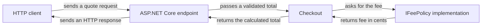

# C# application areas and practices

[C#](README.md) · [Русский](../../ru/csharp/practice.md)

Choose a stack for the application you want to build. Use the patterns below when you need to separate a business rule from I/O, test an integration, or diagnose a slow query.

| Task | Technique | Example |
| --- | --- | --- |
| Pick a stack and a first exercise | Match the platform and libraries to the app | [Application areas](#application-areas) |
| Replace a rule or external dependency | Composition, constructor injection, scoped services | [Patterns and practices](#patterns) |
| Choose a test boundary | Unit, integration, or end-to-end test | [Test at the right boundary](#test-at-the-right-boundary) |
| Keep a query small | EF Core projection and bounded results | [Query only the data you need](#query-data) |

<a id="application-areas"></a>

## Application areas

The stack depends on the target platform. The runnable examples in this section use .NET 10. For desktop, mobile, and game development, check the tools and language version for the target platform or engine.

| Area | Tools and libraries | Skills to practice | First task | Constraint |
| --- | --- | --- | --- | --- |
| CLI and automation | .NET SDK, `System.IO`, `System.Text.Json` | Arguments, exit codes, paths | Build a command that reads a JSON file and prints a summary | Resolve paths from a documented base. Define what invalid input returns. |
| Web API and backend | [ASP.NET Core](https://learn.microsoft.com/en-us/aspnet/core/fundamentals/minimal-apis?view=aspnetcore-10.0), Minimal APIs or controllers, `HttpClient` | HTTP contracts, validation, DI | Expose a shipping quote endpoint and test its success and error responses | The runtime and deployment host must support the chosen framework. Handle authentication and authorization before exposing private data. |
| Relational data | [EF Core 10](https://learn.microsoft.com/en-us/ef/core/what-is-new/ef-core-10.0/whatsnew), SQLite or PostgreSQL provider, [Dapper](https://github.com/DapperLib/Dapper) for explicit SQL | SQL, transactions, migrations, query plans | Persist an order and query a page of orders | Test translation and migrations with the production database engine in an isolated environment. Match provider and EF Core versions. |
| Windows desktop | [WPF](https://learn.microsoft.com/en-us/dotnet/desktop/wpf/overview/) or [WinForms](https://learn.microsoft.com/en-us/dotnet/desktop/winforms/overview/) | XAML and binding in WPF, events and UI thread in both | Build an order editor with validation feedback | WPF and WinForms target Windows. |
| Cross-platform desktop | [Avalonia](https://docs.avaloniaui.net/docs/supported-platforms), XAML | Binding, commands, packaging | Run the same order editor on two supported operating systems | Check the support tier and packaging requirements of each target. |
| Games | [Unity](https://docs.unity.com/en-us/engine/6000.0/manual/programming-environment/overview-of-dot-net-in-unity/csharp-compiler) or the [.NET edition of Godot](https://docs.godotengine.org/en/stable/tutorials/scripting/c_sharp/index.html) | Scenes, input, game loop, frame profiling | Move a character and detect a collision | The engine determines the supported C# and .NET APIs. Check export support for the target. |
| Cloud and background jobs | [.NET Worker Service](https://learn.microsoft.com/en-us/dotnet/core/extensions/workers), Docker, [OpenTelemetry](https://learn.microsoft.com/en-us/dotnet/core/diagnostics/observability-with-otel) | Shutdown, retries, idempotency, metrics and traces | Run a worker in a container and stop it during a job | Account for duplicate delivery and shutdown. Deployment needs an appropriate container host. |
| Mobile | [.NET MAUI 10](https://learn.microsoft.com/en-us/dotnet/maui/supported-platforms?view=net-maui-10.0), Android or iOS tooling | App lifecycle, device permissions, UI and local data | Build an offline checklist and run it in an emulator or on a device | Install the target workload. iOS development from Windows requires a networked Mac build host. |
| Native distribution | [.NET Native AOT](https://learn.microsoft.com/en-us/dotnet/core/deploying/native-aot/) | Runtime identifiers, trimming, deployment builds | Publish a small CLI and run it on the target OS and architecture | Check target toolchain requirements and warnings about reflection or dynamic code. |

Use the standard library APIs for [files, JSON, HTTP, and collections](syntax.md#standard-library). Check the package documentation when you need capabilities beyond them.

| Need | Package or tool | When to use it |
| --- | --- | --- |
| Read legacy JSON contracts | [Newtonsoft.Json](https://www.nuget.org/packages/Newtonsoft.Json) | Existing code or contracts depend on its API or behavior |
| Check local behavior | [xUnit](tooling-and-testing.md#tests), [NUnit](https://docs.nunit.org/), or [MSTest](https://learn.microsoft.com/en-us/dotnet/core/testing/unit-testing-mstest-intro) | Choose the framework and runner supported by the repository |
| Start a database or broker for a test | [Testcontainers for .NET](https://dotnet.testcontainers.org/) | A compatible container runtime is available and the real service matters |
| Export structured logs | [Serilog](https://serilog.net/) | The project needs its logging pipeline and sinks |
| Measure hot paths or allocations | [BenchmarkDotNet](https://benchmarkdotnet.org/articles/overview.html) | A profiler has identified a target. Compare the alternatives under the same runtime and input. |

<a id="patterns"></a>

## Patterns and practices

Use constructor injection when a class depends on behavior that can vary. In this `Program.cs` excerpt, pass the fee policy explicitly. Use a [`net10.0` console project](tooling-and-testing.md#project-templates). A real caller validates the input before invoking checkout.

```csharp
using System;

var checkout = new Checkout(new FlatFee(500));
Console.WriteLine(checkout.Total(2_000));

public interface IFeePolicy
{
    int FeeFor(int orderTotalInCents);
}

public sealed class FlatFee(int feeInCents) : IFeePolicy
{
    public int FeeFor(int orderTotalInCents) => feeInCents;
}

public sealed class Checkout(IFeePolicy feePolicy)
{
    public int Total(int orderTotalInCents) =>
        checked(orderTotalInCents + feePolicy.FeeFor(orderTotalInCents));
}
```

The program prints `2500`. `Checkout` delegates fee calculation to the supplied strategy. A test can supply a different strategy. Start with a function like [the shipping rule](../../../examples/csharp/shipping/Shipping/ShippingFee.cs) when one calculation is enough.

| Need | Pattern and example | Limit |
| --- | --- | --- |
| Select a fee calculation | Strategy. Pass an `IFeePolicy` implementation into `Checkout`. | Introduce the interface when policies actually vary. |
| Translate between two contracts | Adapter. An ASP.NET Core endpoint converts HTTP input to a checkout call and maps the result to an HTTP response. | Keep shipping rules in the calculation code. |
| Wrap an outgoing call with shared behavior | Decorator. A `DelegatingHandler` adds an HTTP correlation header and forwards the request to the next handler. | Keep retry decisions in one layer. Confirm that repeated writes are safe. |

The diagram shows a web adapter using the same separation. The endpoint validates incoming values and maps results to HTTP responses.



| Decision | Practice | Failure to check |
| --- | --- | --- |
| Where to validate | Validate external data at the boundary. Keep invariants close to the operation that needs them. | Returning success for invalid input |
| Where to compose services | Connect implementations at startup. Pass dependencies in constructors. | A service resolves hidden dependencies from a global container |
| How long a service lives | Use transient for each resolution, scoped for each scope, and singleton for the application lifetime. | A singleton captures a scoped service or holds non-thread-safe state |
| How to manage outgoing HTTP | Use a long-lived client with a suitable connection lifetime, or use `IHttpClientFactory` to manage handlers. | Per-request creation of fresh handlers exhausts sockets |
| What to log | Use structured properties with `ILogger`, such as the operation and correlation ID. | Credentials or raw private payloads enter logs |
| When to retry | Identify transient failures and the operation's idempotency before adding retries. | A retried write produces duplicate side effects |

In ASP.NET Core, a request has its own DI scope. A typical EF Core `DbContext` is scoped and supports one operation at a time. In a background worker, create a scope for each job when the job needs scoped services.

## Test at the right boundary

| Question | Test level | Example |
| --- | --- | --- |
| Does the rule return the right fee? | Unit | [Shipping fee test lab](tooling-and-testing.md#tests) |
| Does the endpoint translate input and errors into the right HTTP response? | Integration | `WebApplicationFactory<TEntryPoint>` from `Microsoft.AspNetCore.Mvc.Testing` with the ASP.NET Core test host |
| Does the query work with the intended schema and SQL dialect? | Integration with a real service | Apply migrations in an isolated database and assert the query result |
| Can a user complete checkout through the deployed app? | End to end | Exercise the deployed flow with a synthetic order |

A pure unit test can assert exact boundary values and exception types. Test request routing, binding, and the application configuration with an integration test. Use the database engine you deploy when checking SQL translation, constraints, and transactions. In-memory collections do not reproduce those behaviors.

<a id="query-data"></a>

## Query only the data you need

EF Core 10 fragment. Import `System.Linq` and `Microsoft.EntityFrameworkCore`. Assume `db.Orders` is a `DbSet<Order>` with `Id`, `TotalInCents`, and `IsOpen` properties. Pass the cancellation token from the caller.

```csharp
var page = await db.Orders
    .Where(order => order.IsOpen)
    .OrderBy(order => order.Id)
    .Select(order => new { order.Id, order.TotalInCents })
    .Take(20)
    .ToListAsync(cancellationToken);
```

This query returns up to 20 open orders with two fields each. The database provider translates the `IQueryable` operations before `ToListAsync` materializes the results. Keep filtering and projection before materialization when the provider can translate them. Inspect generated SQL and query counts before tuning. Reading navigation properties in a loop with lazy loading can cause an extra query per row.

## Sources

- [Dependency injection and service lifetimes](https://learn.microsoft.com/en-us/dotnet/core/extensions/dependency-injection/service-lifetimes), [HttpClient lifetime guidance](https://learn.microsoft.com/en-us/dotnet/fundamentals/networking/http/httpclient-guidelines), and [`DelegatingHandler`](https://learn.microsoft.com/en-us/dotnet/api/system.net.http.delegatinghandler?view=net-10.0).
- [ASP.NET Core 10 release notes](https://learn.microsoft.com/en-us/aspnet/core/release-notes/aspnetcore-10.0?view=aspnetcore-10.0) and [ASP.NET Core integration tests](https://learn.microsoft.com/en-us/aspnet/core/test/integration-tests?view=aspnetcore-10.0).
- [EF Core database providers](https://learn.microsoft.com/en-us/ef/core/providers/), [`DbContext` lifetime](https://learn.microsoft.com/en-us/ef/core/dbcontext-configuration/), [efficient queries](https://learn.microsoft.com/en-us/ef/core/performance/efficient-querying), and [database testing strategies](https://learn.microsoft.com/en-us/ef/core/testing/choosing-a-testing-strategy).
