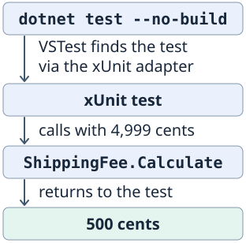
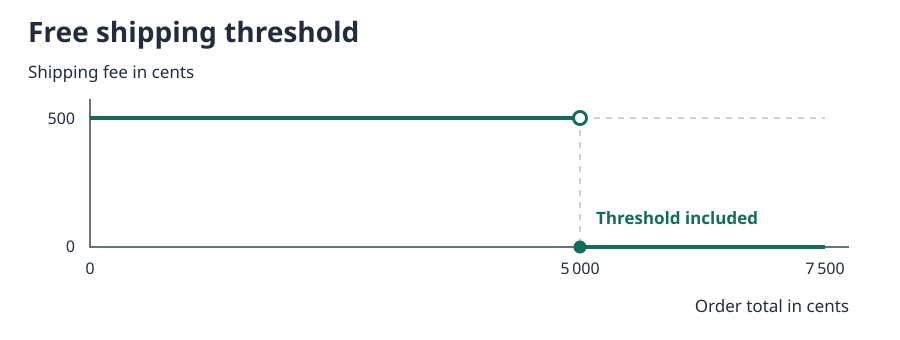

# .NET tools, packages, and tests

[C#](README.md) · [Русский](../../ru/csharp/tooling-and-testing.md)

Use the .NET 10 SDK for these commands. The package and tool examples use fresh temporary directories. Run them from Bash or Zsh with access to NuGet.org or a mirror that carries the named packages.

| Task | Command or project entry | Example |
| --- | --- | --- |
| Start a console app or web API | `dotnet new` and a project template | [Project templates](#project-templates) |
| Add a library and inspect dependencies | `dotnet package add`, `PackageReference`, `dotnet restore` | [Packages](#packages) |
| Share an executable tool with the team | `dotnet tool` and a manifest | [.NET tools](#dotnet-tools) |
| Build and test a rule | xUnit v3, `ProjectReference`, `dotnet test` | [Runnable tests](#tests) |

<a id="project-templates"></a>

## Create a project from a template

Use `dotnet new list console` or `dotnet new list web` to check available templates. Use `dotnet new webapi --help` to see the options in the installed SDK.

| Project | Template | What you get |
| --- | --- | --- |
| Terminal program | `console` | Executable with an entry point |
| Reusable code | `classlib` | Library referenced by a project or packaged for distribution |
| HTTP API | `webapi` | ASP.NET Core starter. Add `--use-controllers` to generate a controller-based project. |
| Background service | `worker` | Host with a `BackgroundService` example |
| Tests | `mstest`, `nunit`, `xunit` | SDK templates. Check the generated project for its test framework and runner versions. |

A `.csproj` file declares the build SDK, target framework, and dependencies. A solution groups projects for builds, IDEs, or tests. `ProjectReference` links to another project's source build. `PackageReference` links to a versioned NuGet package.

The Web SDK, `Microsoft.NET.Sdk.Web`, implicitly references the ASP.NET Core shared framework `Microsoft.AspNetCore.App`. In a plain class library that needs its APIs, declare `<FrameworkReference Include="Microsoft.AspNetCore.App" />`. A framework-dependent web app needs the ASP.NET Core runtime on the deployment host. Add a compatible NuGet package for APIs outside the shared framework, such as an EF Core database provider.

<a id="packages"></a>

## Add and restore NuGet packages

In Python, after activating a virtual environment, `python -m pip install "packaging==25.0"` installs into that environment. Pip alone leaves the project dependency declaration unchanged. In .NET, `dotnet package add` updates a project's dependency declaration and normally runs restore.

| Task | Python with pip | .NET with NuGet |
| --- | --- | --- |
| Find a public package | PyPI | [NuGet.org](https://www.nuget.org/) |
| Record a direct dependency | `pyproject.toml` project dependencies or a requirements file, depending on the workflow | `PackageReference` in `.csproj`. In projects with Central Package Management, versions live in `Directory.Packages.props`. |
| Restore dependencies | `python -m pip install -r requirements.txt` for a requirements-based workflow | `dotnet restore` resolves and fetches project dependencies, including transitive packages |
| Set the source | `--index-url` or pip configuration | `NuGet.Config` or restore options such as `--source` |
| Reproduce a resolution | Pin all dependencies in the requirements workflow | Check in `packages.lock.json` for the application and use `dotnet restore --locked-mode` |

Create a disposable console project and add a specific Newtonsoft.Json release. The .NET 10 SDK uses `dotnet package add`. On older SDKs, use `dotnet add package`.

```bash
demo_dir=$(mktemp -d) &&
  dotnet new console --name PackageDemo --framework net10.0 --output "$demo_dir" --no-restore &&
  dotnet package add Newtonsoft.Json --version 13.0.4 --project "$demo_dir/PackageDemo.csproj" &&
  dotnet package list --project "$demo_dir/PackageDemo.csproj" --include-transitive
```

The list shows `Newtonsoft.Json` requested and resolved as `13.0.4`. The command adds this fragment to the project's `ItemGroup`.

```xml
<PackageReference Include="Newtonsoft.Json" Version="13.0.4" />
```

NuGet treats a bare version as an inclusive minimum and normally resolves the lowest applicable version. An exact constraint uses brackets, for example `Version="[13.0.4]"`. Pinning a direct dependency alone leaves transitive resolution open. Generate a lock file with `dotnet restore --use-lock-file`. Use `--locked-mode` in CI to fail when the declared dependencies no longer match the lock file.

Restore uses the configured package sources, resolves direct and transitive dependencies, and writes the resolved graph to `obj/project.assets.json`. Package files are reused from the NuGet global package cache. Build and test commands normally restore implicitly. Use `--no-restore` after a successful restore with matching project, framework, and artifact settings.

To use only NuGet.org for the disposable project, save the complete configuration below as `$demo_dir/NuGet.Config`. A repository can check in a configuration with its team's approved sources. Use package source mapping when you need to constrain which source may provide each package ID.

```xml
<?xml version="1.0" encoding="utf-8"?>
<configuration>
  <packageSources>
    <clear />
    <add key="nuget.org" value="https://api.nuget.org/v3/index.json" />
  </packageSources>
</configuration>
```

```bash
dotnet restore "$demo_dir/PackageDemo.csproj" --configfile "$demo_dir/NuGet.Config" --use-lock-file &&
  dotnet restore "$demo_dir/PackageDemo.csproj" --configfile "$demo_dir/NuGet.Config" --locked-mode
```

The first command creates `packages.lock.json`. The second verifies the locked resolution. If restore fails, check the sources with `dotnet nuget list source --configfile "$demo_dir/NuGet.Config"`. If a package is found but incompatible, check its supported target frameworks and the project's `TargetFramework`.

<a id="dotnet-tools"></a>

## Install a .NET tool

A tool package provides a command. Use a local manifest for commands that a team or CI must run at the same version. A global installation is per user and convenient for personal commands. The global tool shim directory must be on `PATH`.

Try a local install in a disposable directory. This command checks the EF Core CLI version and needs no database.

```bash
tool_dir=$(mktemp -d) && (
  cd "$tool_dir" &&
  dotnet new tool-manifest &&
  dotnet tool install --local dotnet-ef --version 10.0.0 &&
  dotnet tool restore &&
  dotnet tool run dotnet-ef -- --version
)
```

The tool prints `10.0.0`. Keep the generated `dotnet-tools.json` in a real repository and run `dotnet tool restore` after cloning. The SDK also recognizes manifests at `.config/dotnet-tools.json`. For a per-user installation, the command is `dotnet tool install --global dotnet-ef --version 10.0.0`. Match the tool's major version to the project's EF Core packages. Migration commands also need an EF Core provider and the design-time package in the appropriate project.

<a id="tests"></a>

## Build and run the shipping fee tests

The complete example charges 500 cents on orders below 5,000 cents. Orders at or above that threshold have free shipping. A negative total is invalid. The example accepts integer cents and needs no database, network service, or account.

| File | Role |
| --- | --- |
| [`Shipping.csproj`](../../../examples/csharp/shipping/Shipping/Shipping.csproj) and [`ShippingFee.cs`](../../../examples/csharp/shipping/Shipping/ShippingFee.cs) | Library targeting `net10.0` with the fee calculation |
| [`Shipping.Tests.csproj`](../../../examples/csharp/shipping/Shipping.Tests/Shipping.Tests.csproj) and [`ShippingFeeTests.cs`](../../../examples/csharp/shipping/Shipping.Tests/ShippingFeeTests.cs) | Test project and test cases, including synthetic inputs |

The test project uses `ProjectReference` to compile against the library. xUnit v3 `3.2.2` supplies the test attributes and assertions. `Microsoft.NET.Test.Sdk` `18.0.1` provides VSTest integration. `xunit.runner.visualstudio` `3.1.5` is the xUnit adapter. The example uses the default VSTest mode of the .NET 10 SDK. A repository configured to use Microsoft.Testing.Platform needs a compatible test project configuration and different runner options.

The diagram shows one case after the build. VSTest discovers the test through the xUnit adapter. The test calls `ShippingFee.Calculate(4_999)` and checks that it returns `500`.



From the repository root, restore, build, and run the tests. NuGet access or a populated package cache is needed for restore. Use the same temporary artifact path for all three steps.

```bash
test_project=examples/csharp/shipping/Shipping.Tests/Shipping.Tests.csproj
test_artifacts=$(mktemp -d) &&
  dotnet restore "$test_project" --artifacts-path "$test_artifacts" &&
  dotnet build "$test_project" --artifacts-path "$test_artifacts" --no-restore &&
  dotnet test "$test_project" --artifacts-path "$test_artifacts" --no-build
```

Expect five passing cases. Each `[InlineData]` row runs the same `[Theory]` with different inputs. `[Fact]` runs the invalid-input check once.

Method excerpt from `ShippingFeeTests.cs`. The test class imports `Xunit` and calls `ShippingFee` from the referenced library.

```csharp
[Theory]
[InlineData(0, 500)]
[InlineData(4_999, 500)]
[InlineData(5_000, 0)]
[InlineData(7_500, 0)]
public void Calculate_ReturnsExpectedFee(int orderTotalInCents, int expectedFee)
{
    int actualFee = ShippingFee.Calculate(orderTotalInCents);

    Assert.Equal(expectedFee, actualFee);
}
```

| Input in cents | Assertion |
| --- | --- |
| `0` | Fee is `500` |
| `4999` | Fee is `500` just below the threshold |
| `5000` | Fee is `0` at the threshold |
| `7500` | Fee is `0` above the threshold |
| `-1` | Throws `ArgumentOutOfRangeException` for `orderTotalInCents` |

The chart shows the rule at 5,000 cents, where the fee drops from 500 cents to zero.



To rerun only the invalid-input test, reuse the shell variables from the previous block.

```bash
dotnet test "$test_project" --artifacts-path "$test_artifacts" --no-build \
  --filter 'FullyQualifiedName~Calculate_RejectsNegativeTotal'
```

Expect one passing case.

If VSTest did not discover the test, list all discovered tests after the build. Reuse the same shell variables.

```bash
dotnet test "$test_project" --artifacts-path "$test_artifacts" --no-build --list-tests
```

If the test is missing from the list, check the project path, test SDK, adapter, and test platform. If the test is listed, check the run filter. If `Calculate_ReturnsExpectedFee` gets `500` for `5_000`, check the threshold in `ShippingFee.Calculate`. [VSTest options](https://learn.microsoft.com/en-us/dotnet/core/tools/dotnet-test-vstest#options) · [Choose a test boundary](practice.md#test-at-the-right-boundary).

[Test the same rule through HTTP](first-http-service.md#test-service).

## Sources

- [SDK project templates](https://learn.microsoft.com/en-us/dotnet/core/tools/dotnet-new-sdk-templates) and [ASP.NET Core framework references](https://learn.microsoft.com/en-us/aspnet/core/fundamentals/target-aspnetcore?view=aspnetcore-10.0).
- [`dotnet package add`](https://learn.microsoft.com/en-us/dotnet/core/tools/dotnet-package-add), [`dotnet package list`](https://learn.microsoft.com/en-us/dotnet/core/tools/dotnet-package-list), [`PackageReference` and lock files](https://learn.microsoft.com/en-us/nuget/consume-packages/package-references-in-project-files), [version ranges](https://learn.microsoft.com/en-us/nuget/concepts/package-versioning), and [`NuGet.Config`](https://learn.microsoft.com/en-us/nuget/reference/nuget-config-file).
- [`pip install`](https://pip.pypa.io/en/stable/cli/pip_install/), [`packaging` 25.0](https://pypi.org/project/packaging/25.0/), and [Newtonsoft.Json 13.0.4](https://www.nuget.org/packages/Newtonsoft.Json/13.0.4).
- [Local .NET tools](https://learn.microsoft.com/en-us/dotnet/core/tools/local-tools-how-to-use) and [EF Core CLI](https://learn.microsoft.com/en-us/ef/core/cli/dotnet).
- [xUnit v3 release 3.2.2](https://xunit.net/releases/v3/3.2.2), [xUnit adapter release 3.1.5](https://xunit.net/releases/visualstudio/3.1.5), [Microsoft.NET.Test.Sdk 18.0.1](https://www.nuget.org/packages/Microsoft.NET.Test.Sdk/18.0.1), and [`dotnet test` with VSTest](https://learn.microsoft.com/en-us/dotnet/core/tools/dotnet-test-vstest).
