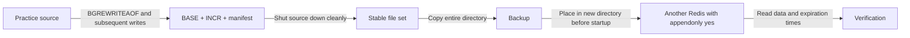

<a id="скопировать-aof-redis-и-проверить-восстановление"></a>
# Back up Redis AOF and verify the restore

[Русский](../../../../ru/databases/non-relational/redis/aof-backup-and-restore.md)

Restore Redis data from a complete AOF file set.
AOF logs write operations that Redis replays on startup.
TTL is the time remaining before a key expires.
The example copies files after cleanly shutting down the practice source.
The source remains unavailable during copying.

[Redis reference](README.md) · [AOF reference](operations.md#create-and-restore-an-aof-backup) · [RDB example](backup-and-restore.md)

| Task | Technique | Where to look |
| --- | --- | --- |
| Make a consistent backup with source downtime | Copy the entire appendonlydir | [Setup](#setup) · [Complete program](#complete-example) |
| Check the log's file set | Read the manifest and check BASE and INCR | [File composition](#understand-the-file-set) |
| Check values and expiration times | Compare data, PEXPIRETIME, and PTTL | [Results](#check-the-result) |

| Item | Details |
| --- | --- |
| Level | Intermediate to advanced. Administrative commands affect only the practice processes. |
| Prerequisites | Python functions, dictionaries, files, processes, `with`, `try`/`finally`, and `assert` |
| Runtime requirements | Redis Open Source 8.2.11, redis-cli 8.2.11, Python 3.14.7, and Unix sockets on macOS or Linux |
| Dependencies | redis-server and redis-cli in PATH. Python uses only the standard library. |

<a id="разобрать-состав-файлов"></a>
## Understand the file set

Since Redis 7.0, AOF can consist of multiple files.
The manifest lists the files and their loading order.
BASE contains the initial data snapshot for the rewritten log.
INCR contains subsequent changes. A log can have several INCR files.
An AOF rewrite produces a compact representation of current data.

The example's `appendonlydir` can contain the following files.

```text
appendonlydir/
├── appendonly.aof.manifest   # list of log parts
├── appendonly.aof.2.base.rdb # BASE: initial state in RDB format
└── appendonly.aof.2.incr.aof # INCR: subsequent write commands
```

The number `2` is illustrative. The program reads filenames from the manifest.
The `.base.rdb` file belongs to the AOF set because `aof-use-rdb-preamble yes` is enabled.
Restore the INCR files and manifest along with that file.
`appenddirname` sets the directory name, and `appendfilename` sets the base filename.

The program creates a string, a hash, and a list, then runs `BGREWRITEAOF` and waits for completion.
`BGREWRITEAOF` starts a background rewrite. Wait for it to finish after the command returns.
The `INFO persistence` checks ensure the rewrite has finished, none is scheduled, and the status is `ok`.
After the rewrite, the program updates the string, appends to the list, and creates two keys with TTLs.
Those writes must be restored from INCR, while the original hash fields come from BASE.

The diagram shows the backup and restore steps.



On clean shutdown, `SHUTDOWN NOSAVE` flushes AOF to disk without creating a separate RDB snapshot.
The program requires the source to exit successfully before copying.
The example sets `appendfsync always` to synchronize AOF on writes for its small practice dataset.
Choose production settings based on your workload and durability requirements.
Automatic rewriting is disabled. The single manual rewrite finishes before shutdown.

<a id="подготовить-запуск"></a>
## Setup

Install Redis Open Source 8.2.11 using the [official instructions](https://redis.io/docs/latest/operate/oss_and_stack/install/archive/install-redis/).
Add `redis-server` and `redis-cli` of that version to PATH.
Create a separate practice directory.
Save the [complete program below](#complete-example) as `aof_backup.py` in that directory.
Run these shell commands.

```bash
redis-server --version
redis-cli --version
python3 aof_backup.py
```

The example needs only the Python standard library and the Redis binaries.
It creates its own processes and uses their addresses.
Each Unix socket is a local connection file. TCP is disabled.
All data stay in a new private `/tmp/redis-aof-*` directory.

Run without `-O` to keep `assert` checks enabled.
The program rejects a run with assertions disabled before creating directories or processes.

<a id="полный-пример"></a>
## Complete example

The complete `aof_backup.py` checks the source file set, both copies, and the restored data.
SHA-256 is a content checksum used to compare file bytes before starting the destination Redis.
Redis can append to the log after startup, so byte comparisons run first.

`inventory()` validates only this example's controlled file set.
It expects one BASE file in RDB format, at least one nonempty INCR file, and a manifest.
Adapt these checks before using them on an arbitrary AOF directory.
`INFO` returns text even with `redis-cli --json`, so the helper handles that reply separately.

[`redis/aof_backup.py`](../../../../../examples/databases/non-relational/redis/aof_backup.py)

<a id="проверить-результат"></a>
## Check the result

Expect exit code `0` and the following messages.

```text
OK: BASE + INCR восстановили строку, hash и порядок list
OK: абсолютный срок сохранён, оставшийся TTL уменьшился
OK: постоянные ключи без TTL, просроченный ключ отсутствует
OK: manifest и все его файлы скопированы без изменения байтов
```

The program also prints the practice directory, part filenames, and PTTL values before and after restoration.
Filenames and PTTL values depend on the run.
`PEXPIRETIME` is the absolute expiration time in milliseconds since the Unix epoch.
`PTTL` is the remaining time in milliseconds. `-1` means no expiration, and `-2` means no key.

| Object | Expected result |
| --- | --- |
| Manifest and listed parts | All files exist. SHA-256 matches for the source and both copies. |
| `demo:title` | `after rewrite`, confirming that the change from INCR was applied |
| `demo:profile` | Preserves `id=42` and `name=Alice` from BASE |
| `demo:queue` | `first`, `second`, `third`, preserving order and the addition from INCR |
| Three persistent keys | `PTTL == -1` |
| `demo:live` | Preserves the value and PEXPIRETIME. Remaining PTTL is positive and lower than before. |
| `demo:expired` | Expired during downtime and is absent, `PTTL == -2` |
| Database 0 | Four keys, with AOF enabled |

TTL continues to decrease while the process is stopped.
AOF restoration preserves the original expiration time.
The `finally` block stops only the processes the program created, even if a check fails.
The practice directory keeps the source, backup, and logs for inspection.
When finished, delete only the directory the program printed.

<a id="ограничения"></a>
## Limitations

The procedure requires a stopped source, identical Redis binaries, and a stable clock on one machine.
The example covers neither backing up a running instance nor switching an existing RDB server to AOF.
To back up without downtime, use a separate procedure that controls rewriting and defines the backup boundary.

The example places files in a new directory before starting the destination Redis.
Use this procedure for a new destination. Do not replace the AOF files of a running Redis instance.
Starting with an empty directory and `appendonly yes` can create an empty database, so startup alone does not confirm a restore.
The program therefore checks the entire file set before startup and the data after startup.

`aof-load-truncated no` prevents Redis from automatically accepting a truncated log tail.
The program leaves files intact and never runs `redis-check-aof --fix`.
Repair can remove part of the history. Preserve a copy and assess the consequences first.

The example uses database 0 and a small synthetic dataset.
Concurrent writes, power failure, disk exhaustion, modules, Cluster, and different Redis versions remain untested.
A long startup delay or clock jump can violate the timing assumptions and stop the checks.
Store production backups separately to protect against loss of the machine.
Test restores regularly.

<a id="источники"></a>
## Sources

- [Redis persistence, AOF file composition, and backups](https://redis.io/docs/latest/operate/oss_and_stack/management/persistence/).
- [BGREWRITEAOF](https://redis.io/docs/latest/commands/bgrewriteaof/), [SHUTDOWN](https://redis.io/docs/latest/commands/shutdown/), [INFO](https://redis.io/docs/latest/commands/info/).
- [EXPIRE and persistence](https://redis.io/docs/latest/commands/expire/), [PEXPIRETIME](https://redis.io/docs/latest/commands/pexpiretime/).
- [Redis 8.2.11 manifest format and AOF loading](https://github.com/redis/redis/blob/8.2.11/src/aof.c), [server shutdown](https://github.com/redis/redis/blob/8.2.11/src/server.c).
- [Redis 8.2.11 release notes](https://github.com/redis/redis/releases/tag/8.2.11).

[AOF reference](operations.md#create-and-restore-an-aof-backup) · [RDB example](backup-and-restore.md) · [Redis reference](README.md) · [Task index](../../../tasks/README.md#redis)
