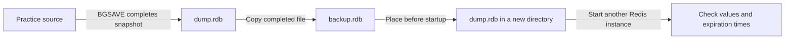

<a id="создать-rdb-копию-redis-и-проверить-восстановление"></a>
# Back up Redis with RDB and verify the restore

[Русский](../../../../ru/databases/non-relational/redis/backup-and-restore.md)

Use this page to back up Redis data and verify the copy in a separate instance.
RDB is a point-in-time data snapshot file.
TTL is the time remaining before a key expires and becomes unavailable.
The example checks values and expiration times after restoration.

[Redis reference](README.md) · [Quick reference](operations.md#create-and-restore-an-rdb-backup) · [AOF example](aof-backup-and-restore.md)

| Task | Technique | Where to look |
| --- | --- | --- |
| Back up and restore data | Two separate Redis instances and one Python file | [Setup](#setup) · [Complete program](#complete-example) |
| Check expiration times | Compare absolute expiration and remaining TTL | [Expected results](#check-the-result) |
| Understand recovery limits | Consider snapshot time, AOF, and system clocks | [Limitations](#limitations) |

| Item | Details |
| --- | --- |
| Level | Intermediate. Administrative commands affect only the practice processes. |
| Prerequisites | Python functions, dictionaries, `with`, `try`/`finally`, `assert`, processes, and files |
| Runtime requirements | Redis Open Source 8.2.11, redis-cli 8.2.11, Python 3.14.7, and macOS or Linux with Unix sockets |
| Dependencies | Both Redis binaries in PATH. Python uses only the standard library. |

<a id="как-устроен-пример"></a>
## How the example works

The program creates two Redis processes with separate Unix sockets.
A Unix socket is a local file used to connect to a process without a TCP port.
Each run creates a new directory under `/tmp` that only the current user can access.
The program uses only the Redis processes it creates.

The source contains a string, a hash with profile fields, and a list with two entries.
Two additional string keys expire after 120 seconds and 5 seconds.
The program follows these steps.



`BGSAVE` starts background saving.
Wait for the file to be ready even after the command returns.
The program uses `INFO persistence` to wait for completion and check status `ok`.
The new directory ensures an old `dump.rdb` cannot be mistaken for a new backup.
After completion, the program copies the file to `backup.rdb` and compares SHA-256 checksums.
Matching SHA-256 checksums confirm that the copied bytes match.
The subsequent Redis startup and data checks verify that the backup is usable.

After copying, the program changes a string and adds a key in the source.
It then stops the source with `SHUTDOWN NOSAVE` and waits for the short TTL to expire.
This stops only the practice process and leaves later changes unsaved.
Another process loads the backup from a new directory with AOF disabled.
AOF is a write operation log. When both AOF and RDB are enabled, Redis loads AOF on startup.

<a id="подготовить-запуск"></a>
## Setup

Install Redis Open Source 8.2.11 using the [official instructions](https://redis.io/docs/latest/operate/oss_and_stack/install/archive/install-redis/).
Add `redis-server` and `redis-cli` of that version to PATH.
Create a separate practice directory.
Save the [program below](#complete-example) as `rdb_backup.py` in that directory.
Run these shell commands from the practice directory.

```bash
redis-server --version
redis-cli --version
python3 rdb_backup.py
```

Python needs only the standard library.
Run without `-O` to keep `assert` checks enabled.
The program rejects a run with assertions disabled before creating processes.

<a id="полный-пример"></a>
## Complete example

The complete `rdb_backup.py` creates data, copies RDB, and checks the result.
It runs `redis-cli` with `--json` to parse replies.
`INFO` returns text even with this flag, so the helper handles it separately.
The `-e` flag makes a Redis command error produce a nonzero client exit code.
The program passes each Redis command argument separately without invoking a shell.

[`redis/rdb_backup.py`](../../../../../examples/databases/non-relational/redis/rdb_backup.py)

<a id="проверить-результат"></a>
## Check the result

Expect exit code `0` and the following messages.

```text
OK: string, hash, list и ключи без срока восстановлены
OK: срок истечения сохранён, оставшийся TTL уменьшился
OK: просроченный ключ и запись после снимка отсутствуют
```

The program also prints the practice directory, two PTTL values, and the RDB checksum.
The PTTL values and checksum depend on the run.
`PTTL` returns the remaining time in milliseconds.
`-1` means the key has no expiration. `-2` means the key is absent.
`PEXPIRETIME` returns the absolute expiration time in milliseconds since the Unix epoch.

| Object checked | Expected result |
| --- | --- |
| `demo:title` | `before snapshot`. The later update is absent. |
| `demo:profile` | Preserves `id=42` and `name=Alice` |
| `demo:queue` | Preserves the order of `first` and `second` |
| Three keys without a TTL | `PTTL == -1` |
| `demo:live` | Preserves the value and PEXPIRETIME. Remaining PTTL is positive and lower than before. |
| `demo:expired` | Key is absent, `PTTL == -2` |
| `demo:later` | Key created after the snapshot is absent |
| Restored database 0 size | Four keys |

Redis stores the absolute expiration time, so TTL continues to decrease during downtime.
The restored key keeps that expiration time.

The `finally` block stops the processes even if a check fails.
The practice directory keeps the backup, source RDB, and logs for inspection.
When finished, delete only the directory the program printed.

<a id="ограничения"></a>
## Limitations

The example uses a small dataset on one machine with a stable clock.
Large clock differences between machines affect expiration checks.
On a slow machine, the short-lived key can expire before the snapshot. The corresponding assertion stops the example.

The backup contains the state at snapshot time.
Later changes are absent.
An RDB file can contain multiple logical databases. This example creates data only in database 0.

This example places RDB in a new directory before starting the destination Redis.
Do not use this procedure to replace the RDB file of a running Redis instance.
Restoration requires a compatible RDB format, Redis version, and any modules used.
Both processes use the same binaries.

The example leaves concurrent writes during BGSAVE, corrupted backups, AOF, Cluster, and recovery after power failure untested.
A local copy demonstrates the mechanism. Store production backups separately to protect against loss of the machine.
Test production restores regularly.

<a id="источники"></a>
## Sources

- [Redis RDB, copying completed files, and restoration](https://redis.io/docs/latest/operate/oss_and_stack/management/persistence/).
- [BGSAVE](https://redis.io/docs/latest/commands/bgsave/), [INFO persistence](https://redis.io/docs/latest/commands/info/).
- [EXPIRE and persistence](https://redis.io/docs/latest/commands/expire/), [PTTL](https://redis.io/docs/latest/commands/pttl/), [PEXPIRETIME](https://redis.io/docs/latest/commands/pexpiretime/).
- [Redis 8.2.11 RDB saving and loading](https://github.com/redis/redis/blob/8.2.11/src/rdb.c).
- [Redis 8.2.11 release notes](https://github.com/redis/redis/releases/tag/8.2.11).

[RDB reference](operations.md#create-and-restore-an-rdb-backup) · [Redis reference](README.md) · [Task index](../../../tasks/README.md#redis)
