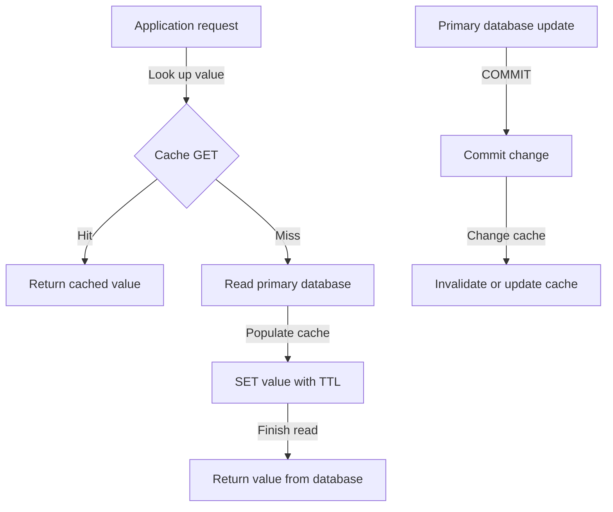

<a id="структуры-ttl-и-кеширование"></a>
# Data structures, TTL, and caching

[Русский](../../../../ru/databases/non-relational/redis/data-and-caching.md)

Use this page to choose a data structure and expiration policy in Redis 8.2.
For a cache, decide which store is authoritative and how much staleness is acceptable.

<a id="быстрый-поиск"></a>
## Quick reference

| Data or task | Technique | Example or details |
| --- | --- | --- |
| Update a value and keep its expiration | SET XX KEEPTTL | [TTL](#update-a-value-and-keep-its-expiration) |
| Choose a structure based on the operations | String, hash, list, set, sorted set | [Data structures](#choose-a-data-structure-for-the-operation) |
| Reduce reads from the primary database | Cache-aside and invalidation | [Caching](#cache-aside) |
| Try every operation in a practice instance | Separate process and randomly named keys | [Setup](data-lab.md#setup) · [Complete code](data-lab.md#complete-data-structures-and-ttl-example) |

[Redis](README.md)

| Item | Details |
| --- | --- |
| Levels | Basic for structures and TTL. Intermediate for caching. |
| Prerequisites | Dedicated Redis 8.2, Python 3.14, and redis-py 8.1.0 |

<a id="подготовка"></a>
## Setup

To run the full example, [install the client and set up an isolated Redis instance](data-lab.md#setup).
Use a practice instance for all examples.
The snippets below continue the complete program. It defines `client` with `decode_responses=True` and uses its own key, `cache`.

<a id="полный-пример-структуры-и-ttl"></a>

<a id="обновить-значение-и-сохранить-срок"></a>
## Update a value and keep its expiration

Use this approach when updating an existing key with a TTL while preserving the time remaining.
The Python snippet uses the client and key from the [complete program](data-lab.md#complete-data-structures-and-ttl-example).
The first command prepares a value that expires after 60 seconds.

```python
client.set(cache, '{"name":"Ada"}', ex=60)
updated = client.set(cache, '{"name":"Ada Lovelace"}', xx=True, keepttl=True)
if updated is None:
    print("Key missing. Skipped update.")
else:
    print("Value updated.")
```

If the key exists with a TTL at the time of the update, Redis changes the value and keeps the original expiration time.
If the key disappears before the update, `XX` prevents Redis from creating it. redis-py returns `None`.

`XX` checks only that the key exists.
If another client removes the TTL or sets a value without a TTL, `KEEPTTL` preserves the lack of expiration.
To handle concurrent changes, use a separate atomic protocol to check expiration and write the new value.

SET removes the previous TTL unless you specify a new expiration or use KEEPTTL.
The application or eviction can remove a key before its TTL expires.
The complete program operates sequentially on its own keys in an isolated Redis instance.

<a id="выбрать-структуру-по-данным"></a>
## Choose a data structure for the operation

Choose based on the operations you need and your requirements for order and uniqueness.

| Data | Commands | Limitation |
| --- | --- | --- |
| String or binary value | SET/GET/MGET, INCR | INCR requires a string representing an integer. The application chooses how to serialize objects. |
| Hash | HSET/HGET/HGETALL | Stores separate fields. The application defines field types and validation. |
| List | LPUSH/RPUSH/LPOP/LRANGE | Preserves order. Large ranges are expensive. LPOP has no acknowledgment or retry mechanism. |
| Set | SADD/SISMEMBER/SINTER | Unique members with no guaranteed order |
| Sorted set | ZADD/ZRANGE/ZREVRANGE | Sorts by score and applies sorted set rules to ties |
| Bitmap, HyperLogLog, or geospatial index | SETBIT / PFADD / GEOADD | Specialized structures. HyperLogLog estimates the number of distinct elements. |
| [Stream](transactions-and-messaging.md#полный-пример-stream-и-pubsub) | XADD/XREADGROUP/XACK | Message log and delivery tracking. Durability depends on configuration. |

Use TYPE to check the type.
Using a command for a different type on an existing key returns WRONGTYPE.

TTL and PTTL return the remaining time in seconds and milliseconds, respectively.
EXPIRE and PEXPIRE change the expiration time.
PERSIST removes it.
INCR and HSET preserve an existing TTL.

To scan a large namespace, use SCAN with MATCH and COUNT.
Account for duplicate results and changes during the scan.
COUNT is a hint. Redis can return a different number of entries per call.

<a id="кеширование-cache-aside"></a>
## Cache-aside

**Intermediate.** The primary database is the source of truth.
Redis stores a copy with an expiration time.

The diagram shows how the application reads and updates the primary database.



The protocol allows stale reads.
A concurrent read can populate the cache with an old value after invalidation.
Decide how much staleness to accept and whether to use versioning or a different protocol.
Add a small random variation to TTLs to reduce simultaneous expiration.
Limit concurrent fills for a hot key.
For a missing object, consider briefly caching a distinct negative result.

If the cache fails, protect the primary database from overload.
Set limits, monitor load, and define a fallback.
Configure maxmemory and the eviction policy separately.
Consider separate instances for cache entries and irreplaceable application state.
This protects application state when Redis evicts cache entries.
SET NX PX can be part of a lock protocol.
To release the lock safely, check the token.
Analyze failures before using SET NX PX in a distributed lock.

<a id="источники"></a>
## Sources

- [Data structures](https://redis.io/docs/latest/develop/data-types/), [SET](https://redis.io/docs/latest/commands/set/), [EXPIRE](https://redis.io/docs/latest/commands/expire/), [TTL](https://redis.io/docs/latest/commands/ttl/).
- [SCAN](https://redis.io/docs/latest/commands/scan/), [eviction](https://redis.io/docs/latest/develop/reference/eviction/), [cache-aside](https://redis.io/tutorials/howtos/solutions/microservices/caching/).
- [Redis 8.2.11 release notes](https://github.com/redis/redis/releases/tag/8.2.11).
