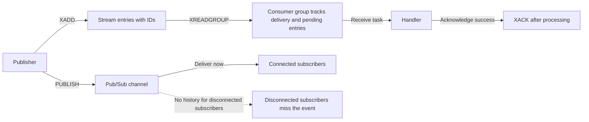

<a id="атомарные-изменения-и-доставка-сообщений"></a>
# Atomic updates and message delivery

[Русский](../../../../ru/databases/non-relational/redis/transactions-and-messaging.md)

Use this page when updates compete or messages need specific delivery guarantees.
Decide which operations must be atomic and what should happen on a retry or disconnection.

<a id="быстрый-поиск"></a>
## Quick reference

| Situation | Technique | Example or details |
| --- | --- | --- |
| Independent commands need fewer round trips | Pipeline without a transaction | [Comparison](#atomicity-transactions-and-pipelining) |
| Other clients must stay out of a group of updates | MULTI/EXEC | [Quick example](#change-a-counter-and-its-expiration-together) |
| An update depends on a value you read | WATCH and bounded retries | [Conflict](transactions-lab.md#complete-example-of-a-conflict-and-command-error) |
| Acknowledge a task after processing | Stream, pending entries, and XACK | [Delivery](#acknowledge-a-processed-message) |
| Send transient notifications | Pub/Sub without message history | [Complete example](transactions-lab.md#complete-stream-and-pubsub-example) |

[Redis](README.md)

| Item | Details |
| --- | --- |
| Levels | Intermediate for pipelining, MULTI, and WATCH. Advanced for streams and delivery. |
| Prerequisites | Setup and REDIS_URL from the [first example](data-lab.md#setup), with standalone Redis 8.2 |

<a id="атомарность-транзакция-и-pipeline"></a>
## Atomicity, transactions, and pipelining

| Mechanism | Purpose | Limitation |
| --- | --- | --- |
| One command such as INCR | Atomically change one value | Durability depends on persistence settings |
| Pipeline | Send several commands without waiting for each reply | Other clients can interleave commands unless the pipeline uses MULTI/EXEC |
| MULTI → commands → EXEC | Run the group without interleaving commands from other clients | Successful commands remain applied when another command fails at runtime |
| WATCH → read → MULTI/EXEC | Optimistically check that a watched key has not changed | Data can change and cause EXEC to abort. A retry may be needed. |
| Lua or Redis Functions | Read, check, and update on the server in one atomic operation | A script or function can fail after making writes that remain applied. Runtime is finite. |

redis-py `pipeline()` uses a transaction by default.
For pipelining alone, set transaction=False explicitly.
WATCH holds the connection until completion or reset.
Use a context manager.
DISCARD clears the queue before EXEC.
Distinguish queueing errors from execution errors.
After an execution error, inspect each command's result.
Successful commands can still take effect.

<a id="полный-пример-конфликт-и-ошибка-команды"></a>

<a id="изменить-счётчик-и-срок-одной-группой"></a>
## Change a counter and its expiration together

Use this approach when other clients must stay out of the group of operations.
This snippet comes from the [complete program](transactions-lab.md#complete-example-of-a-conflict-and-command-error).
`client` is the configured redis-py client, and `counter` is the example's own key with value `1`.

```python
with client.pipeline(transaction=True) as pipe:
    pipe.incr(counter)
    pipe.expire(counter, 60)
    results = pipe.execute()
assert results == [2, True]
```

The counter becomes `2`, and the expiration is set to 60 seconds.
In MULTI/EXEC, successful commands remain applied after another command fails at runtime.
The [complete program](transactions-lab.md#complete-example-of-a-conflict-and-command-error) checks this behavior and a WATCH conflict separately.

After WatchError, the application usually rereads the data and retries with a limit.
In Redis Cluster, multi-key transactions require compatible hash slots.
A single transaction cannot span arbitrary shards.

<a id="полный-пример-stream-и-pubsub"></a>

<a id="подтвердить-обработанное-сообщение"></a>
## Acknowledge a processed message

Use this approach when a task should remain pending until the application processes it successfully.
This snippet comes from the [complete program](transactions-lab.md#complete-stream-and-pubsub-example).
`client` is the configured redis-py client, and `stream` is the example's own stream with a `workers` group and one new entry.

```python
deliveries = client.xreadgroup("workers", "worker-1", {stream: ">"}, count=1, block=500)
message_id, fields = deliveries[0][1][0]
# Сначала надёжно завершите прикладную обработку fields.
client.xack(stream, "workers", message_id)
assert client.xpending(stream, "workers")["pending"] == 0
```

XACK removes the entry from the group's pending list after processing.
The snippet assumes it receives an entry. A real handler must also handle an empty result.
After acknowledgment, the message body remains in the stream.
Acknowledgment and external side effects are separate operations.
The [complete program](transactions-lab.md#complete-stream-and-pubsub-example) creates the stream and checks Pub/Sub delivery separately.

The example performs no external side effects.
Make the handler idempotent so it can handle redelivery.

The diagram compares message delivery through a stream and a transient Pub/Sub channel.



A stream retains entries until deletion or trimming.
Durability after a failure depends on persistence.
Monitor entries that remain pending.
Reassign stale pending entries with XAUTOCLAIM or another protocol.
Handle redelivery.
Choose retention and MAXLEN based on consumer lag.
Acknowledgment cannot recover a deleted message body.
Pub/Sub delivers each message at most once.
Redis queues no retries if a subscriber disconnects or fails.

<a id="источники"></a>
## Sources

- [Transactions, WATCH, and errors](https://redis.io/docs/latest/develop/using-commands/transactions/), [pipelining](https://redis.io/docs/latest/develop/using-commands/pipelining/).
- [Streams](https://redis.io/docs/latest/develop/data-types/streams/), [XACK](https://redis.io/docs/latest/commands/xack/), [XAUTOCLAIM](https://redis.io/docs/latest/commands/xautoclaim/).
- [Pub/Sub and delivery guarantees](https://redis.io/docs/latest/develop/pubsub/), [redis-py pipeline](https://redis.readthedocs.io/en/v8.1.0/advanced_features.html).
- [Redis 8.2.11 release notes](https://github.com/redis/redis/releases/tag/8.2.11).
