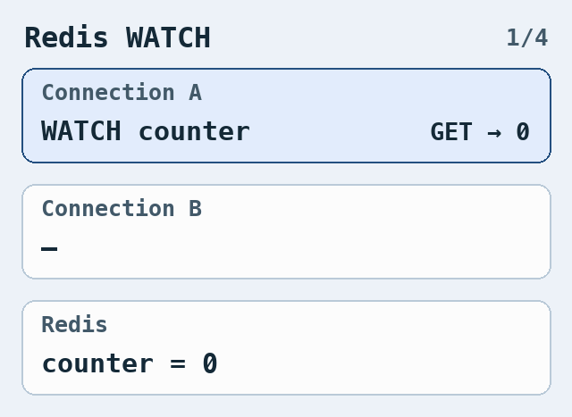
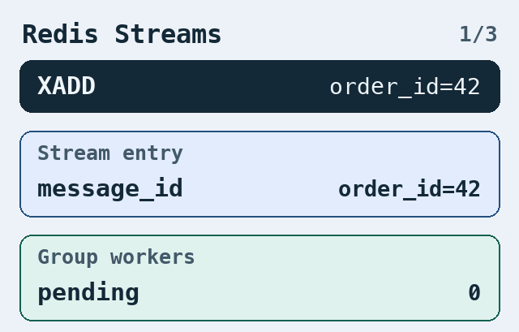

# Verify Redis transactions and delivery

[Русский](../../../../ru/databases/non-relational/redis/transactions-lab.md)

Run complete examples that exercise a WATCH conflict, a command error, and message delivery.
Use a dedicated standalone Redis 8.2 instance. Each example uses a random namespace for its keys.
[Transactions and messaging](transactions-and-messaging.md) · [Redis](README.md).

| Task | Technique | Example |
| --- | --- | --- |
| Check a conflict and behavior after a runtime error | WATCH and MULTI/EXEC | [Complete program](#complete-example-of-a-conflict-and-command-error) |
| Check pending entries, acknowledgment, and transient notification | Stream and Pub/Sub | [Complete program](#complete-stream-and-pubsub-example) |

| Item | Details |
| --- | --- |
| Level | Intermediate for transactions. Advanced for delivery. |
| Prerequisites | [redis-py 8.1.0 and REDIS_URL setup](data-lab.md#setup), plus Python 3.14 |

## Complete example of a conflict and command error

Save the example as `transactions.py`.
Run `python transactions.py` in the prepared environment.
The script deliberately triggers a WATCH conflict and an INCR error.
It checks both results and deletes only its own keys.

[`redis/transactions.py`](../../../../../examples/databases/non-relational/redis/transactions.py)

The output is `OK: pipeline, WATCH conflict, MULTI/EXEC and no runtime rollback`.
The WATCH conflict leaves the value at `1`.
The INCR error leaves the successful SET from the same EXEC in effect.
The finally block removes the keys.

Show the WATCH conflict step by step

The connection held by `WATCH` reads `counter = 0`. A separate connection from the pool increments it to `1`. The first connection queues `SET counter 10` under `MULTI`, using its earlier read. Redis returns null at `EXEC` and skips the queued write. redis-py reports `WatchError`. The value stays at `1`.

[Replay the GIF](../../../../assets/redis-watch-conflict.gif)

## Complete stream and Pub/Sub example

**Advanced.** Save the example as `messaging.py`.
Run `python messaging.py`.
The example creates a stream with its own consumer group.
The Pub/Sub subscription handles one delivery and exits.

[`redis/messaging.py`](../../../../../examples/databases/non-relational/redis/messaging.py)

The output is `OK: stream delivery/pending/ACK and bounded Pub/Sub notification`.
After XACK, the pending count is zero and the stream entry still exists.
The Pub/Sub example checks one notification to an already connected subscriber.
The examples cover successful handling without external side effects or handler failure.

Show what changes after XACK

`XADD` writes the entry to the stream. When `XREADGROUP` delivers it to `worker-1`, the `workers` group has one pending entry. After processing, `XACK` clears the group's pending record. The entry remains in the stream and can still be read with `XRANGE`.

[Replay the GIF](../../../../assets/redis-streams-ack.gif)

## Sources

- [Transactions, WATCH, and errors](https://redis.io/docs/latest/develop/using-commands/transactions/), [pipelining](https://redis.io/docs/latest/develop/using-commands/pipelining/).
- [Streams](https://redis.io/docs/latest/develop/data-types/streams/), [XACK](https://redis.io/docs/latest/commands/xack/), [XAUTOCLAIM](https://redis.io/docs/latest/commands/xautoclaim/).
- [Pub/Sub and delivery guarantees](https://redis.io/docs/latest/develop/pubsub/), [redis-py pipeline](https://redis.readthedocs.io/en/v8.1.0/advanced_features.html).
- [Redis 8.2.11 release notes](https://github.com/redis/redis/releases/tag/8.2.11).
