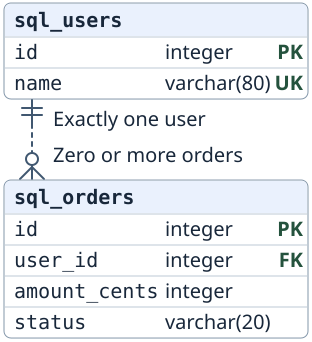

# Set up the SQL practice tables

[Русский](../../../ru/databases/sql/query-lab.md)

This example creates users and orders for the SQL reference.
[Query examples](queries.md) · [SQL](README.md).

Use a new PostgreSQL 18 or SQLite 3.53 practice database with the names `sql_users` and `sql_orders` available.

## Complete example

Save the SQL as `demo.sql`.
For PostgreSQL, replace `PRACTICE_DB` with the name of a separate practice database.
Run `psql -X --set=ON_ERROR_STOP=1 --dbname=PRACTICE_DB --file=demo.sql`.
For SQLite, choose a new file named sql-demo.db in a separate practice directory.
Run `sqlite3 -bail -cmd 'PRAGMA foreign_keys=ON' sql-demo.db < demo.sql`.
Run these commands in your shell.
For MySQL or SQL Server, adapt the transaction control using the [dialect comparison](dialects-and-transactions.md).

This complete SQL example runs on PostgreSQL and SQLite.
It creates only practice objects and uses no DROP statements.

[`sql/demo.sql`](../../../../examples/databases/sql/demo.sql)

The expected totals are `alice | 14000`, `bob | 0`, and `carol | 0`.
The value of preserved_amount is `10000`.
The example stores amounts as whole cents in a fictional currency to avoid REAL rounding.
The example supplies IDs explicitly because key generation varies across database engines.
The [query examples](queries.md) use these tables in the same database.

The diagram shows the keys and the relationship between the practice tables.

- The two bars at `sql_users` mean that each order has exactly one user. `NOT NULL` and the `user_id` foreign key enforce this.
- The circle and crow’s foot at `sql_orders` mean that a user may have zero or more orders.
- The dashed line marks a non-identifying relationship. An order has its own primary key, `sql_orders.id`. The labels `PK`, `FK` and `UK` mark a primary key, a foreign key and a uniqueness constraint, respectively.

[ER relationship notation](https://mermaid.js.org/syntax/entityRelationshipDiagram.html#relationship-syntax).

## Sources

- [PostgreSQL joins and grouping](https://www.postgresql.org/docs/18/queries-table-expressions.html), [CTEs](https://www.postgresql.org/docs/18/queries-with.html), [window functions](https://www.postgresql.org/docs/18/functions-window.html).
- [SQLite SELECT](https://www.sqlite.org/lang_select.html), [WITH](https://www.sqlite.org/lang_with.html), [window functions](https://www.sqlite.org/windowfunctions.html).
- [SQLite scalar subqueries](https://www.sqlite.org/lang_expr.html#subquery_expressions), [PostgreSQL scalar subqueries](https://www.postgresql.org/docs/18/sql-expressions.html#SQL-SYNTAX-SCALAR-SUBQUERIES).
- [MySQL 8.4 JOIN](https://dev.mysql.com/doc/refman/8.4/en/join.html), [SQL Server CTEs](https://learn.microsoft.com/en-us/sql/t-sql/queries/with-common-table-expression-transact-sql?view=sql-server-ver17).
- [PostgreSQL 18.6 release notes](https://www.postgresql.org/docs/18/release-18-6.html), [SQLite 3.53.4 release notes](https://www.sqlite.org/releaselog/3_53_4.html).
