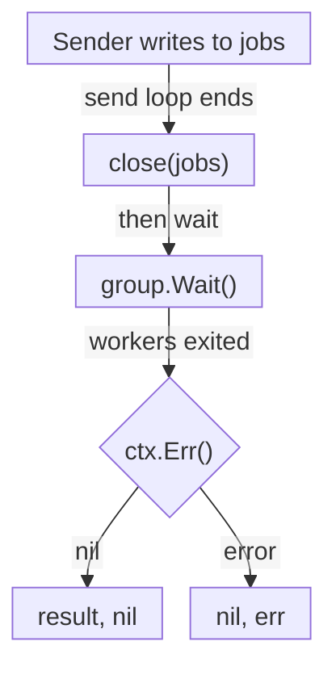

<a id="отмена-goroutines-и-общие-данные"></a>
# Cancellation, goroutines, and shared data

[Русский](../../ru/go/concurrency-and-testing.md)

Open this page to process a list concurrently or protect data used by several goroutines.
The examples preserve string order and wait for every started worker to finish before returning.
[Go reference](README.md) · [Module files](language.md#complete-module)

| Task | Technique | Example |
| --- | --- | --- |
| Process a list with bounded concurrency | Fixed workers and result indices | [Worker pool](#bounded-worker-pool) |
| Stop work on cancellation | `context` in the sender and workers | [Cancellation](#cancel-processing) |
| Update a shared counter without lost updates | One mutex for reading and writing | [Counter](#shared-data-and-mutexes) |
| Test order, errors, and races | Tests and `-race` | [Verification](#tests-and-the-race-detector) |

**Level** — intermediate → advanced.
Prerequisites include functions, slices, errors, and memory ownership. Go 1.27 is required.
The snippets use the standard library.
Save [worker.go, counter.go, and worker_test.go](examples/concurrency-and-testing.md) with `go.mod` following the [example setup](examples/concurrency-and-testing.md#setup).

<a id="ограниченный-worker-pool"></a>
## Bounded worker pool

Two workers must uppercase the list `go, python, rust`.
The output order must match the input order.
Pass each job its index. Wait for the workers before reading the result.

**Example snippet inside `main`, importing `context`, `fmt`, and `example.com/cheatsheet`**

```go
input := []string{"go", "python", "rust"}
result, err := cheatsheet.Uppercase(context.Background(), input, 2)
fmt.Println(result, err) // [GO PYTHON RUST] <nil>
```

Two goroutines write results at the indices of the input list.
If `python` finishes before `go`, `PYTHON` still goes into `result[1]`.
Keep the input slice unchanged during processing.
For short strings, goroutine overhead can outweigh concurrency benefits. The example does not measure speedup.

The diagram shows the shutdown order.
The sender closes `jobs` after sending every job or selecting the `ctx.Done()` case.
Each worker calls `Done()` when it exits. After `Wait()`, the function checks the context error.
If `ctx.Err()` returns an error, the function returns `nil` and that error. Otherwise, it returns the result.



[Complete example with `worker.go`](examples/concurrency-and-testing.md#bounded-worker-pool)

<a id="отменить-обработку"></a>
## Cancel processing

The caller cancels the task. The function returns the context error.
Pass `context` as the first argument. Provide a way out of blocking `select` statements in the sender and workers.

**Independent example snippet inside `main`, importing `context`, `errors`, `fmt`, and `example.com/cheatsheet`**

```go
ctx, cancel := context.WithCancel(context.Background())
cancel()
result, err := cheatsheet.Uppercase(ctx, []string{"go"}, 2)
fmt.Println(result == nil, errors.Is(err, context.Canceled)) // true true
```

An already-canceled context rejects processing before workers start.
When cancellation occurs during processing, workers check `Done()` between jobs.
Cancellation does not interrupt `strings.ToUpper` halfway through an operation.
When several `select` cases are ready, cancellation has no absolute priority.
The example does not guarantee that no jobs run after `cancel`.
Also call `cancel` for `WithTimeout`, usually with `defer`.
Avoid using context as a container for arbitrary parameters.

[Complete implementation](examples/concurrency-and-testing.md#bounded-worker-pool) · [Rejection test](examples/concurrency-and-testing.md#tests-and-the-race-detector)

<a id="общие-данные-и-mutex"></a>
## Shared data and mutexes

Twenty goroutines each increment one counter a hundred times.
Every increment must be preserved. Reads must not overlap unprotected writes.
Use one mutex for both methods.

**Independent example snippet inside `main`, importing `fmt`, `sync`, and `example.com/cheatsheet`**

```go
var counter cheatsheet.Counter
var group sync.WaitGroup
for range 20 {
    group.Add(1)
    go func() {
        defer group.Done()
        for range 100 {
            counter.Add(1)
        }
    }()
}
group.Wait()
fmt.Println(counter.Value()) // 2000
```

The counter equals `2000` after all goroutines finish.
The zero value of `Counter` is ready to use.
Pass `Counter` by pointer. Do not copy a mutex after its first use.
A channel carries data or signals. A mutex protects a shared-memory invariant.
An atomic type can serve an independent counter. Avoid mixing atomic and ordinary access to the same value.

[Complete counter.go](examples/concurrency-and-testing.md#shared-data-and-mutexes)

<a id="тесты-и-race-detector"></a>
## Tests and the race detector

After adding the [complete worker_test.go](examples/concurrency-and-testing.md#tests-and-the-race-detector), run these commands from the module directory.

```bash
go test -count=1 ./...
go vet ./...
go test -race -count=1 ./...
```

The tests check string order, empty input, an invalid worker count, a canceled context, and the exact increment count.
The race detector requires a supported platform and build tools.
`-race` detects races only on executed paths. Logical race conditions and deadlocks require separate checks.
The test timeout bounds waiting but does not prove the absence of all goroutine leaks.
`-count=1` disables reuse of a cached test result.

| Situation | Action |
| --- | --- |
| `WithCancel` / `WithTimeout` created | Call cancel, usually with defer |
| A worker blocks on send | Add `ctx.Done()` or another guaranteed completion path |
| Goroutines must finish before continuing | Call Add before starting, Done in the worker, and Wait after starting |
| Several workers return errors | Define a cancellation/collection policy. This example returns only the context error |
| A channel is nil | Send/receive block. Use this property only in a deliberate select design |

<a id="источники"></a>
## Sources

[context](https://pkg.go.dev/context), [sync](https://pkg.go.dev/sync),
[memory model](https://go.dev/ref/mem), [race detector](https://go.dev/doc/articles/race_detector),
[testing](https://pkg.go.dev/testing), [Go 1.27 release notes](https://go.dev/doc/go1.27).
