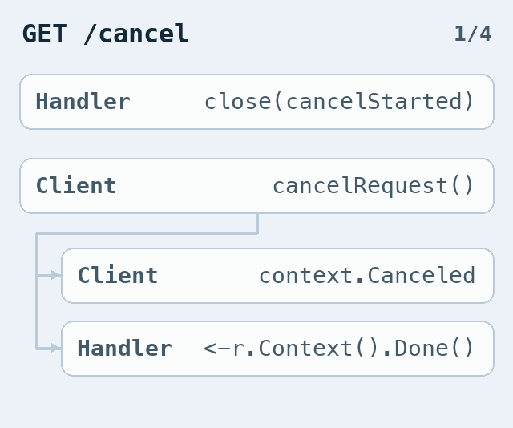

# HTTP request cancellation and deadlines in Go

[Русский](../../ru/go/context.md)

Pass a `context.Context` to an outgoing HTTP request to limit how long it can run or let the caller cancel it.
The practice program checks a successful response, an expired deadline, and explicit cancellation while a request is in flight.

| Task | Technique | Example |
| --- | --- | --- |
| Set a time limit from now | `context.WithTimeout` | [Set a deadline](#set-a-deadline) |
| Set an exact cutoff time | `context.WithDeadline` | [Set a deadline](#set-a-deadline) |
| Cancel an operation on a signal | `context.WithCancel` and `cancel()` | [Cancel a request](#cancel-a-request) |
| Identify the cause of a failure | `errors.Is` | [Check three outcomes](#check-three-outcomes) |

The example uses the standard library. Running the file requires Go 1.16 or newer for `io.ReadAll`.
If you are new to functions and errors, start with the [Go language reference](language.md).

## Set a deadline

Derive a child context from the caller's context. If there is no parent context yet, start with `context.Background()`.
Canceling the parent context cancels the child. An earlier parent deadline also limits the child context.
Use `WithTimeout` for a limit of 200 ms. If you already have a cutoff as a `time.Time` value, pass it to `WithDeadline`.

This fragment goes inside a function that returns `(string, error)`. Use `parent`, `client`, and `get` from the complete example. Set `url` to the request URL. Import `context` and `time`.

```go
ctx, cancel := context.WithTimeout(parent, 200*time.Millisecond)
defer cancel()
return get(ctx, client, url)
```

Inside `get`, create the request with `http.NewRequestWithContext(ctx, http.MethodGet, url, nil)`. Send the request with `client.Do(req)`.
The deadline applies through the end of reading the response body.
After a successful `Do`, use `defer resp.Body.Close()` before checking the status and reading the body.
Call `cancel` when the function returns, even if the request succeeds. The call releases the child context's resources, including stopping its timer.

## Cancel a request

Get a child context and a cancellation function with `context.WithCancel(parent)`. Pass the context to the request.
In the complete example, the `/cancel` handler uses a channel to report that it received the request. Client code waits for that signal and calls `cancelRequest()`.
The handler waits on `<-r.Context().Done()` and returns after the client closes the connection.
A context carries a cancellation signal. Code that runs its own long operation must handle that signal itself.

In this fragment, `err` is the error returned by `get`. The fragment imports `context` and `errors`.

```go
switch {
case errors.Is(err, context.DeadlineExceeded):
    // The deadline expired.
case errors.Is(err, context.Canceled):
    // The operation was canceled.
}
```

`errors.Is` identifies the cause inside a wrapped error. Handle other errors separately.

<details>
<summary>Show cancellation step by step</summary>



The `/cancel` handler closes `cancelStarted` after it receives the request. The client goroutine then calls `cancelRequest()`. The client recognizes `context.Canceled` with `errors.Is`. The handler returns after `r.Context().Done()` closes. The order of these two outcomes can vary.

[Open the GIF to replay it](../../assets/go-request-cancellation.gif?raw=true)

</details>

## Check three outcomes

Open the [complete `main.go` file](../../../examples/go/context/main.go). Run the command from the repository root.

```bash
go run ./examples/go/context/main.go
```

`httptest.NewServer` opens a local port on the loopback interface. The program sends requests only to that server and closes it when the program exits.
All three requests share a five-second parent deadline. The `/timeout` handler waits until the request deadline expires and the client cancels the request.

Compare the output with the expected result.

```text
success: ok
timeout: context deadline exceeded
cancel: context canceled
```

The program checks the body of the successful response and the causes of both errors. A failed check causes a nonzero exit status.

[Cancel work in a worker pool](concurrency-and-testing.md#cancel-processing) · [Test an HTTP handler](http-json.md#test-without-a-network-server)

## Sources

- [Go 1.27.1 — the `context` package](https://pkg.go.dev/context@go1.27.1).
- [`http.NewRequestWithContext`](https://pkg.go.dev/net/http@go1.27.1#NewRequestWithContext), [`http.Client.Do`](https://pkg.go.dev/net/http@go1.27.1#Client.Do), and [`http.Request.Context`](https://pkg.go.dev/net/http@go1.27.1#Request.Context).
- [`httptest.NewServer`](https://pkg.go.dev/net/http/httptest@go1.27.1#NewServer).
- [Go 1.16 — addition of `io.ReadAll`](https://go.dev/doc/go1.16).
