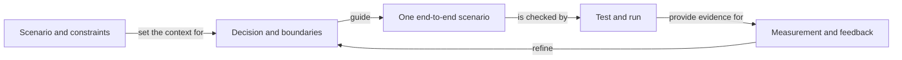

# Design a Python project

[Русский](../../../../ru/python/architecture/project-design/README.md)

Use this guide to turn requirements into a code structure, a way to verify it, and a plan for changes.
Open the guide when starting a project or revisiting its boundaries.
The work produces decisions and verifiable artifacts in your repository.
The application configuration depends on the project.

[Python catalog](../../README.md) · [General principles](../../../architecture/principles.md)

## Quick lookup

| Question | Where to go | Result |
| --- | --- | --- |
| What must the system do? | [Initial conditions](#define-the-task-before-choosing-an-architecture) | Scenarios, constraints, and acceptance criteria |
| Parts of the application must change or release independently | [Compare boundaries](structure-and-decisions.md#deployment-and-code-organization) | Module map and decision record |
| A scenario test requires a real database or SDK | [Pass dependencies explicitly](structure-and-decisions.md#dependency-injection) | An explicit place to assemble the application |
| What does a working Python package look like? | [Complete example](example.md) | `pyproject.toml`, code, settings, and tests |
| What should be checked before release? | [Readiness checks](delivery-and-evolution.md#readiness-checks) | Checklist with evidence |
| How should the database and architecture change? | [Change plan](delivery-and-evolution.md#schema-data-and-architecture-changes) | Sequence, stop conditions, and rollback |
| Which metrics should you choose? | [Observability and metrics](delivery-and-evolution.md#observability-and-metrics) | Measurable goals for a specific workload |

**Scope** — architecture, packaging, configuration, testing, and operations for Python applications.
The complete package with manual dependency injection, settings, and tests is on a [separate page](example.md).

## Define the task before choosing an architecture

Write down several real scenarios.
For each scenario, identify who calls the application.
Specify the scenario's result.
Specify the data to store.
Specify what counts as an error.
Add a sample input for each scenario.
Add an acceptance criterion for each scenario.

| What to establish | Example of a concrete answer | Where to keep it |
| --- | --- | --- |
| Purpose | The CLI imports a catalog. The API searches for products | README and scenario descriptions |
| Data boundary | Who creates a product and who may change it | Data schema and access rules |
| Constraints | Whether offline operation, personal data, or compatibility requirements apply | Requirements description |
| Load | Catalog size, concurrent requests, and acceptable response time | Measurement plan / test results |
| Operations | Who deploys, monitors, and restores the system | Startup instructions and runbook |

Write down unknowns as questions or testable hypotheses.
Assign someone to find each answer.
Team size and entity count provide context. Architecture also depends on the scenarios and constraints.

## Get the first verifiable result

The diagram shows a work cycle.
Set the schedule separately.
The first end-to-end scenario goes from input to result.
One example loads a practice catalog, finds an existing product, and returns a clear error for a missing product.
The working example is [here](example.md).

## Make decisions and assemble a reproducible project

| Decision | What to define explicitly |
| --- | --- |
| Structure | Module boundaries, public interfaces, and import direction |
| Stack | Reason for choosing the library, supported Python version, and operational constraints |
| Packaging | `pyproject.toml`, build backend, import package, and entry point |
| Dependencies | Object lifetimes and where objects are created and closed |
| Configuration | Required settings, defaults, sources of values, and validation at startup |
| Testing | What behavior to check in isolation, with real infrastructure, and end to end |
| Errors and logs | How a domain error becomes a response, and what aids diagnosis without leaking secrets |

An interface can describe functions without wrapping each function in a separate class.
[SOLID](../../../architecture/solid.md) and [patterns](../../../architecture/patterns/README.md) help assess a specific boundary.
Use the requirements to decide which approaches apply.

For the first scenario and release, use the [readiness checks](delivery-and-evolution.md#readiness-checks).
The checks cover startup, success, a significant failure, and the lifecycle of external resources.

## Revisit boundaries

Start with an observable problem.
Examples include slow releases, conflicting changes, a need for independent scaling, or unacceptable recovery times.
Record the symptom first.
Specify the constraints.
Define how to measure the outcome.
Then choose a change.
Define the transition period.

- The [architecture decision](structure-and-decisions.md#record-a-decision-in-an-adr) records the reasons for the choice and its consequences.
- The [change plan](delivery-and-evolution.md#schema-data-and-architecture-changes) defines compatibility, verification, and rollback.
- [Metrics](delivery-and-evolution.md#observability-and-metrics) show whether the original problem was resolved.
- Splitting into microservices is one option. A well-structured monolith can remain the long-term solution.

## Common errors

| Error | What to do |
| --- | --- |
| Choose microservices based on developer count | Explain the need for independent deployment. Specify the cost of a distributed system |
| Treat the directory tree as the architecture | Check import direction. Check data ownership |
| Apply universal test percentages and RPS targets | Choose risk scenarios and measurements for this application |
| Rewrite everything for a new stack | Plan a reversible step. Check whether it resolves the original problem |
| Copy a sample `.env.production` with a password | Define the secret source for the specific environment. Keep only a safe sample in the repository |

## Sources

- [PyPA pyproject.toml](https://packaging.python.org/en/latest/guides/writing-pyproject-toml/), [src layout](https://packaging.python.org/en/latest/discussions/src-layout-vs-flat-layout/).
- [Cockburn on Ports & Adapters](https://alistair.cockburn.us/hexagonal-architecture/), [Fowler on Monolith First](https://martinfowler.com/bliki/MonolithFirst.html).
- [Pydantic Settings](https://docs.pydantic.dev/latest/concepts/pydantic_settings/).

[Choose a current task from Quick lookup](#quick-lookup).
