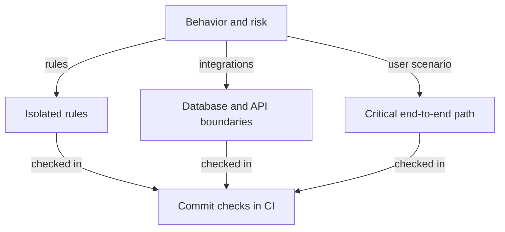
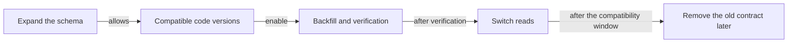

# Verify, release, and evolve a project

[Русский](../../../../ru/python/architecture/project-design/delivery-and-evolution.md)

Use this page before changing a contract or releasing the application.
Choose a check based on the risk of the specific scenario.

| Situation | Technique | Example / form |
| --- | --- | --- |
| It is unclear what tests should cover | Check the rule, adapter, and end-to-end path separately | [Test strategy](#test-strategy) |
| A change is being prepared for merge or release | Gather evidence using the checklist | [Readiness checks](#readiness-checks) |
| Old and new clients run at the same time | Expand the contract, migrate clients, and remove the old path | [Rename a field](#rename-a-field-without-breaking-existing-clients-at-cutover) |
| The outcome of a change needs evaluation | Define the operation, load profile, and measurement window | [Metrics](#observability-and-metrics) |

[Guide](README.md) · [Working package and tests](example.md)

**Level** — intermediate to advanced.
Use the checklists for your application. The field-change plan below illustrates a staged rollout.

## Navigation

- [Test strategy](#test-strategy)
- [Readiness checks](#readiness-checks)
- [Schema, data, and architecture changes](#schema-data-and-architecture-changes)
- [Observability and metrics](#observability-and-metrics)
- [Antipatterns and diagnostics](#antipatterns-and-diagnostics)

## Test strategy

**Intermediate level.**
Choose checks according to risks and boundaries.
Set test proportions based on those choices.

| Check | What it verifies | Example |
| --- | --- | --- |
| Isolated | A rule or use case without infrastructure | An unknown product raises `ProductNotFound` |
| Integration | Consistency with a real adapter or driver | SQLite stores and retrieves the same model |
| Contract | Compatibility between producers and consumers | API fields and error codes match the agreement |
| End to end | A critical path through the assembled application | CLI or HTTP produces the expected result on practice data |
| Load | Behavior under a defined load profile | Defined volumes, concurrency, latency, and resources |

The diagram groups checks by risk.

The groups do not prescribe a fixed 70/20/10 split.
Coverage helps find untested code. Assertion quality and requirement correctness require separate review.
If an async function returns a coroutine, await the coroutine in the test.
Use AsyncMock when the contract requires awaiting the mock.

## Readiness checks

**Beginner / intermediate level.**
Adapt the checklist to your application.
Check off each item after verification and add a link to the result.

### First working scenario

- [ ] Run the README installation commands in a clean environment.
- [ ] Run the README startup commands in a clean environment.
- [ ] Specify the Python version.
- [ ] Specify dependencies.
- [ ] Check that the lockfile matches the selected tool.
- [ ] Run the sample input and confirm the expected result.
- [ ] Test that invalid input produces a clear result.
- [ ] Test that missing data produces a clear result.
- [ ] Check that settings are validated at startup.
- [ ] List required settings in a safe environment example.

### Change before merging into the main branch

- [ ] Check code formatting.
- [ ] Run the selected quality checks.
- [ ] Test the changed behavior.
- [ ] Test significant failure cases.
- [ ] Check that tests assert behavior as well as any relevant mock calls.
- [ ] Check that all external resources close on success.
- [ ] Check that all external resources close on an exception.
- [ ] Document the new behavior.
- [ ] Record a significant decision in an ADR or an equivalent format.
- [ ] For data or contract changes, make a compatibility plan.
- [ ] For data or contract changes, check the old code.
- [ ] For data or contract changes, check the new code.

### Release for an application that is deployed

- [ ] Verify that the release uses the same artifact that was tested.
- [ ] List the environment settings.
- [ ] Test migrations on a copy with suitable data structure and volume.
- [ ] Define when to stop the release.
- [ ] Define how to roll back code.
- [ ] Define how to roll back data.
- [ ] Restore the required backups in a test environment.
- [ ] Check that logs are accessible.
- [ ] Check that metrics are accessible.
- [ ] Assign someone to respond.
- [ ] Check that readiness reflects the ability to serve requests.
- [ ] After release, smoke-test the main scenario.
- [ ] After release, smoke-test the required compatibility.

## Schema, data, and architecture changes

**Advanced level.**
First, identify what is changing.

| Change type | Typical artifact | Verification and rollback |
| --- | --- | --- |
| Database schema | Versioned migration script, such as an Alembic revision | Test the upgrade on a copy. Check application compatibility. Assess whether downgrade preserves data |
| Data | Idempotent backfill that tracks progress | Check invariants, retries, and stopping. Plan an inverse transformation or restore for rollback |
| Deployment | Release and traffic-switching sequence | Check smoke tests and metrics. For rollback, restore the previous compatible artifact |
| Architecture boundary | ADR and a plan for migrating the use case in stages | Compare behavior. Check routing for the old and new paths. Provide a way back to the old path |

A project can evolve without following the sequence MVP → Kubernetes → microservices after a fixed number of months.
Choose the tool and size of the change based on an observed need.

### Rename a field without breaking existing clients at cutover

The existing field is `name`.
The new contract uses `display_name`.
Deployment happens in stages.
The old and new code run together for a time.
Adapt this plan to your database. It describes the rollout steps without an executable migration.

| Step | Action | When to proceed | Rollback option |
| --- | --- | --- | --- |
| Prepare | Check a copy. Verify restore. Identify all writers to the field. Determine lock duration | The rehearsal passes. The release owner is identified | No changes have been made yet |
| Expand | Add the new nullable field in a separate migration | The old code works with the expanded schema | Keep the extra field. Revert to the old code |
| Write both fields | The new code writes both fields consistently. Retain the old field for now | All required writers are updated. Discrepancies are monitored | Revert to the old code while keeping the old field |
| Backfill | Populate only values that have yet to be copied, in batches | Counts, correspondence, and concurrent changes have been checked | Stop or rerun the backfill. The original field is retained |
| Switch reads | After verifying invariants, read the new field | Checks pass on the real workload profile | Return to the old read path while compatibility holds |
| Contract | Remove the old field in a separate later release | No old readers or writers remain. The rollback window has ended | The previous code may fail after removal. A separate recovery plan is required |

With concurrent writes, the backfill must account for values that change.
The backfill must preserve newer data.
External writers, triggers, table sizes, replicas, and client contracts can require a different plan.
Plan code rollback and data rollback separately.
`downgrade` cannot recover values that have already been lost.

The diagram shows the order of contract changes.

The [SQLAlchemy material](../../databases/sqlalchemy/async-and-operations.md) contains an example of running a real local Alembic migration.

## Observability and metrics

**Intermediate / advanced level.**
First, state the user expectation.
Define how to measure whether it is met.

| Area | What to define | What one number cannot tell you |
| --- | --- | --- |
| Latency | Operation, percentile, window, and input volume | The average does not describe the slow tail |
| Throughput | Requests or tasks per second at a defined concurrency and resource level | Comparing RPS requires a request profile |
| Reliability | What counts as a successful request, the period, and the error rate | An HTTP 200 can contain incorrect data |
| Recovery | Acceptable data loss and time to restore service | The existence of a backup file does not prove recoverability |
| Delivery | Change lead time, release frequency, and failed releases | Appropriate values depend on the team |

For logs, define the event, level, time, correlation or request ID, and minimum useful context.
Keep passwords and tokens out of events.
[structlog](../../logging/structlog/README.md) shows how to configure processors.
[FastAPI](../../web/fastapi/recipes.md) demonstrates HTTP errors.
The domain model can remain independent of HTTP status codes.

## Antipatterns and diagnostics

| Observation | Question or action to verify |
| --- | --- |
| A module changes for unrelated reasons | Separate the different rules and infrastructure responsibilities |
| Circular imports | Check dependency direction. Identify the contract owner |
| One change affects many services | Check boundaries, API compatibility, and shared data |
| N+1, blocking I/O, or missing pagination | Measure queries and wait times. Choose a loading strategy and limits |
| A very long function | Assess whether responsibilities are mixed. Use line count as a signal to investigate |
| Repeated code | Check whether it expresses the same rule or different rules that happen to look alike |

Sources include [Fowler on Parallel Change](https://martinfowler.com/bliki/ParallelChange.html),
[the Alembic tutorial](https://alembic.sqlalchemy.org/en/latest/tutorial.html),
[Google SRE on monitoring](https://sre.google/sre-book/monitoring-distributed-systems/),
and [Fowler on the Practical Test Pyramid](https://martinfowler.com/articles/practical-test-pyramid.html).
