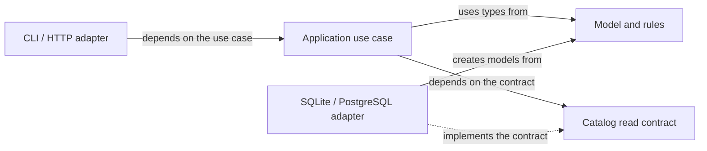

<a id="выбрать-границы-структуру-и-зависимости"></a>
# Choose boundaries, structure, and dependencies

[Русский](../../../../ru/python/architecture/project-design/structure-and-decisions.md)

Use this page when a change affects several modules or a test requires external infrastructure.
Choose the boundary based on an observable problem.

| Situation | Technique | Example |
| --- | --- | --- |
| Parts of the application require different releases | Compare shared and independent releases | [Deployment boundaries](#deployment-and-code-organization) |
| Imports depend on the working directory | Create an installable package | [Python package structure](#python-package-structure) |
| A calculation test requires a database | Pass in a ready adapter | [Dependency injection](#dependency-injection) |
| Reasons for a choice get lost | Record the context, options, and consequences | [Completed ADR](#record-a-decision-in-an-adr) |

[Guide](README.md) · [Working package](example.md)

**Level** — beginner to advanced.
Use these design criteria and sample documents to evaluate choices in the project's context.

<a id="навигация"></a>
## Navigation

- [Deployment and code organization](#deployment-and-code-organization)
- [Python package structure](#python-package-structure)
- [Choose a stack and conventions](#choose-a-stack-and-conventions)
- [Dependency injection](#dependency-injection)
- [Record a decision in an ADR](#record-a-decision-in-an-adr)

<a id="развёртывание-и-организация-кода"></a>
## Deployment and code organization

**Beginner / intermediate level.**
Deployment and code-organization decisions are related.
Each decision needs its own criteria.

| Deployment option | When to consider it | Cost and checks |
| --- | --- | --- |
| One application | A shared release, consistent data, and scaling together are sufficient | Check that modules are easy to understand. Check release time |
| Modular monolith | Clear domain boundaries are needed within a shared deployment | Control imports. Control data access between modules |
| Several services | The need for independent releases, ownership, or scaling has been established | The solution must account for the network, partial failures, contract compatibility, and observability |

A modular monolith can run in one process and container.
Several containers running copies of the same application are still replicas of one application.
If state and external dependencies permit, scale a monolith with multiple instances.

| Code organization | Useful boundary | What to check |
| --- | --- | --- |
| Layers | Presentation → use cases → data access | Business rules stay out of HTTP and SQL details |
| By feature / domain module | `catalog`, `orders`, `users` | Changing one feature requires edits only in the relevant places |
| Ports & Adapters | The application is separate from input and storage mechanisms | The main use case can be tested without an HTTP server or external database |

These approaches can be combined.
For example, a `catalog` module inside a monolith can have its own ports and adapters.
Feature-based organization can be used independently of DDD.

<a id="структура-python-пакета"></a>
## Python package structure

**Intermediate level.**
For an installable application, use an import package and an explicit entry point.
The tree shows one possible file layout and the roles of its components.

```text
project/
├── pyproject.toml
├── README.md
├── src/
│   └── project_app/
│       ├── __init__.py
│       ├── __main__.py       # assembly and startup
│       ├── catalog/          # domain module
│       │   ├── domain.py
│       │   ├── application.py
│       │   └── adapters.py
│       └── config.py
└── tests/
    ├── unit/
    └── integration/
```

In a small application, a module can be one file.
Create separate directories as needed.
A `src` layout helps test the installed package.
It separates importable code from root-level files.
This layout is a packaging choice.
A flat layout is also valid if its import behavior is clear.

In the diagram, solid arrows show code dependencies.
Dashed arrows show conformance to a contract.
The diagram describes static relationships. SQL calls follow the runtime flow.



The contract expresses an application requirement.
A structural Protocol allows an implementation without importing or inheriting from Catalog.
A matching interface and behavior are sufficient.
The composition root connects concrete objects.
At runtime, calls can still go from the application through the adapter to the database.

<a id="выбор-стека-и-конвенций"></a>
## Choose a stack and conventions

**Intermediate level.**
For each technology, state why you chose it.
Specify how to verify that it meets the requirements.

| Question | What to record |
| --- | --- |
| Python | Supported branch, development and CI version, and availability of required libraries |
| HTTP | [FastAPI](../../web/fastapi/README.md) for an ASGI or typed API, or [Flask](../../web/flask/README.md) for a WSGI use case. Choose according to requirements and experience |
| Data | Constraints and transactions. Choose [SQLite](../../../databases/relational/sqlite/README.md) or [PostgreSQL](../../../databases/relational/postgresql/README.md) based on usage |
| Database access | [SQLAlchemy](../../databases/sqlalchemy/README.md), session lifetimes, and the migration tool |
| Cache / queue | An established use case for [Redis](../../../databases/non-relational/redis/README.md). Add caching where the application needs it |
| Quality | Formatter, linter, type checks when needed, [pytest](../../testing/pytest/README.md), and identical commands locally and in CI |
| Observability | Log format, request ID, required metrics, and health/readiness checks. Provide a health check independently of any task queue |

`pyproject.toml` stores tool configuration.
Pin versions for a reproducible environment with your chosen lockfile mechanism.
[uv](../../tooling/uv/README.md) is one option.
Pre-commit hooks are useful for early checks.
CI checks a commit independently of local hooks.
To pin a hook, use a real, verified tag.

Name modules and functions in `snake_case`.
Name classes in `PascalCase`.
Name constants in `UPPER_SNAKE_CASE`.
A single leading `_` marks a non-public detail by convention. Python still allows access.
`__name` triggers name mangling. Use separate controls to protect data.

<a id="внедрение-зависимостей"></a>
## Dependency injection

**Intermediate / advanced level.**
DI passes in ready-to-use dependencies.
DIP directs dependencies toward a contract.

| Method | When it is convenient | What remains your responsibility |
| --- | --- | --- |
| Function arguments / constructor | Small or understandable object graph | Assembly, resource cleanup, and lifetimes |
| FastAPI `Depends` | HTTP-request resources and parameters | Keeping HTTP context out of business logic, `yield` and lifespan |
| DI container | Many ways to assemble objects and complex lifetimes | Explicit graph, provider configuration, and correct resource cleanup |

Choose a container according to the graph and lifecycle needs.
The [working example](example.md) uses manual DI.
The example checks one use case with two adapters.
Give SQLAlchemy Sessions explicit request or task scopes.

<a id="записать-решение-adr"></a>
## Record a decision in an ADR

**Advanced level.**
An ADR is a short record of a significant architecture decision.
Keep ADRs alongside code, for example in `docs/decisions/`.
The format may vary by team.
Keep the context, options, and consequences.

The table shows a completed example for the practice catalog.

| Field | Contents |
| --- | --- |
| Decision | Start with one Python package and a catalog read port |
| Status | Accepted for the practice example |
| Context | CLI lookup and tests without an external server are required. Modules can be released together |
| Considered | SQL directly in the CLI, a use case with a port, and a separate HTTP service |
| Chosen | The use case receives `Catalog`. The CLI assembles the objects. The SQLite adapter is checked separately |
| Consequences | Several small objects. Storage can be replaced without changing the use case. Distributed concerns require separate decisions |
| When to revisit | A confirmed need for an external API or writes by multiple users |

An ADR can be revisited as conditions change.
Link the new decision to the previous decision.
Explain what changed.

Sources include [PyPA src layout](https://packaging.python.org/en/latest/discussions/src-layout-vs-flat-layout/),
[Cockburn on Hexagonal Architecture](https://alistair.cockburn.us/hexagonal-architecture/),
[Fowler on Monolith First](https://martinfowler.com/bliki/MonolithFirst.html),
[Dependency Injector](https://python-dependency-injector.ets-labs.org/),
and [Nygard on documenting architecture decisions](https://cognitect.com/blog/2011/11/15/documenting-architecture-decisions).
