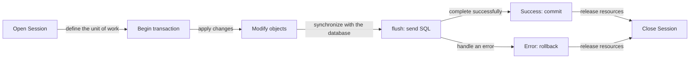

# SQLAlchemy API 2.x

[Русский](../../../../ru/python/databases/sqlalchemy/README.md)

SQLAlchemy combines the Core SQL expression builder with an ORM for sessions, relationships, and transactions.
Use this reference for models, transactions, queries, and relationship-loading choices.
The reference uses the `select()` style.
The examples use SQLAlchemy 2.1.
The examples retain the main constructs introduced in 2.0.

[Python catalog](../../README.md) · [FastAPI and a session per request](../../web/fastapi/database.md)

<a id="быстрый-поиск"></a>
## Quick lookup

| Task | API | Where |
| --- | --- | --- |
| Models, types, defaults, constraints | `DeclarativeBase`, `Mapped`, `mapped_column` | [Models](models-and-transactions.md#shared-schema-for-the-recipes) |
| CRUD and rollback | `Session`, `session.begin()`, `rollback()` | [Transactions](models-and-transactions.md#crud-transactions-and-savepoints) |
| 1:N, N:1, 1:1, N:M | `relationship`, `ForeignKey`, `Table` | [Complete schema](models-and-transactions.md#shared-schema-for-the-recipes) |
| WHERE/JOIN/CTE/CASE/UNION/EXISTS | `select`, `func`, `aliased` | [Queries](queries.md) |
| Eliminate excessive queries when reading collections | N+1, lazy, `selectinload` | [N+1 card](relationship-loading.md#find-n1) · [Standalone program](n-plus-one.md#setup-and-run) |
| Choose collection loading by size and constraints | `selectinload` or `joinedload` | [Decision table](relationship-loading.md#choose-a-strategy) · [Select-in](relationship-loading.md#load-collections-with-selectinload) · [Joined and unique](relationship-loading.md#load-a-collection-with-joinedload) |
| Load the author of each post | Compare repeated fields and SELECT counts | [Scalar relationship](relationship-loading.md#load-a-scalar-relationship) |
| Prevent unexpected lazy SELECTs | `raiseload` | [Card and limitations](relationship-loading.md#detect-unplanned-lazy-loading) |
| Load part of a relationship with a custom JOIN | `contains_eager`, `populate_existing` | [Partial collection](filtered-relationships.md#load-a-partial-collection-from-a-join) |
| Process a large result set | `yield_per`, `partitions` | [Batches and limitations](streaming.md) |
| Async sessions and attributes | `AsyncSession`, `AsyncAttrs`, `awaitable_attrs` | [Async](async-and-operations.md#async-session) |
| UPSERT / FOR UPDATE / partial index | PostgreSQL dialect | [PostgreSQL compilation](queries.md#postgresql-compilation-without-a-connection) |
| Events, SQL logs, and query timing | `event`, `logging`, `perf_counter` | [Observability](async-and-operations.md#events-and-diagnostics) |
| Change a schema | Alembic | [Migrations](async-and-operations.md#alembic-in-a-separate-practice-project) |

| Parameter | Value |
| --- | --- |
| API / dialect | SQLAlchemy 2.1. Executable examples use SQLite. PostgreSQL examples are marked separately |
| Prerequisites | Python, SQL, transactions. The async recipe requires `async with` |
| Standalone N+1 | [Synchronous example with two models](n-plus-one.md) with separate setup and checks. It does not need the shared schema |

<a id="навигация"></a>

<a id="базовый-уровень"></a>

<a id="записать-пользователя-в-явной-транзакции"></a>
## Save a user in an explicit transaction

**Situation** — the user must be saved on success, with changes rolled back on an exception.
**Change** — separate the session lifetime from the transaction boundary.
The snippet uses `User` and `new_engine()` from the [complete schema](models-and-transactions.md#shared-schema-for-the-recipes).

```python
from sqlalchemy.orm import Session
from demo_models import User, new_engine

engine = new_engine()
try:
    with Session(engine) as session, session.begin():
        user = User(name="alice", email="alice@example.com")
        session.add(user)
        session.flush()
        assert user.id is not None
finally:
    engine.dispose()
```

**Result** — `flush` provides the ID, and a successful exit from `begin` commits the transaction.
SQLite exists only in memory. The data disappears after the engine is disposed.
[Complete CRUD and rollback checks](models-and-transactions.md#crud-transactions-and-savepoints).


For an introduction to N+1, use the [separate single-file setup](n-plus-one.md#setup-and-run).
The installation below applies to the shared schema and the other recipes in this section.
Install the packages in a separate environment with `python -m pip install 'sqlalchemy[asyncio]==2.1.8' pytest`.
The `asyncio` extra is required by the shared model with AsyncAttrs, including its synchronous recipes.
For async examples, add `aiosqlite` and `pytest-asyncio`.

| Component | Purpose |
| --- | --- |
| `Engine` / `Connection` | Driver and pool access / a specific connection |
| `MetaData` / `Table` / `Column` | Core schema definition. `Column` remains useful in 2.x |
| `DeclarativeBase`, `Mapped[T]` | ORM mapping and annotations. Some supported styles do not require `Mapped` |
| `Session` | Identity map and unit of work. A session cannot serve as a shared thread-safe container |
| `select()` | Query definition. A session or connection executes the SQL |
| `Result` / `ScalarResult` | Rows / values from the first selected column |

`with Session(engine)` closes the session without committing by itself.
On success, `with session.begin()` commits the transaction.
On an exception, the context rolls back the transaction.
`flush()` sends changes to the database within the transaction.
The method also provides generated IDs.
Calling `flush()` does not commit.
[Complete runnable example](models-and-transactions.md).

The diagram shows the session boundary and the outcomes of an explicit transaction.



| Read operation | Result |
| --- | --- |
| `session.get(User, id)` | An object or `None`, accounting for the identity map |
| `session.scalars(select(User)).all()` | A list of ORM objects |
| `session.execute(select(User.name, User.email))` | Rows containing two selected values |
| `result.scalar_one()` / `scalar_one_or_none()` | Checks the result count. More than one row raises an error |

<a id="средний-уровень"></a>

<a id="получить-строки-из-нескольких-колонок"></a>
## Retrieve rows with multiple columns

**Situation** — retrieve names and ages of adults from the prepared Alice and Bob records.
**Change** — select columns explicitly and use `execute` to retain both columns.
The snippet uses a Session containing data from the [complete `seed()`](queries.md#select-join-subqueries-and-ctes).

```python
from sqlalchemy import select
from demo_models import User

rows = session.execute(
    select(User.name, User.age).where(User.age >= 18).order_by(User.id)
).all()
assert rows == [("alice", 30)]
```

**Result** — one row with two values.
`scalars()` would retain only the first selected column.
[Complete JOIN, CTE, EXISTS examples and checks](queries.md).


- `Mapped[str | None]` infers nullable. Explicit `nullable=` takes precedence. `Numeric` usually returns `Decimal`. Annotate the corresponding field as Decimal.
- `default` runs on the Python/SQLAlchemy side. `server_default` is part of the database DDL. `onupdate` does not create a server-side trigger.
- Enforce uniqueness and foreign keys through constraints. A scalar `relationship` alone cannot enforce 1:1. A unique FK or PK is required.
- `Enum(MyEnum)` stores member **names** by default. Set `values_callable` for string values. Integer storage requires an appropriate separate column or conversion model.
- ORM `cascade="all, delete-orphan"` and FK `ON DELETE` are separate mechanisms. The [schema and tests](models-and-transactions.md) explicitly enable SQLite foreign keys.

<a id="продвинутый-уровень"></a>

<a id="прочитать-коллекции-без-запроса-для-каждого-пользователя"></a>
## Read collections without a query per user

**Situation** — a user list must include every post, and an additional SELECT is acceptable.
**Change** — load the collections with `selectinload`.
This query snippet comes from the [standalone program with two models](n-plus-one.md#full-program).

```python
stmt = select(User).options(selectinload(User.posts)).order_by(User.id)
users = session.scalars(stmt).all()
rows = [(user.name, [post.title for post in user.posts]) for user in users]
```

**Practice dataset result** — Alice has two posts, and Bob has an empty collection. Two SELECTs run instead of three.
The query count applies to two users and a fresh Session.
The complete program includes imports and setup.
[Strategy selection, JOIN costs, and limitations](relationship-loading.md#choose-a-strategy).


[Queries](queries.md) covers SQL expressions and separate PostgreSQL compilation.
The [loading cards](relationship-loading.md) help select the required relationship data.
[Large result sets](streaming.md) covers batch processing separately.
For complete collections across a list, start with `selectinload` if additional SELECTs are acceptable.
For a small collection, compare `joinedload`, accounting for repeated parent fields and the required `unique()` call.
For a scalar relationship, compare SELECT counts and repeated related-object fields.
The [decision table and query limitations](relationship-loading.md#choose-a-strategy) describe the selection criteria.
SELECT counts alone do not demonstrate a speed improvement.

[Async and operations](async-and-operations.md) covers a session per task, events, and migrations.
Choose pool size, `max_overflow`, `pool_recycle`, and `pool_pre_ping` according to the driver and database limits.
Values in the examples are specific to those examples.

SQLAlchemy's compilation cache does not cache result rows.
A cache does not imply a server-side prepared statement.
New examples do not need the legacy `sqlalchemy.ext.baked` extension.
Reuse parameterized expressions.
Measure queries.

<a id="частые-ошибки"></a>
## Common errors

| Symptom | Correction |
| --- | --- |
| Session is “rolled back” after flush | Call `rollback()` before reusing it, or exit the transaction context |
| `DetachedInstanceError` | Load the required fields and relationships ahead of time, or convert the object to a DTO before closing the session |
| Expecting `expire_on_commit=False` to solve everything | It prevents expiration on commit, but unloaded relationships still require loading |
| A regular JOIN leaves a relationship unpopulated | JOIN filters rows. Eager loading requires loader options or `contains_eager` |
| `metadata` used as an ORM attribute | Declarative reserves this name. Use a different Python name with the intended SQL column name |
| One AsyncSession in `gather()` | Allocate a session to each concurrent task |

`Session.query()` is a legacy API.
`Session.get()` replaces `Query.get()`.
`Column` constructs remain valid where supported.
Avoid restoring library-level autocommit.
Define explicit transaction boundaries for the task.

<a id="источники"></a>
## Sources

- [SQLAlchemy 2.1](https://docs.sqlalchemy.org/en/21/), [mappings](https://docs.sqlalchemy.org/en/21/orm/declarative_tables.html), [Session](https://docs.sqlalchemy.org/en/21/orm/session_basics.html).
- [Relationship loading](https://docs.sqlalchemy.org/en/21/orm/queryguide/relationships.html), [async](https://docs.sqlalchemy.org/en/21/orm/extensions/asyncio.html), [2.0 migration](https://docs.sqlalchemy.org/en/20/changelog/migration_20.html).
