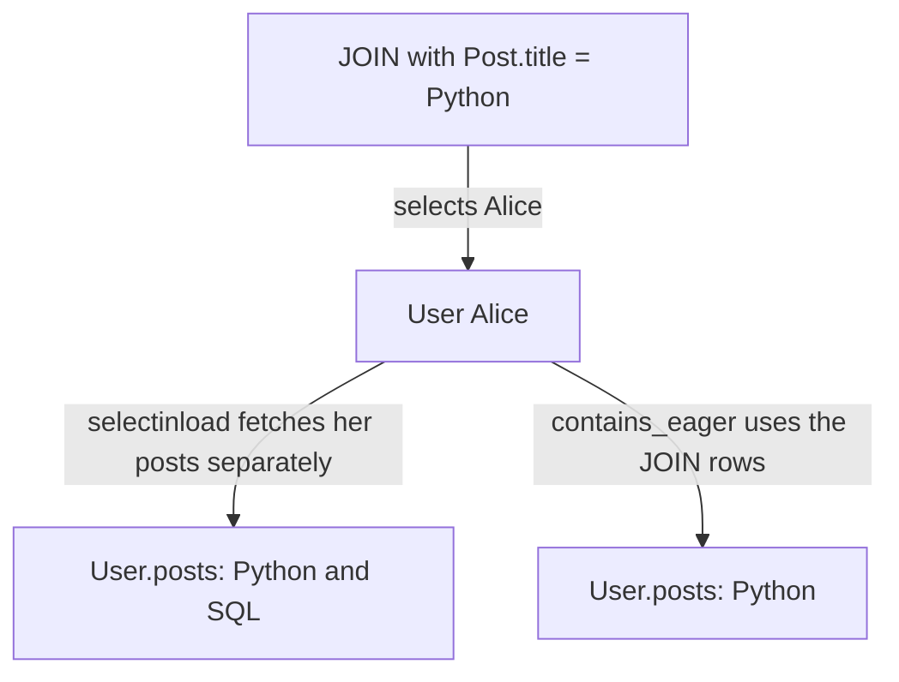

# Filter and refresh SQLAlchemy collections

[Русский](../../../../ru/python/databases/sqlalchemy/filtered-relationships.md) · [Choose a loading strategy](relationship-loading.md#choose-a-strategy) · [SQLAlchemy reference](README.md)

Decide which parents to return and what each collection should contain. If a collection is already loaded, decide separately whether the query should replace its contents in the Session.

| Task | Technique | Card |
| --- | --- | --- |
| Find users with a Python post and read all their posts | Explicit JOIN and `selectinload` | [Complete collections](#filter-parents-and-load-complete-collections) |
| Keep only posts that match the JOIN filter | `contains_eager` | [Partial collection](#load-a-partial-collection-from-a-join) |
| Replace a loaded collection with the query result | `populate_existing` | [Refresh in the Session](#refresh-an-already-loaded-collection) |

Use Python 3.14, synchronous SQLAlchemy 2.1.9 ORM, and in-memory SQLite. Set up the models, data, and `engine` using the [lab instructions](loading-lab.md#prepare-the-examples). The first two cards use fresh Sessions. For the third card, first load Alice's complete collection in the same Session, as in the [complete test](../../../../../examples/python/databases/sqlalchemy/test_relationship_loading.py).

The diagram starts with a JOIN that selects Alice by her Python post. The loading technique determines what her collection contains.



<a id="отфильтровать-родителей-и-загрузить-полные-коллекции"></a>
## Filter parents and load complete collections

**Situation** — select users with a Python post, while including all posts for each selected user.
Filter parents with an explicit JOIN.
Load the collection separately.

```python
from sqlalchemy import select
from sqlalchemy.orm import Session, selectinload
from demo_models import Post, User

with Session(engine) as session:
    users = session.scalars(
        select(User).join(User.posts).where(Post.title == "Python")
        .options(selectinload(User.posts)).order_by(User.id)
    ).unique().all()
```

**Result.** The query returns Alice with the posts titled `Python` and `SQL`.
`unique()` removes potential duplicate parents after the explicit JOIN.
Filtering parents does not automatically filter collection contents.
[Complete and partial collection comparison](loading-lab.md#compare-strategies-and-check-limitations)

<a id="загрузить-частичную-коллекцию-из-join"></a>
## Load a partial collection from a JOIN

**Situation** — `User.posts` should contain only posts selected by your JOIN.
In a fresh Session, route the JOIN rows into the relationship.

```python
from sqlalchemy import select
from sqlalchemy.orm import Session, contains_eager
from demo_models import Post, User

with Session(engine) as session:
    users = session.scalars(
        select(User).join(User.posts).where(Post.title == "Python")
        .options(contains_eager(User.posts)).order_by(User.id)
    ).unique().all()
```

**Result.** The query returns Alice with one post titled `Python`. The post titled `SQL` remains in the database.
After the state expires, a subsequent load can return the complete collection again.
If the collection is already loaded, use the [next card](#refresh-an-already-loaded-collection).
[Complete check](loading-lab.md#compare-strategies-and-check-limitations)

<a id="обновить-уже-загруженную-коллекцию"></a>
## Refresh an already loaded collection

**Situation** — Alice is already in the Session with the complete posts collection.
A new query alone can leave an already loaded relationship unchanged.
The snippet continues in this Session with no pending changes.

```python
from sqlalchemy import select
from sqlalchemy.orm import contains_eager
from demo_models import Post, User

stmt = (
    select(User).join(User.posts).where(Post.title == "Python")
    .options(contains_eager(User.posts))
    .execution_options(populate_existing=True)
)
alice = session.scalars(stmt).unique().one()
```

**Result.** Alice's loaded collection now contains only the post titled `Python`.
Before refreshing, decide how to preserve any required local changes.
`populate_existing` can replace values in memory. Pay particular attention when autoflush is disabled.
`expire_all()` marks state as expired while retaining the Session's identity map.
Subsequent access can execute SQL.
Avoid sharing a Session concurrently between threads.
[Identity map and reloading check](loading-lab.md#compare-strategies-and-check-limitations)

## Sources

- [Select-in loading](https://docs.sqlalchemy.org/en/21/orm/queryguide/relationships.html#select-in-loading).
- [Load a partial collection with contains_eager](https://docs.sqlalchemy.org/en/21/orm/queryguide/relationships.html#using-contains-eager-to-load-a-custom-filtered-collection-result).
- [Refresh loaded objects with populate_existing](https://docs.sqlalchemy.org/en/21/orm/queryguide/api.html#populate-existing).
