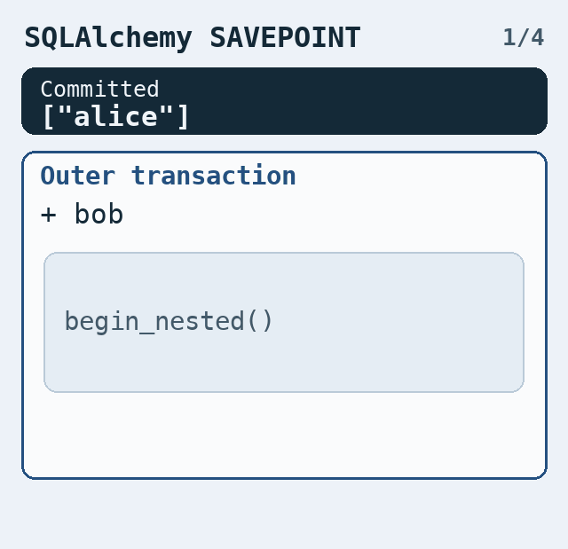

# Models, CRUD, and transactions

[Русский](../../../../ru/python/databases/sqlalchemy/models-and-transactions.md)

Use this page to prepare shared models, perform CRUD operations, or check transaction rollback.
The example creates an in-memory SQLite database without using an existing database.

| Task | Technique | Example / details |
| --- | --- | --- |
| Prepare relationship models | `Mapped`, FKs, constraints | [Complete demo_models.py](#shared-schema-for-the-recipes) |
| Add, update, and delete | `Session`, `begin`, `flush` | [CRUD and tests](#crud-transactions-and-savepoints) |
| Preserve the outer transaction after an error | `begin_nested` and a savepoint | [Savepoint test](#crud-transactions-and-savepoints) |

[Reference](README.md) · [Queries](queries.md) · [Async and operations](async-and-operations.md)

**Level** — beginner to intermediate, with advanced savepoints and custom types.
The extended recipes use the shared schema below.
For an introduction to loading, [two models in one file](n-plus-one.md) are enough.
Run the examples on Python 3.14 with SQLite from the standard `sqlite3` module.
Run `python -m pip install 'sqlalchemy[asyncio]==2.1.8' 'pytest==9.2.0'`.
The shared base inherits AsyncAttrs. Importing asyncio support in SQLAlchemy 2.1 requires greenlet through the `asyncio` extra.
[Installation explanation](https://docs.sqlalchemy.org/en/21/faq/installation.html#i-m-getting-an-error-about-greenlet-not-being-installed-when-i-try-to-use-asyncio).
The examples create only an in-memory practice database.

## Shared schema for the recipes

The complete `demo_models.py` demonstrates scalar and optional fields, defaults, Enum, a JSON TypeDecorator, constraints, and four relationship types.

[`sqlalchemy/demo_models.py`](../../../../../examples/python/databases/sqlalchemy/demo_models.py)

Use `Date`, `BigInteger`, and `LargeBinary` for dates of birth, large integers, and binary data.
Choose the type and dialect to match the data.
`DateTime(timezone=True)` does not guarantee identical timezone storage across database systems.
The SQLite example stores server time without that guarantee.
The JSON TypeDecorator demonstrates an extension technique.
If the dialect supports the required JSON features, the built-in `JSON` type is usually simpler.
`MutableDict` tracks the top level of a dictionary.
Nested dicts and lists require a separate change-tracking strategy.

## CRUD, transactions, and savepoints

The complete `demo_crud.py` creates a `User` with all required fields.

[`sqlalchemy/demo_crud.py`](../../../../../examples/python/databases/sqlalchemy/demo_crud.py)

Run `python demo_crud.py`.
The expected result is `['alice', 'bob']`.
INSERT, UPDATE, and DELETE affect only the example's temporary database.
The database disappears after the engine is closed.
`RETURNING` depends on the database system and version.
This example exercises `RETURNING` on the SQLite version in the runtime environment.
Account for autobegin when using an existing session.
Reading can also start a transaction.
Before calling `session.begin()` again, check whether a transaction has already started.

The complete `test_models.py` checks rollback, savepoints, constraints, relationships, and the custom type.

[`sqlalchemy/test_models.py`](../../../../../examples/python/databases/sqlalchemy/test_models.py)

Run `python -m pytest -q test_models.py`.
The savepoint lets the outer transaction continue after the duplicate-email error.
Valid changes in the outer transaction should persist.
The example catches the exception outside the nested context.
An unhandled exception would also exit the outer context.

Show the savepoint rollback step by step

Alice is already committed. The test adds Bob in the outer transaction. `begin_nested()` flushes Bob's insert before establishing the savepoint. The duplicate email raises `IntegrityError` inside the savepoint. The nested context rolls back to the savepoint, and the test catches the error outside that context. The outer transaction then adds Carol and commits. The final query returns `["alice", "bob", "carol"]`.

[Open the GIF to replay it](../../../../assets/sqlalchemy-savepoint.gif?raw=true)

In FastAPI, a dependency with `yield` provides a session.
The complete [sync/async HTTP recipe](../../web/fastapi/database.md) is in the FastAPI section.
Choose the transaction boundary in one place.
Avoid distributing commits across uncoordinated layers.

Sources include [Declarative](https://docs.sqlalchemy.org/en/21/orm/declarative_tables.html), [relationships](https://docs.sqlalchemy.org/en/21/orm/basic_relationships.html), [transactions and savepoints](https://docs.sqlalchemy.org/en/21/orm/session_transaction.html), [custom types](https://docs.sqlalchemy.org/en/21/core/custom_types.html), and [MutableDict](https://docs.sqlalchemy.org/en/21/orm/extensions/mutable.html).
