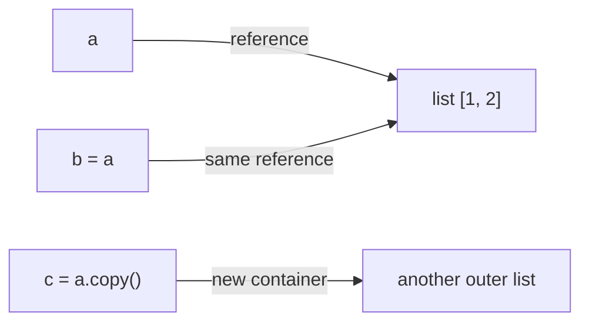

<a id="типы-данных-python"></a>
# Python data types

[Русский](../../../../ru/python/language/types/README.md)

Use this reference to choose types, operations, and conversions. It also covers mutable objects.
Type annotations describe a contract for tools. Runtime input validation requires a separate check.

[Python catalog](../../README.md) · [Complete examples](recipes.md)

<a id="быстрый-поиск"></a>
## Quick lookup

| Task | Choice | Example |
| --- | --- | --- |
| Integer or approximate number | `int` or `float` | [Card](#numbers-strings-and-logic) |
| Exact decimal arithmetic | Construct `Decimal` from strings and specify rounding | [Card](#numbers-strings-and-logic) |
| Complex number | `complex`, for example `3 + 4j` | [Card](#numbers-strings-and-logic) |
| Mutable sequence | `list` | [Card](#collections) |
| Fixed sequence of references | `tuple` | [Card](#collections) |
| Integer sequence without a prebuilt list | `range` | [Card](#collections) |
| Text or binary data | `str` or `bytes`, with `bytearray` for mutable bytes | [Card](#collections) |
| Key-to-value mapping | `dict`, or `defaultdict` for grouping | [Card](#collections) |
| Unique values | `set`, or `frozenset` for an immutable set | [Card](#collections) |
| Missing value | `None`, checked with `is None` | [Card](#conversions-and-checks) |

| Requirement | Value |
| --- | --- |
| Target documentation | Python 3.14. Examples use the standard library |

<a id="базовый-уровень"></a>

<a id="числа-строки-и-логика"></a>
## Numbers, strings, and logic

To round the decimal price `"2.675"` to cents with HALF_UP, construct `Decimal` from a string and specify the rounding mode.
The standalone fragment uses the standard library.

```python
from decimal import Decimal, ROUND_HALF_UP

amount = Decimal("2.675").quantize(Decimal("0.01"), rounding=ROUND_HALF_UP)
assert amount == Decimal("2.68")
```

The result is `2.68` without an intermediate `float`. Choose the rounding mode for your task.
[Complete program with checks](recipes.md#complete-program).

| Expression | Result or meaning |
| --- | --- |
| `0b1010`, `0o12`, `0xA` | Integer `10` in different bases |
| `int("ff", 16)` | `255` |
| `3e5`, `1.5e-3` | `300000.0`, `0.0015` |
| `(3 + 4j).real`, `(3 + 4j).imag` | `3.0`, `4.0` |
| `Decimal("0.1")` | Decimal value without an intermediate float |
| `f"Привет, {name}"` | String formatting, with an existing `name` variable |
| `" a b ".strip().split()` | `['a', 'b']`. The methods return new strings |
| `bool(0)`, `bool("")`, `bool([])`, `bool(None)` | `False` |
| `bool("False")` | `True`, because every nonempty string is truthy |

`float` has binary rounding error. Use `math.isclose` for approximate comparisons.
Division `/` and floor division `//` differ.
`int(-3.8)` truncates toward zero. `-3.8 // 1` rounds down.
`bool` is a subtype of `int`, so `isinstance(True, int)` is true.
Account for that relationship if your numeric input must exclude `bool`.

<a id="коллекции"></a>
## Collections

To get unique languages from a list with duplicates, create a set. Sort the result for stable output.
The following fragment stands on its own.

```python
languages = ["python", "go", "python"]
unique = set(languages)
assert unique == {"python", "go"}
assert sorted(unique) == ["go", "python"]
```

The set contains each value once. It requires hashable elements and does not retain the input order.
[Complete program with collection operations](recipes.md#complete-program).

To estimate the work done by loops over a collection, compare [one pass and enumerating all pairs](../../../algorithms/README.md#big-o).

| Type | Operations and behavior |
| --- | --- |
| `list` | `append`, `extend`, `pop`, and slices. Items may have different types |
| `tuple` | `(5,)` has one item. Tuple immutability does not freeze a nested list |
| `range` | `range(1, 6, 2)` yields `1, 3, 5`. The upper bound is excluded |
| `str` | Unicode text with `lower`, `upper`, `replace`, `split`, and `join` |
| `bytes`, `bytearray` | Indexing gives an integer. Convert text with `encode` and `decode` |
| `dict` | Keeps insertion order. `keys`, `values`, and `items` return views |
| `set` | `a \| b`, `a & b`, `a - b`, `a ^ b`. Iteration order is unspecified |
| `frozenset` | An immutable set of hashable elements that can be a dictionary key |

`{}` creates a dictionary. Use `set()` for an empty set.
When an element is missing, `remove` raises `KeyError`, while `discard` accepts its absence.
`dict.get` does not raise `KeyError`. Distinguish the default from a stored `None`.

<a id="средний-уровень"></a>

<a id="преобразования-и-проверка"></a>
## Conversions and checks

If a missing limit means use the default and `0` remains valid, check for `None` explicitly.
The following fragment stands on its own.

```python
limit = 0
actual = 10 if limit is None else limit
assert actual == 0
```

This preserves the zero limit. `limit or 10` would return `10`.
Check the type separately if the limit needs validation.
[Complete conversion checks](recipes.md#complete-program).

`list(iterable)`, `tuple(iterable)`, and `set(iterable)` create collections.
`dict` accepts key-value pairs. `str([1, 2])` is Python's representation and does not provide general JSON serialization.
`int("abc")` raises `ValueError`. Handle that specific exception for expected invalid input.

`type(value) is T` checks the exact type. `isinstance(value, T)` includes subtypes.
`is None` checks a different condition from `if not value`. Zero and empty collections can be valid values.

<a id="словари-специального-назначения"></a>
## Specialized dictionaries

- `defaultdict(list)` creates a list on `mapping[key]` access. `.get()` does not call the factory.
- `OrderedDict` supports reordering with `move_to_end` and removal by order. An ordinary `dict` already preserves insertion order.
- Order does not affect ordinary dictionary equality. Equality between two `OrderedDict` objects takes order into account.
- `dict.items()` views reflect subsequent changes. Use `list(mapping.items())` for a snapshot.

<a id="продвинутый-уровень"></a>

<a id="изменяемость-ссылки-и-хешируемость"></a>
## Mutability, references, and hashability

When a copied outer list needs independent nested rows, choose a deep copy for supported nested objects.
The following fragment stands on its own.

```python
from copy import deepcopy

original = [[1]]
shallow = original.copy()
deep = deepcopy(original)
original[0].append(2)
assert shallow == [[1, 2]]
assert deep == [[1]]
```

The shallow copy shares the nested list. The deep copy retains its previous contents.
Resources such as connections require their own copying strategy.
[Complete checks of references and hashability](recipes.md#complete-program).

The diagram shows which objects the variables reference.



Assignment creates another reference to the object. A shallow copy creates a new outer container with references to the original nested objects.
`deepcopy` recursively copies supported objects and preserves relationships among repeated references within the copy.

Immutability and hashability are distinct. A tuple containing a list is an immutable container with an unhashable value.
`list`, `dict`, and `set` cannot be ordinary dictionary keys.
User-defined classes have their own `__eq__` and `__hash__` rules.

`sys.getsizeof` reports the object's own size and excludes a recursive total for its elements.
`sys.getrefcount` reports CPython references. The result depends on temporary references and implementation details. Check mutability separately.
[Working checks of all cases](recipes.md).

<a id="частые-ошибки"></a>
## Common mistakes

| Symptom | Cause or action |
| --- | --- |
| Two variables changed together | Both reference one object. Choose the required copy depth |
| Lists in `[[0] * 2] * 3` change together | The outer list repeats references. Use a comprehension for independent rows |
| `0.1 + 0.2 != 0.3` | Binary arithmetic. Use `isclose` or a suitable decimal model |
| `TypeError: unhashable type` | The key or element is unhashable. Choose a suitable representation |
| `bool("false")` enabled an option | Parse the string against explicitly allowed values |

<a id="источники"></a>
## Sources

- [Python 3.14 built-in types](https://docs.python.org/3.14/library/stdtypes.html).
- [collections](https://docs.python.org/3.14/library/collections.html), [Decimal](https://docs.python.org/3.14/library/decimal.html).
- [Copying](https://docs.python.org/3.14/library/copy.html), [sys size and references](https://docs.python.org/3.14/library/sys.html).
- [Data model and hash](https://docs.python.org/3.14/reference/datamodel.html#object.__hash__), [annotations](https://docs.python.org/3.14/library/typing.html).
