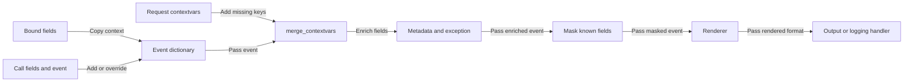

# structlog

[Русский](../../../../ru/python/logging/structlog/README.md)

structlog builds each event as a dictionary.
Context fields and call arguments pass through a processor chain and a renderer.
Use this reference to configure logging and request context.
The detailed pages include reproducible configurations.

[Python catalog](../../README.md) · [FastAPI](../../web/fastapi/README.md)

<a id="быстрый-поиск"></a>
## Quick reference

| Task | API | Recipe |
| --- | --- | --- |
| Render JSON, console, or key-value output | `JSONRenderer`, `ConsoleRenderer`, `KeyValueRenderer` | [Configuration](configuration.md#standalone-configuration) |
| Add or remove logger fields | `bind`, `unbind`, `try_unbind` | [Context](context-and-web.md#local-and-contextual-binding) |
| Add fields to every request log | `merge_contextvars`, `bound_contextvars` | [Contextvars](context-and-web.md) |
| Preserve a traceback | `exception` or `exc_info=True` | [Configuration and tests](configuration.md) |
| Process stdlib and structlog events consistently | `ProcessorFormatter` | [Standard library integration](configuration.md#integrate-with-standard-library-logging) |
| Manage async, FastAPI, or Django context | Task isolation and middleware | [Context and web](context-and-web.md) |
| Filter, mask, or profile logging | Processors and level checks | [Ordering and cost](configuration.md#ordering-and-cost) |

| Item | Details |
| --- | --- |
| API | structlog 26.1 |
| Prerequisites | Python, dictionaries, and logging. For contextvars, familiarity with concurrent tasks. |

<a id="навигация"></a>

<a id="базовый-уровень"></a>

<a id="связать-события-с-одним-пользователем"></a>
## Associate events with a user

Several events belong to user `123`, while the original logger should stay shared.
Get a new logger with `bind`.
This snippet uses the [complete demo_logging.py](configuration.md#standalone-configuration).

```python
from demo_logging import configure_logging

parent = configure_logging()
child = parent.bind(user_id=123)
child.info("user_logged_in")
parent.info("service_ready")
```

The first JSON event contains `user_id=123`. The second has no `user_id`.
`bind` returns a new logger and leaves the original context intact.
[Complete configuration and output checks](configuration.md#standalone-configuration).

Install the packages in a separate environment with `python -m pip install 'structlog==26.1.0' pytest`.
After `import structlog`, try `structlog.get_logger().info("user_logged_in", user_id=123)`.
This introductory snippet uses the default configuration.
See the [complete configuration](configuration.md) for a reproducible setup.

| Technique | Behavior |
| --- | --- |
| `log.info("event_name", key=value)` | Structured event. The message occupies the `event` field. |
| `child = log.bind(user_id=1)` | New logger with the field. The original logger stays intact. |
| `child = child.unbind("user_id")` | New logger without the key. A missing key raises KeyError. |
| `try_unbind("key")` | Removes the key if present |
| `debug/info/warning/error/critical` | Log levels. Filtering depends on configuration. |
| `exception("failed")` inside except | Adds a traceback with a suitable processor and renderer |

<a id="средний-уровень"></a>

<a id="добавить-поле-всем-событиям-одной-работы"></a>
## Add a field to every event within an operation

Nested functions create their own loggers and need a shared `request_id`.
Use `bound_contextvars` with `merge_contextvars` configured.
This snippet uses the [complete demo_logging.py](configuration.md#standalone-configuration).

```python
import structlog
from structlog.contextvars import bound_contextvars
from demo_logging import configure_logging

log = configure_logging()
with bound_contextvars(request_id="training-request"):
    structlog.get_logger().info("inside")
log.info("outside")
```

Only the `inside` event contains the temporary identifier.
The context manager restores previous values. Clear old context at the start of each new request.
[Complete concurrent-task and middleware checks](context-and-web.md).

First merge fields from `contextvars` into the event.
Then add level, time, and metadata.
Process the exception.
Mask fields.
Place the renderer last.
For standard library logging, use a compatible `ProcessorFormatter`.
Choose one final renderer for each processing path.

The diagram shows an event passing through processors.



A call argument overrides a field with the same name in the bound logger.
`merge_contextvars` adds missing keys.
Pass a stable event name and separate fields so you can search fields directly.

<a id="продвинутый-уровень"></a>

<a id="не-вычислять-дорогие-данные-выключенного-debug"></a>
## Skip expensive computation when DEBUG is disabled

Building a diagnostic list is expensive, and the logger is set to INFO.
Check the level before computing the argument.
This snippet uses the filtering logger from the [complete configuration](configuration.md#standalone-configuration).

```python
import logging
from demo_logging import configure_logging

log = configure_logging(level=logging.INFO)
if log.is_enabled_for(logging.DEBUG):
    log.debug("snapshot", values=list(range(100_000)))
```

The list is never created, and no event is emitted.
The stdlib BoundLogger uses `isEnabledFor` for the level check.
[Processor ordering and limitations](configuration.md#ordering-and-cost).

[Contextvars and middleware](context-and-web.md) define the request boundary and cleanup.
Changes can remain isolated across synchronous code, asynchronous code, and threads.
In an async application, ordinary `.info()` runs synchronously.
The filtering logger shown here supports `await log.ainfo()`, which moves processing to a thread pool.

`cache_logger_on_first_use=True` works well with stable configuration.
Existing loggers retain their configuration.
A filtering logger from `make_filtering_bound_logger` has a fixed minimum level.
For dynamic stdlib levels, choose its BoundLogger and `filter_by_level`.
Measure the actual processor path before claiming a speed improvement.

<a id="частые-ошибки"></a>
## Common mistakes

| Problem | What to do |
| --- | --- |
| `with logger.bind(...)` | Use the returned logger or `with bound_contextvars(...)` |
| `JSONRenderer(serializer=str)` | The serializer must encode the whole event dictionary as JSON. Use the default or a compatible JSON encoder. |
| `structlog.dev.lazy(...)` | structlog 26.1 has no such public API. Check the level before expensive computation. |
| Assuming `StackInfoRenderer` only runs at ERROR or above | It responds to `stack_info=True` |
| Assuming `get_logger("name")` returns a stdlib logger | It returns a structlog proxy. LoggerFactory determines stdlib integration. |
| Reconfiguring loggers or handlers in middleware | Configure once at startup to avoid duplicates or incompatible chains |
| Logging only `str(exception)` | Use `exception` or `exc_info` for a traceback |

<a id="источники"></a>
## Sources

- [Bound loggers](https://www.structlog.org/en/stable/bound-loggers.html), [processors](https://www.structlog.org/en/stable/processors.html), [API](https://www.structlog.org/en/stable/api.html).
- [Contextvars](https://www.structlog.org/en/stable/contextvars.html), [stdlib logging](https://www.structlog.org/en/stable/standard-library.html), [performance](https://www.structlog.org/en/stable/performance.html).
