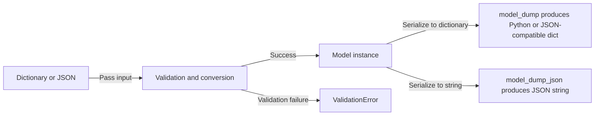

# Pydantic v2

[Русский](../../../../ru/python/validation/pydantic/README.md)

Pydantic validates and converts data using Python annotations.
It also serializes models and generates JSON Schema.
Use this page as an API and recipe reference.
Application settings live in the separate `pydantic-settings` package.

[Python catalog](../../README.md) · [FastAPI](../../web/fastapi/README.md)

<a id="быстрый-поиск"></a>
## Quick reference

| Task | API | Recipe |
| --- | --- | --- |
| Validate a dictionary or JSON | `model_validate`, `model_validate_json` | [Models and validators](models.md) |
| Constrain a field or set an alias | `Field`, `ConfigDict` | [Models](models.md#models-validation-and-json) |
| Validate several fields together | `model_validator(mode="after")` | [Discounted product](models.md#models-validation-and-json) |
| Serialize and compute a field | `model_dump`, `model_dump_json`, `computed_field` | [Models](models.md) |
| Read ORM attributes | `from_attributes=True` | [ORM and configuration](models.md#attributes-configuration-and-types) |
| Validate a list directly | `TypeAdapter(list[Model])` | [Advanced tasks](advanced.md#generics-typeadapter-and-custom-types) |
| Define a custom type, generic, or dynamic model | `Annotated`, `Generic`, `create_model` | [Advanced tasks](advanced.md) |
| Load settings or FastAPI query parameters | `BaseSettings`, `Query()` | [Integrations](advanced.md#application-settings) |
| Migrate v1 code or measure speed | Migration guide, `timeit` | [Migration and performance](advanced.md#migration-and-performance) |

| Item | Details |
| --- | --- |
| API | Pydantic v2. The newer alias parameters require 2.11 or later. |
| Prerequisites | Python types, classes, and JSON. Example syntax requires Python 3.10 or later. |

<a id="навигация"></a>

<a id="базовый-уровень"></a>

<a id="преобразовать-вход-и-отвергнуть-неверное-значение"></a>
## Convert input and reject invalid values

A counter arrives as the string `"42"`, and negative values are invalid.
Define the field and its numeric bound in the model.
This standalone snippet requires Pydantic v2.

```python
from pydantic import BaseModel, Field, ValidationError


class Count(BaseModel):
    value: int = Field(ge=0)


assert Count.model_validate({"value": "42"}).value == 42
try:
    Count(value=-1)
except ValidationError as error:
    assert error.errors()[0]["type"] == "greater_than_equal"
```

The model converts a valid string to `int` and rejects a negative value.
Use strict mode to disable coercion.
[Complete models, tests, and commands](models.md#models-validation-and-json).

Install the package in a separate virtual environment with `python -m pip install 'pydantic[email]==2.14.3'`.

| Declaration or operation | Meaning |
| --- | --- |
| `name: str` | Required field |
| `name: str \| None` | Required field that accepts `None` |
| `name: str \| None = None` | Field can be omitted |
| `Field(default_factory=list)` | New list for each instance. Pydantic also copies unhashable defaults. |
| `Field(gt=0, le=100)` | Numeric bounds. For floats, use `allow_inf_nan=False` if needed. |
| `model.model_dump()` | Python values, including datetime and Decimal |
| `model.model_dump(mode="json")` | Dictionary with JSON-compatible values |
| `model.model_dump_json()` | JSON string, with no `mode` parameter |

Pydantic coerces some types by default.
For example, it can convert the string `"42"` to `int`.
Use `strict=True` for a strict input boundary.
Check the behavior of the types you need.
Invalid input raises `ValidationError`.
Its `errors()` method describes each error's location, type, and cause.
[Complete example and tests](models.md).

The diagram shows input validation and model serialization.



<a id="средний-уровень"></a>

<a id="проверить-согласованность-нескольких-полей"></a>
## Validate relationships between fields

A product costs `10.00`, and its discounted price must be lower.
Check both prices in `model_validator(mode="after")`.
This method belongs to the `Product` class in the [complete model](models.md#models-validation-and-json).

```python
@model_validator(mode="after")
def valid_discount(self) -> "Product":
    if self.discount_price is not None and self.discount_price >= self.price:
        raise ValueError("Скидочная цена должна быть меньше обычной")
    return self
```

A price and discounted price both equal to `10.00` cause `ValidationError`.
A discounted price of `0` remains valid.
Import `model_validator` from Pydantic.
The complete class defines the fields and `Decimal`. Run the method as part of that class.
[Tests for a zero discounted price and invalid prices](models.md#models-validation-and-json).

- `field_validator` validates or converts a field. `model_validator` checks model consistency. In `before` mode, input can be any object. Check its type before treating it as a dict. Keep the caller's dictionary intact.
- `alias`, `validation_alias`, and `serialization_alias` serve different purposes. New examples set `validate_by_name` and `validate_by_alias` explicitly. `by_alias=True` controls output names.
- `extra="forbid"` rejects unknown keys. `ignore` ignores them. `allow` preserves them. Choose the input boundary for each model.
- `validate_assignment=True` validates field assignment. In-place changes to nested lists bypass assignment validation. `frozen=True` prevents field assignment, while nested objects can remain mutable.
- `SecretStr` masks the representation. `Field(exclude=True)` omits a field from serialization. Required fields remain required. Use a separate public model to define the public output contract.

<a id="продвинутый-уровень"></a>

<a id="проверить-список-без-модели-обёртки"></a>
## Validate a list directly

The input contains a list of counters, `['1', '2']`, and you want a list as the result.
Create a `TypeAdapter` for the entire list and reuse it.
This standalone snippet requires Pydantic v2.

```python
from pydantic import TypeAdapter

counts = TypeAdapter(list[int])
assert counts.validate_python(["1", "2"]) == [1, 2]
assert counts.dump_json([1, 2]) == b"[1,2]"
```

The adapter validates the list directly, and an invalid item raises `ValidationError`.
It validates the declared type. Define additional business constraints explicitly.
[Complete UserView, generic, and rejection example](advanced.md#generics-typeadapter-and-custom-types).

The [advanced recipes](advanced.md) cover generics, `TypeAdapter` reuse, dynamic models, and custom Core Schema.
Prefer `Annotated` with constraints until a type needs a low-level hook.

`model_construct()` skips validation.
Use it only with trusted data.
Measure performance for your workload.
For simple models, ordinary validation can be similarly fast.
Benchmark `frozen`, `__slots__`, or claimed speedups such as “up to 50x” before relying on them.

<a id="частые-ошибки"></a>
## Common mistakes

| Symptom | Cause or action |
| --- | --- |
| An excluded field is missing on input | `exclude=True` leaves required fields required. Supply a value or change the model. |
| A `@property` is absent from JSON | Add `@computed_field` to include a computed field |
| Error about an unannotated field | Define type aliases at module scope. Use `ClassVar` for a static attribute. |
| An ORM object is rejected | Enable `from_attributes`. Load ORM relationships separately. |
| Treating `protected_namespaces` as secret hiding | It prevents API name conflicts. Design privacy separately. |
| YAML is rejected as JSON | Parse YAML with a separate parser, then pass the result to `model_validate` |

<a id="источники"></a>
## Sources

- [Models](https://pydantic.dev/docs/validation/latest/concepts/models/), [fields](https://pydantic.dev/docs/validation/latest/concepts/fields/), [serialization](https://pydantic.dev/docs/validation/latest/concepts/serialization/).
- [ConfigDict](https://pydantic.dev/docs/validation/latest/api/pydantic/config/), [migration](https://pydantic.dev/docs/validation/latest/get-started/migration/), [performance](https://pydantic.dev/docs/validation/latest/concepts/performance/).
