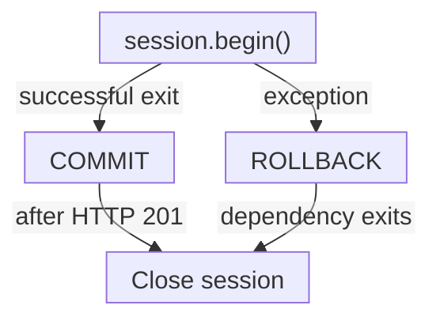

<a id="выдать-сессию-бд-на-запрос"></a>
# Provide a database session per request

[Русский](../../../../ru/python/web/fastapi/database.md)

Use this page when an HTTP handler needs its own database session and must complete a transaction.
Choose the sync or async example to match the driver.

| Task | Technique | Example / details |
| --- | --- | --- |
| Use a blocking driver | `def`, session provided through `yield` | [Synchronous example](#synchronous-sqlalchemy) |
| Use an async driver | `AsyncSession`, `async with`, lifespan | [Asynchronous example](#async-sqlalchemy-and-lifespan) |
| Check persistence and rejection | Isolated SQLite database per test | [Complete checks](testing.md#database-sessions-and-lifespan) |

[Quick reference](README.md) · [Testing](testing.md) · [SQLAlchemy](../../databases/sqlalchemy/README.md)

| Parameter | Value |
| --- | --- |
| Level | Intermediate for synchronous sessions, advanced for async and lifecycle |
| Prerequisites | SQL, transactions, SQLAlchemy, and `Depends`. Async requires `async with` |

Use Python 3.14. Install the packages for the selected variant below.

Both examples are standalone.
Keep each example's `Base`, engines, and session factories together.
The examples use local SQLite with synthetic data.
Production connections are unnecessary here.

<a id="синхронный-sqlalchemy"></a>
## Synchronous SQLAlchemy

In a separate environment, run `python -m pip install 'fastapi==0.162.0' 'uvicorn[standard]' 'sqlalchemy==2.1.8' 'pydantic[email]==2.14.3'`.
Save the complete example in `db_app.py`.

[`db_app.py`](../../../../../examples/python/web/fastapi/db_app.py)

```bash
uvicorn db_app:app --reload
```

```bash
curl -i -X POST http://127.0.0.1:8000/users -H 'Content-Type: application/json' -d '{"username":"alice","email":"alice@example.com"}'
curl http://127.0.0.1:8000/users
```

Expect `201` with an `id`.
The next request returns a user list.
Repeating the same email returns `409`.
The recipe creates or adds data to `fastapi-sync.db` in the launch directory.
Data persists across runs.
For a clean experiment, use a new practice directory.

`check_same_thread=False` removes SQLite's restriction on which thread can use the connection.
This parameter does not make `Session` safe for concurrent shared access.
Each request has its own session.
Blocking operations run in `def` handlers.
FastAPI executes these handlers in a thread pool.
Synchronous `create_all` in lifespan is acceptable here for a tiny practice database.
In an application, run migrations as a separate step.

Sources include [SQLAlchemy sessions and transactions](https://docs.sqlalchemy.org/en/21/orm/session_basics.html), [FastAPI dependencies with yield](https://fastapi.tiangolo.com/tutorial/dependencies/dependencies-with-yield/), and [Pydantic reading object attributes](https://pydantic.dev/docs/validation/latest/concepts/models/#arbitrary-class-instances).

<a id="async-sqlalchemy-и-lifespan"></a>
## Async SQLAlchemy and lifespan

If you are new to `async def` and `await`, start with [asyncio basics](../../language/asyncio.md).

For the independent async example, run `python -m pip install 'fastapi==0.162.0' 'uvicorn[standard]' 'sqlalchemy[asyncio]==2.1.8' 'aiosqlite==0.22.1'`.
Save the complete independent example in `async_db_app.py`.

[`async_db_app.py`](../../../../../examples/python/web/fastapi/async_db_app.py)

Run `uvicorn async_db_app:app --reload`.
POST `/notes` with JSON `{"text":"Прочитать документацию"}` returns `201`.
GET `/notes` returns a note list.
`fastapi-async.db` is created in the launch directory.

**Application lifespan**

1. Before `yield`, `lifespan` creates the tables.
2. While the application runs, POST and GET use separate sessions. After a `201` response, the next GET reads the saved note.
3. At application shutdown, `lifespan` calls `engine.dispose()`.

The diagram shows the transaction for one `POST /notes`. `get_session` gives the handler a session. Inside `session.begin()`, the handler adds the row and calls `flush()`.



The transaction commits or rolls back when `session.begin()` exits. `flush()` sends changes to the database within the transaction.
The `get_session` context closes the session when the dependency ends. On the successful path in this example, that happens after the response is sent. [Dependency scope with `yield`](https://fastapi.tiangolo.com/tutorial/dependencies/dependencies-with-yield/#early-exit-and-scope).
`lifespan` replaces the earlier `@app.on_event("startup")` and `shutdown` handlers.
Keep each concurrent task's `AsyncSession` separate.
The driver and URL must match the async engine.
Wrapping a regular synchronous driver in `async def` does not make the driver nonblocking.

This page leaves production migrations, PostgreSQL pooling, relationship lazy loading, and database recovery to separate SQLAlchemy/Alembic tasks.
The same lifespan principle applies to other clients.

Sources include [FastAPI lifespan](https://fastapi.tiangolo.com/advanced/events/), [SQLAlchemy async API](https://docs.sqlalchemy.org/en/21/orm/extensions/asyncio.html), and [AsyncSession with concurrent tasks](https://docs.sqlalchemy.org/en/21/orm/extensions/asyncio.html#using-asyncsession-with-concurrent-tasks).
