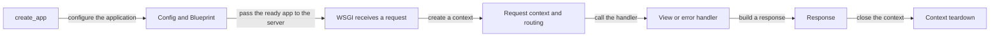

# Flask

[Русский](../../../../ru/python/web/flask/README.md)

Flask creates a synchronous Python web application with a WSGI interface.
Flask provides routing, request/response handling, templates, and contexts.
Choose an ORM, API schema, authentication, and migrations separately.

<a id="быстрый-поиск"></a>
## Quick lookup

| Task | API / command | Details |
| --- | --- | --- |
| Create an independent app | `create_app(test_config=None)` | [Application](application.md) |
| Group routes | `Blueprint`, `register_blueprint` | [Application](application.md) |
| Query / JSON / path | `request.args`, `request.get_json()`, `<int:item_id>` | [Application](application.md) |
| Return JSON | `jsonify(...)`, `(response, status)` tuple | [Application](application.md) |
| Client error | `abort(400)` and an HTTPException handler | [Application](application.md) |
| Inspect an HTTP response from the terminal | `curl -i`, `jq` | [HTTP and JSON](../../../tools/http-json.md) |
| Test without a server | `app.test_client()` | [Testing](testing.md) |
| Resource per context | `g`, `teardown_appcontext` | [Database](configuration-and-deployment.md#connection-lifecycle) |
| Local development | `flask --app flask_app:create_app run --debug` | [Running](application.md#run-and-check) |
| Production | WSGI server and reverse proxy | [Deployment](configuration-and-deployment.md#development-and-production) |

| Parameter | Value |
| --- | --- |
| API branch | Flask 3.1.x |
| Prerequisites | Python, HTTP, an isolated environment, and pytest for checks |

<a id="навигация"></a>

<a id="базовый-уровень"></a>

<a id="запустить-api-и-проверить-ответ"></a>
## Run the API and check the response

**Situation** — JSON `{"name":" Alice "}` must produce a greeting, and an empty name must produce an error.
**Change** — send the request through the application client.
The snippet uses the [complete `flask_app.py`](application.md#complete-application).

```python
from flask_app import create_app

app = create_app({"TESTING": True})
with app.test_client() as client:
    response = client.post("/api/greet", json={"name": " Alice "})
    assert response.status_code == 200
    assert response.json == {"greeting": "Hello, Alice"}
    assert client.post("/api/greet", json={"name": " "}).status_code == 400
```

**Result** — success `200` and rejection `400` are checked without opening a port.
The client does not test the WSGI server or reverse proxy.
[Complete test module](testing.md#complete-check-suite).


Use Python 3.14 to reproduce the example.
In a separate environment, run `python -m pip install 'Flask==3.1.3' 'Werkzeug==3.1.9' 'pytest==9.2.0'`.
Save [flask_app.py](application.md) and [test_flask_app.py](testing.md) in one directory.
Run `python -m pytest -q test_flask_app.py`.
The test HTTP client does not open a network port.

A route maps a URL and HTTP method to a view function.
`GET /api/items/1` returns JSON.
`POST /api/greet` accepts a JSON object and rejects invalid data.
Query arguments arrive as strings.
The application remains responsible for custom validation.

<a id="средний-уровень"></a>

<a id="разделять-создание-приложения-и-обработку-запроса"></a>
## Separate application creation from request handling

**Situation** — tests need two applications with different settings and independent mutable configurations.
**Change** — call the factory for each application.
The snippet uses the [complete `create_app`](application.md#complete-application).

```python
from flask_app import create_app

first = create_app({"TESTING": True, "DEMO_VALUE": "first"})
second = create_app({"TESTING": True, "DEMO_VALUE": "second"})
assert first.config["DEMO_VALUE"] == "first"
assert second.config["DEMO_VALUE"] == "second"
```

**Result** — the instances have independent configurations.
The factory alone does not isolate an external database or a global dictionary.
[Complete application and Blueprint](application.md#complete-application).


A factory creates the app.
The factory applies configuration before registering components.
A Blueprint describes a group of routes.
A Blueprint is neither a separate server nor a separate app.
`request`, `session`, `g`, and `current_app` are context-local objects.
Avoid storing context-local objects in global variables.
Use context-local objects within the appropriate context, or explicitly design the boundary for access outside it.

The diagram shows application startup and subsequent handling of one request.



The [tests](testing.md) create a fresh app for each test and check the HTTP status, JSON, headers,
invalid input, and template escaping.

<a id="продвинутый-уровень"></a>

<a id="управлять-конфигурацией-транзакциями-и-эксплуатацией"></a>
## Manage configuration, transactions, and operations

**Situation** — reuse a SQLite connection within one app context and close it afterward.
**Change** — attach teardown from the [complete `flask_db.py`](configuration-and-deployment.md#connection-lifecycle).
This snippet is for the practice application.

```python
from flask_app import create_app
from flask_db import get_db, init_app

app = create_app({"TESTING": True, "DATABASE": ":memory:"})
init_app(app)
with app.app_context():
    connection = get_db()
    assert get_db() is connection
```

**Result** — the same connection is returned within the context. Teardown closes the connection on exit.
Closing a connection does not replace an explicit business-transaction commit.
[Complete closure and rollback test](configuration-and-deployment.md#connection-lifecycle).


Load extension configuration before `init_app`.
Open the database connection lazily.
Close the connection after the context ends.
Teardown should not automatically commit every transaction.
The [SQLite example](configuration-and-deployment.md#connection-lifecycle) separates explicit commit from resource cleanup.
For an ORM, use [SQLAlchemy](../../databases/sqlalchemy/README.md).

Use the built-in server and debugger locally.
[Production](configuration-and-deployment.md#development-and-production) requires a separate WSGI server, proxy-trust configuration, secrets, and logging.
An `async def` view in Flask retains the WSGI model and does not make background tasks durable.

<a id="частые-ошибки"></a>
## Common errors

| Symptom | Cause / correction |
| --- | --- |
| Working outside application/request context | A proxy was accessed outside its context. For CLI or test setup, use `app.app_context()` as intended |
| 415 when expecting JSON | Unsuitable Content-Type. Use `json=...` in the client |
| Unexpected 404/405 | Check the Blueprint prefix, URL, and HTTP method |
| Session does not work | SECRET_KEY is required. A signed cookie leaves its contents readable |
| Test uses a Django client | Create `app.test_client()` for the Flask app |
| Database error after a request | Avoid transferring a connection or session between contexts and worker processes |

<a id="источники"></a>
## Sources

- [Factory](https://flask.palletsprojects.com/en/stable/patterns/appfactories/), [Blueprint](https://flask.palletsprojects.com/en/stable/blueprints/).
- [Quickstart](https://flask.palletsprojects.com/en/stable/quickstart/), [errors](https://flask.palletsprojects.com/en/stable/errorhandling/), [testing](https://flask.palletsprojects.com/en/stable/testing/).
- [Configuration](https://flask.palletsprojects.com/en/stable/config/), [database lifecycle](https://flask.palletsprojects.com/en/stable/tutorial/database/).
- [Deploying](https://flask.palletsprojects.com/en/stable/deploying/), [async](https://flask.palletsprojects.com/en/stable/async-await/).

[Python catalog](../../README.md) · [pytest testing](../../testing/pytest/README.md)
