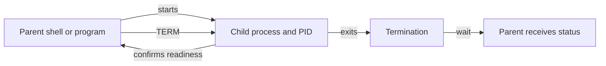

<a id="права-пользователи-и-процессы"></a>
# Permissions, users, and processes

[Русский](../../../ru/systems/linux/permissions-and-processes.md)

Use this page to restrict access to your files or stop your own child process.
When access fails, identify the user, path, and existing restrictions first.

| Task | Approach | Example |
| --- | --- | --- |
| Allow only the owner to read a configuration file | `id`, path inspection, and `chmod` | [Permissions](#read-permissions) |
| Choose how to stop a process | Verify the PID and understand the signal | [Signals](#processes-and-signals) |
| Wait for your process to finish | Readiness confirmation, TERM, and `wait` | [Complete example](#check-termination-of-your-own-child-process) |

Intermediate level. The complete example requires UID/GID knowledge, Bash, Python 3, and your own files and processes.
[Linux reference](README.md).

<a id="прочитать-права"></a>
## Read permissions

If only the owner should read `project/config.ini` and enter its directory, check ownership and the path before changing mode bits.

`id` displays the user and groups. `ls -ld path` displays metadata for the directory or file itself.
Ordinary mode bits distinguish the owner, group, and others (`u`, `g`, `o`).

| Bit | Regular file | Directory |
| --- | --- | --- |
| `r` = 4 | Read contents | Read the list of names |
| `w` = 2 | Change contents | Change directory entries, usually together with `x` |
| `x` = 1 | Execute a supported format or interpreter | Traverse the directory and search names |

`chmod 640 file` grants the owner rw, the group r, and others no access.
`chmod 750 dir` grants the owner rwx and the group rx.
Deletion primarily depends on the parent directory's permissions. The file's own `w` bit does not determine whether it can be deleted.
Also consider the sticky bit, ACLs, SELinux/AppArmor, capabilities, and mount flags.
Mode bits alone do not describe every access restriction.
`umask` removes permissions from the requested mode of new files and directories. Existing paths keep their current permissions.

These are separate reference fragments for your own files.

```bash
id
umask
ls -ld project project/config.ini
chmod u=rw,go= project/config.ini
chmod u=rwx,go= project
```

The file receives mode `600` and the directory receives `700`.
Other users and processes without additional privileges lose access through these mode bits.
The last two commands change access. Verify the path and the requirements of other users and processes first.
`chown USER:GROUP path` changes ownership and requires suitable privileges.
Recursive chown on an unknown root can damage the system. Avoid using `chmod -R 777` as a general fix for denied access.

<a id="процессы-и-сигналы"></a>
## Processes and signals

When your child process is ready but its task should end, request termination with TERM, then wait for the child's exit status.

A process has a PID, parent PPID, user, and state.
`ps` takes a snapshot. `top` displays processes interactively.
On Linux procps, `ps -ef` and `ps -p PID -o pid,ppid,stat,args` show the required context.
The PID in this reference is a placeholder. Find the actual process and check its owner before sending a signal.

`kill -TERM PID` requests termination. A signal handler can clean up.
`kill -KILL PID` cannot be caught, so resource and application cleanup are not guaranteed.
Use TERM before considering KILL.
`Ctrl-C` usually sends SIGINT to the foreground process group. `Ctrl-Z` suspends a job.
`jobs`, `bg`, and `fg` manage jobs in the current interactive shell.
`nohup` does not provide service management, automatic restarts, or health checks.

The diagram shows how a parent and its child interact during termination.



The short Python fragment below comes from the complete scenario.
Here, `child` is the parent's own `subprocess.Popen` instance after the `ready` message.

```python
child.terminate()
status = child.wait(timeout=5)
```

With the default SIGTERM action, `status` is `-15`.
If the child is still running after five seconds, `wait` raises `TimeoutExpired`. That outcome does not confirm termination.
The [complete example](#check-termination-of-your-own-child-process) waits for readiness and cleans up on failure.

<a id="проверить-завершение-своего-дочернего-процесса"></a>
## Check termination of your own child process

The complete example uses Bash and Python 3 on GNU/Linux or macOS.
Python provides an explicit readiness signal and controls only its own direct child process.
Run `bash process.sh`.
The example does not find PIDs by name, run administrative commands, or create temporary files.

`kill -0` checks PID existence and access. It does not confirm that exec finished or the application is ready.
The parent waits for `ready` through a pipe.
The child sends that message after installing the default SIGTERM action.
After that setup, TERM will stop the child even before it enters `signal.pause()`.
The five-second limit bounds the wait for an event or termination.

[`linux/process.sh`](../../../../examples/systems/linux/process.sh)

Expect `process OK`.
The example checks `-15` from Python Popen. A negative return code means termination by a signal.
For a child terminated by SIGTERM, Bash `wait` usually reports `128 + 15 = 143`.
Bash exposes status through a different interface. Do not compare that status directly with Popen.returncode.

On the normal path, the parent sends TERM.
If an error happens before termination, `finally` forcibly stops its own child if that child is still running, then calls wait.
Other processes are unaffected.
This child holds no application files or data that need saving during an emergency stop.

<a id="источники"></a>
## Sources

[GNU chmod/umask](https://www.gnu.org/software/coreutils/manual/coreutils.html),
[Bash signals/jobs/wait](https://www.gnu.org/software/bash/manual/bash.html),
[Linux ps](https://man7.org/linux/man-pages/man1/ps.1.html),
[Linux signals](https://man7.org/linux/man-pages/man7/signal.7.html),
[Python Popen and returncode](https://docs.python.org/3.14/library/subprocess.html#subprocess.Popen.returncode),
[signal.pause](https://docs.python.org/3.14/library/signal.html#signal.pause),
[Waiting for a pipe with selectors](https://docs.python.org/3.14/library/selectors.html).
