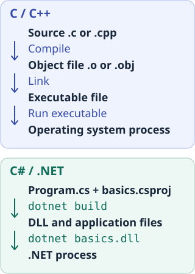

# Task and synonym index

[Русский](../../ru/tasks/README.md)

Find an action even if you cannot remember the tool or technique name.
Links lead to a specific card, commands, or example in the main material.

| Task | Where to look in the index |
| --- | --- |
| Start with Python, read a file, or choose a data type | [First Python program](../python/language/first-program.md) · [Files, types, and collections](#python-files-types-and-collections) |
| Run a Python coroutine or wait for several operations concurrently | [asyncio basics](#python-asyncio-basics) |
| Create a Python project and manage dependencies and builds | [Project and environment](#python-projects-and-environments) |
| Validate data, write tests, or configure logs | [Validation, tests, and logging](#validation-tests-and-logging) |
| Send an HTTP request, write an API, or protect a route | [HTTP and web applications](#http-apis-and-web-applications) |
| Review Go, cancel tasks, or protect shared data | [Go](#go-language-and-concurrency) |
| Look up syntax, build a program, or choose a library for C, C#, or C++ | [C, C#, and C++](#c-family-basics) |
| Query data, run a transaction, or create a backup | [Databases and SQL](#databases-and-sql) |
| Find a file, process, network port, or service log | [Linux and shell](#linux-and-shell) |
| Write a Dockerfile, run a service with Compose, or diagnose a failed CI test | [Docker Compose and CI](#docker-compose-and-ci) |
| Undo a change, update a branch, or prepare a PR | [Git and GitHub](#git-and-github) |
| Choose a boundary, contract, pattern, or retry protocol | [Architecture](#architecture-and-design) |
| Estimate how the operation count grows with input size | [Algorithms](#algorithms-and-complexity) |
| Add a cheat sheet or check its formatting | [Writing materials](#writing-materials) |

Search the page with `Ctrl+F` / `⌘F`.
Try `rollback`, `undo`, `N+1`, `request_id`, `backup`, or `retry`.
The second column contains search terms and related API names.
These words help you find the task.
They are not always interchangeable.
See the linked material for versions and setup.
Command consequences and example limitations appear there as well.

[Catalog by technology](../README.md#material-catalog)

## Python files, types, and collections

| Task | Synonyms and API names | Direct link |
| --- | --- | --- |
| Read a large file one line at a time | Python, line by line, large text file, without loading the whole file | [Read lines in Python](../python/language/read-lines.md) |
| Choose a number type, a string, or exact monetary arithmetic | numeric, string, `int`, `float`, `Decimal` | [Python numbers, strings, and logic](../python/language/types/README.md#numbers-strings-and-logic) |
| Round a monetary amount and test type operations | Decimal, quantize, ROUND_HALF_UP, rounding, currency | [Complete Python operations and copying example](../python/language/types/recipes.md#check-operations-copies-and-type-boundaries) |
| Choose a list, dictionary, or set | collection, array, map, unique, `list`, `dict`, `set` | [Python collections](../python/language/types/README.md#collections) |
| Convert a value and check its type | cast, conversion, `isinstance`, `type`, `None` | [Python conversions and checks](../python/language/types/README.md#conversions-and-checks) |
| Group data and manage dictionary order | grouping, defaultdict, OrderedDict, move_to_end, ordering | [Python special-purpose dictionaries](../python/language/types/README.md#specialized-dictionaries) |
| Understand copying and shared references | copy, deepcopy, aliasing, mutable, hashable, mutability | [Python references and hashability](../python/language/types/README.md#mutability-references-and-hashability) |

## Python asyncio basics

| Task | Synonyms and API names | Direct link |
| --- | --- | --- |
| Run a coroutine and wait for the result | asyncio, async def, await, asyncio.run, event loop | [First Python coroutine](../python/language/asyncio.md#run-a-coroutine) |
| Wait for multiple operations concurrently | TaskGroup, task, concurrency, asynchronous I/O | [Concurrent waits in Python](../python/language/asyncio.md#wait-for-operations-concurrently) |

## Python projects and environments

| Task | Synonyms and API names | Direct link |
| --- | --- | --- |
| Organize a Python package into files | layout, src layout, package, project structure | [Python package structure](../python/architecture/project-design/structure-and-decisions.md#python-package-structure) |
| Pass dependencies and assemble a working package | DI, bootstrap, composition root, adapter, CLI | [Complete package](../python/architecture/project-design/example.md) |
| Record a decision or check that a change is ready | ADR, checklist, release, architecture decision | [Record an ADR](../python/architecture/project-design/structure-and-decisions.md#record-a-decision-in-an-adr) · [Readiness checks](../python/architecture/project-design/delivery-and-evolution.md#readiness-checks) |
| Create a project and run a command in its environment | uv, init, venv, run, virtual environment | [uv learning project](../python/tooling/uv/projects.md#offline-practice-project) |
| Add, update, or remove a dependency | dependency, add, update, upgrade, remove, package | [Change dependencies with uv](../python/tooling/uv/projects.md#add-upgrade-and-remove-dependencies) |
| Align the lockfile and installed environment | sync, locked, frozen, reproducibility | [uv lockfile and environment](../python/tooling/uv/projects.md#lockfile-and-environment) |
| Separate development dependencies or export requirements | dependency group, extras, pip, export | [uv groups](../python/tooling/uv/projects.md#groups-and-platforms) · [Export](../python/tooling/uv/projects.md#export-and-the-pip-interface) |
| Reproduce installation in CI or a container | GitHub Actions, Docker, cache, build | [uv in CI](../python/tooling/uv/automation.md#github-actions) · [Docker](../python/tooling/uv/automation.md#docker) |

## Validation, tests, and logging

| Task | Synonyms and API names | Direct link |
| --- | --- | --- |
| Validate a dictionary or JSON, restrict fields, and return JSON | Pydantic, validate, serialize, alias, `Field`, `model_dump` | [Pydantic models, validation, and JSON](../python/validation/pydantic/models.md#models-validation-and-json) |
| Read attributes from an ORM object | from_attributes, ORM mode, ConfigDict | [Pydantic attributes and configuration](../python/validation/pydantic/models.md#attributes-configuration-and-types) |
| Validate a list without a wrapper model or define a custom type | TypeAdapter, generic, Annotated, custom type | [Pydantic types and adapters](../python/validation/pydantic/advanced.md#generics-typeadapter-and-custom-types) |
| Read settings from environment variables | settings, env, dotenv, BaseSettings | [Pydantic Settings](../python/validation/pydantic/advanced.md#application-settings) |
| Migrate Pydantic code from v1 to v2 | migration, parse_obj, dict, model_validate | [Pydantic migration](../python/validation/pydantic/advanced.md#migration-and-performance) |
| Select a test by name or marker and stop at an error | pytest, run test, `-k`, `-m`, `-x`, pdb | [pytest selection and debugging](../python/testing/pytest/configuration.md#test-selection-and-debugging) |
| Prepare data or a temporary file, or assert an error | fixture, tmp_path, capsys, raises, approx | [Complete pytest fixtures and assertions example](../python/testing/pytest/fixtures.md#complete-practice-example) |
| Run one test against different inputs | parametrize, parameterized, data variants | [Complete pytest example](../python/testing/pytest/fixtures.md#complete-practice-example) · [Combine parameters](../python/testing/pytest/fixtures.md#parametrize-independent-dimensions) |
| Replace an external call without network access | mock, monkeypatch, patch, fake | [Test an external contract with pytest](../python/testing/pytest/mocking-and-async.md#test-an-external-contract-offline) |
| Test an async function | asyncio, pytest-asyncio, event loop, async fixture | [Complete pytest async test](../python/testing/pytest/mocking-and-async.md#test-an-external-contract-offline) · [Event loop setup](../python/testing/pytest/mocking-and-async.md#async-fixtures-and-the-event-loop) |
| Generate a CI report | JUnit, coverage, xdist, plugins | [pytest plugins and reports](../python/testing/pytest/configuration.md#plugins-and-reports) |
| Configure JSON logs and capture an exception | structlog, renderer, traceback, exc_info | [structlog configuration and checks](../python/logging/structlog/configuration.md#standalone-configuration) |
| Add fields to all logs for a request or task | bind, contextvars, request_id, correlation id | [Local and contextual bind in structlog](../python/logging/structlog/context-and-web.md#local-and-contextual-binding) |
| Combine standard logging and structlog | stdlib, ProcessorFormatter, shared format | [structlog integration with logging](../python/logging/structlog/configuration.md#integrate-with-standard-library-logging) |

## HTTP APIs and web applications

| Task | Synonyms and API names | Direct link |
| --- | --- | --- |
| Inspect the status and headers of an HTTP response | `curl -i`, `curl -I`, GET, HEAD, HTTP status code, Content-Type | [Inspect the HTTP response](../tools/http-json.md#inspect-the-http-response) |
| Print a field from a JSON response | `jq -r`, curl, JSON body, name | [Extract a JSON field](../tools/http-json.md#extract-a-json-field) |
| Create a FastAPI route with path/query/body parameters and validation | REST, endpoint, request, response, 422 | [Quick card](../python/web/fastapi/recipes.md#http-api-with-validation) · [Complete HTTP API](../python/web/fastapi/http-api.md#http-api-with-validation) |
| Pass a dependency to a FastAPI handler | Depends, dependency injection, sub-dependency | [How FastAPI dependencies work](../python/web/fastapi/recipes.md#how-dependencies-work) |
| Accept a form or file | upload, multipart, Form, UploadFile | [Quick card](../python/web/fastapi/recipes.md#forms-and-file-uploads) · [Complete upload example](../python/web/fastapi/uploads.md#forms-and-file-uploads) |
| Configure CORS or middleware | browser, cross-origin, headers, request middleware | [Quick card](../python/web/fastapi/recipes.md#middleware-and-cors) · [Complete middleware and CORS example](../python/web/fastapi/middleware.md#middleware-and-cors) |
| Verify a password and protect a route with a token | auth, authentication, JWT, bearer, OAuth2, 401 | [Complete FastAPI authentication example](../python/web/fastapi/authentication.md#complete-example) |
| Provide a database session per request and close resources | SQLAlchemy, Session, AsyncSession, yield, lifespan | [Synchronous FastAPI session](../python/web/fastapi/database.md#synchronous-sqlalchemy) · [Async and lifespan](../python/web/fastapi/database.md#async-sqlalchemy-and-lifespan) |
| Test a FastAPI response and invalid input | TestClient, httpx2, integration test, 422 | [FastAPI TestClient card](../python/web/fastapi/testing.md#synchronous-testclient) · [Complete checks](../python/web/fastapi/testing-lab.md) |
| Test a FastAPI handler without calling the real dependency | Depends, dependency_overrides, override, substitution, stub, fake, offline, no database | [Dependency override card](../python/web/fastapi/testing.md#dependency-override) · [Standalone program](../python/web/fastapi/dependency-overrides.md#minimal-standalone-example) |
| Restore the original FastAPI dependencies after a test or failure | cleanup, finally, dependency_overrides, restoration | [Standalone example](../python/web/fastapi/dependency-overrides.md#minimal-standalone-example) · [Prior overrides and exceptions](../python/web/fastapi/dependency-overrides.md#complete-test-file) |
| Run an API in a container | deploy, Dockerfile, Uvicorn, production | [FastAPI container](../python/web/fastapi/deployment.md#container-for-the-minimal-application) |
| Create a Flask application and group routes | app factory, create_app, Blueprint, jsonify | [Complete Flask application](../python/web/flask/application.md#complete-application) |
| Test a Flask response and rejection without a server | test_client, request context, 400, 404 | [Complete Flask check suite](../python/web/flask/testing.md#complete-check-suite) |
| Close a Flask connection after a request | g, teardown_appcontext, resource lifecycle | [Flask connection lifecycle](../python/web/flask/configuration-and-deployment.md#connection-lifecycle) |
| Choose how to run Flask | WSGI, development server, reverse proxy, deploy | [Flask development and production](../python/web/flask/configuration-and-deployment.md#development-and-production) |
| Create a table from a model and edit records in the admin | Django, ORM, migrations, makemigrations, migrate, admin, test | [Django model and admin](../python/web/django/README.md) |
| Check TypeScript without starting a server | tsc, --noEmit, strict mode | [Type-check the client](../typescript/README.md#check-types-without-a-server) |
| Read an API response in TypeScript and validate the JSON shape | fetch, Response.ok, unknown, type guard | [Validate JSON in the client](../typescript/README.md#read-and-validate-a-json-response) |
| Bound and validate a JSON request in Go | HTTP handler, MaxBytesReader, json.Decoder, validation | [Go handler with input boundaries](../go/http-json.md#handler-with-input-boundaries) |
| Test a Go handler without a network server | httptest, ResponseRecorder, HTTP test | [Go HTTP/JSON test](../go/http-json.md#test-without-a-network-server) |

## Go language and concurrency

| Task | Synonyms and API names | Direct link |
| --- | --- | --- |
| Create a module, run, format, and check code | Golang, go.mod, go run, gofmt, go test, go vet, race detector | [Go learning module commands](../go/README.md#module-commands) |
| Review slices, maps, pointers, structs, and generics | syntax, slice, pointer, receiver, interface | [Go constructs](../go/language.md#basic-constructs) · [Complete module](../go/examples/language.md#complete-module) |
| Wrap an error and inspect its cause | error wrapping, errors.Is, errors.As, %w | [Go valid- and invalid-input tests](../go/language.md#test-valid-and-invalid-input) |
| Bound concurrency and cancel tasks | goroutine, worker pool, channel, context, select, cancel | [Go bounded worker pool](../go/concurrency-and-testing.md#bounded-worker-pool) |
| Set an HTTP request timeout or cancel the request | context, WithTimeout, WithCancel, deadline, NewRequestWithContext | [Go HTTP request timeout and cancellation](../go/context.md#check-three-outcomes) |
| Protect shared memory | mutex, sync.Mutex, race, data race, counter | [Go shared data](../go/concurrency-and-testing.md#shared-data-and-mutexes) |
| Test concurrent code and detect races | concurrency test, go test -race, race detector | [Go tests and race detector](../go/concurrency-and-testing.md#tests-and-the-race-detector) |

## C, C#, and C++

| Task | Synonyms and API names | Direct link |
| --- | --- | --- |
| Build and run a C program | C17, clang, main, printf, linking | [C first run](../c/README.md#first-run) |
| Pass an array to a C function | size_t, sizeof, pointer, bounds | [C arrays and memory](../c/README.md#arrays-and-memory) |
| Look up C syntax and memory management | struct, enum, pointer, malloc, free, const | [C syntax](../c/syntax.md) |
| Add a library and test a function in C | CMake, vcpkg, FetchContent, CTest, Unity | [C dependencies](../c/tooling-and-testing.md#packages) · [Tests](../c/tooling-and-testing.md#tests) |
| Choose tools for C and organize the code | embedded, driver, systems software, resource ownership | [C patterns](../c/practice.md#patterns) · [Application areas](../c/practice.md#application-areas) |
| Build and run a C# project | C#, C Sharp, .NET SDK, csproj, dotnet build, dotnet run | [C# first run](../csharp/README.md#first-run) |
| Add a number to a list or validate a C# argument | `List<T>`, Add, foreach, TryParse, exit code | [C# collections](../csharp/README.md#collections) · [Common mistakes](../csharp/README.md#common-mistakes) |
| Look up a value in a C# dictionary and tell a stored zero from a missing key | key is missing, key exists, value is 0, `Dictionary`, `TryGetValue`, `out` | [Check the key and read its value](../csharp/syntax.md#try-get-value) |
| Read a file with cancellation in C# | cancel a read, async file read, CancellationToken | [Read a file asynchronously](../csharp/syntax.md#async-io-and-cleanup) |
| Run a first .NET web service and test a bad request | C#, HTTP endpoint, 400 response, ASP.NET Core, integration test | [First request](../csharp/first-http-service.md#run-service) · [HTTP test](../csharp/first-http-service.md#test-service) |
| Save an order and read it after restarting a .NET service | keep data after restart, find by ID, persist an order, C#, EF Core, SQLite | [Orders in SQLite](../csharp/persist-orders.md#create-order) · [Read after restart](../csharp/persist-orders.md#restart) |
| Look up C# syntax | nullable, record, generics, LINQ, async, await | [C# syntax](../csharp/syntax.md) |
| Install a NuGet package or run C# tests | NuGet, PackageReference, dotnet restore, dotnet test | [C# packages](../csharp/tooling-and-testing.md#packages) · [Tests](../csharp/tooling-and-testing.md#tests) |
| Choose a .NET framework and define component boundaries | ASP.NET Core, EF Core, DI, desktop, games | [C# patterns](../csharp/practice.md#patterns) · [Application areas](../csharp/practice.md#application-areas) |
| Build and run a C++ program | C++20, clang++, main, cout, linking | [C++ first run](../cpp/README.md#first-run) |
| Add an element to a vector and check the index | std::vector, push_back, size, at, out_of_range | [C++ collections](../cpp/README.md#collections) · [Common mistakes](../cpp/README.md#common-mistakes) |
| Look up C++ syntax and lifetime rules | RAII, const, reference, move, template, lambda | [C++ syntax](../cpp/syntax.md) |
| Add a C++ library and run tests | CMake, vcpkg, Conan, CTest, GoogleTest | [C++ dependencies](../cpp/tooling-and-testing.md#packages) · [Tests](../cpp/tooling-and-testing.md#tests) |
| Choose tools for C++ and organize the code | RAII, Qt, Unreal Engine, embedded, low latency | [C++ patterns](../cpp/practice.md#patterns) · [Application areas](../cpp/practice.md#application-areas) |

Compare the path from source code to a running program

The diagram shows the artifacts in a typical console build. Arrow labels identify the command or stage that creates the next artifact or starts the process.

C and C++ compile the source to an object file and link an executable.
In .NET, `dotnet build` builds the project and restores dependencies by default. Run `dotnet basics.dll` from the directory that contains the DLL. Running the application requires a compatible .NET runtime and the other application files.
In the [C# exercise](../csharp/README.md#first-run), `dotnet run --project … --no-build` uses the previous build output from the same artifacts directory.

[Clang stages](https://releases.llvm.org/21.1.0/tools/clang/docs/CommandGuide/clang.html) · [.NET builds](https://learn.microsoft.com/en-us/dotnet/core/tools/dotnet-build) · [Run a project or DLL](https://learn.microsoft.com/en-us/dotnet/core/tools/dotnet-run#description)

## Databases and SQL

### SQL and access from Python

| Task | Synonyms and API names | Direct link |
| --- | --- | --- |
| Select rows and join tables | SELECT, WHERE, JOIN, EXISTS, filtering, join | [SQL filtering and joins](../databases/sql/queries.md#filtering-and-joins) |
| See which rows a JOIN keeps | INNER JOIN, LEFT JOIN, NULL, pairs, match | [Compare joins on the same tables](../databases/sql/queries.md#compare-inner-join-and-left-join) |
| Insert, update, or delete rows | INSERT, UPDATE, DELETE, CRUD, DML | [Change data with SQL](../databases/sql/queries.md#change-data) |
| Find email addresses that appear more than once | find duplicates, duplicate email, repeated values | [Duplicate email addresses](../databases/sql/queries.md#duplicate-emails) |
| Group data and calculate a result within a group | GROUP BY, HAVING, CTE, WITH, OVER, window, window function | [SQL aggregation, CTEs, and windows](../databases/sql/queries.md#aggregation-ctes-and-window-functions) |
| Choose a transaction and isolation level | BEGIN, COMMIT, ROLLBACK, isolation, locking | [SQL transactions and isolation](../databases/sql/dialects-and-transactions.md#transactions-and-isolation) |
| Account for differences between PostgreSQL and SQLite | dialect, placeholder, UPSERT, types | [SQL dialect differences](../databases/sql/dialects-and-transactions.md#dialect-differences) |
| Define ORM models and relationships | SQLAlchemy, Mapped, relationship, ForeignKey, one-to-many | [Shared SQLAlchemy schema](../python/databases/sqlalchemy/models-and-transactions.md#shared-schema-for-the-recipes) |
| Change data through an ORM and roll back part of an operation | SQLAlchemy, Session, CRUD, transaction, savepoint | [SQLAlchemy transactions and savepoints](../python/databases/sqlalchemy/models-and-transactions.md#crud-transactions-and-savepoints) |
| Write SELECT/JOIN/CTE queries from Python | SQLAlchemy, select, func, aliased, ORM query | [SQLAlchemy queries](../python/databases/sqlalchemy/queries.md#select-join-subqueries-and-ctes) |
| Avoid excessive database queries when reading collections | SQLAlchemy, N+1, lazy loading, eager loading, SELECT counter | [N+1 card](../python/databases/sqlalchemy/relationship-loading.md#find-n1) · [Example and SELECT count chart](../python/databases/sqlalchemy/n-plus-one.md) |
| Choose loading for collections and scalar relationships | selectinload, joinedload, unique, relationship, result size, LIMIT | [SQLAlchemy decision table](../python/databases/sqlalchemy/relationship-loading.md#choose-a-strategy) |
| Prevent unintended lazy loading | raiseload, unexpected SQL, InvalidRequestError | [SQLAlchemy error in place of a SELECT](../python/databases/sqlalchemy/relationship-loading.md#detect-unplanned-lazy-loading) |
| Filter parents and load all their children | JOIN, filter, complete collection, selectinload | [SQLAlchemy parents and complete collections](../python/databases/sqlalchemy/filtered-relationships.md#filter-parents-and-load-complete-collections) |
| Populate a relationship from your own JOIN result | contains_eager, filtered collection, partial collection | [SQLAlchemy partial collection](../python/databases/sqlalchemy/filtered-relationships.md#load-a-partial-collection-from-a-join) |
| Replace an already-loaded relationship | populate_existing, expire_all, identity map | [Refresh a SQLAlchemy collection](../python/databases/sqlalchemy/filtered-relationships.md#refresh-an-already-loaded-collection) |
| Process a large ORM result in batches | yield_per, partitions, streaming, memory | [SQLAlchemy batch processing](../python/databases/sqlalchemy/streaming.md) |
| Use an async ORM session | AsyncSession, AsyncAttrs, awaitable_attrs, asyncio | [SQLAlchemy async session](../python/databases/sqlalchemy/async-and-operations.md#async-session) |
| Change a schema through a migration | Alembic, revision, upgrade, downgrade, migration | [Standalone Alembic project](../python/databases/sqlalchemy/async-and-operations.md#alembic-in-a-separate-practice-project) |

### PostgreSQL

| Task | Synonyms and API names | Direct link |
| --- | --- | --- |
| Connect and review console commands | psql, connection, describe, list tables | [PostgreSQL connection and psql](../databases/relational/postgresql/operations.md#connections-and-psql-commands) |
| Grant a user access | role, GRANT, REVOKE, privileges, permissions | [PostgreSQL roles and access](../databases/relational/postgresql/operations.md#roles-and-access) |
| Perform an UPSERT and check affected rows | ON CONFLICT, RETURNING, INSERT, UPDATE, DELETE | [PostgreSQL data changes](../databases/relational/postgresql/queries.md#change-data-and-check-the-result) |
| Traverse a tree with a recursive query | recursive CTE, WITH RECURSIVE, hierarchy | [PostgreSQL recursive traversal](../databases/relational/postgresql/queries.md#recursive-traversal) |
| Choose an index and inspect a query plan | EXPLAIN, ANALYZE, B-tree, GIN, performance | [PostgreSQL indexes and query plans](../databases/relational/postgresql/schema-and-indexes.md#indexes-and-query-plans) |
| Search JSON or text | JSONB, full-text search, tsvector, text search | [PostgreSQL JSONB and search](../databases/relational/postgresql/schema-and-indexes.md#jsonb-and-full-text-search) |
| Choose a PostgreSQL backup format | backup, dump, custom, plain, directory, archive | [PostgreSQL backup formats and versions](../databases/relational/postgresql/backup-and-restore.md#choose-a-format-and-check-versions) |
| Create a logical PostgreSQL backup | pg_dump, consistent snapshot, logical backup | [Create a PostgreSQL custom archive](../databases/relational/postgresql/backup-and-restore.md#create-a-logical-backup) |
| Restore PostgreSQL into a new database | restore, pg_restore, createdb, single-transaction | [Custom archive](../databases/relational/postgresql/backup-and-restore.md#restore-a-logical-backup-to-a-new-database) · [SQL file](../databases/relational/postgresql/backup-and-restore.md#restore-a-sql-file) |
| Verify a restored PostgreSQL backup | verify backup, data, FK, CHECK, identity | [PostgreSQL verification](../databases/relational/postgresql/backup-and-restore.md#verify-the-restored-database) · [Complete scenario](../databases/relational/postgresql/backup-lab.md) |
| Find a lock, a long-running query, or table bloat | locks, pg_stat_activity, VACUUM, monitoring | [PostgreSQL isolation and locks](../databases/relational/postgresql/operations.md#transactions-isolation-and-locks) · [Maintenance](../databases/relational/postgresql/operations.md#monitoring-and-maintenance) |

### SQLite

| Task | Synonyms and API names | Direct link |
| --- | --- | --- |
| Connect to SQLite from Python and bind parameters safely | sqlite3, parameterized query, in-memory, foreign keys | [Short SQLite query](../databases/relational/sqlite/python-and-queries.md#полный-пример-блог-в-памяти) · [Complete blog example](../databases/relational/sqlite/query-lab.md) |
| Manage commit/rollback in Python | sqlite3, autocommit, transaction, transaction control | [Complete SQLite scenario](../databases/relational/sqlite/query-lab.md) · [Transaction modes](../databases/relational/sqlite/python-and-queries.md#manage-a-transaction-in-the-application) |
| Create a SQLite backup | backup, Connection.backup, .backup, database copy | [Python](../databases/relational/sqlite/backup-and-restore.md#back-up-with-python) · [CLI](../databases/relational/sqlite/backup-and-restore.md#back-up-with-the-cli) |
| Restore SQLite to a new file | restore, .restore, .dump, SQL backup | [Binary backup](../databases/relational/sqlite/backup-and-restore.md#restore-a-backup-to-a-new-file) · [SQL dump](../databases/relational/sqlite/backup-and-restore.md#create-and-restore-a-sql-dump) |
| Verify a restored SQLite backup | integrity_check, foreign_key_check, verify backup, trigger | [SQLite verification](../databases/relational/sqlite/backup-and-restore.md#verify-the-restored-database) · [Complete scenarios](../databases/relational/sqlite/backup-lab.md) |
| Change a SQLite schema while preserving relationships | migration, user_version, table rebuild | [Choose a SQLite migration](../databases/relational/sqlite/backup-and-migrations.md#полный-пример-перестроение-таблицы) · [Complete example](../databases/relational/sqlite/migration-lab.md) |
| Handle a busy database and concurrent access | database is locked, busy_timeout, WAL, concurrent writes | [SQLite concurrency and WAL](../databases/relational/sqlite/backup-and-migrations.md#concurrency-and-wal) |

### Redis

| Task | Synonyms and API names | Direct link |
| --- | --- | --- |
| Choose a structure and set key lifetime | string, hash, list, set, sorted set, TTL, expire | [Redis structures and TTL](../databases/non-relational/redis/data-and-caching.md#полный-пример-структуры-и-ttl) |
| Cache a read and invalidate a stale value | cache-aside, invalidation, cache miss, caching | [Redis caching](../databases/non-relational/redis/data-and-caching.md#cache-aside) |
| Distinguish pipelining, transactions, and optimistic locking | MULTI, EXEC, WATCH, atomic, atomicity | [Redis mechanisms](../databases/non-relational/redis/transactions-and-messaging.md#atomicity-transactions-and-pipelining) · [Conflict and error](../databases/non-relational/redis/transactions-lab.md#complete-example-of-a-conflict-and-command-error) |
| Choose Pub/Sub or Streams and acknowledge a message | queue, stream, consumer group, XACK, delivery | [Choose Redis delivery semantics](../databases/non-relational/redis/transactions-and-messaging.md#полный-пример-stream-и-pubsub) · [Complete example](../databases/non-relational/redis/transactions-lab.md#complete-stream-and-pubsub-example) |
| Verify Redis persistence and recovery | persistence, RDB, AOF, backup, restore | [Redis persistence and recovery](../databases/non-relational/redis/operations.md#durability-and-recovery) |
| Create a Redis RDB backup and restore it to another instance | backup, restore, dump.rdb, BGSAVE, snapshot | [RDB card](../databases/non-relational/redis/operations.md#create-and-restore-an-rdb-backup) · [Complete example](../databases/non-relational/redis/backup-and-restore.md#complete-example) |
| Copy Redis AOF files and restore data | appendonlydir, appendonly.aof.manifest, BASE, INCR, log, backup, restore | [AOF card](../databases/non-relational/redis/operations.md#create-and-restore-an-aof-backup) · [File set and example](../databases/non-relational/redis/aof-backup-and-restore.md#understand-the-file-set) |
| Verify values and key lifetimes after restoring Redis | TTL, PTTL, PEXPIRETIME, expire, expiration | [RDB](../databases/non-relational/redis/backup-and-restore.md#check-the-result) · [AOF](../databases/non-relational/redis/aof-backup-and-restore.md#check-the-result) |
| Find memory usage and slow commands | memory, eviction, INFO, SLOWLOG, latency | [Redis memory and monitoring](../databases/non-relational/redis/operations.md#memory-and-monitoring) |

## Linux and shell

| Task | Synonyms and API names | Direct link |
| --- | --- | --- |
| Copy, compare, or process files | shell, Bash, cp, cmp, temporary directory | [Safe shell practice script](../systems/linux/shell-and-files.md#safe-practice-example) |
| Find a line, redirect output, or inspect an exit code | grep, pipe, stderr, stdout, exit code, search | [Shell text and streams](../systems/linux/shell-and-files.md#text-streams-and-exit-codes) |
| Find files with spaces and unusual names | find, xargs, null delimiter, print0, filename | [Shell file search](../systems/linux/shell-and-files.md#find-files-with-unusual-names) |
| Check a file's permissions and owner | permission, owner, chmod, umask, id | [Linux permissions](../systems/linux/permissions-and-processes.md#read-permissions) |
| Find a process and terminate your own child process cleanly | ps, PID, kill, SIGTERM, wait, signal | [Processes and signals](../systems/linux/permissions-and-processes.md#processes-and-signals) · [Practice checking termination](../systems/linux/permissions-and-processes.md#check-termination-of-your-own-child-process) |
| Identify an IP address and route | network, ip route, interface, address | [Linux networking](../systems/linux/network-and-services.md#inspect-the-network-state-first) |
| Find the process listening on a TCP port | port in use, address already in use, EADDRINUSE, `ss -lntp`, PID, listener, socket | [Command and output](../systems/linux/process-by-port.md#find-a-tcp-listener) · [Permissions](../systems/linux/process-by-port.md#when-the-pid-is-missing) · [Namespace](../systems/linux/process-by-port.md#when-the-process-is-in-another-namespace) |
| Inspect a service and its logs | systemd, systemctl, journalctl, service, logs | [Linux systemd services](../systems/linux/network-and-services.md#systemd-services) |
| Check available space and resources | disk, df, du, free, memory | [Linux disk and resources](../systems/linux/network-and-services.md#disk-and-resources) |

## Docker Compose and CI

| Task | Synonyms and API names | Direct link |
| --- | --- | --- |
| Get your first response from a container | Docker, Dockerfile, docker compose up, curl | [First HTTP server run](../tools/docker/first-run.md#first-run) |
| See complete Dockerfile and compose.yaml files for three services | volume, network, gateway, mount | [Complete files and exercises](../tools/docker/lab.md#dockerfile) · [How a request travels](../tools/docker/guide.md) |
| Write a Dockerfile and build an image | FROM, COPY, RUN, CMD, USER, docker build | [Build your first image](../tools/docker/dockerfile.md#build-your-first-image) · [Reuse the installation cache](../tools/docker/dockerfile.md#reuse-the-installation-cache) |
| Exclude .venv, .git, and .env from a build | .dockerignore, context root, COPY | [File location and the three rules](../tools/docker/compose-file.md#where-to-put-dockerignore) |
| Copy main.py from the root when the Dockerfile is in dockers/ | COPY, build context, docker build -f, compose.yaml | [Build command and both Compose file locations](../tools/docker/build-context.md) |
| Connect a Dockerfile to a service and publish a port | compose.yaml, build.context, dockerfile, ports, image | [Define a service](../tools/docker/compose-file.md#define-a-service) · [Locate the Dockerfile](../tools/docker/compose-file.md#locate-the-dockerfile) |
| Read logs, run a command, or stop a container | docker compose ps, logs, exec, run, stop, down | [Commands by task](../tools/docker/commands.md) |
| See changes after editing code or configuration | restart, up --build, rebuild, stale response | [Apply a change](../tools/docker/commands.md#apply-a-change) |
| Start an app and a practice database with one command | Docker Compose, PostgreSQL, compose up, container, healthcheck | [Run the app with Compose](../tools/compose-and-github-actions.md#run-the-application-locally) |
| Run an existing workflow manually | GitHub Actions, `workflow_dispatch`, Run workflow | [Start a manual run](../tools/compose-and-github-actions.md#run-an-existing-workflow-manually) |
| Reproduce a test failure in CI | GitHub Actions, PostgreSQL, integration job, `fail_test` | [Run the practice workflow](../tools/compose-and-github-actions.md#run-the-test-in-github-actions) |
| Find a failed check in a CI log | GitHub Actions, logs, assert, test, `gh run view`, `--log-failed` | [Diagnose the failure in GitHub Actions](../tools/compose-and-github-actions.md#find-the-cause-in-the-log) |
| Check an API response status and shape with the same test locally and in CI | API contract, FastAPI, PostgreSQL, TypeScript, Docker Compose, GitHub Actions | [End-to-end contract check](../tools/api-contract-lab.md) |

## Git and GitHub

| Task | Synonyms and API names | Direct link |
| --- | --- | --- |
| Inspect changes and prepare a local commit | status, diff, staged, add, commit, log | [Git commit card](../tools/git/workflow.md#inspect-changes-and-prepare-a-commit) |
| Create a branch and test the full workflow | switch, branch, merge, learning repository | [Complete Git workflow](../tools/git/workflow.md#verifiable-workflow) |
| Temporarily set unfinished work aside | stash, stash pop, WIP, shelve | [Set work aside in Git](../tools/git/workflow.md#temporarily-set-work-aside) |
| Leave a file out of the next commit and keep my changes | remove a file from the index, keep edits, unstage, undo git add, `git restore --staged` | [Unstage a file](../tools/git/history.md#unstage-a-file) |
| Undo uncommitted file changes | discard, restore, working tree, discard edits | [Choose a source for Git restore](../tools/git/history.md#discard-uncommitted-changes) |
| Undo a local commit while preserving changes | undo, rollback, reset soft, reset mixed, HEAD~1 | [Return edits to the index or working tree](../tools/git/history.md#undo-a-commit-while-preserving-changes) |
| Undo a published change | revert, reversing commit, shared history | [Undo without rewriting Git history](../tools/git/history.md#undo-a-published-change) |
| Recover a lost commit | reflog, rescue, restore HEAD, lost branch | [Create a Git rescue branch](../tools/git/history.md#recover-a-lost-commit) |
| Fix your last commit | amend, commit message, forgotten file | [Amend the last Git commit](../tools/git/history.md#amend-your-last-commit) |
| Move your branch to a new base and resolve a conflict | rebase, conflict, continue, abort, rebasing | [Rebase a Git branch](../tools/git/history.md#rebase-your-branch) |
| Fetch changes and choose merge or rebase | fetch, pull, fast-forward, remote, origin | [Choose a Git integration method](../tools/git/remotes.md#fetch-changes-and-choose-integration) |
| Update a branch while preserving commits and resolve a conflict | merge, conflict, continue, abort, merging | [Resolve a Git merge conflict](../tools/git/remotes.md#update-a-branch-and-resolve-a-conflict) |
| Choose how to update a remote branch | push, rejected, non-fast-forward, safe push | [Ordinary Git push or explicit lease](../tools/git/remotes.md#choose-how-to-update-a-remote-branch) |
| Update a remote branch after an agreed rewrite | force-with-lease, push, expected OID, SHA | [Verify the expected Git SHA](../tools/git/remotes.md#rewrite-your-branch-with-a-lease-check) |
| Verify the result before deleting a branch | delete branch, cleanup, merged, squash, gone | [Check main and delete the intended reference](../tools/git/remotes.md#delete-a-branch-after-verifying-the-result) |
| Prepare a clear PR description | pull request, summary, testing, risks, review | [Prepare a GitHub proposal](../tools/github-pull-requests/review.md#prepare-a-clear-proposal) |
| Create a draft PR or view a proposal through the CLI | gh pr create, gh pr view, gh pr list, draft | [GitHub CLI for PRs](../tools/github-pull-requests/review.md#create-and-view-through-the-cli) |
| Check CI and merge readiness | checks, required checks, approval, review, merge gate | [Before merging on GitHub](../tools/github-pull-requests/review.md#before-merging) |
| Choose Merge, Squash, or Rebase for a PR | merge method, history, linear history | [GitHub merge methods](../tools/github-pull-requests/merging.md#choose-a-merge-method) |
| Investigate extra commits in a PR | wrong base, commit range, stacked PR, merge base | [Incorrect GitHub commit list](../tools/github-pull-requests/merging.md#investigate-an-incorrect-commit-list) |

## Architecture and design

| Task | Synonyms and API names | Direct link |
| --- | --- | --- |
| Find a useful module boundary | cohesion, coupling, module boundary, SOLID, SRP | [Design boundaries](../architecture/principles.md#cohesion-and-coupling) · [S and reasons for change](../architecture/solid.md#s--reasons-for-change) |
| Preserve valid state on success and failure | invariant, contract, encapsulation, precondition, postcondition | [Complete stock reservation example](../architecture/contracts.md#reserve-stock) |
| Decide when to extract shared code | DRY, KISS, YAGNI, duplication, abstraction | [DRY / KISS / YAGNI principles](../architecture/principles.md#dry-kiss-and-yagni) |
| Add a behavior variant without new client branches | SOLID, OCP, Open/Closed, extension, strategy | [O extension point](../architecture/solid.md#o--a-justified-extension-point) |
| Check implementation substitution and narrow a client interface | SOLID, LSP, ISP, substitution, Protocol, duck typing | [L contract](../architecture/solid.md#l--behavioral-substitution) · [I consumer role](../architecture/solid.md#i--a-consumer-focused-interface) |
| Separate a rule from an SDK or database and pass a dependency | SOLID, DIP, DI, dependency inversion, injection | [D dependency diagram and composition](../architecture/solid.md#d--dependency-direction-and-di-as-a-passing-mechanism) |
| Substitute a calculation algorithm | Strategy, callable, interchangeable algorithm, rate | [Strategy roles and call](../architecture/patterns/design-patterns.md#strategy-for-algorithm-substitution) |
| Translate an external API, units, and format | Adapter, adaptee, conversion, legacy SDK | [Adapter roles and call](../architecture/patterns/design-patterns.md#adapter-for-translating-an-external-contract) |
| Add behavior around a call | Decorator, wrapper, wrapping, audit | [Decorator roles and call](../architecture/patterns/design-patterns.md#decorator-for-behavior-around-a-call) |
| Assemble an implementation from configuration | Factory, factory function, composition | [Factory card](../architecture/patterns/design-patterns.md#factory-for-assembling-the-required-implementation) |
| Subscribe local listeners to an event | Observer, callback, subscribe, unsubscribe | [Complete Observer example](../architecture/patterns/code-examples.md#observer-subscriptions-unsubscribe-and-listener-errors) |
| Pass an action as data and define replay | Command, handler, request_id, dedup, replay | [Complete Command example](../architecture/patterns/code-examples.md#command-request-handler-and-local-replay) |
| Compare layers, features, and ports through package trees | Layered, feature-oriented, Vertical Slice, Ports & Adapters, hexagonal | [Architectural code organization](../architecture/patterns/architecture-patterns.md#code-organization) |
| Choose a monolith or separate services | modular monolith, microservices, deployment, release | [Deployment boundaries](../architecture/patterns/architecture-patterns.md#deployment-boundaries) |
| Save an order and publication intent in one transaction | Transactional Outbox, relay, at-least-once, duplicate | [Complete Outbox and duplicate window](../architecture/patterns/outbox-example.md#complete-outbox-example-and-duplicate-publication) |
| Compensate steps in a distributed process | Saga, orchestration, choreography, compensation | [Saga steps and compensation](../architecture/patterns/distributed-systems.md#saga-for-coordinating-local-steps) |
| Separate write and read models | CQRS, command/query, read model, projection, Event Sourcing | [CQRS separation boundaries](../architecture/patterns/distributed-systems.md#cqrs-for-separate-write-and-read-models) |
| Retry a transient failure within limits | Retry, backoff, jitter, deadline, idempotency, idempotent retry | [Retry decision](../architecture/patterns/distributed-systems.md#retry-for-transient-failures) |
| Change a published contract in stages | parallel change, expand/migrate/contract, backward compatibility | [Stages of contract change](../architecture/principles.md#change-a-contract-gradually) |

## Algorithms and complexity

| Task | Synonyms and API names | Direct link |
| --- | --- | --- |
| Compare one pass with enumerating all pairs | Big O, complexity, input size, linear growth, quadratic growth, O(n), O(n²) | [Big O operation counts](../algorithms/README.md#big-o) |

## Writing materials

[Run repository static checks and review an external PR (Russian)](../../../scripts/README.md).

| Task | Synonyms and API names | Direct link |
| --- | --- | --- |
| Create a short card that links to a complete example | template, cheat sheet, quick reference, before/after | [Reference template (Russian)](../../../templates/cheat-sheet.md#карточка) |
| Prepare a standalone learning program | example, tutorial, dependencies, run, complete example | [Complete example template (Russian)](../../../templates/standalone-example.md) |
| Describe a migration, recovery, or other operation | procedure, runbook, instructions, sequence | [Procedure template (Russian)](../../../templates/procedure.md) |
| Choose one file or a directory of detailed pages | structure, navigation, README, content organization | [Choose a format (Russian)](../../../templates/README.md#выбор-формата) · [Detailed page (Russian)](../../../templates/README.md#подробная-страница) |
| Compare the current style with stricter technical writing | STE, ASD-STE100, Simplified Technical English, style, 80%, 75% | [Three versions of one page (Russian)](../../../templates/ste-comparison/README.md#сравнить-три-варианта-подачи-документации) |

[Back to top](#task-and-synonym-index) · [Material catalog](../README.md)
