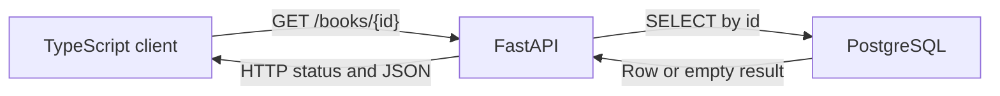

# Check a FastAPI contract from TypeScript locally and in GitHub Actions

[Русский](../../ru/tools/api-contract-lab.md) · [Tools](README.md)

Check that a TypeScript client gets the expected HTTP response from FastAPI. FastAPI reads a book from PostgreSQL. Docker Compose runs all three components locally and in GitHub Actions.

| Task | Approach | Where to start |
| --- | --- | --- |
| Check API responses on your computer | `docker compose run --build --rm client` | [Local run](#run-the-check-locally) |
| Repeat the check in CI | Run the workflow manually | [GitHub Actions](#repeat-the-check-in-github-actions) |
| Find out why a local check failed | Client output and service logs | [Diagnose a failed check](#diagnose-a-failed-check) |

The contract specifies which HTTP status and JSON fields the client expects from the server. `GET /books/1` returns `200` and `{"id":1,"title":"The Hobbit"}`. `GET /books/999` returns `404` and `{"detail":"Book not found"}`.



## Prepare the environment

For a local run, you need a running Docker Engine and a version of `docker compose run` that supports `--build`. The build needs access to Docker Hub, PyPI, and the npm registry. Python and Node.js run inside containers.

The example uses Python 3.14, FastAPI 0.162.0, Psycopg 3.3.9, Uvicorn 0.54.0, PostgreSQL 18.6, Node.js 26.8.2, and TypeScript 6.0.3. The database contains one sample book. Compose uses the sample password `lab-only-password` and leaves service ports unpublished on the host.

[First Compose run](compose-and-github-actions.md) · [First TypeScript HTTP request](../typescript/README.md) · [FastAPI routes](../python/web/fastapi/http-api.md)

## Read the full example

| File | What it does |
| --- | --- |
| [`compose.yaml`](../../../examples/tools/api-contract-lab/compose.yaml) | Creates a shared network and waits for service dependencies |
| [`init.sql`](../../../examples/tools/api-contract-lab/init.sql) | Creates the `books` table and inserts book `id = 1` in an empty database |
| [`app.py`](../../../examples/tools/api-contract-lab/app.py) | Passes `id` as a SQL parameter and builds the HTTP response |
| [`client.mts`](../../../examples/tools/api-contract-lab/client.mts) | Sends two requests and checks their statuses and JSON |
| [`Dockerfile`](../../../examples/tools/api-contract-lab/Dockerfile) and [`requirements.txt`](../../../examples/tools/api-contract-lab/requirements.txt) | Build the API and client images with their dependencies |
| [`workflow-example.yml`](../../../examples/tools/api-contract-lab/workflow-example.yml) | Runs the same check on demand in GitHub Actions |

The client uses `http://app:8000`. FastAPI connects to the database using the name `postgres`. Compose resolves these names on the shared network. Inside each container, `localhost` refers to that container.

When Docker builds the client image, `tsc` checks the types and emits `client.mjs`. At runtime, the client receives JSON over the network. The `Book` type exists only at compile time. The client reads the response as `unknown` and checks that `id` is an integer and `title` is a string.

## Run the check locally

From the repository root, enter the example directory and run the client.

```bash
cd examples/tools/api-contract-lab
docker compose run --build --rm client
```

Compose builds the images and starts PostgreSQL and FastAPI. Once the API accepts connections, Compose starts the client. The `--rm` option removes the client container when it exits. PostgreSQL and FastAPI stay running.

On success, the client exits with code `0` and prints two lines.

```text
OK GET /books/1 -> 200 The Hobbit
OK GET /books/999 -> 404 Book not found
```

### Diagnose a failed check

The client exits with a nonzero code for an unexpected status, a missing required field, or an incorrect field value. Additional fields are allowed. The message `GET /books/999: expected HTTP 404, got 200` means the server returned a success response for a missing book.

If the client fails to start or receive a response, check the service status and logs.

```bash
docker compose ps -a
docker compose logs --tail 50 app postgres
```

To clean up, run this command from the example directory. It removes the containers, network, and the project's `books-data` volume, including its data. PostgreSQL will run `init.sql` again on the next start.

```bash
docker compose down --volumes
```

## Repeat the check in GitHub Actions

Use a separate practice repository with Actions enabled and write access. If its local copy is next to `Python_cheat_sheet`, run these commands from the **practice repository root**.

```bash
cp -R ../Python_cheat_sheet/examples/tools/api-contract-lab .
mkdir -p .github/workflows
cp api-contract-lab/workflow-example.yml .github/workflows/api-contract.yml
git status --short
```

Commit the files and push the commit to the practice repository's default branch. GitHub looks for the manual workflow file on that branch. [Working with remotes](git/remotes.md).

1. Open **Actions → API contract lab → Run workflow**.
2. Select the default branch and click **Run workflow**.
3. Open the new run and the **Check the API contract** step in the **contract** job. Look for both `OK GET` lines.

GitHub runs the same Compose command in the `api-contract-lab` directory on Ubuntu 24.04. If the check fails, **Show service logs** prints logs from the API and PostgreSQL. The last step removes the containers, network, and practice volume after success or failure. The workflow uses `contents: read` to fetch the files and pins `actions/checkout` to a full commit SHA. It requires no repository secrets.

## Sources

- Docker. [Run a one-off container](https://docs.docker.com/reference/cli/docker/compose/run/) and [service startup order](https://docs.docker.com/compose/how-tos/startup-order/).
- PostgreSQL and Psycopg. [Official image initialization](https://hub.docker.com/_/postgres) and [SQL query parameters](https://www.psycopg.org/psycopg3/docs/basic/params.html).
- FastAPI. [HTTP errors](https://fastapi.tiangolo.com/tutorial/handling-errors/) and [response model](https://fastapi.tiangolo.com/tutorial/response-model/).
- TypeScript and Node.js. [Type narrowing](https://www.typescriptlang.org/docs/handbook/2/narrowing.html) and [`fetch` in Node.js 26.8.2](https://nodejs.org/download/release/v26.8.2/docs/api/globals.html#fetch).
- GitHub. [Run a workflow manually](https://docs.github.com/en/actions/how-tos/manage-workflow-runs/manually-run-a-workflow) and [`actions/checkout` v7.0.1](https://github.com/actions/checkout/releases/tag/v7.0.1).
