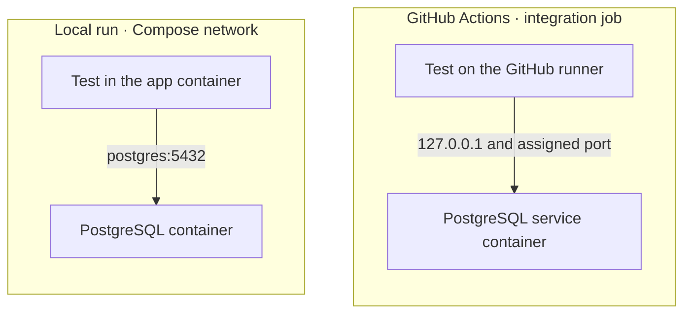

# Run a Python app with PostgreSQL in Docker Compose and test with GitHub Actions

[Русский](../../ru/tools/compose-and-github-actions.md)

Run a sample Python application with PostgreSQL on your computer. Then run the integration test on GitHub and investigate an intentional failure.

| Task | Technique | Where to run it |
| --- | --- | --- |
| Check the application's response | `docker compose up` and a request to `/health` | [Terminal on your computer](#run-the-application-locally) |
| Check the PostgreSQL query | `python -m unittest -v` | [Application container](#run-the-test-locally) |
| Reproduce a test failure in CI | `Run workflow` with the `fail_test` input | [Run it on GitHub](#run-the-test-in-github-actions) |
| Find the cause of a failure in an existing run | Open the failed step | [GitHub Actions log](#find-the-cause-in-the-log) |

## Preparation

To run locally, you need a running Docker Engine, the `docker compose` command with `up --wait` support, and `curl`. The shell commands are for Bash or Zsh. Pulling missing images requires access to Docker Hub. The application build uses a Python 3.14 base image and installs Psycopg 3.3.9 from PyPI. Both setups use PostgreSQL 18.6.

To run on GitHub, you need a separate practice repository with Actions enabled and write access. The example uses the practice credentials `lab` and `lab-only-password`. Use the example in a practice environment with an empty database. The `http.server` module serves the practice app.

## Example files

The complete example is in `examples/tools/compose-and-github-actions/`.

| File | Purpose |
| --- | --- |
| [`app.py`](../../../examples/tools/compose-and-github-actions/app.py) | Handles `GET /health` and runs `SELECT current_database()` |
| [`test_app.py`](../../../examples/tools/compose-and-github-actions/test_app.py) | Checks the result of the PostgreSQL query |
| [`requirements.txt`](../../../examples/tools/compose-and-github-actions/requirements.txt) | Sets the Psycopg version with the binary package |
| [`Dockerfile`](../../../examples/tools/compose-and-github-actions/Dockerfile) | Builds the application image with the test |
| [`compose.yaml`](../../../examples/tools/compose-and-github-actions/compose.yaml) | Runs the application and PostgreSQL locally |
| [`workflow-example.yml`](../../../examples/tools/compose-and-github-actions/workflow-example.yml) | Defines a manual test run on GitHub |

## Run the application locally

From the cheat sheet repository root, change to the example directory. Run the remaining Compose commands from this directory.

```bash
cd examples/tools/compose-and-github-actions
docker version
docker compose config -q
docker compose up --build -d --wait
docker compose ps
curl --fail --silent --show-error http://127.0.0.1:18080/health
```

`docker version` shows a `Server` section when the Docker Engine is available. `config -q` validates the configuration. `up --build` builds the application image. `-d` leaves the containers running in the background. `--wait` waits for health checks to pass.

In the output of `docker compose ps`, both services show `healthy`. The request returns HTTP 200 and JSON.

```json
{"status": "ok", "database": "compose_lab"}
```

Compose creates a shared network. The application connects to PostgreSQL using the service name `postgres` and port `5432` on that network. The only port published to your computer is the application's `127.0.0.1:18080`. `depends_on` with `service_healthy` sets the startup order. The `/health` request checks a real connection and returns the database name from the SQL result.

If startup fails or the request returns HTTP 503, check the service status and logs.

```bash
docker compose ps -a
docker compose logs --tail 30 app postgres
```

`PostgreSQL is unavailable` in the `app` log means the application could not connect to the database or lost its connection. Check the `postgres` log. After fixing the cause, run `docker compose up -d --wait` again. If port `18080` is in use, change the number to the left of `:8000` in `compose.yaml` and use the new port in `curl`.

## Run the test locally

With the containers running, run the test from a terminal in the example directory. `docker compose exec` starts Python inside the `app` container with the database connection settings.

```bash
docker compose exec app python -m unittest -v
```

The test calls the application's `database_status()` function. The function queries PostgreSQL. The test checks the `ok` status and the actual database name `compose_lab`. Expect one test and `OK`.

To trigger a practice failure, set the variable for the test process. The test will use a deliberately incorrect expected database name.

```bash
docker compose exec -e LAB_FORCE_FAILURE=1 app python -m unittest -v
```

Expect `FAILED (failures=1)` and exit code `1`. Run the first command again to get `OK`.

## Run the test in GitHub Actions

Create an empty practice repository next to your local copy of `devrefsnap`. In your terminal, copy the example files from the root of the **practice repository**. Move the sample workflow to the directory GitHub uses for workflow files.
If your local checkout has a different directory name, replace `../devrefsnap` in the command.

```bash
cp -R ../devrefsnap/examples/tools/compose-and-github-actions/. .
mkdir -p .github/workflows
mv workflow-example.yml .github/workflows/postgres-test.yml
git status --short
```

Commit the files. Push the commit to the **practice repository's** default branch. The file must be at `.github/workflows/postgres-test.yml` on that branch. [Working with a remote repository](git/remotes.md).

A workflow is a file that defines a run. `workflow_dispatch` enables manual runs with the `fail_test` input. The `integration` job runs on an Ubuntu 24.04 machine hosted by GitHub. GitHub starts PostgreSQL as a service container and assigns an available port on the runner. The `Run database test` step connects via `127.0.0.1` and uses that port. The job runs the test directly on the GitHub runner. Your local test ran inside the `app` container.

The diagram compares where the test runs and which address it uses to connect to PostgreSQL.



`contents: read` lets the job read the repository files. Both `uses` steps pin official actions to full commit SHAs. The example requires no repository secrets.

1. On GitHub, open **Actions → PostgreSQL integration test → Run workflow**.
2. Select the default branch. Leave **Make the test fail on purpose** off. Click **Run workflow**.
3. Open the new run, the **integration** job, and the **Run database test** step. Find `OK` in the successful run's log.
4. Start the workflow again. Turn on **Make the test fail on purpose**. Open the same step in the new run's log.

If the **Run workflow** button is missing, check the file path on the default branch, Actions settings, and your write access.

## Find the cause in the log

If you already have a practice run, open **Actions → PostgreSQL integration test**. Select the failed run. Open the **integration** job, then the **Run database test** step.

For the practice failure, find `test_reports_current_database` and the `self.assertEqual` line from `test_app.py`. Compare the actual and expected database names. This excerpt shows the relevant message.

```text
AssertionError: 'compose_lab' != 'intentional_failure'
```

`compose_lab` came from PostgreSQL. The test used `intentional_failure` based on the workflow input. If the run fails before it reaches `self.assertEqual`, open the log of the first failed step. For example, `OperationalError` in the test step points to a PostgreSQL connection problem.

To recover, start a new run with the input turned off. **Re-run jobs** repeats the run with the original input.

## Clean up the practice environment

From the local example directory, run `docker compose down` to stop and remove the project containers and network. The named PostgreSQL volume remains available.

To reset the practice database completely, run the command below. It deletes this project's `lab-data` volume and all data in it. Use this command only for practice data.

```bash
docker compose down --volumes
```

GitHub removes the PostgreSQL container when the job finishes. You can open the log from the run history.

## Sources

- Docker. [Compose quickstart](https://docs.docker.com/compose/gettingstarted/) and [service startup order](https://docs.docker.com/compose/how-tos/startup-order/).
- PostgreSQL. [Official Docker image and PostgreSQL 18 volume path](https://hub.docker.com/_/postgres) and [`current_database()`](https://www.postgresql.org/docs/18/functions-info.html#FUNCTIONS-INFO-SESSION).
- Python. [`http.server`](https://docs.python.org/3.14/library/http.server.html) and [Psycopg installation](https://www.psycopg.org/psycopg3/docs/basic/install.html).
- GitHub. [PostgreSQL service](https://docs.github.com/en/actions/tutorials/use-containerized-services/create-postgresql-service-containers), [manual runs](https://docs.github.com/en/actions/how-tos/manage-workflow-runs/manually-run-a-workflow), and [run logs](https://docs.github.com/en/actions/how-tos/monitor-workflows/use-workflow-run-logs).
- Action releases. [`actions/checkout` v7.0.1](https://github.com/actions/checkout/releases/tag/v7.0.1) and [`actions/setup-python` v7.0.0](https://github.com/actions/setup-python/releases/tag/v7.0.0).

If your project already has `uv.lock`, use the [uv recipes for CI and Docker](../python/tooling/uv/automation.md).
To check an HTTP contract from TypeScript with one command locally and in CI, see the [end-to-end lab](api-contract-lab.md).
